# B17.3 · Tabellone della partita in alto a sinistra (08/11/2026)

Richiesta dell'utente (08/11 sera, punto 3): «la UI attuale del punteggio non mi piace: voglio il punteggio in alto a
sinistra, anziché al centro, possibilmente più grande e leggibile. Cura proporzioni e posizionamento rispetto al resto
dell'interfaccia». Due passi: il **primo** (commit 6f64161 e revisione 6a5f11b) ha spostato il tabellone del B10
nell'angolo e lo ha ingrandito, con la schermata di riferimento non ancora arrivata; il **secondo** (§ «Allineamento alla
schermata di riferimento», sotto) ne ha rifatto il disegno sulla schermata che l'utente ha mandato (misure in
`docs/b17/punteggio-riferimento.md`). Le funzioni di stato di `natpf_scoreboard.js` (nomi, punti, scritte) non cambiano.
Un **terzo passo** (§ «Rifinitura», sotto) applica i minori della revisione del secondo: carattere a 3 cqh, sottotitolo
≥ 12 px, sigle che non cadono su P1/P2 per nomi simili, pillola «In attesa» senza l'arco giallo.

## Rifinitura (terzo passo, 08/11 notte: minori della revisione del secondo passo)

1. **Più grande** («possibilmente più grande e leggibile»): con `--sb` a 2,6 cqh le maiuscole (18,7 px di carattere a
   720p, ~13 px di maiuscola) erano solo l'8 % più grandi del riferimento (17 px, maiuscole ~12). Ora `--sb:
   clamp(17px, 3cqh, 40px)`: 21,6 px a 720p (maiuscole ~15 px, +27 % sul riferimento), 32,4 a 1080p, 18 a 1024×600, 17 a
   844×390, 21,6 nel ledwall 720. Il sottotitolo `.sb-foot` passa a `max(12px, 0.6em)`: 13 px a 720p, 19,4 a 1080p, 12 a
   600 e 390. Il riquadro a 720p è 176 × 88 px (prima 152 × 76); l'altezza totale con il sottotitolo arriva al 21,5–21,8 %
   dello schermo (bordo basso a 155 px a 720p, 233 a 1080p, 131 a 600): la prova nel browser accetta fino al 23 % (prima
   il 20 %, con il 19,4–19,8 % misurato). Nel ledwall 720×720 diviso il riquadro finisce a 198 px (< 358) e la copia del
   P2 a 559 (pausa a 650: 91 px liberi); a tutte le misure la copia resta ≥ 40 px prima della pausa (tabella sotto).
   Corretta anche la frase del secondo passo «~17 px → ×1,33 ≈ 2,6 cqh»: 17 × 1,33 = 22,6 px = 3,1 cqh a 720p, non 2,6
   (18,7 px, ×1,1); il terzo passo è a 3 cqh = 21,6 px ≈ ×1,27.
2. **Sigle** (`natpf_scoreboard.js` · `shortName`, `shortNames`): con la regola «3 lettere, poi 4, poi P1/P2» i nomi
   «Marco»/«Marcello» e «Jean Paul»/«Jean Pierre» cadevano su P1/P2 (i nomi scelti sparivano), «Anna»/«Annalisa»
   uscivano ANNA/ANN (il nome di al più 4 caratteri restava intero) e «José»/«Josè» si distinguevano solo dall'accento.
   Nuova regola: **3 lettere** (anche per i nomi corti: «Anna» → ANN); se le due sigle sono uguali si allungano fino a 6
   (MARC/MARI, MARCO/MARCE, ANNA/ANNAL); con più parole le lettere non vanno oltre la prima parola («Jean Paul» → JEAN,
   mai JEANPA), e se le sigle sono ancora uguali si usano le **iniziali delle parole** prima dell'ultima più le lettere
   dell'ultima (JPA/JPI; se serve allungate: JPAU/JPAO; «Marco»/«Marco Rossi» → MAR/MRO); il confronto è **senza accenti
   e maiuscole** (JOSÉ e JOSÈ sono la stessa sigla); solo alla fine P1/P2 («Marco»/«Marco», «José»/«Josè»). Un numero
   davanti resta intero («2 CPU» → 2CPU). Test unitari in `test/natpf-scoreboard.test.mjs` con tutti questi casi.
3. **Pillola «In attesa di Player 2»**: `natpf-hud.css` le dà `border-left: 4px solid` giallo e `natpf-round.css` gli
   angoli a pillola (`--r-pill`): il bordo sinistro curvo si vedeva come un arco «(» giallo. Ora `#hud-root
   .opponent-presence-pill` ha `border-left: 0` e `padding-left: 14px`; il colore dell'attesa resta nel puntino. La
   prova verifica `borderLeftWidth` 0 con gli angoli tondi.

| 1280×720, sfida un amico con «In attesa di Player 2» (pillola senza arco) | Ledwall 720×720 diviso (riquadro a 198 < 358, copia del P2 a 559 < 610) |
|---|---|
| 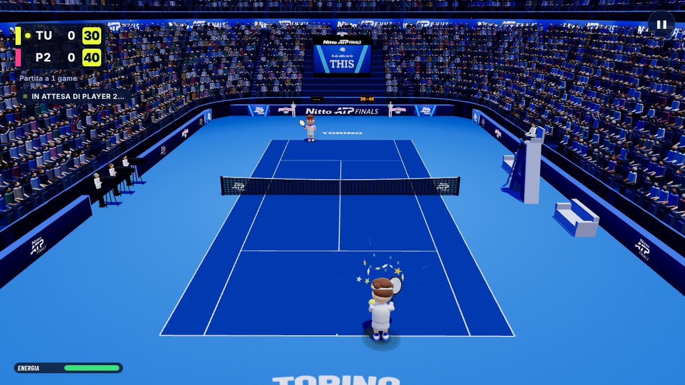 | 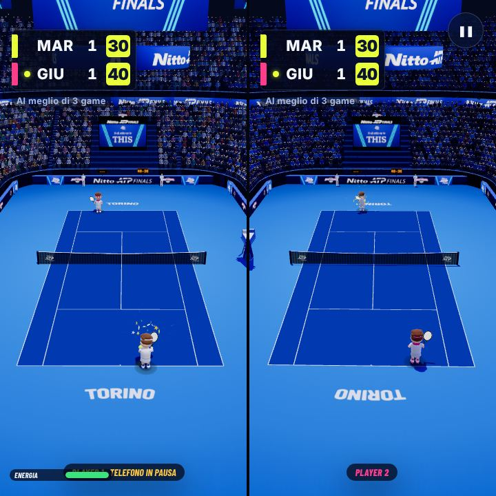 |

Stesso schermo a 1280×720 (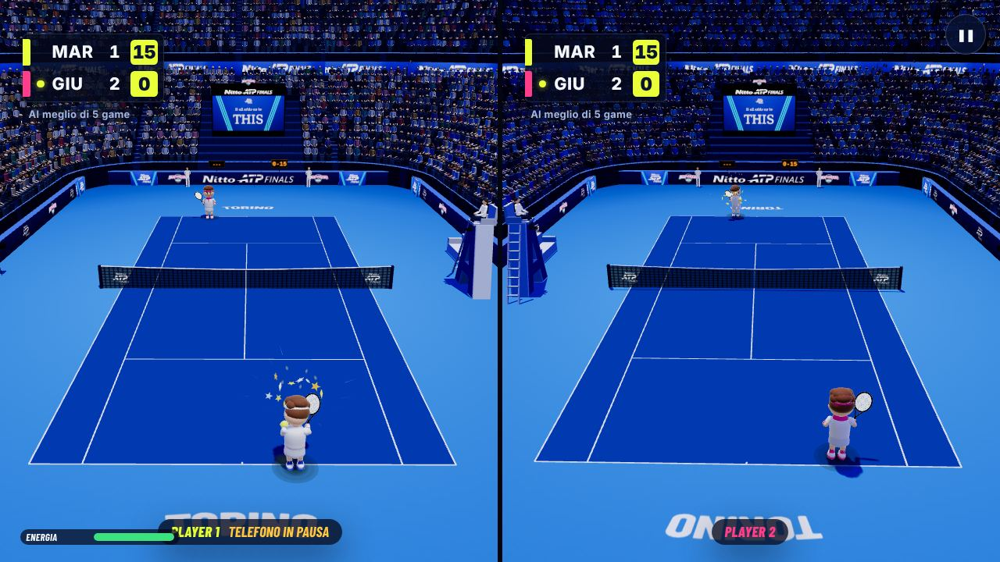). Le altre schermate
(1920×1080, 1024×600, 844×390, 2v2, vantaggi) sono fuori dal repository in `scratchpad/b17-punteggio/rifinitura/e2e/`.

Riquadri misurati dalla prova `tools/e2e/natpf-tabellone.mjs` dopo la rifinitura (x, y, larghezza, altezza in px;
«tabellone» = riquadro + sottotitolo):

| Schermo | Tabellone | Riquadro | `--sb` | Casella | Sottotitolo | Copia del P2 | Pausa |
|---|---|---|---|---|---|---|---|
| 1280×720, 1v1 CPU | 29, 43, 176×112 (bordo basso 155 = 21,5 %) | 176×88 | 21,6 | 35×32, cifra 23,3 | 13 | — | 1210 |
| 1920×1080, 1v1 CPU | 44, 64, 263×169 (233 = 21,6 %) | 263×132 | 32,4 | 52×49, cifra 35 | 19,4 | — | 1850 |
| 1024×600, 1v1 CPU | 24, 36, 146×95 (131 = 21,8 %) | 146×73 | 18 | 29×27, cifra 19,4 | 12 | — | 954 |
| 1280×720, 2v2 («TU+CPU» / «2CPU») | 29, 43, 222×112 | 222×88 | 21,6 | 35×32 | 13 | — | 1210 |
| 1280×720, sfida un amico, «AD» e «Vantaggio di Player 2» | 29, 43, 323×112 | 168×88 | 21,6 | 35×32 | 13 | — | 1210 |
| 1280×720, sfida un amico, «In attesa di Player 2» | 29, 43, 168×112 | 168×88 | 21,6 | 35×32 | 13 | pillola a 29, 166 (10 px sotto), bordo sinistro 0 | 1210 |
| 1280×720, stesso schermo (MAR/GIU) | 29, 43, 181×112 | 181×88 | 21,6 | 35×32 | 13 | 672, 43, 181×112 (finisce a 853 < 1170) | 1210 |
| 1920×1080, stesso schermo, nomi di 24 caratteri al vantaggio | 44, 64, 677×169 | 272×132 | 32,4 | 52×49 | 19,4 | 1008, 64, 677×169 (finisce a 1685 < 1810) | 1850 |
| 1024×600, stesso schermo, nomi lunghi | 24, 36, 376×95 | 151×73 | 18 | 29×27 | 12 | 538, 36, 376×95 (finisce a 914 = 954 − 40) | 954 |
| 844×390, stesso schermo, nomi lunghi | 19, 23, 291×91 | 142×69 | 17 | 27×26 | 12 | 443, 23, 291×91 (finisce a 734 = 774 − 40) | 774 |
| ledwall 720×720, 1v1 CPU | 17, 43, 176×112 | 176×88 | 21,6 | 35×32 | 13 | — | 650 |
| ledwall 720×720, stesso schermo | 17, 43, 181×112 (finisce a 198 < 358) | 181×88 | 21,6 | 35×32 | 13 | 378, 43, 181×112 (finisce a 559 < 610) | 650 |

Prove della rifinitura: `cd natpf-tennis && npm test` 975/975 (nuovo test delle sigle uguali, `--sb` a 3 cqh e
sottotitolo a 12 px nelle regole CSS); `node --test tools/test/*.test.mjs` 200/200; `npm run build` ok (3,1 s);
`tools/e2e/natpf-tabellone.mjs` (GAME_PORT 3751) **40/40** (carattere atteso 3 cqh tra 17 e 40 px, sottotitolo ≥ 12 px,
altezza ≤ 23 %, verifica nuova sulla pillola senza bordo sinistro); `natpf-scritte-2v2.mjs` 73/73;
`natpf-split-ready.mjs` 34/34. Non verificato: schermo reale, il giudizio dell'utente sulla grandezza (3 cqh) e sulle
sigle allungate (MARCO/MARCE, JPA/JPI).

## Allineamento alla schermata di riferimento (secondo passo, 08/11 sera)

La schermata dell'utente (un gioco di tennis commerciale a 1280×720; il file resta fuori dal repository) ha un riquadro
scuro compatto a ~30 px dal bordo sinistro e ~45 px dall'alto: per riga una **linguetta colorata**, la **pallina** di chi
serve, il **nome abbreviato** in maiuscolo (3 lettere), i numeri e i **punti del game in una casella piena gialla**; niente
intestazioni né formato in parole. Qui si prende la disposizione, un terzo più grande («più grande e leggibile»), con i
colori NATPF (giallo palla per chi guarda, rosa per l'altro).

| Primo passo (angolo 420×200 a 1280×720, ×2) | Dopo (stesso angolo): sigle, casella piena, sottotitolo |
|---|---|
| 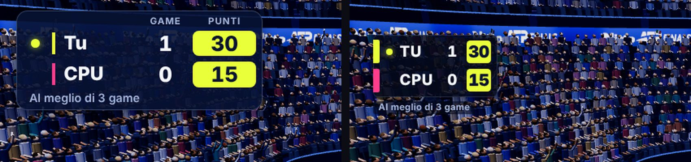 | |

Schermate intere: 1280×720 (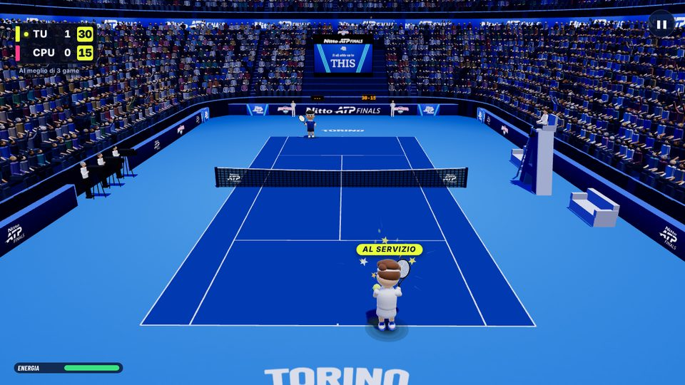), 1920×1080 (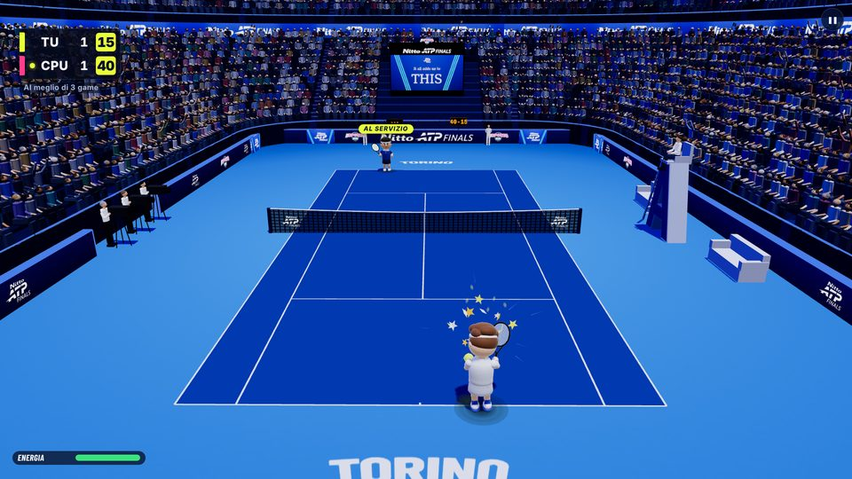),
1024×600 (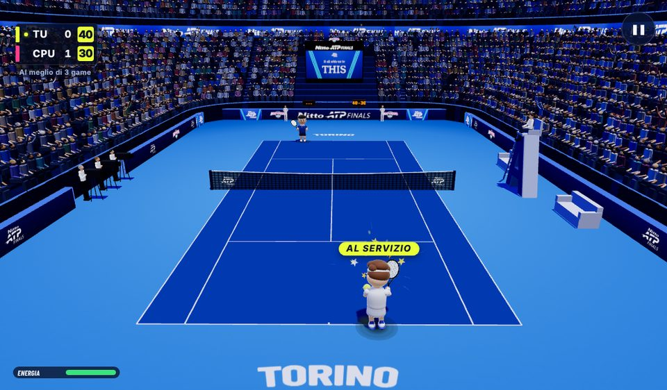), ledwall 720×720 (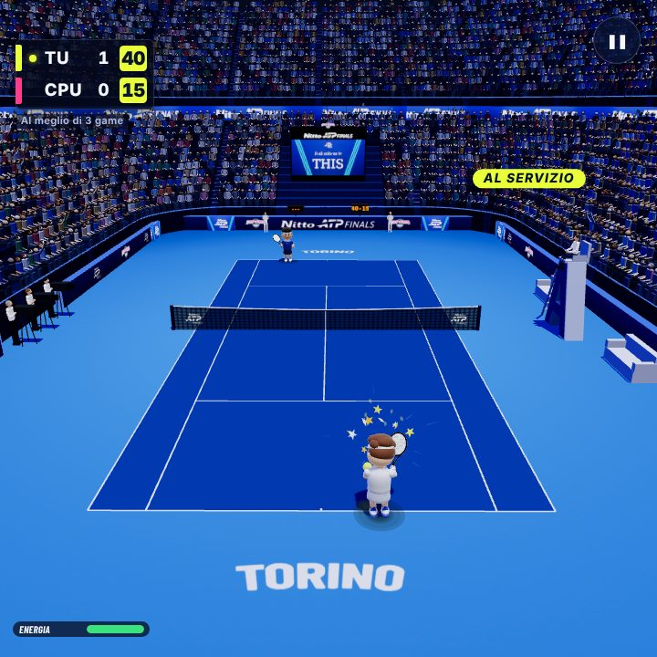), stesso
schermo a 1280×720 (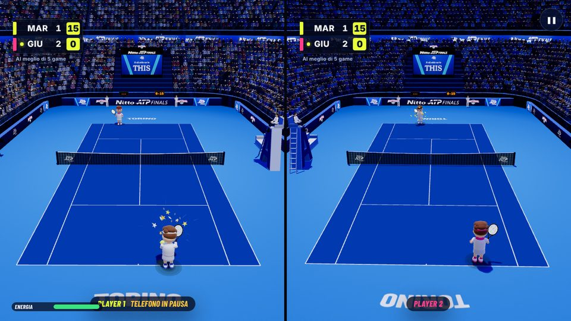) e nel ledwall 720×720
(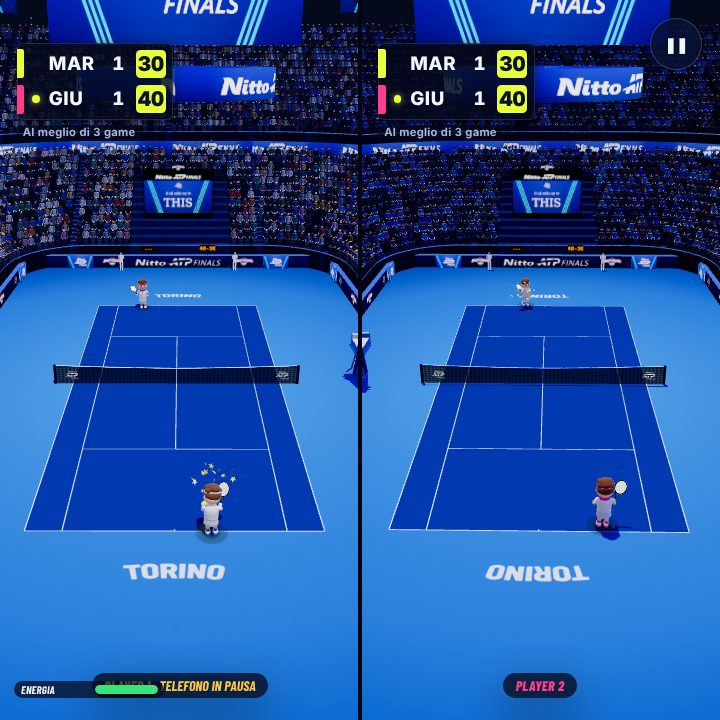), 1024×600 diviso con i nomi di 24 caratteri al
vantaggio (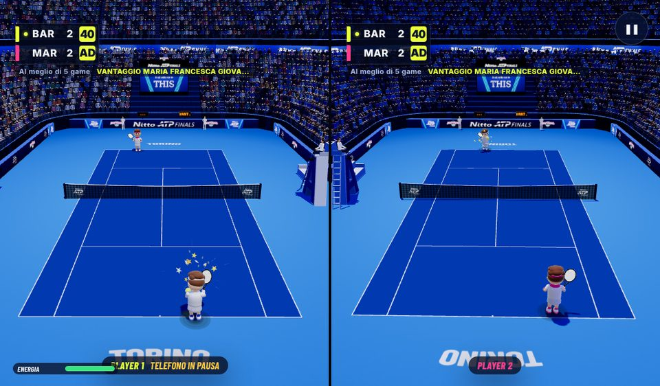), 2v2 («TU+CPU» / «2CPU»,
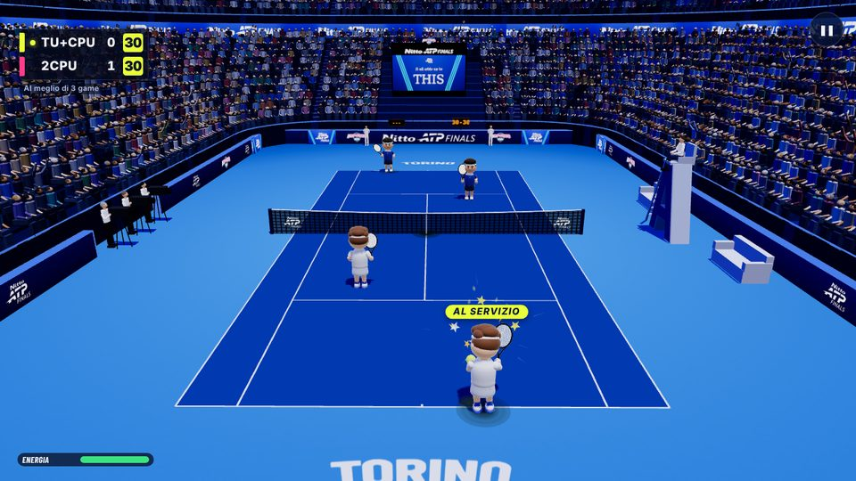), sfida un amico al vantaggio («AD», «VANTAGGIO DI PLAYER 2»,
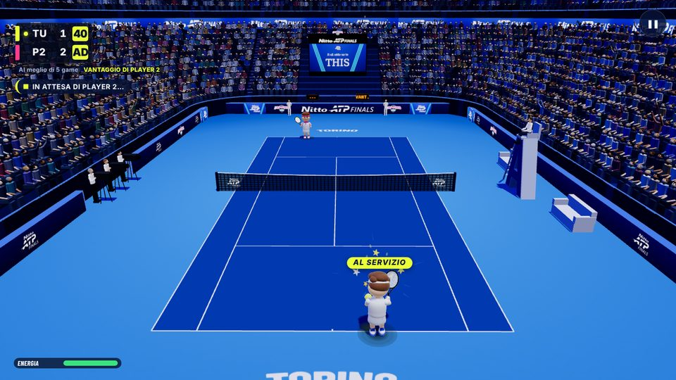) e con «In attesa di Player 2» sotto (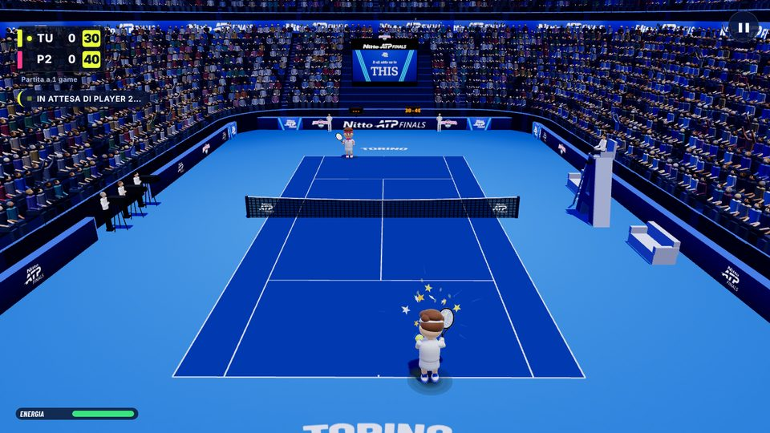).

### Che cosa cambia nel disegno (`natpf_scoreboard.js` · `scoreboardHtml`, `natpf-round.css`)

| Elemento | Primo passo | Dopo | Riferimento (1280×720) |
|---|---|---|---|
| Riquadro `.sb-box` | griglia unica con intestazione «Game / Punti», 303×~95 px | due righe da **1,75 em** (32,8 px a 720p = 4,6 cqh), 152×76 px a 720p, 228×115 a 1080p, 127×64 a 1024×600 | 165×60 px, righe da 28 px |
| Posizione | `--sb-left` 1,6 cqw (20 px), `--sb-top` 1,8 cqh (13 px) | `--sb-left: clamp(12px, 2.3cqw, 44px)` (29 px a 1280, 44 a 1920, 17 nel ledwall 720), `--sb-top: clamp(12px, 6cqh, 64px)` (43 px a 720p, 64 a 1080p, 36 a 600) | 30 px, 45 px |
| Carattere `--sb` | 3,2 cqh (23 px a 720p) su nomi interi | **2,6 cqh** `clamp(15px, 2.6cqh, 36px)`: 18,7 px a 720p, 28 a 1080p, 15,6 a 1024×600, 18,7 nel ledwall 720 (≥ 16 px chiesti); **terzo passo: 3 cqh** `clamp(17px, 3cqh, 40px)`, 21,6 px a 720p | nomi e numeri ~17 px (18,7 px = ×1,1; la frase «×1,33 ≈ 2,6 cqh» era sbagliata: 17 × 1,33 = 22,6 px ≈ 3,1 cqh; con 3 cqh ≈ ×1,27) |
| Colonne | pallina · nome (fino a 11 em) · game · punti | **linguetta 0,42 em** (piena altezza della riga, gialla/rosa) · pallina 0,85 em · **sigla** (max-content, fino a 7 em) · game 1,5 em · **casella 1,6 em** | linguetta 6 px, pallina 8 px, casella 24×26 |
| Nome | intero («Marco», «Tu + CPU») | **sigla maiuscola**: `shortName`: «TU», «CPU», «P1»/«P2», prime 3 lettere del nome scelto («MAR», «GIU»; 4 se le due sigle uscirebbero uguali, «MARC»/«MARI»; «P1»/«P2» se uguali anche così), nomi di al più 4 caratteri interi («ANNA»), squadre «TU+CPU», «MAR+CPU», «2CPU» (terzo passo: sempre 3 lettere, allungate fino a 6, poi iniziali delle parole, P1/P2 solo alla fine; § «Rifinitura»). Nome intero nel `title` della riga, in `data-sb-name` e nel testo per lo screen reader | «DRL», «2KG» |
| Punti | casella gialla larga 3,4 em con «Vant.» | **casella piena gialla a larghezza fissa** 1,6 × 1,5 em (30×28 px a 720p, 45×42 a 1080p) con la cifra scura `#0a1330` a **1,08 em** (20 px a 720p = 2,8 cqh), «**AD**» al vantaggio | 24×26 px, cifra scura |
| Intestazione «Game / Punti» | sì | **no** | no |
| Formato e «Parità»/«Vantaggio …» | piede dentro il riquadro | **sottotitolo `.sb-foot` sotto il riquadro** su un velo scuro leggero, `max(11px, 0.6em)`: 11,2 px a 720p, 16,8 a 1080p, 11 a 600 e 390 (terzo passo: `max(12px, 0.6em)`, 13 px a 720p); «Vantaggio Nome Lungo» si accorcia con i puntini | niente (set e game bastano) |
| Altezza totale (riquadro + sottotitolo) | 123 px a 720p (17 %) | **97 px a 720p** (bordo basso a 140 = 19,4 %), 146 a 1080p (210 = 19,4 %), 83 a 1024×600 (119 = 19,8 %) | 60 px |
| «In attesa di Player 2» | `--sb-top + 5.65·--sb` | `--sb-top + 4.8·--sb + 1.5·max(11px, 0.6·--sb)`: 9 px sotto il tabellone a 720p, allineato a sinistra (terzo passo: 12 px nella formula, 10 px sotto, e senza il bordo sinistro giallo) | — |
| Stesso schermo | `--sb` segue anche la larghezza (2,4 cqw) perché il riquadro con i nomi interi finiva sotto la pausa | regola tolta: con le sigle il riquadro è largo ~157 px (ledwall diviso: finisce a 174 su 358; la copia del P2 a 535 con la pausa a 650); resta la larghezza massima della metà per il sottotitolo | — |

Riquadri misurati dalla prova `tools/e2e/natpf-tabellone.mjs` (x, y, larghezza, altezza in px; «tabellone» = riquadro +
sottotitolo, «riquadro» = `.sb-box`):

| Schermo | Tabellone | Riquadro | `--sb` | Casella | Sottotitolo | Copia del P2 | Pausa |
|---|---|---|---|---|---|---|---|
| 1280×720, 1v1 CPU | 29, 43, 152×97 | 152×76 | 18,7 | 30×28, cifra 20,2 | 11,2 | — | 1210 |
| 1920×1080, 1v1 CPU | 44, 64, 228×146 | 228×115 | 28,1 | 45×42, cifra 30,3 | 16,8 | — | 1850 |
| 1024×600, 1v1 CPU | 24, 36, 127×83 | 127×64 | 15,6 | 25×23, cifra 16,8 | 11 | — | 954 |
| 1280×720, 2v2 («TU+CPU» / «2CPU») | 29, 43, 192×97 | 192×76 | 18,7 | 30×28 | 11,2 | — | 1210 |
| 1280×720, sfida un amico, «AD» e «Vantaggio di Player 2» | 29, 43, 280×97 (il sottotitolo è la parte larga) | 145×76 | 18,7 | 30×28 | 11,2 | — | 1210 |
| 1280×720, stesso schermo (MAR/GIU) | 29, 43, 157×97 | 157×76 | 18,7 | 30×28 | 11,2 | 672, 43, 157×97 | 1210 |
| 1920×1080, stesso schermo, nomi di 24 caratteri al vantaggio | 44, 64, 587×146 | 235×115 | 28,1 | 45×42 | 16,8 | 1008, 64, 587×146 (finisce a 1595 < 1810) | 1850 |
| 1024×600, stesso schermo, nomi lunghi | 24, 36, 376×83 | 131×64 | 15,6 | 25×23 | 11 | 538, 36, 376×83 (finisce a 914 < 954 − 40) | 954 |
| 844×390, stesso schermo, nomi lunghi | 19, 23, 291×81 | 126×61 | 15 | 24×24 | 11 | 443, 23, 291×81 (finisce a 734 = 774 − 40) | 774 |
| ledwall 720×720, 1v1 CPU | 17, 43, 152×97 | 152×76 | 18,7 | 30×28 | 11,2 | — | 650 |
| ledwall 720×720, stesso schermo | 17, 43, 157×97 (finisce a 174 < 358) | 157×76 | 18,7 | 30×28 | 11,2 | 378, 43, 157×97 (finisce a 535 < 610) | 650 |

### «Al servizio» nello stesso schermo (difetto preesistente segnalato dal revisore)

Nelle schermate del primo passo l'etichetta gialla «AL SERVIZIO» compariva, nello stesso schermo, a cavallo del bordo
sinistro della metà del P2 (1280×720) e tagliata al bordo destro del ledwall 720. L'etichetta è una proiezione sul
**singolo** schermo intero (`game_engine._projectToScreen` → `hud.updateServerTag`, che la tiene tra 80 px e larghezza −
80): nello stesso schermo `_updateProjectedHUD` la nasconde già (`!this.natpfSplit?.active`), ma solo al primo
`update()`: finché il motore è fermo (prova con `update` sostituito, pausa) restava dov'era, nella posizione dell'ultima
proiezione a schermo intero. Ora `startSplit()` la nasconde **subito** (`hud.updateServerTag(null, false)`), e la prova
chiama `_updateProjectedHUD()` prima di ogni schermata, come fa la partita a ogni fotogramma; verifica che sia in vista a
schermo intero e sparita nello stesso schermo (subito dopo `startSplit()`, dopo un nuovo battitore e nel ledwall diviso).

## Primo passo: prima e dopo (1280×720, 1v1 contro la CPU, 30-15)

| Prima (B10: centro, `--sb` 16,6 px) | Dopo (B17.3: angolo in alto a sinistra, `--sb` 23 px) |
|---|---|
| 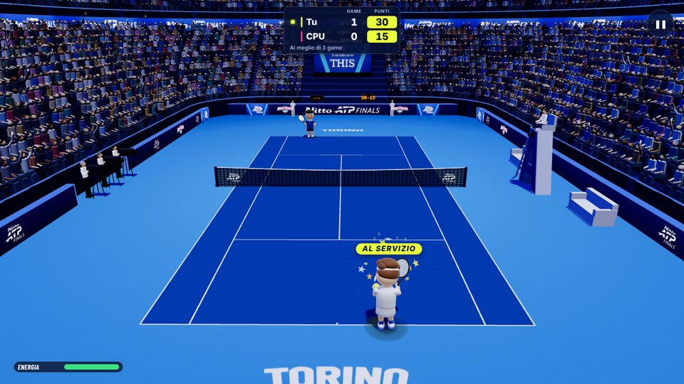 | 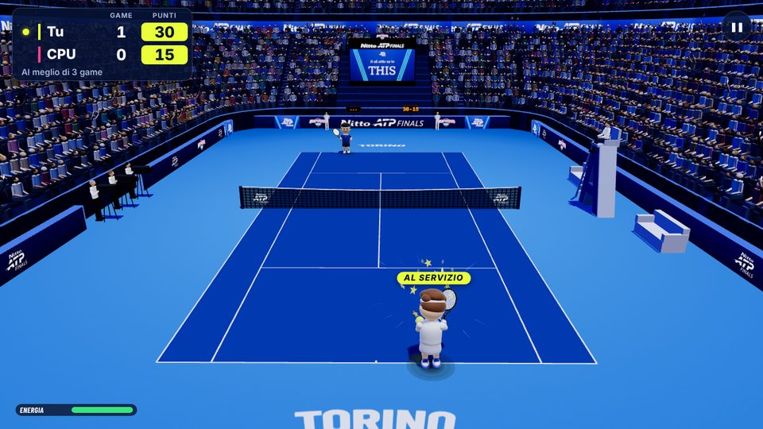 |

Stesso schermo (1280×720, Marco e Giulia):

| Prima: un tabellone al centro, a cavallo della linea | Dopo: un tabellone in alto a sinistra di ogni metà |
|---|---|
| 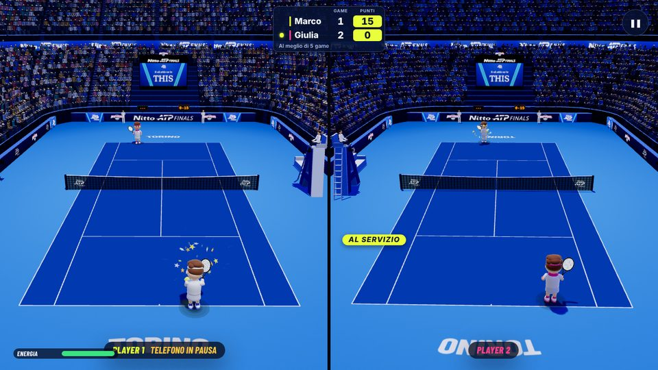 | 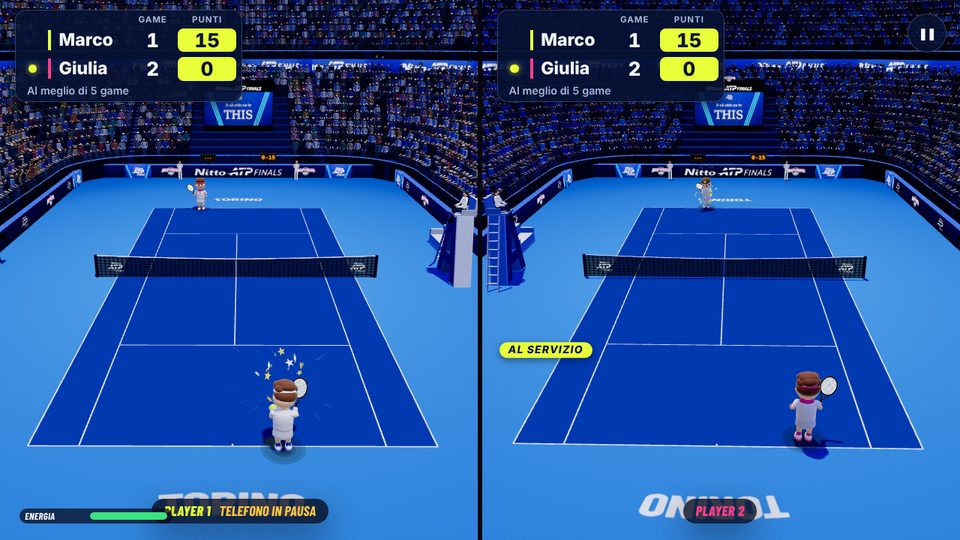 |

Altre schermate: 1920×1080 (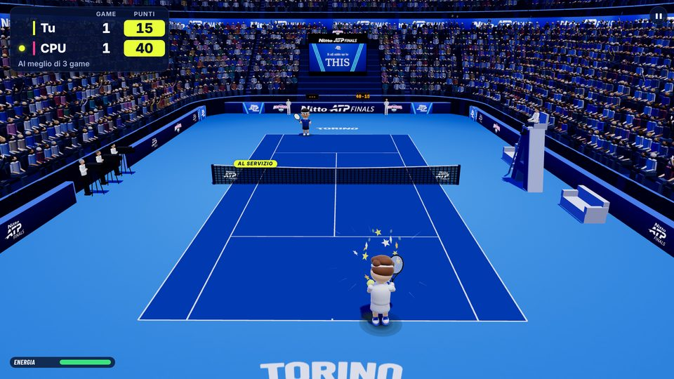), 1024×600 (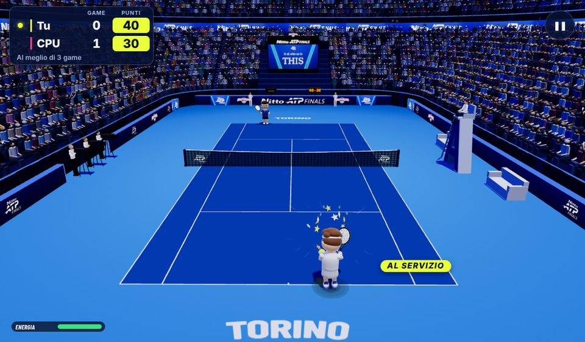),
ledwall 720×720 con lo stesso schermo (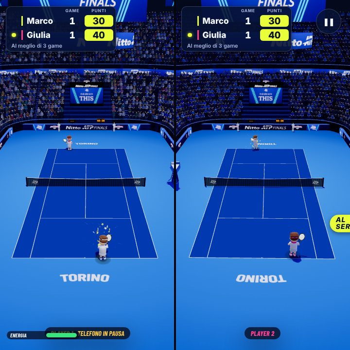), sfida un amico
con «In attesa di Player 2» sotto il tabellone (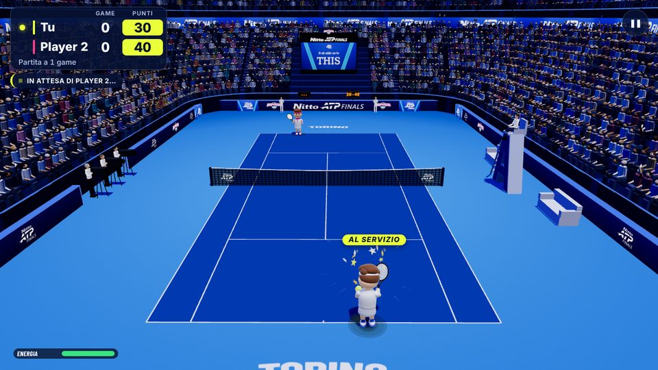), nomi di 24 caratteri a
1920×1080 nello stesso schermo (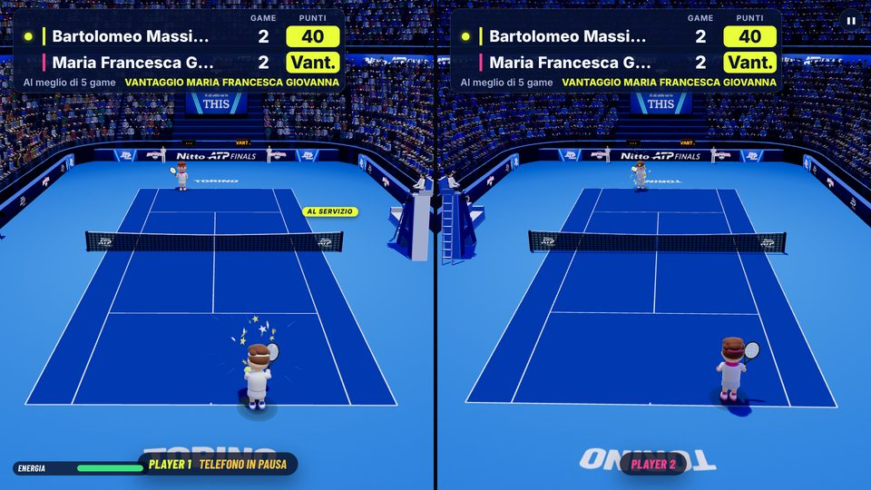).

## Primo passo: misure scelte (CSS in `natpf-tennis/natpf-round.css`, variabili su `#hud-root`; superate dal secondo passo, sopra)

| Misura | Prima | Dopo | Perché |
|---|---|---|---|
| `--sb` (carattere base del tabellone) | `clamp(13px, 2.3cqh, 32px)` | `clamp(16px, 3.2cqh, 44px)` | +39 %: 23 px a 720p, 35 px a 1080p, 19 px a 1024×600, 16 px a 844×390 (minimo alzato da 13) |
| posizione | `#top-hud-bar` relativa, tabellone con `margin-inline: auto` (centro) | `#top-hud-bar` assoluta a `--sb-top` / `--sb-left`, tabellone a sinistra | stesso angolo della scritta dell'esito in basso (`#timing-popup.anchored`: 10–28 px) |
| `--sb-top` | 12 px fissi | `clamp(10px, 1.8cqh, 24px)` | 13 px a 720p, 19 px a 1080p |
| `--sb-left` | — | `clamp(10px, 1.6cqw, 28px)` | 20 px a 1280, 28 px a 1920, 12 px nel ledwall 720 |
| larghezza massima | `min(94cqw, 26em)` | `min(60cqw, 26em)`; stesso schermo `min(calc(49.8cqw - var(--sb-left) - 110px), 26em)` | non oltre metà schermo; nello stesso schermo lo spazio reale della metà meno il pulsante di pausa (52 px a 18 px dal bordo: comincia a larghezza − 70 px) e 40 px di margine, così la copia del P2, che parte a 50,2 cqw + `--sb-left`, finisce al più a 100 cqw − 110 px (revisione del 08/11: con `min(46cqw, 26em)` a 844×390 copriva la pausa). I nomi lunghi si accorciano con i puntini come prima |
| piede (formato, «Vantaggio …») | `max(10px, 0.62em)` | `max(11px, 0.62em)` | ≥ 11 px chiesti; 14,3 px a 720p, 21,4 px a 1080p, 11,9 px a 1024×600 |
| stesso schermo, metà strette | — | `--sb: clamp(16px, min(3.2cqh, 2.4cqw), 44px)` | nel ledwall 720×720 diviso (358 px per metà) la copia del P2 a 23 px finiva sotto il pulsante di pausa: a 17,3 px le resta libero il margine di 40 px; a 1280 e oltre non cambia nulla |
| «In attesa di Player 2» | centrato, `top: 26px + 5.4·--sb` | `left: --sb-left`, `top: --sb-top + 5.65·--sb`, niente `translate(-50%)` | sotto il tabellone, allineato al suo bordo sinistro (7 px sotto a 720p); il rimpicciolimento durante lo scambio e l'animazione dell'arrivo partono dall'angolo in alto a sinistra |

Il tabellone è alto circa 5,3 em (intestazione 0,58 + due righe 1,57 ciascuna + piede 0,93 + bordi 0,62): **123 px a
720p (17 %)**, 185 px a 1080p (17 %), 103 px a 1024×600. La prova nel browser accetta fino al 20 % dell'altezza (prima
il 13 %, con il carattere piccolo; il 19 % del primo passo passava per 0,5–1 px, revisione del 08/11).

Riquadri misurati dalla prova `tools/e2e/natpf-tabellone.mjs` (x, y, larghezza, altezza in px):

| Schermo | Tabellone | `--sb` | Piede | Copia del P2 (stesso schermo) | Pausa |
|---|---|---|---|---|---|
| 1280×720, 1v1 CPU | 20, 13, 303×123 | 23,0 | 14,3 | — | 1210–1262 |
| 1920×1080, 1v1 CPU | 28, 19, 454×185 | 34,6 | 21,4 | — | 1850–1902 |
| 1024×600, 1v1 CPU | 16, 11, 252×103 | 19,2 | 11,9 | — | 954–1006 |
| 1024×600, stesso schermo, nomi di 24 caratteri al vantaggio | 16, 11, 384×103 | 19,2 | 11,9 | 530, 11, 384×103 (finisce a 914, 40 px prima della pausa; prima della revisione 407 larga → 937, 17 px) | 954 |
| 1280×720, 2v2 CPU («Tu + CPU» / «2 CPU») | 20, 13, 316×123 | 23,0 | 14,3 | — | |
| 1280×720, stesso schermo (Marco/Giulia) | 20, 13, 303×123 (finisce a 323 < 637) | 23,0 | 14,3 | 663, 13, 303×123 (finisce a 966 < 1170) | 1210 |
| 1920×1080, stesso schermo, nomi di 24 caratteri al vantaggio | 28, 19, 733×185 | 34,6 | 21,4 | 992, 19, 733×185 (finisce a 1725 < 1810) | 1850 |
| 844×390, stesso schermo, nomi lunghi | 14, 10, 297×87 | 16 | 11 | 437, 10, 297×87 (finisce a 734, 40 px prima della pausa; prima della revisione 375 larga → 812, **sotto la pausa**) | 774 |
| 1280×720, sfida un amico, «Vantaggio di Player 2» | 20, 13, 351×123 | 23,0 | 14,3 | — | |
| ledwall 720×720, 1v1 CPU | 12, 13, 303×123 | 23,0 | 14,3 | — | 650–702 |
| ledwall 720×720, stesso schermo | 12, 13, 227×93 (finisce a 239 < 358) | 17,3 | 11 | 373, 13, 227×93 (finisce a 600 < 610) | 650 |

## Stesso schermo: perché due tabelloni (vale per tutti e due i passi)

Nel disegno diviso ogni metà è lo schermo di un giocatore (camera propria, etichetta in basso, scritta dell'esito nel
proprio angolo). Il tabellone unico al centro stava a cavallo della linea scura, fuori da tutte e due le metà. Ora
`#natpf-scoreboard` sta in alto a sinistra della metà del Player 1 e la copia `#natpf-scoreboard-p2` (markup in
`index.html`, riempita da `natpf_ui.onScore` con lo stesso HTML solo quando lo stesso schermo è attivo, nascosta dal CSS
fuori dallo stesso schermo) in alto a sinistra della metà del Player 2, a `50cqw + 0.2cqw + --sb-left` (la linea scura di
`splitViewports` è larga 0,4 cqw). Le righe sono le stesse (P1 sopra, P2 sotto) su tutti e due: è il tabellone della
partita, non la vista di uno dei due. In allenamento e in arcade restano nascosti come prima (`natpf-ui.css`).

## Primo passo, revisione del 08/11: la copia del P2 sotto la pausa alle larghezze strette

Con `max-width: min(46cqw, 26em)` nello stesso schermo la copia del P2 (che parte a 50,2 cqw + `--sb-left`) poteva
arrivare a ~96 cqw, mentre il pulsante di pausa (fisso, 52 px a 18 px dal bordo destro) comincia a larghezza − 70 px: a
844×390 con i nomi di 24 caratteri il «40» e il «Vant.» del P2 finivano sotto la pausa (812 > 774), a 1024×600 restavano
17 px dei 40 richiesti. Ora la larghezza massima è lo spazio reale della metà meno pausa e margine,
`min(calc(49.8cqw - var(--sb-left) - 110px), 26em)`: 507 px a 1280, 384 a 1024×600, 297 a 844×390, 237 nel ledwall 720
diviso (dove il tabellone ne usa 227); a 1280 e oltre non cambia nulla. I nomi lunghi e la scritta «Vantaggio …» si
accorciano con i puntini.

| Prima (844×390, nomi lunghi: P2 sotto la pausa) | Dopo (297 px, 40 px prima della pausa) |
|---|---|
| 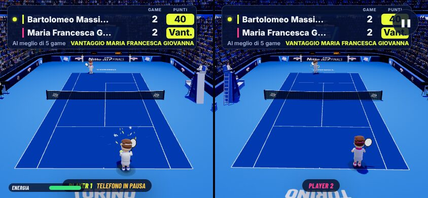 | 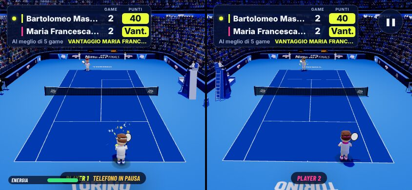 |

1024×600 con i nomi lunghi (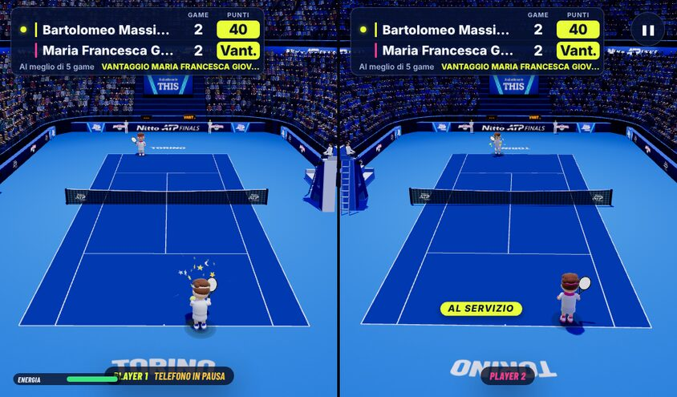).

Minori della stessa revisione: la prova pretende il pulsante di pausa in partita (prima `!v.pause ||` passava senza
misurare) e accetta un tabellone alto fino al 20 % dello schermo (il 19 % passava per 0,5–1 px); `startSplit()` e
`endSplit()` del motore chiamano `natpfUi.onScore` così la copia del P2 è piena subito all'avvio dello stesso schermo
(prima restava vuota fino al primo punteggio: `setMatchFormat('singles')` sincronizzava prima di `natpfSplit.active`) e
si svuota alla fine; in arcade `natpf-ui.css` nasconde `.natpf-scoreboard` (anche la copia), come in allenamento.
Preesistente e non toccato qui (da segnalare in B16/B17): nello stesso schermo l'etichetta «AL SERVIZIO» del P2 compare
al bordo sinistro della metà destra a 1280 e tagliata a destra nel ledwall 720.

## Prove

Secondo passo (allineamento alla schermata di riferimento):
- `cd natpf-tennis && npm test`: 928/928 (aggiornati `test/natpf-scoreboard.test.mjs`: sigle `shortName`/`shortNames`,
  HTML con `.sb-box`, linguetta, `data-sb-name` con il nome intero, «AD», niente `sb-head`, regole CSS del disegno; e
  `test/natpf-scoreboard-ui.test.mjs`: righe lette come «nome=SIGLA game punti»).
- `node --test tools/test/*.test.mjs`: 197/197. `npm run build`: ok (4,5 s).
- `tools/e2e/natpf-tabellone.mjs` (GAME_PORT 3711): **39/39** (prima della correzione del `height` della casella e dello
  spostamento dell'avviso: 37/39). Verifiche nuove: angolo a 2,3 cqw / 6 cqh (±1 px) a 1280×720, 1920×1080, 1024×600 e
  nel ledwall 720×720; carattere 2,6 cqh; nessuna intestazione; riquadro ≤ 13 em; due caselle dei punti larghe uguali (1,6
  em ± 2 px) e alte 1,5 em con la cifra a 1,08 em; «AD» al vantaggio; sigle «TU», «CPU», «P1»/«P2», «MAR»/«GIU», «BAR»/«MAR»,
  «TU+CPU»/«2CPU» con il nome intero in `data-sb-name` e nel `title`; sottotitolo sotto il riquadro e ≥ 11 px; «Al servizio»
  in vista a schermo intero e nascosta nello stesso schermo (subito, dopo un nuovo battitore, nel ledwall diviso).
- `natpf-scritte-2v2.mjs`: 73/73. `natpf-menu.mjs`: 22/22. `natpf-split-ready.mjs`: 34/34.
- Schermate prima/dopo del secondo passo (1280×720, 1920×1080, 720×720, 1024×600, stesso schermo) e il confronto
  affiancato alla schermata di riferimento (fuori dal repository): `scratchpad/b17-punteggio/riferimento/`.

Non verificato: schermo reale (Windows, ledwall vero), la sfida un amico con due computer veri (il tabellone del Player
2 è provato con il ruolo cambiato nel motore), il giudizio dell'utente sulle sigle (3 lettere come nel riferimento; il
nome intero resta nel `title` della riga) e sul velo del sottotitolo. Le misure di questa sezione sono quelle del
secondo passo (2,6 cqh); quelle attuali, dopo la rifinitura, stanno in § «Rifinitura».

Primo passo (commit 6f64161 e revisione 6a5f11b):
- `cd natpf-tennis && npm test`: 927/927 (aggiornato `test/natpf-scoreboard.test.mjs`: piede ≥ 11 px).
- `node --test tools/test/*.test.mjs`: 197/197. `npm run build`: ok.
- `tools/e2e/natpf-tabellone.mjs` (GAME_PORT 3631): 37/37 verifiche, con le nuove: angolo in alto a sinistra e
  carattere atteso a 1280×720, 1920×1080, 1024×600, ledwall 720×720; 40 px liberi prima della pausa (il pulsante deve
  esserci: senza, la prova è rossa); copia del P2 nello stesso schermo (1280×720, ledwall 720×720, e con i nomi di 24
  caratteri a 1920×1080, 1024×600 e 844×390: nella sua metà e 40 px prima della pausa), piena subito dopo `startSplit()`
  e sparita dopo `endSplit()`; «In attesa di Player 2» 4–24 px sotto il tabellone e allineato; piede ≥ 11 px. Prima
  della correzione della larghezza le due verifiche nuove a 1024×600 e 844×390 erano rosse (34/36). Prova di mutazione:
  senza la regola `body.natpf-split #hud-root { --sb: … 2.4cqw … }` la verifica del ledwall 720 diviso è rossa (36/37:
  carattere 23 px invece di 17; con la nuova larghezza massima la copia resta comunque 40 px prima della pausa).
- `natpf-scritte-2v2.mjs` (la scritta dell'esito ora non deve coprire nemmeno il tabellone, misura `tabellone` in
  `overlaps`): 73/73. `natpf-menu.mjs`: 22/22. `natpf-split-ready.mjs`: 34/34 (i QR e le schede «In attesa» non sono toccati dal tabellone, che compare solo in partita).

Non verificato: schermo reale (Windows, ledwall vero), la schermata di riferimento dell'utente (non arrivata), la
sfida un amico con due computer veri (il tabellone del Player 2 è provato con il ruolo cambiato nel motore).
