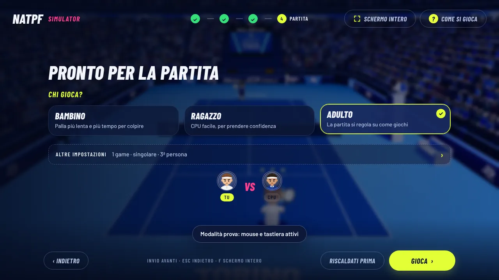
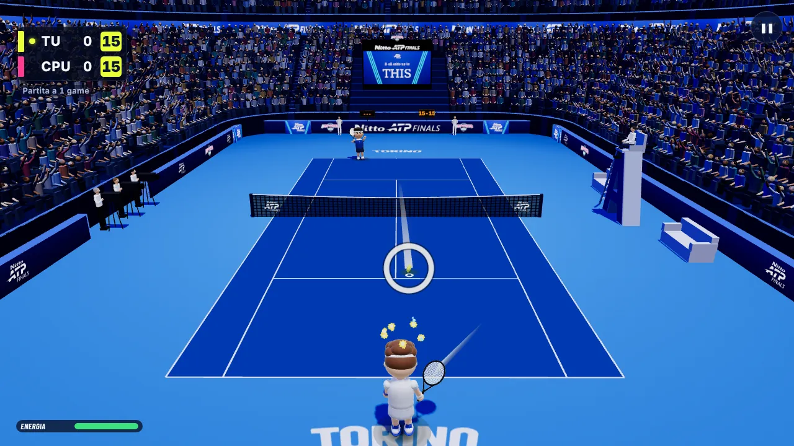
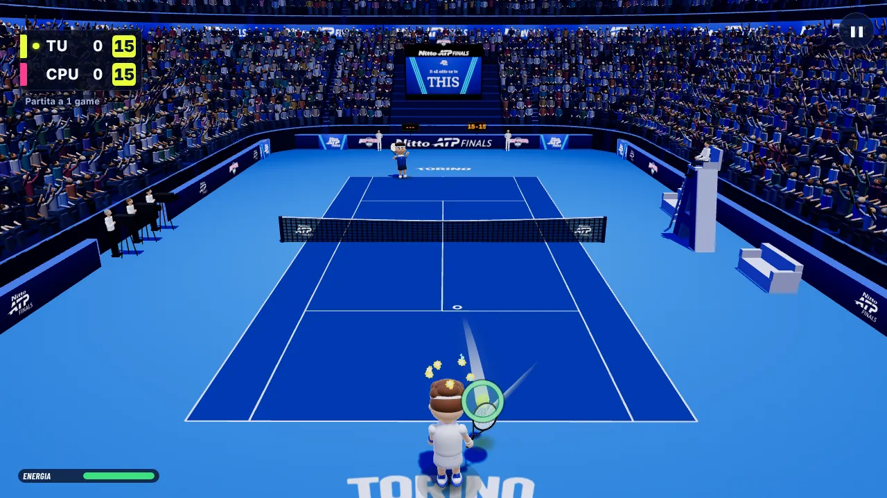
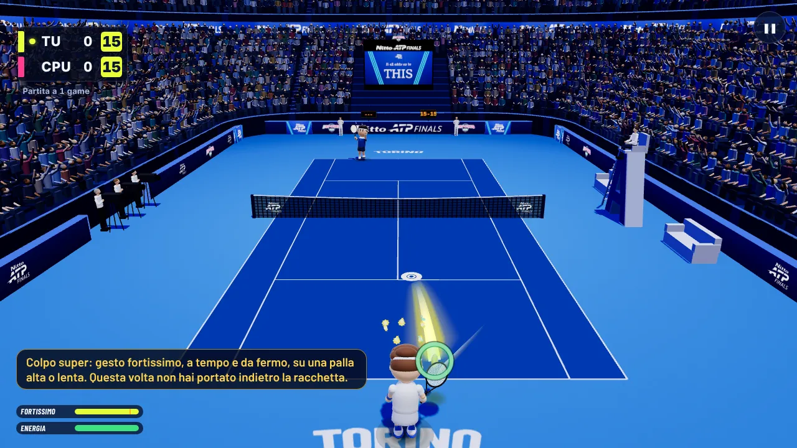

# B18.2 · tappa 2, gruppo 3 · «Chi gioca», livelli Bambini ed Evento, segnale del momento giusto, colpo super spiegato

Difetto 3 e miglioramenti 3 e 4 del rapporto B16 (`docs/b16/rapporto-gameplay.md` §2, §3, appendice D3, M3, M4).
Base: `9b8f9cb` (versione 2026-11-12.2). Lavoro fatto in una worktree (ramo `b18-t2-4-evento-bambini`), senza push e
senza toccare `natpf-simulator` o `main`. I file di versione e i documenti di ripresa non sono toccati.

Tutti i numeri di questo documento vengono dal **gioco simulato** (il motore vero senza disegno, con giocatori
simulati) o dal gioco vero nel browser con i comandi del menu. **Non sono misure di persone vere, e nessun bambino vero
ha provato il livello Bambini.**

## In breve

1. Quando si prepara la partita contro la CPU non si sceglie più un livello: si dice **chi gioca**, «Bambino», «Ragazzo»
   o «Adulto». Di base è scelto «Adulto».
2. **Bambino** apre un livello nuovo, «Bambini»: palla più lenta, più tempo per colpire, CPU che tira al centro e non
   attacca. Il bambino simulato passa da 47 a 74–79 punti vinti su 100 e da 39–46 a 95–100 partite vinte su 100, con
   scambi più lunghi (11 colpi a punto invece di 7).
3. **Adulto** apre un livello nuovo, «Evento», che **si regola da solo**: tra un punto e l'altro la CPU diventa un poco
   più brava se chi gioca ha vinto il punto, un poco più facile se l'ha perso. Gli adulti medi simulati vincono 62–75
   punti su 100 (a Casual 84–95): l'obiettivo del rapporto era 60–70.
4. **Ragazzo** è la CPU facile di sempre (Casual), identica a prima.
5. CPU Esperta (Pro) e Leggenda ci sono ancora, identiche: si scelgono in «Altre impostazioni» → «Livello della CPU».
6. **Segnale del momento giusto**: un anello attorno alla palla che arriva si stringe e diventa verde quando è il momento
   di colpire. Di base c'è con Bambino e Adulto. Non cambia l'esito dei colpi.
7. **Colpo super spiegato**: dopo un gesto fortissimo che non diventa super compare una riga che dice perché.
8. Nello stesso schermo e nella sfida tra due computer non cambia niente.

## Come si attiva

| Cosa | Dove | Di base |
|---|---|---|
| Chi gioca | Menu → **Gioca** → **Contro la CPU** → racchetta → pagina «Pronto per la partita»: le tre tessere **Bambino · Ragazzo · Adulto** sotto «Chi gioca?» | Adulto |
| Livello per nome (anche Esperta e Leggenda) | stessa pagina → **Altre impostazioni** → prima riga **Livello della CPU: Bambini · Facile · Evento · Esperta · Leggenda** | Evento |
| Segnale del momento giusto | Menu → **Opzioni** → **Segnale del momento giusto: Di base · Sì · No** (sesta riga, dopo «Scia della palla»: la pagina scorre) | Di base |
| Colpo super spiegato | niente da accendere: vale in ogni partita contro la CPU | acceso |
| Livello dall'indirizzo della pagina | `?mode=bambini`, `?mode=casual`, `?mode=evento`, `?mode=pro`, `?mode=leggenda` (anche `?difficulty=`) | nessuno |

Che cosa fanno i valori:

- **Bambino** → livello Bambini. **Ragazzo** → Casual. **Adulto** → livello Evento.
- **Livello della CPU**: «Facile» è Casual, «Esperta» è Pro. Se si sceglie Esperta o Leggenda nessuna tessera resta
  scelta e sotto le tessere compare «Livello: CPU Esperta, scelto in «Altre impostazioni». Tocca chi gioca per
  cambiarlo.»; lo dice anche il riassunto accanto ad «Altre impostazioni». Toccare una tessera riporta al livello di
  quella tessera.
- **Segnale del momento giusto**:
  - «Di base»: acceso con Bambino e Adulto (livelli Bambini ed Evento), spento con gli altri livelli;
  - «Sì»: acceso a tutti i livelli contro la CPU;
  - «No»: spento a tutti i livelli, anche a Bambini ed Evento.
  La scelta resta salvata su quel computer (è una scelta dello stand: «Nuovo giocatore» e il chiosco non la toccano).
  Nello stesso schermo e nella sfida tra due computer il segnale non c'è mai.
- **Indirizzo**: chi ha un collegamento salvato con `?mode=pro` o `?mode=leggenda` ritrova quel livello, scelto in
  «Altre impostazioni». Il livello dell'indirizzo diventa il valore di base di quella pagina (vedi sotto).
- **Chiosco e «Nuovo giocatore»**: riportano «Chi gioca» al valore di base (Adulto, o il livello dell'indirizzo), fanno
  ripartire il livello Evento dal suo valore di partenza e fanno rivedere la spiegazione lunga del colpo super.
  Prima «Nuovo giocatore» lasciava il livello scelto da chi aveva giocato prima.
- **«Gioca ancora»** (stesso giocatore): il livello Evento continua da dove era arrivato.
- **«Menu»** a fine partita e **«Torna al menu»** dalla pausa: il livello Evento riparte dal valore di partenza (chi
  arriva dopo non trova la CPU regolata su chi ha giocato prima). La tessera scelta resta: la cambia solo «Nuovo
  giocatore» o il chiosco.

Non c'è niente di nuovo nel pannello dello stand.

## Cosa cambia per chi gioca

### Chi gioca

L'idea è tua: il gioco non può riconoscere un bambino, quindi lo chiede. La pagina «Pronto per la partita» contro la
CPU ha tre tessere al posto delle tre di prima (CPU facile, CPU esperta, CPU Leggenda):

| Tessera | Scritta sotto | Livello |
|---|---|---|
| Bambino | Palla più lenta e più tempo per colpire | Bambini (nuovo) |
| Ragazzo | CPU facile, per prendere confidenza | Casual (identico a prima) |
| Adulto | La CPU si regola su come giochi | Evento (nuovo) |

Riscaldamento e sfide (Precision, Combo e le altre) continuano a usare la CPU facile, come prima, qualunque tessera sia
scelta.

### Livello Bambini

Rispetto a Casual:

- **più tempo per colpire**: si può colpire fino a 6 centesimi di secondo più tardi; lo stesso errore di tempo sposta
  meno la palla verso le righe; la finestra del voto «Perfetto» è più larga di circa il 40%;
- **meno palle fuori** per un gesto impreciso (meno dispersione, meno rischio vicino alle righe);
- **la palla della CPU arriva più lenta**: i suoi colpi restano in aria l'8% in più, il suo servizio il 15% in più;
- **la CPU tira quasi sempre al centro**: 7 colpi su 10 al centro, mai il contropiede, mai l'angolo stretto, e non
  attacca la palla debole;
- **la CPU sbaglia un poco di più** quando deve correre o allungarsi, e sbaglia più spesso la risposta al servizio
  (un bambino batte piano: 20 risposte sbagliate su 100 di base invece di 12,5).

La CPU corre come a Casual (4,4 metri al secondo): se corresse meno gli scambi finirebbero subito.
Non cambiano il riconoscimento dei gesti, la finestra in cui il colpo viene preso, la regola dei colpi falliti e le
condizioni del colpo super.

### Livello Evento

Parte da una CPU a metà strada tra Casual e Pro, più vicina a Pro, e si sposta da lì secondo come va la partita. Come
funziona è scritto per intero nel capitolo «L'adattamento, detto a parole».

Che cosa cambia insieme, un poco a ogni gradino, andando dalla CPU più facile alla più brava:

| | CPU più facile (uguale a Casual) | alla partenza | CPU più brava |
|---|---|---|---|
| Corsa della CPU | 4,4 m/s | 5,4 m/s | 5,6 m/s (Pro: 5,3) |
| Tempo prima che parta | 0,24 s | 0,20 s | 0,19 s |
| Errori della CPU in allungo (peso nella regola del passo 2) | 0,24 | 0,08 | 0,045 (come Pro) |
| Tempo di volo dei suoi colpi (più corto = palla più veloce) | quello di Casual | 16% più corto | 20% più corto (come Pro) |
| Colpi scelti come a Pro (più profondi, più angolati) | mai | 8 su 10 | sempre |
| Servizio della CPU | piano e al centro | quasi come Pro | come Pro |
| Precisione chiesta a chi gioca («Perfetto», direzione, rischio vicino alle righe) | quella di Casual | quasi quella di Pro | quella di Pro |
| Corsa del personaggio di chi gioca | 10,2 m/s | 9,1 m/s | 8,8 m/s (come Pro) |

Restano sempre quelle di Casual, a ogni gradino: la finestra in cui il colpo viene preso e la regola dei colpi
falliti. Con la CPU più brava, quindi, Evento è ancora un poco più largo di Pro per chi gioca.

### Segnale del momento giusto

Attorno alla palla che arriva compare un anello giallo, largo. Si stringe mentre la palla si avvicina. Quando è il
momento di colpire è stretto sulla palla e diventa **verde**. Se la palla passa diventa rosso e sparisce.

- Il verde dura quanto la finestra del voto «Perfetto» del livello (a Bambini è più larga).
- L'istante è lo stesso con cui il gioco giudica il colpo: l'anello non inventa un tempo suo.
- È solo disegno. Non legge i gesti e non cambia l'esito, il voto o la palla: la stessa partita simulata, con gli
  stessi semi, è identica con il segnale acceso e spento (c'è un test).
- L'anello non torna mai più largo mentre la stessa palla arriva. Senza questa regola succedeva circa in una palla su
  cinque (fino a 60 centimetri in più), perché il gioco corregge in volo la stima del tempo.
- Nel tutorial la scheda «Colpisci la palla» adesso dice: «Con il segnale del momento giusto un anello si stringe
  sulla palla: colpisci quando si chiude.»

Il rapporto proponeva di misurare la quota di «Perfetto» prima e dopo. **Con il gioco simulato non si può**: i
giocatori simulati non guardano l'anello. Serve la prova con persone (capitolo «Cosa non è provato»).

### Colpo super spiegato

Le condizioni del colpo super **non cambiano** (decisione del 29/10). Cambia quello che si legge.

- **La prima volta** che un giocatore fa un gesto fortissimo (barra della potenza piena, «Fortissimo») e il super non
  scatta, in basso a sinistra, sopra le barre, compare per 5 secondi:
  «Colpo super: gesto fortissimo, a tempo e da fermo, su una palla alta o lenta. Questa volta la palla era bassa e
  veloce.» (l'ultima frase dice il motivo di quella volta).
- **Le volte dopo**, per 2,6 secondi: «Super mancato: eri fuori tempo.»
- I motivi che si possono leggere: «la palla era bassa e veloce», «eri fuori tempo», «eri in corsa», «la palla era dal
  lato sbagliato», «il gesto era poco chiaro», «vale solo con dritto, rovescio o schiacciata, non con i colpi tagliati
  o il pallonetto».
- Nessuna scritta se il gesto non era fortissimo, se il colpo è fallito (lo dice già l'esito) o se il super è riuscito
  («SUPER!» c'è già).
- Nel tutorial la scheda «Cambia tipo di colpo» finisce con: «Colpo super: gesto fortissimo, a tempo e da fermo, su
  una palla alta o lenta.»

Non ho fatto l'alone attorno alla palla «da super» in arrivo, che il rapporto proponeva insieme alla scritta: vedi
«Cosa resta aperto».

## L'adattamento, detto a parole

Una regola sola, uguale per tutti.

1. La bravura della CPU è un numero tra 0 e 1. A 0 è la CPU facile, quella di «Ragazzo». A 1 è la più brava del
   livello: la CPU di Pro con un poco di corsa in più. In mezzo, ogni valore è una media tra le due.
2. La partita di un giocatore nuovo comincia a **0,8**.
3. **A ogni punto vinto** da chi gioca la CPU sale di un gradino piccolo: 0,035. **A ogni punto perso** scende di un
   gradino più grande: 0,065. I due gradini stanno nel rapporto 35 a 65. Così la CPU smette di muoversi, in media,
   quando chi gioca vince **65 punti su 100**: è il centro dell'obiettivo del rapporto.
4. **Nei primi sei punti** di un giocatore i gradini valgono il doppio (0,07 e 0,13): all'inizio il gioco non sa chi ha
   davanti, e una partita da 1 game dura 4–7 punti.
5. La CPU cambia **solo tra un punto e l'altro**, mai durante lo scambio.
6. **Limiti fissi**: la CPU non scende mai sotto quella facile e non sale mai sopra la più brava.
7. **Non c'è nessun altro aiuto.** Nessun punto dato, nessun colpo sbagliato apposta, nessuna palla resa più facile
   durante lo scambio. Un punto perso abbassa la CPU, ma solo dal punto dopo, di un gradino, e mai sotto la CPU facile.
8. Una partita nuova dello stesso giocatore («Gioca ancora») riparte da dove era arrivata. «Nuovo giocatore», il chiosco
   che riparte, il ritorno al menu principale, una tessera di «Chi gioca», la riga «Livello della CPU» e l'avvio del
   gioco la riportano a 0,8.

Non oscilla: un punto sposta la CPU al massimo di 0,13 su 1 (in corsa: 16 centimetri al secondo), e più la CPU è
lontana dal punto giusto più i punti la riportano indietro. Sullo schermo non c'è nessuna scritta.

Nella demo dietro il menu, nel riscaldamento, nelle sfide, a tutti gli altri livelli, nello stesso schermo e nella
sfida tra due computer la regola non viene usata.

## Misure

### Come ho misurato

Banco: `natpf-tennis/scripts/audit/evento-bambini.mjs` (`npm run audit:evento`). Usa il motore vero senza disegno e i
giocatori simulati degli altri banchi.

- **Profili**: bambino, amatore, umano, medio, tennista sono quelli di `rally-balance.mjs`. «ragazzo» è nuovo, definito
  nel banco a metà strada tra bambino e amatore. «Adulto medio» del rapporto = amatore, umano, medio. «Bravo» = tennista.
- **Due serie di semi** indipendenti (A e B), 4 semi per serie, 300 punti per seme.
- **Una partita**: 1 game con il formato in fiera (punto decisivo sul 40-40), oppure al meglio di 3 con il formato
  classico. Comincia da un game battuto da chi gioca (la scelta di base). A Evento ogni partita è di un visitatore
  nuovo: la CPU riparte da 0,8.
- **Durata**: tempo di gioco simulato, senza la scritta d'inizio e la schermata finale.
- Distorsione del banco, come negli altri: lo scambio che arriva a 60 colpi è chiuso d'ufficio a favore della CPU.

Comandi usati per le tabelle:

```sh
cd natpf-tennis
npm run audit:evento -- --nsemi=4 --punti=300 --json                                  # tabelle 1 e 2
npm run audit:evento -- --curva --serie=A --nsemi=4 --punti=200 --json                # tabella 3
npm run audit:evento -- --livelli=evento --serie=A --nsemi=4 --punti=300 --rivincite=3 --json   # tabella 4
npm run audit:evento -- --impronte                                                    # livelli di prima
```

### 1. Punti, partite, scambi e durata

In ogni casella: serie A · serie B.

**Partita da 1 game, formato in fiera** (serie A · serie B)

| chi gioca | livello | partite | punti vinti | partite vinte | colpi per punto (media · p90) | durata in secondi (metà · 9 su 10 · massimo) | punti a partita |
|---|---|---|---|---|---|---|---|
| bambino | Bambini | 115 · 120 | 76,1 · 78,7% | 96,5 · 95% | 10,95 · 26 — 10,55 · 25 | 81 · 151 · 224 — 79 · 151 · 192 | 5,2 · 4,9 |
| bambino | Casual | 104 · 105 | 47 · 47,3% | 38,5 · 44,8% | 6,87 · 15 — 7,24 · 18 | 71 · 95 · 175 — 69 · 112 · 140 | 5,8 · 5,7 |
| bambino | Evento | 112 · 109 | 20,9 · 26,1% | 3,6 · 3,7% | 7,87 · 16 — 7,36 · 16 | 60 · 95 · 140 — 63 · 91 · 144 | 5 · 5,3 |
| ragazzo | Bambini | 132 · 133 | 87,2 · 88,8% | 99,2 · 99,2% | 11,2 · 25 — 11,14 · 25 | 75 · 127 · 198 — 70 · 129 · 201 | 4,6 · 4,5 |
| ragazzo | Casual | 108 · 108 | 66,1 · 63,8% | 82,4 · 76,9% | 9,39 · 21 — 8,89 · 19 | 82 · 121 · 189 — 74 · 121 · 189 | 5,5 · 5,6 |
| ragazzo | Evento | 103 · 101 | 36,3 · 41,8% | 22,3 · 31,7% | 10,71 · 23 — 10,89 · 24 | 87 · 127 · 188 — 91 · 131 · 194 | 5,7 · 6 |
| adulto medio «amatore» | Bambini | 145 · 146 | 96,7 · 96,4% | 100 · 100% | 10,51 · 23 — 10,1 · 23 | 62 · 108 · 161 — 61 · 95 · 181 | 4,1 · 4,2 |
| adulto medio «amatore» | Casual | 128 · 130 | 83,9 · 84,9% | 97,7 · 98,5% | 10,26 · 22 — 9,35 · 20 | 74 · 111 · 154 — 63 · 116 · 156 | 4,7 · 4,7 |
| adulto medio «amatore» | Evento | 104 · 104 | 62,3 · 62,6% | 82,7 · 77,9% | 14,77 · 31 — 13,89 · 29 | 114 · 165 · 213 — 112 · 153 · 202 | 5,9 · 5,8 |
| adulto medio «umano» | Bambini | 132 · 133 | 88,1 · 88,3% | 99,2 · 99,2% | 10,05 · 24 — 9,04 · 21 | 67 · 104 · 179 — 60 · 102 · 144 | 4,5 · 4,5 |
| adulto medio «umano» | Casual | 132 · 132 | 89 · 88,7% | 100 · 100% | 9,5 · 20 — 9,65 · 21 | 60 · 108 · 135 — 64 · 100 · 131 | 4,5 · 4,5 |
| adulto medio «umano» | Evento | 112 · 109 | 71,2 · 70,7% | 93,8 · 90,8% | 16,96 · 35 — 17,95 · 38 | 117 · 176 · 242 — 125 · 187 · 282 | 5,4 · 5,4 |
| adulto medio «medio» | Bambini | 148 · 148 | 98,2 · 98,7% | 100 · 100% | 7,86 · 18 — 8,05 · 18 | 50 · 79 · 128 — 50 · 81 · 104 | 4,1 · 4,1 |
| adulto medio «medio» | Casual | 140 · 142 | 93,8 · 94,8% | 100 · 100% | 7,3 · 16 — 7,45 · 16 | 51 · 78 · 109 — 50 · 74 · 103 | 4,3 · 4,2 |
| adulto medio «medio» | Evento | 111 · 110 | 74,7 · 74,2% | 96,4 · 93,6% | 12,49 · 26 — 11,88 · 25 | 88 · 133 · 197 — 84 · 132 · 163 | 5,3 · 5,2 |
| bravo «tennista» | Bambini | 152 · 152 | 100 · 100% | 100 · 100% | 4,6 · 9 — 4,26 · 8 | 34 · 45 · 57 — 32 · 43 · 62 | 4 · 4 |
| bravo «tennista» | Casual | 149 · 149 | 99,7 · 99,5% | 100 · 100% | 4,78 · 9 — 4,83 · 10 | 33 · 46 · 82 — 35 · 48 · 61 | 4 · 4 |
| bravo «tennista» | Evento | 146 · 146 | 96,4 · 96,7% | 100 · 100% | 10,03 · 22 — 9,55 · 19 | 58 · 79 · 124 — 54 · 83 · 101 | 4,2 · 4,1 |

**Partita al meglio di 3, formato classico** (serie A · serie B)

| chi gioca | livello | partite | punti vinti | partite vinte | colpi per punto (media · p90) | durata in secondi (metà · 9 su 10 · massimo) | punti a partita |
|---|---|---|---|---|---|---|---|
| bambino | Bambini | 94 · 100 | 73,5 · 76,5% | 100 · 100% | 11,1 · 27 — 10,78 · 26 | 198 · 335 · 519 — 180 · 320 · 477 | 12 · 11,2 |
| bambino | Casual | 61 · 59 | 46,7 · 47,9% | 39,3 · 45,8% | 7,68 · 17 — 7,34 · 16 | 197 · 329 · 389 — 206 · 276 · 346 | 16,2 · 16,2 |
| bambino | Evento | 74 · 81 | 33,5 · 31,7% | 6,8 · 6,2% | 7,18 · 15 — 7,27 · 16 | 152 · 267 · 367 — 146 · 253 · 349 | 14 · 13 |
| ragazzo | Bambini | 129 · 129 | 87,8 · 88,4% | 100 · 100% | 11,67 · 28 — 12,01 · 28 | 161 · 236 · 311 — 160 · 239 · 422 | 9,2 · 9,1 |
| ragazzo | Casual | 76 · 77 | 65,1 · 65,9% | 89,5 · 94,8% | 9,16 · 20 — 9,19 · 21 | 184 · 321 · 415 — 194 · 326 · 450 | 13,8 · 13,9 |
| ragazzo | Evento | 53 · 52 | 46,1 · 46,5% | 37,7 · 44,2% | 10,37 · 23 — 11,1 · 24 | 280 · 434 · 487 — 293 · 406 · 537 | 18,3 · 18 |
| adulto medio «amatore» | Bambini | 142 · 142 | 95,8 · 95,9% | 100 · 100% | 10,16 · 23 — 10,21 · 22 | 127 · 182 · 282 — 125 · 191 · 272 | 8,4 · 8,3 |
| adulto medio «amatore» | Casual | 125 · 127 | 86,3 · 87,6% | 100 · 100% | 9,23 · 21 — 9,42 · 21 | 132 · 181 · 294 — 132 · 186 · 249 | 9,3 · 9,3 |
| adulto medio «amatore» | Evento | 65 · 71 | 62,7 · 65,2% | 96,9 · 98,6% | 14,07 · 30 — 14,27 · 31 | 294 · 417 · 533 — 270 · 403 · 554 | 15,6 · 14,5 |
| adulto medio «umano» | Bambini | 128 · 130 | 88,3 · 89% | 100 · 100% | 9,51 · 21 — 9,66 · 22 | 135 · 191 · 233 — 133 · 203 · 268 | 9,1 · 9 |
| adulto medio «umano» | Casual | 128 · 127 | 87,5 · 87% | 100 · 100% | 9,46 · 21 — 9,4 · 20 | 136 · 179 · 268 — 134 · 185 · 286 | 9,2 · 9,3 |
| adulto medio «umano» | Evento | 88 · 87 | 70,4 · 70,3% | 100 · 100% | 16,97 · 36 — 16,03 · 34 | 274 · 400 · 523 — 268 · 360 · 549 | 12,7 · 12,8 |
| adulto medio «medio» | Bambini | 148 · 147 | 99 · 99,1% | 100 · 100% | 7,97 · 18 — 7,9 · 17 | 104 · 138 · 212 — 101 · 140 · 163 | 8,1 · 8,1 |
| adulto medio «medio» | Casual | 135 · 140 | 92 · 94,5% | 100 · 100% | 7,46 · 16 — 7,27 · 15 | 104 · 146 · 247 — 99 · 132 · 206 | 8,8 · 8,5 |
| adulto medio «medio» | Evento | 93 · 89 | 71,9 · 71,1% | 100 · 98,9% | 11,52 · 25 — 12,03 · 26 | 190 · 306 · 411 — 198 · 273 · 501 | 12,3 · 12,3 |
| bravo «tennista» | Bambini | 148 · 148 | 100 · 100% | 100 · 100% | 4,33 · 8 — 4,43 · 8 | 66 · 78 · 98 — 68 · 81 · 95 | 8 · 8 |
| bravo «tennista» | Casual | 148 · 147 | 99,6 · 99,2% | 100 · 100% | 4,74 · 9 — 4,79 · 9 | 70 · 84 · 106 — 70 · 86 · 108 | 8 · 8,1 |
| bravo «tennista» | Evento | 142 · 142 | 96 · 95,9% | 100 · 100% | 10,27 · 21 — 10,48 · 21 | 113 · 152 · 229 — 116 · 158 · 204 | 8,3 · 8,3 |

Che cosa dicono:

- **Bambino**. A Casual vince 47 punti su 100 e 39–46 partite su 100. A Bambini 74–79 punti e 95–100 partite, con
  scambi da 11 colpi (a Casual 7). Una partita da 1 game dura in metà dei casi 80 secondi.
- **Ragazzo a Casual**: 64–66 punti su 100, 77–82 partite da 1 game su 100. È già una partita tirata, senza toccare
  niente.
- **Adulto medio a Evento**: 62–75 punti su 100 invece di 84–95; partite da 1 game vinte 78–96 su 100 invece di 98–100.
- **Scambi e durata a Evento**: gli scambi si allungano (12–18 colpi a punto invece di 7–10) e con loro la partita: 1
  game dura in metà dei casi 84–125 secondi (a Casual 50–74) e 9 volte su 10 finisce entro 132–187 secondi (a Casual
  entro 74–116). È il
  compromesso più visibile di questo livello: vedi «Cosa resta aperto».
- **Il bravo** vince quasi sempre anche a Evento (96 punti su 100): la CPU arriva al suo tetto e ci resta. Per lui ci
  sono Esperta e Leggenda.
- **Chi sceglie la tessera sbagliata**: un bambino con «Adulto» vince 21–34 punti su 100; un adulto con «Bambino»
  vince sempre.

### 2. Evento: come si muove la CPU durante la partita

Il numero è la bravura della CPU (0 facile, 1 la più brava); ogni partita parte da 0,8.

| chi gioca | formato | bravura della CPU a fine partita (media) | 8 partite su 10 finiscono tra | quanto si allontana al massimo da 0,8 dentro la partita (media · caso peggiore) |
|---|---|---|---|---|
| bambino | 1 game in fiera | 0,36 · 0,39 | 0,28–0,42 · 0,28–0,55 | 0,44 · 0,52 — 0,42 · 0,52 |
| bambino | al meglio di 3 | 0,15 · 0,14 | 0–0,29 · 0–0,27 | 0,65 · 0,8 — 0,66 · 0,8 |
| ragazzo | 1 game in fiera | 0,48 · 0,53 | 0,28–0,82 · 0,35–0,82 | 0,36 · 0,52 — 0,32 · 0,52 |
| ragazzo | al meglio di 3 | 0,31 · 0,33 | 0,1–0,55 · 0,06–0,6 | 0,54 · 0,8 — 0,53 · 0,8 |
| adulto medio «amatore» | 1 game in fiera | 0,75 · 0,76 | 0,42–1 · 0,42–1 | 0,22 · 0,52 — 0,21 · 0,45 |
| adulto medio «amatore» | al meglio di 3 | 0,72 · 0,76 | 0,51–0,96 · 0,58–0,96 | 0,27 · 0,65 — 0,25 · 0,58 |
| adulto medio «umano» | 1 game in fiera | 0,85 · 0,85 | 0,65–1 · 0,65–1 | 0,18 · 0,52 — 0,2 · 0,52 |
| adulto medio «umano» | al meglio di 3 | 0,85 · 0,84 | 0,64–1 · 0,69–1 | 0,21 · 0,41 — 0,21 · 0,52 |
| adulto medio «medio» | 1 game in fiera | 0,88 · 0,87 | 0,65–1 · 0,65–1 | 0,18 · 0,38 — 0,19 · 0,45 |
| adulto medio «medio» | al meglio di 3 | 0,87 · 0,86 | 0,7–1 · 0,67–1 | 0,2 · 0,52 — 0,21 · 0,65 |
| bravo «tennista» | 1 game in fiera | 0,99 · 0,99 | 0,95–1 · 0,95–1 | 0,2 · 0,2 — 0,19 · 0,2 |
| bravo «tennista» | al meglio di 3 | 1 · 1 | 1–1 · 1–1 | 0,2 · 0,2 — 0,2 · 0,26 |

Tre partite da 1 game e tre al meglio di 3 dell'adulto «amatore», punto per punto (serie A):

```
1 game       0,80 0,87 0,74 0,81 0,88 0,75 0,62 0,66
1 game       0,80 0,87 0,74 0,81 0,68 0,75 0,62 0,66
1 game       0,80 0,87 0,74 0,81 0,68 0,75 0,82
meglio di 3  0,80 0,87 0,94 1,00 1,00 0,87 0,94 0,97 1,00 0,94 0,97
meglio di 3  0,80 0,87 0,74 0,81 0,68 0,75 0,82 0,76 0,79 0,82 0,86 0,90
meglio di 3  0,80 0,87 0,74 0,61 0,68 0,55 0,62 0,66 0,59 0,62 0,56 0,59 0,53 0,47 0,50 0,54 0,57 0,60 0,64 0,57 0,61 0,55 0,58
```

Una partita del bambino che ha scelto «Adulto» (al meglio di 3): `0,80 0,67 0,54 0,41 0,28 0,15 0,02 0,00 0,00`. La CPU
scende fino a quella facile in sette punti e si ferma lì.

- Per gli adulti medi la CPU resta vicino a dove parte: dentro una partita si sposta in media di 0,18–0,27.
- Lo spostamento più grande visto in una partita da 1 game è 0,52: quattro punti persi di fila all'inizio (0,80 →
  0,28). Nel meglio di 3 è 0,65 per gli adulti e 0,80 per chi perde sempre (arriva alla CPU facile).
- I gradini doppi durano sei punti: una partita da 1 game si gioca quasi tutta con quelli. Dopo, la CPU si muove a
  passi di 0,035 e 0,065.

### 3. Dove sta il punto giusto: Evento con la CPU ferma

Punti vinti su 100 con la CPU bloccata a un valore (senza adattamento); tra parentesi i colpi per punto. Serie A, 4
semi × 200 punti.

| chi gioca | CPU a 0 (Casual) | 0,25 | 0,5 | 0,75 | 1 |
|---|---|---|---|---|---|
| bambino | 46,1% (7,39) | 41% (7,23) | 32,4% (7,36) | 22,1% (8,05) | 16,1% (7,62) |
| ragazzo | 64,1% (9,01) | 54,4% (9,65) | 46,8% (10,56) | 35,4% (11,28) | 21,6% (11,15) |
| adulto medio «amatore» | 84,9% (9,45) | 79,1% (11,47) | 69,3% (12,67) | 61,8% (14,62) | 48,3% (15,99) |
| adulto medio «umano» | 86,6% (9,52) | 87% (10,88) | 77,2% (14,79) | 72,3% (16,54) | 65,3% (19,2) |
| adulto medio «medio» | 91,5% (7,44) | 89% (8,45) | 83,9% (9,86) | 74,3% (11,29) | 64,3% (12,84) |
| bravo «tennista» | 99,6% (4,78) | 99,5% (5,72) | 98,8% (6,92) | 97,8% (8,5) | 96% (10,71) |

- A 0 il livello è Casual, numero per numero (c'è un test che confronta le due partite punto per punto).
- I 65 punti su 100 stanno a circa 0,65 per «amatore» e a 1 per «umano» e «medio». Per questo la partenza è 0,8.
- «umano» e «medio» anche con la CPU più brava vincono 64–65 punti su 100: per loro il livello è al tetto. Un tetto
  più alto vorrebbe una CPU più forte di Pro, cioè la Leggenda, che in questo passo non andava toccata.

### 4. «Gioca ancora»: tre partite di fila dello stesso giocatore

Punti vinti · partite vinte · bravura della CPU all'inizio → alla fine (tra parentesi quante partite). Serie A.

| chi gioca | formato | 1ª partita: punti · partite vinte · CPU | 2ª partita | 3ª partita |
|---|---|---|---|---|
| bambino | 1 game in fiera | 28,2% · 8,3% · CPU 0,8 → 0,41 (36) | 43,9% · 38,9% · CPU 0,19 → 0,12 (36) | 44,3% · 37,1% · CPU 0,08 → 0,05 (35) |
| bambino | al meglio di 3 | 27,4% · 0% · CPU 0,8 → 0,1 (24) | 48% · 50% · CPU 0,08 → 0,06 (22) | 46,4% · 35% · CPU 0,03 → 0,04 (20) |
| ragazzo | 1 game in fiera | 37,6% · 20% · CPU 0,8 → 0,5 (35) | 50,2% · 47,1% · CPU 0,4 → 0,32 (34) | 51,6% · 50% · CPU 0,24 → 0,18 (32) |
| ragazzo | al meglio di 3 | 48,8% · 47,6% · CPU 0,8 → 0,4 (21) | 55,6% · 68,4% · CPU 0,3 → 0,2 (19) | 63,2% · 100% · CPU 0,21 → 0,23 (17) |
| adulto medio «amatore» | 1 game in fiera | 60,2% · 75% · CPU 0,8 → 0,74 (36) | 61,9% · 77,8% · CPU 0,72 → 0,7 (36) | 59,6% · 69,7% · CPU 0,67 → 0,64 (33) |
| adulto medio «amatore» | al meglio di 3 | 64,6% · 96% · CPU 0,8 → 0,74 (25) | 62,9% · 95,7% · CPU 0,76 → 0,72 (23) | 67,3% · 100% · CPU 0,72 → 0,75 (22) |
| adulto medio «umano» | 1 game in fiera | 69,9% · 89,5% · CPU 0,8 → 0,83 (38) | 66,3% · 81,1% · CPU 0,81 → 0,8 (37) | 75,3% · 97,2% · CPU 0,83 → 0,87 (36) |
| adulto medio «umano» | al meglio di 3 | 71,1% · 100% · CPU 0,8 → 0,85 (30) | 67,7% · 100% · CPU 0,88 → 0,87 (28) | 70,1% · 100% · CPU 0,88 → 0,91 (27) |
| adulto medio «medio» | 1 game in fiera | 74,4% · 100% · CPU 0,8 → 0,88 (40) | 66,5% · 78,9% · CPU 0,89 → 0,88 (38) | 71,6% · 94,4% · CPU 0,9 → 0,91 (36) |
| adulto medio «medio» | al meglio di 3 | 72,2% · 100% · CPU 0,8 → 0,88 (30) | 71,7% · 100% · CPU 0,88 → 0,93 (30) | 67,4% · 100% · CPU 0,95 → 0,91 (27) |
| bravo «tennista» | 1 game in fiera | 98,6% · 100% · CPU 0,8 → 1 (51) | 98% · 100% · CPU 1 → 1 (48) | 98% · 100% · CPU 1 → 1 (48) |
| bravo «tennista» | al meglio di 3 | 96,2% · 100% · CPU 0,8 → 0,99 (48) | 95,8% · 100% · CPU 0,99 → 1 (48) | 95,3% · 100% · CPU 1 → 1 (46) |

- Gli adulti medi restano a 60–75 punti su 100 in tutte e tre le partite.
- Chi è più debole di quanto il livello si aspetta recupera dalla seconda partita: il «ragazzo» passa da 38 a 50–52
  punti su 100 (1 game), il bambino da 28 a 44.

### 5. Valore di partenza: che cosa ho provato

Partita da 1 game in fiera, serie A: punti vinti · partite vinte su 100.

| Partenza | ragazzo | amatore | umano | medio |
|---|---|---|---|---|
| 0,5 | 46,5 · 43 | 70,8 · 93 | 76,9 · 96 | 83,7 · 100 |
| 0,65 | 41,9 · 36 | 69 · 88 | 75,3 · 97 | 77,7 · 99 |
| **0,8 (scelto)** | 36,3 · 22 | 62,3 · 83 | 71,2 · 94 | 74,7 · 96 |

Con una partenza più bassa gli adulti medi escono dall'obiettivo verso l'alto (70–84) e la partita torna quasi
sempre vinta. Con 0,8 stanno a 62–75. Il prezzo lo paga chi gioca peggio dell'adulto medio: vedi «Cosa resta aperto».
La partenza è un numero solo (`EVENTO.start` in `natpf_evento.js`).

### 6. I livelli di prima non sono cambiati

Impronte di Casual, Pro, Leggenda e 1v1 (4 profili × 2 semi × 80 punti: punti, colpi di ogni scambio, come finisce ogni
punto, voti, rimbalzi): **32 su 32 identiche a `9b8f9cb`**. Le ho calcolate due volte: sui sorgenti di
`9b8f9cb` estratti a parte (`git archive`) e su questo ramo, con lo stesso script e gli stessi semi (7 e 2001). Il banco
le ristampa con `npm run audit:evento -- --impronte`.

## Obiettivi del rapporto

| Obiettivo | Misura | Esito |
|---|---|---|
| L'adulto medio intorno al 60–70% dei punti al livello Evento (§4) | amatore 62–65 · umano 70–71 · medio 71–75 | raggiunto per «amatore» e «umano»; «medio» sta 1–5 punti sopra (è al tetto del livello) |
| «Chi gioca resta intorno al 55–70% dei punti» (difetto 3, proposta) | come sopra; ragazzo 36–47, bambino 21–34, tennista 96 | vale per l'adulto medio; non per chi è molto più debole o molto più forte |
| Un livello per bambini sotto Casual: il bambino fa scambi e vince game | 74–79 punti, 95–100 partite, 11 colpi a punto | raggiunto nel gioco simulato |
| Dentro limiti fissi | la CPU resta tra Casual e la più brava in tutte le partite misurate | raggiunto |
| Il segnale non cambia l'esito dei colpi | stessa partita con il segnale acceso e spento | raggiunto |
| Le condizioni del super non cambiano | `SUPER` e `superShot` non toccati (test sui valori) | raggiunto |
| Livelli di oggi identici con semi fissi | 32 impronte su 32 | raggiunto |
| Quota di «Perfetto» prima e dopo il segnale (miglioramento 3) | non misurabile con il gioco simulato | **da fare con persone** |

## Schermate

Le ho guardate tutte a 1280×720, 1920×540 e 720×720 (in `docs/b18/img/`, prefisso `t2-4-`).

| Cosa | 1280×720 | 1920×540 | 720×720 |
|---|---|---|---|
| «Chi gioca?» | `chi-gioca-1280x720.webp` | `chi-gioca-1920x540.webp` | `chi-gioca-720x720.webp` |
| «Altre impostazioni» aperte | `altre-impostazioni-1280x720.webp` | `altre-impostazioni-1920x540.webp` | `altre-impostazioni-720x720.webp` |
| Livello Esperta scelto per nome | `livello-esperta-1280x720.webp` | | |
| Segnale: la palla arriva (giallo) | `segnale-aspetta-1280x720.webp` | `segnale-aspetta-1920x540.webp` | `segnale-aspetta-720x720.webp` |
| Segnale: adesso (verde) | `segnale-adesso-1280x720.webp` | `segnale-adesso-1920x540.webp` | `segnale-adesso-720x720.webp` |
| Colpo super spiegato, prima volta | `super-spiegato-1280x720.webp` | `super-spiegato-1920x540.webp` | `super-spiegato-720x720.webp` |
| «Super mancato» | `super-mancato-1280x720.webp` | | |
| Opzioni, riga del segnale | `opzioni-segnale-1280x720.webp` | `opzioni-segnale-1920x540.webp` | `opzioni-segnale-720x720.webp` |






Che cosa ho visto:

- «Chi gioca?», le tre tessere, «Altre impostazioni» e «Gioca» stanno nello schermo senza scorrere alle tre misure.
- Con «Altre impostazioni» aperte la pagina ha una riga in più di prima (cinque invece di quattro). Sugli schermi bassi
  la pagina scorre da sola fino all'ultima riga, come faceva già: a 1920×540 e a 720×720 il titolo e le tessere
  salgono fuori vista; i cinque livelli e «Gioca» si vedono sempre.
- La pagina Opzioni ha dieci righe e scorreva già: la riga del segnale è la sesta e a 1920×540 e 1280×720 si vede
  intera solo scorrendo un poco.
- L'anello giallo si vede bene alle tre misure. L'anello verde è piccolo (è stretto sulla palla): a 1920×540 è largo
  una trentina di punti dello schermo. Sul ledwall vero non è provato.
- La scritta del super sta sopra le barre di potenza ed energia, in due righe (tre a 720×720), e non copre il campo.
- Nelle schermate del campo la palla è stata messa in gioco dalla prova e il gioco è fermo sull'istante voluto.

## Come funziona (per chi mette le mani nel codice)

- `natpf_evento.js` (nuovo): la regola del livello Evento, senza DOM e senza motore. `EVENTO` (partenza, obiettivo,
  gradino, gradini doppi, limiti), `eventoStep` (pura), stato unico (`eventoState`, `eventoK`, `eventoPoint`,
  `eventoReset`), `blend` (media tra due gruppi di valori).
- `natpf_skill.js`: `SKILL_LEVELS.bambini` e `SKILL_LEVELS.evento`; `EVENTO_ENDS` (i due estremi), `eventoLevelAt(k)`;
  `skillLevel('evento')` segue `k`; `eventoAfterPoint` e `eventoRestart`; `cpuFlightFactor`; `SERVE_WEIGHT.bambini`,
  `SERVE_WEIGHT.evento` e `eventoServeAt(k)`; `CPU_PATTERNS.bambini`; `cpuShotChoice` (a Evento sceglie come Pro con
  probabilità `cpuPro`). Casual, Pro e Leggenda sono gli stessi oggetti di prima.
- `natpf_impact.js`: `lateMargin` aggiunge il margine di Bambini, solo per chi gioca contro la CPU.
- `game_engine.js` (3 righe): i due livelli nuovi tra quelli accettati dall'indirizzo; × tempo di volo dei colpi della
  CPU; `eventoAfterPoint` a fine punto. `hud_ui.js` (2 righe): i due livelli tra quelli che si possono scegliere.
- `natpf_who.js` (nuovo): «Chi gioca» → livello, valore di base, indirizzo, scritte. Funzioni pure.
- `natpf_lobby.js`: tessere, «Livello della CPU», riga del segnale nelle Opzioni, `resetWho`, riassunto con il livello.
- `natpf_timing_cue.js` (nuovo): `cueOn`, `cueView`, `cueHold` (pure) e l'anello (uno sprite, una texture disegnata
  sul momento: nessun file in più).
- `natpf_super_hint.js` (nuovo): `superReason`, `superHint` (pure) e la scritta.
- `natpf_kiosk.js`, `natpf_new_player.js`: chiamano `resetWho` e `superHint.reset`.
- `natpf_onboarding.js`: una frase in due schede del tutorial. `index.html`, `natpf-ui.css`: tessere, righe, scritta.
- `natpf_stroke_outcome.js` **non è toccato** (né `ASSIST.leggenda` né l'esito della palla corta): i due livelli nuovi
  usano le righe di Casual di quelle tabelle. `natpf_duo_rules.js` e il riconoscimento dei gesti non sono toccati.

Un livello nuovo contro la CPU usa le parti «facili» del motore di base dove il motore distingue solo tra Pro/Leggenda
e gli altri (`game_engine.js`): è voluto, e la velocità della palla a Evento viene da `cpuFlight`.

Peso: nessuna dipendenza e nessun file di gioco in più oltre a quattro moduli piccoli. Le schermate stanno in `docs/`,
che non entra nei pacchetti.

## Test e prove

(Le verifiche finali sono in corso: questa sezione viene riscritta con i numeri alla fine del passo.)

## Cosa resta aperto

1. **Chi gioca peggio dell'adulto medio e sceglie «Adulto» perde la prima partita.** Il profilo «ragazzo» con «Adulto»
   vince 36–42 punti su 100 e 22–32 partite da 1 game su 100; dalla seconda partita sale a 50. Il rapporto dice che non
   si sa quale profilo simulato somigli al visitatore vero della fiera: se somiglia più al «ragazzo» che all'«amatore»,
   la partenza a 0,8 è troppo alta. Rimedi, dal più semplice: lo staff consiglia «Ragazzo» a chi non ha mai giocato;
   abbassare `EVENTO.start` (tabella 5: a 0,5 il «ragazzo» vince 43 partite su 100, ma gli adulti medi tornano a
   vincere 93–100 partite su 100). **È la decisione più importante da prendere dopo le prime partite con persone
   vere.**
2. **A Evento le partite durano di più.** Scambi da 12–18 colpi invece di 7–10; 1 game dura 9 volte su 10 fino a 2–3
   minuti (a Casual fino a 2), il meglio di 3 fino a 7 minuti (la più lunga misurata: 9). Con la coda allo stand conviene tenere 1
   game. Se gli scambi risultano troppo lunghi con persone vere, la leva è far tirare la CPU più forte e meno a lungo
   (`cpuPro`, `cpuFlight` dell'estremo difficile).
3. **Il bravo non trova una partita tirata a Evento** (96 punti su 100). Il tetto è la CPU di Pro con un poco di corsa
   in più; più su c'è solo la Leggenda, che ha regole sue e in questo passo non andava toccata. Un Evento che arriva
   fino alla Leggenda è un lavoro a parte, da fare dopo il passo sulla Leggenda.
4. **«Medio» sta 1–5 punti sopra l'obiettivo** (71–75): stesso motivo del punto 3.
5. **Bambini è molto facile**: il bambino simulato vince 95–100 partite su 100. L'ho lasciato così perché la richiesta
   era «deve poter fare scambi e vincere game», e perché il bambino simulato non è un bambino vero. Se dal vivo risulta
   troppo facile si toglie per primo il margine sul ritardo (`lateMargin`).
6. **L'alone attorno alla palla «da super» in arrivo** (seconda metà della proposta del miglioramento 4) non è fatto.
   Oggi attorno alla palla c'è già l'anello del momento giusto: due segni sulla stessa palla vanno prima provati
   insieme. Costo piccolo.
7. **Il segnale nel riscaldamento e nelle sfide** segue la tessera scelta (acceso con Bambino e Adulto), anche se lì la
   CPU è quella facile. L'ho lasciato così perché aiuta proprio chi sta imparando; non è stato chiesto.
8. **Il doppio contro la CPU** usa gli stessi livelli; il banco misura solo il singolare.
9. **La scritta «CPU» sopra il tabellone** resta «CPU» anche a Bambini ed Evento (come a Casual). Con `?mode=pro` nella
   pagina «Partita» la targhetta dell'avversario dice «CPU» e non «CPU Pro» finché non si tocca un livello: succedeva
   già prima, non l'ho toccato.

## Cosa non è provato

- **Persone vere**: nessuna. Tutti i punti, le partite e le durate vengono da giocatori simulati.
- **Bambini veri**: nessuno. Il profilo «bambino» è un giocatore simulato che prepara poco, colpisce fuori tempo e
  piano; non so quanto somigli a un bambino di una certa età.
- **Se il segnale aiuta davvero** a colpire a tempo (quota di «Perfetto» prima e dopo): si misura solo con persone, con
  la diagnostica che c'è già.
- **Se le scritte del super si leggono e si capiscono** durante il gioco, a distanza, sul grande schermo.
- **Telefono vero**: le prove nel browser usano la racchetta «mouse» della modalità prova e punti assegnati dal motore;
  la scritta del super è provata mettendo il colpo a mano nel registro del motore, non con un gesto.
- **Ledwall, PC Windows dell'evento, installer**: non provati. Le tre misure sono finestre del browser di prova.
- **Fotogrammi al secondo**: non misurati. L'anello è uno sprite solo e la scritta è un elemento della pagina.
- **Pacchetti**: non rifatti (i file di versione non andavano toccati).
