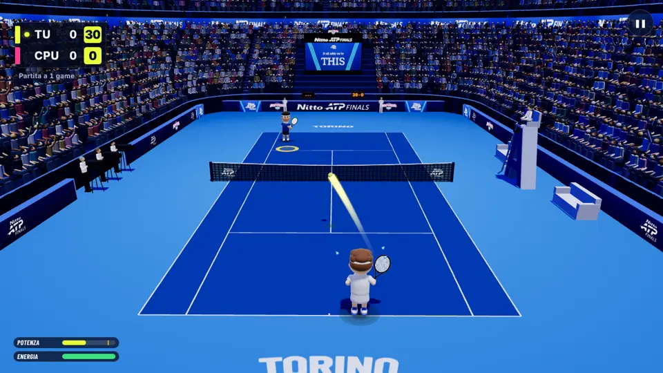
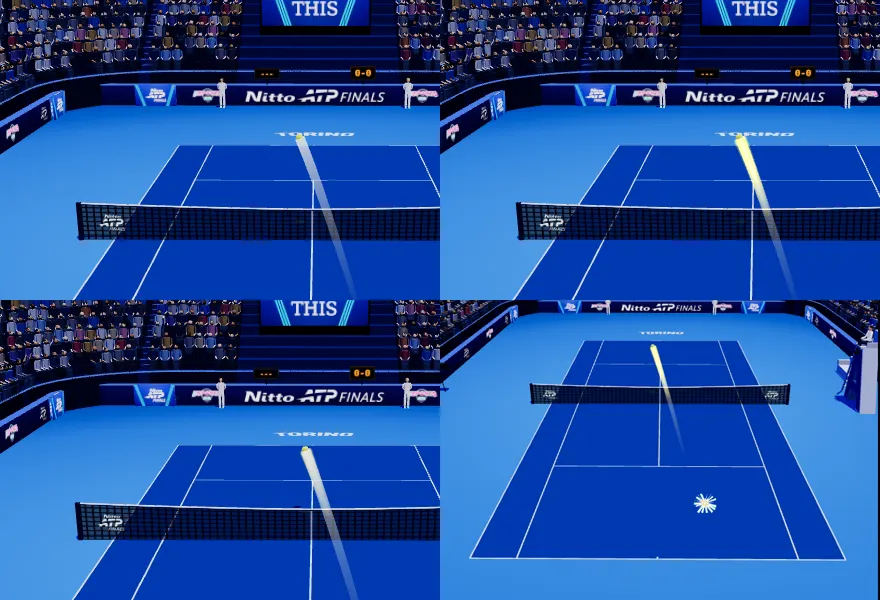
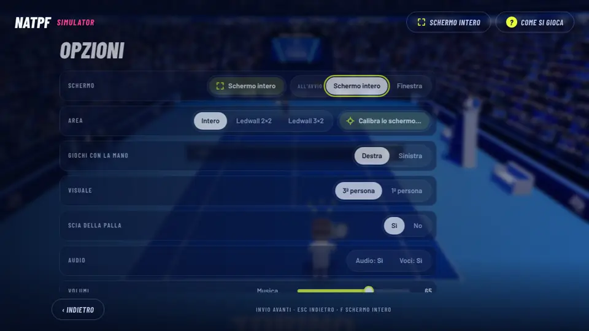
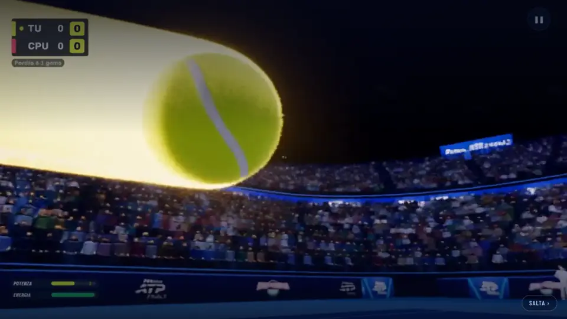
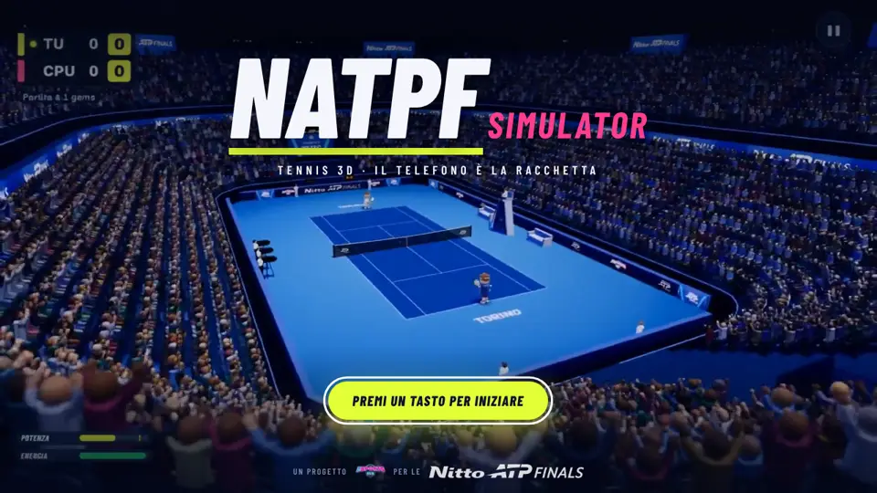
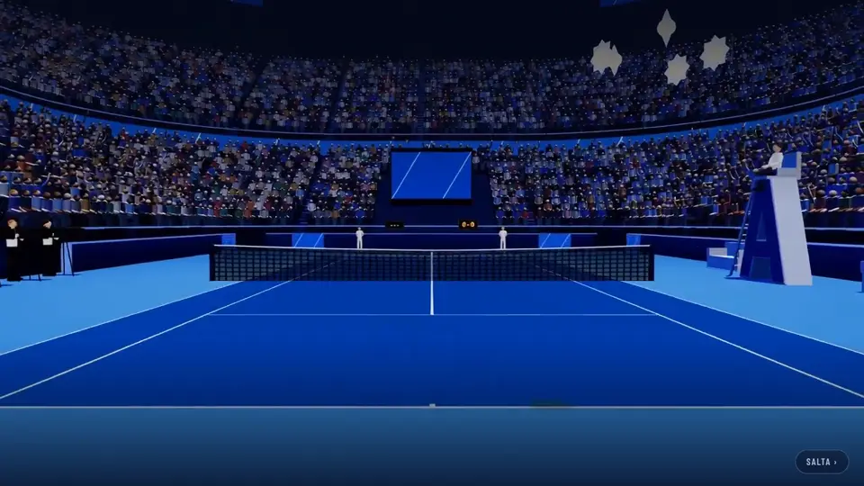
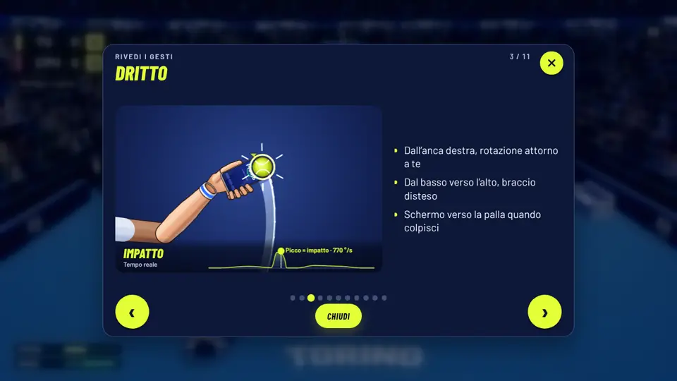
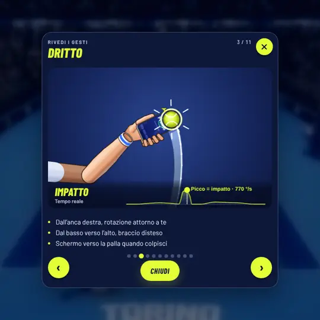
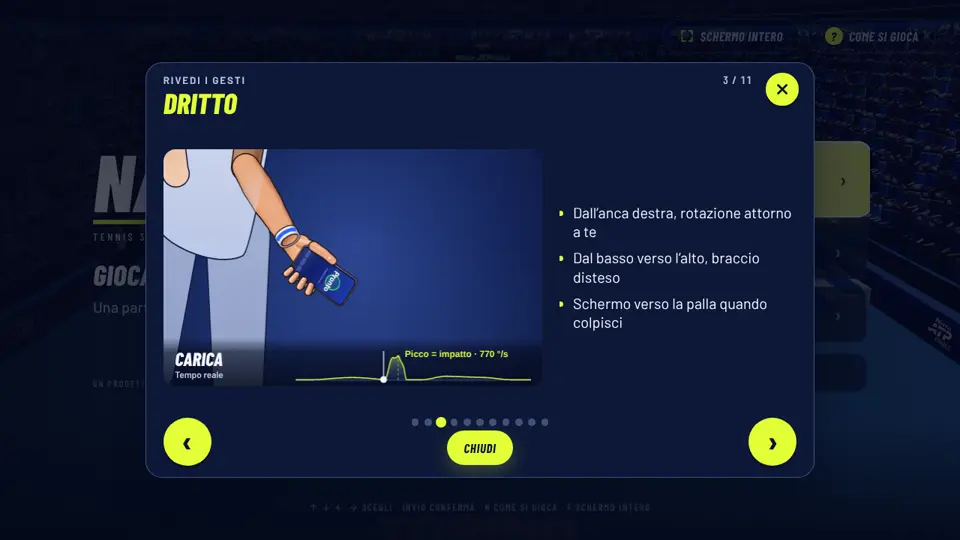

# B21 · Video nel gioco — B22 · Scia luminosa della palla

Richieste dell'utente dell'11/11/2026. Lavoro fatto sul commit `4dc6ae7` (versione 2026-11-11.1), **senza cambiare la
versione**: i pacchetti con il numero nuovo li fa chi integra il ramo.

## In breve

| Cosa | Com'è adesso | Si spegne? |
|---|---|---|
| **Intro** | Parte il **trailer** (10 s). Se non arriva o non parte, parte il video di prima, come prima. | `?trailer=0` nell'indirizzo |
| **Tutorial «Come si gioca»** | Dietro la scheda dei gesti scorrono due clip di gioco **sfocate**. I gesti restano l'animazione 3D e le foto. | Da solo con «riduci movimento» del sistema; nello stesso schermo non c'è |
| **Scia della palla** | La palla in gioco lascia una **scia gialla luminosa**, più lunga e più forte quanto più è veloce. | **Opzioni → «Scia della palla» → No** |

---

## B22 · Scia luminosa della palla

### Cosa cambia

Dietro la palla in gioco c'è un nastro giallo luminoso, come nel trailer ma un po' meno forte (opacità massima 0,8
al centro, bordi sfumati; nel trailer è piena e più larga).

- Vale per **ogni colpo in gioco**: di chi gioca, del Player 2 e della CPU, servizio compreso.
- **Lunghezza e intensità seguono la velocità**: lunghezza = velocità × 0,22 s (al più 6 m); sotto 7 m/s niente scia
  (lancio del servizio, pallonetti lenti, palla che rotola), da 24 m/s in su intensità piena.
- **La palla non è coperta**: nei primi 28 cm dietro la palla la scia parte da zero. **Le righe si vedono sotto**: la
  scia non è mai piena.
- **Colpo potente, colpo super, scambio caldo si riconoscono ancora**: hanno la loro scia di prima, bianca e azzurra,
  più lunga, con le scintille; in quei colpi la scia gialla sta *sotto* e fa solo da alone.
- Al colpo la scia **riparte dalla racchetta** (non resta un pezzo di scia davanti alla palla); al rimbalzo continua.
- La scia sottile bianca di prima c'è sempre, uguale.

Sopra a sinistra com'era (e com'è con l'opzione su «No»), a destra con la scia; sotto a sinistra un colpo potente, a
destra lo stesso schermo (le due viste):

### Come si attiva / come si spegne

1. Dal menu principale: **Opzioni**.
2. Riga **«Scia della palla»**: **Sì** · **No**.
3. Vale subito e **resta salvata** su quel computer. (La riga è nelle Opzioni del menu; nel foglio della pausa non
   c'è.)

- Di base è **Sì**.
- È salvata nel browser con la chiave `natpf-tennis.sciaPalla` (`0` = spenta, `1` = accesa; niente = accesa).
- Su **No** il gioco è **esattamente com'era**: il nastro non è nella scena.

### Verifiche

- **Su «No» il disegno è identico a prima, pixel per pixel.** Sei scene ferme e ripetibili (palla che va, che torna,
  colpo potente, pallonetto lento, rimbalzo, due viste dello stesso schermo) disegnate sul commit `4dc6ae7` e sul ramo:
  stessa impronta di tutti i pixel del campo. Prova: `tools/e2e/natpf-scia-palla.mjs` con `BASELINE=` (sul commit di
  prima) e `CONFRONTA=` (sul ramo). Nelle scene i personaggi sono nascosti (respirano e sbattono gli occhi: non sono
  ripetibili).
- **Il gioco non cambia** con nessuno dei due valori:
  - la scia non legge e non scrive niente della fisica e non usa numeri casuali; anche crearla non ne consuma (three.js
    ne userebbe per i nomi interni degli oggetti: lì si usa un generatore a parte);
  - impronte dei punti con gli stessi semi, prima e dopo: `scripts/audit/b20/impronta-cpu.mjs --punti=120` (12 righe,
    contro la CPU) e `scripts/audit/b20/scambio-caldo.mjs --partite=1 --coppie=medio,amatore` (stesso schermo, opzione
    spenta e accesa): **uscite identiche**;
  - test `natpf-scia-palla.test.mjs`: una partita simulata di 30 punti con la scia accesa, spenta e assente dà gli
    stessi punti, scambi e colpi.
- **Partita vera contro la CPU nel browser**: la scia si vede sui colpi di tutti e due (fotogrammi con la scia dopo i
  colpi di chi gioca 177 su 177, della CPU 344 su 345; con la palla oltre 14 m/s 405 su 409; i pochi che mancano sono
  i primi istanti dopo un colpo o all'inizio dello scambio, quando la scia riparte da zero).
- **Opzione**: clic su «No» → spenta subito e salvata; pagina ricaricata → resta «No»; clic su «Sì» → accesa.

### Prestazioni

Misure nel contenitore di prova, **senza scheda grafica** (il gioco 3D lì va a 1–2 fotogrammi al secondo: è il caso
peggiore per il disegno, non somiglia a un PC vero).

| Misura | Senza scia | Con la scia |
|---|---|---|
| Tempo per disegnare lo stesso fotogramma (mediana di 24), prima esecuzione | 934,4 ms | 940,3 ms (+0,6%) |
| … seconda esecuzione | 895,1 ms | 879,9 ms (−1,7%) |
| Fotogrammi al secondo, stessa scena (2 misure da 6 s per lato), prima esecuzione | 1,27 e 1,07 | 1,24 e 1,21 |
| … seconda esecuzione | 1,30 e 1,27 | 1,29 e 1,32 |
| Calcolo della scia per fotogramma | — | circa 2 milionesimi di secondo (1,8 e 2,2) |

Le differenze sono dentro l'oscillazione della misura (una volta più lenta, una volta più veloce): nessun calo
misurabile. Niente allocazioni per fotogramma (storia
in un anello di numeri, vertici riscritti sul posto; lo controlla un test). Un solo oggetto in più da disegnare, senza
texture. Funziona nelle due viste dello stesso schermo (si orienta verso ogni camera da sola) e sul computer del
Player 2 nella sfida tra due computer (usa la palla disegnata lì, nessuna fisica in più).

### File

- `natpf-tennis/src/natpf/natpf_ball_glow.js`: la scia e l'opzione (in testa al file le misure che si possono ritoccare:
  `BALL_GLOW`).
- `natpf-tennis/src/game_engine.js`: la scia riceve gli stessi punti della scia di prima e un fotogramma da
  `_updateEffects`.
- `natpf-tennis/index.html`, `src/natpf/natpf_lobby.js`: la riga nelle Opzioni.
- Test: `natpf-tennis/test/natpf-scia-palla.test.mjs`, `natpf-scia-opzione.test.mjs`; nel browser
  `tools/e2e/natpf-scia-palla.mjs`.

---

## B21 · Video nel gioco

### 1. Il trailer come video d'avvio

All'avvio parte il trailer (10 s, quello approvato, senza titolo aggiunto). Il titolo «NATPF Simulator» entra
sull'ultima inquadratura (a 8,5 s), poi «Premi un tasto per iniziare» (a 10,6 s).

Non cambia niente del resto dell'intro: un tasto, un clic o un tocco porta subito al titolo; «Salta ›»; la seconda volta
nella stessa sessione si vede solo il titolo (sull'ultima inquadratura del video visto prima); `?intro=0` la salta;
«Rivedi l'intro» nelle Opzioni la rifà.

#### Dove sta il trailer

Il trailer pesa 2.258.622 byte: **nello zip Cloudflare non entra** (vedi il peso più sotto).

| Versione | Da dove arriva il trailer |
|---|---|
| **Programma Windows** | È **dentro il programma**: nessuna rete. |
| **Web (Cloudflare)** | Si scarica dal bucket pubblico R2, lo stesso degli aggiornamenti: `https://pub-96b3cd8975b6434aaeac3ecfcca14a19.r2.dev/media/trailer-aad6b9311db4.mp4` |

Il gioco capisce da solo dov'è: nel programma Windows c'è `window.natpfDesktop`.

Il file nel repository è `natpf-desktop/media/trailer-aad6b9311db4.mp4`. Il nome porta i primi 12 caratteri della sua
impronta (sha256): un trailer nuovo ha un nome nuovo, quindi nessuno riceve mai byte vecchi dalla cache.

#### Come funziona il ripiego

1. Il gioco prova il trailer.
2. Parte il **video di prima** (`intro.mp4`, l'arena che si accende), esattamente come prima, se:
   - il trailer dà errore (404, rete assente, file rovinato): **subito**;
   - il browser rifiuta di farlo partire: subito;
   - non è partito dopo **2,5 s** (1,5 s nel programma Windows). Il tempo si conta a passi di un quarto di secondo:
     quando il gioco che si avvia tiene occupata la pagina il tempo non scorre (senza questo il trailer veniva scartato
     per colpa dell'avvio, misurato).
3. Se nemmeno il video di prima parte resta l'**immagine finale** con il titolo, come prima.
4. Se il trailer si ferma a metà per più di 2 s (rete caduta): immagine finale e titolo.

Mentre il trailer si carica il video di prima è già pronto sotto: il ripiego non ha attese sue.

Per **non** avere il trailer: aggiungere `?trailer=0` all'indirizzo del gioco.

#### Cosa serve su R2

- Il file `media/trailer-aad6b9311db4.mp4` sul bucket, con tipo `video/mp4`.
- **Lo carica il workflow** `.github/workflows/natpf-windows.yml` («NATPF eseguibili Windows»), con i segreti R2 che ci
  sono già: parte da solo quando il ramo arriva su `natpf-simulator` (cambia `natpf-desktop/**`), o a mano da GitHub →
  Actions.
  - Se il file c'è già con lo stesso peso non lo ricarica.
  - Lo carica anche quando l'installer di quella versione è già pubblicato.
  - **Se il caricamento fallisce l'installer si pubblica lo stesso**: resta un avviso giallo nell'esecuzione.
  - Alla fine un passo controlla l'indirizzo pubblico (solo avviso).
- **Se il video su R2 manca** (workflow non ancora girato, bucket spento, indirizzo cambiato): il gioco sul web usa il
  video di prima. Nessun errore, nessuna attesa in più (il 404 fa partire subito il ripiego).
- Ordine consigliato: prima il ramo su `natpf-simulator` (il workflow carica il trailer), poi lo zip su Cloudflare. Al
  contrario funziona lo stesso: finché il trailer non è sul bucket si vede il video di prima.
- Nota: gli indirizzi `r2.dev` hanno limiti di traffico messi da Cloudflare (sono pensati per prove). Con tanta gente
  insieme il trailer può non arrivare in tempo: il gioco ripiega. Un dominio proprio sul bucket toglierebbe il limite
  (in quel caso va cambiato `base` in `natpf-desktop/aggiornamenti.json` e in `TRAILER.base` di `natpf_intro.js`: un
  test controlla che siano uguali).
- Intestazioni: `site/_headers` non ha una Content-Security-Policy, quindi il video dal bucket è permesso. Lo script del
  pacchetto ora si ferma se un giorno ne comparisse una che non lo permette, e se un trailer finisse nel pacchetto.

### 2. Sfondo sfocato del tutorial «Come si gioca»

Dietro la scheda dei gesti scorrono due clip di gioco già sfocate (8 s l'una), una dopo l'altra, in ciclo, mute, con un
velo scuro sopra. La scheda ha il suo fondo pieno: testi e animazione 3D dei gesti sono quelli di prima.

- Le clip **non mostrano i gesti**: sono solo uno sfondo (regola del 28/10: i gesti li mostrano l'animazione 3D e le
  foto).
- Le due clip **si alternano**: finita una parte l'altra; alla riapertura si riparte dall'altra.
- **A tutorial chiuso i video sono fermi**: nessuna decodifica in partita (lo controlla la prova nel browser).
- **Ripiego**: se il video non parte (file mancante, riproduzione rifiutata) resta lo sfondo di prima (il velo scuro
  sul campo). Sotto: con le clip che danno 404.
- Con **«riduci movimento»** del sistema: niente video, le clip non si scaricano nemmeno.
- **Nello stesso schermo (due tutorial affiancati): niente video.** Misurato: con un video per metà le due animazioni
  dei gesti scendevano da 59,9 a **30,2** fotogrammi al secondo. Lì resta lo sfondo di prima. (Per riprovarci:
  `TUT_BG.half` in `natpf_tutorial_bg.js`.)
- Non c'è un'opzione nelle Opzioni per spegnerlo (non richiesta).

Fotogrammi al secondo con la modale aperta (`tools/e2e/natpf-modale-gesti.mjs`, senza scheda grafica):

| Caso | Prima | Dopo |
|---|---|---|
| Modale sopra il menu, 1280×720 | 59,9 | 59,9 · 59,9 · 59,9 · 60,1 (quattro esecuzioni) |
| Modale sopra il menu, 1920×1080 | 60,2 | 60,1 · 58,9 · 60,1 · 60,2 |
| Stesso schermo, due modali, **con** un video per metà | 59,9 | 30,2 → **scartato** |
| Stesso schermo, due modali, senza video (com'è ora) | 59,9 | 60,0 · 59,6 · 59,9 |
| Modale sopra il campo che gioca, 1280×720 | 2,2 (campo da solo 2,4) | 2,3–2,4 (campo da solo 2,4–2,6) |

### Dove stanno i file

| File | Peso | Dove | Nello zip Cloudflare |
|---|---|---|---|
| `trailer-aad6b9311db4.mp4` | 2.258.622 byte | `natpf-desktop/media/` | **no** |
| `trailer-fine.webp` (ultima inquadratura) | 95.634 byte | `natpf-tennis/public/media/` | sì |
| `tutorial-sfondo-1.mp4` | 227.356 byte | `natpf-tennis/public/media/` | sì |
| `tutorial-sfondo-2.mp4` | 333.566 byte | `natpf-tennis/public/media/` | sì |
| `intro.mp4`, `intro-fine.webp` (ripiego) | come prima | `natpf-tennis/public/media/` | sì |

Tutti i video sono 1280×720, 24 fotogrammi al secondo, senza audio, fatti con fotogrammi veri del gioco. Provenienza in
`natpf-tennis/public/media/LEGGIMI.txt`.

Codice:

- Intro: `natpf-tennis/src/natpf/natpf_intro.js` (in testa al file come funziona; `TRAILER` ha nome, impronta, tempi),
  ritardi delle animazioni in `natpf-ui.css` (`--intro-shift`).
- Sfondo del tutorial: `natpf-tennis/src/natpf/natpf_tutorial_bg.js`, acceso e spento da `natpf_tutorial.js`.
- Programma Windows: `natpf-desktop/scripts/prepara.mjs` copia il trailer in `app/natpf-tennis/dist/media/` e si ferma se
  il nome non corrisponde al contenuto o se il gioco non conosce quel nome.
- Pacchetto Cloudflare: `natpf-tennis/scripts/pacchetto-cloudflare.mjs` (i due controlli nuovi).
- Workflow: `.github/workflows/natpf-windows.yml` (funzione `carica_trailer` e passo «Trailer dell'intro dall'indirizzo
  pubblico»).

Per **cambiare il trailer**: mettere il file nuovo in `natpf-desktop/media/` con il nome
`trailer-<primi 12 caratteri dello sha256>.mp4`, togliere il vecchio, aggiornare `file`, `sha256` e `bytes` di
`TRAILER` in `natpf_intro.js` (e `shiftMs` se l'ultima inquadratura comincia in un altro momento), rifare
`trailer-fine.webp` dall'ultimo fotogramma. I test dicono se qualcosa non torna.

### Peso dello zip Cloudflare

Zip di prova fatto con `natpf-tennis/scripts/pacchetto-cloudflare.mjs` (Node 22.22.0, versione 2026-11-11.1):

| | Byte |
|---|---|
| Limite | 25.000.000 |
| Prima (`4dc6ae7`) | margine 2.366.189 |
| **Ora** | **23.292.525** (131 file) |
| **Margine** | **1.707.475** (1,71 MB) |

Sono 658.714 byte in più: le due clip sfocate, l'ultima inquadratura del trailer, il codice. Il trailer non è nello zip
(controllato).

---

## Test

| Cosa | Risultato |
|---|---|
| `npm test` in `natpf-tennis` | 1.154 test: 1.153 superati, 0 falliti, 1 saltato (l'avvio LAN, che vuole `npm ci` in `tools/lan`: rifatto dopo, `natpf-lan.test.mjs` 12 su 12) |
| `npm run build` | riuscita |
| `node --test tools/test/*.test.mjs` | 205 su 205 |
| `natpf-desktop`: `npm test` | 29 su 29 |
| `tools/lan`: `node --test test/*.test.mjs` | 12 su 12 |
| `natpf-desktop/scripts/prepara.mjs` | il trailer finisce in `app/natpf-tennis/dist/media/`; il gestore del gioco del programma lo serve (200 e 206, `video/mp4`) |
| Blocco `carica_trailer` del workflow con un `aws` finto | primo caricamento, secondo giro senza ricaricare, caricamento fallito, file tronco, nome sbagliato, nessun file: in tutti i casi il passo continua |

Test di unità nuovi: `natpf-intro-trailer.test.mjs` (sorgente del video e ripiego, con una pagina finta),
`natpf-tutorial-sfondo.test.mjs`, `natpf-scia-palla.test.mjs`, `natpf-scia-opzione.test.mjs`; aggiunte a
`turn-worker.test.mjs` (pacchetto) e a `natpf-desktop/test/desktop-core.test.mjs`.

Prove nel browser (`CHROMIUM_PATH=/opt/pw-browsers/chromium node tools/e2e/<nome>.mjs`):

| Prova | Verifiche superate |
|---|---|
| `natpf-intro-trailer` (nuova) | 52 su 52 |
| `natpf-scia-palla` (nuova, con `CONFRONTA=` sulle impronte di `4dc6ae7`) | 45 su 45 |
| `natpf-modale-gesti` (con le verifiche dello sfondo) | 29 su 29 |
| `natpf-tutorial-phone` | 52 su 52 |
| `natpf-training-flow` | 22 su 22 |
| `natpf-menu` | 28 su 28 |
| `natpf-rally` | 9 su 9 |
| `natpf-split-ready` | 34 su 34 |
| `natpf-schermo` (in più: usa l'intro vera) | 41 su 41 |

`natpf-intro-trailer` prova: trailer che parte e titolo sull'ultima inquadratura; trailer 404, rete bloccata, bucket che
non risponde (in tutti e tre parte il video di prima, titolo a 5,8–5,9 s del video e «Premi un tasto» a 7,8 s, come
prima); un tasto durante il trailer; «Rivedi l'intro» e «Salta ›»; `?intro=0`; `?trailer=0`; programma Windows (file
locale, e file mancante); riproduzione rifiutata (immagine finale).

Schermate guardate: intro con il trailer (a 3 s, sul titolo, a «Premi un tasto», intro breve), ripiego, tutorial con lo
sfondo a 1280×720 e a 720×720, tutorial senza video, partita con la scia, le sei scene ferme con e senza scia, le
Opzioni.

## Cosa NON è provato

- **Windows vero**: l'installer non è stato costruito né avviato. È provato che `prepara.mjs` mette il trailer nella
  cartella del programma e che il server del programma lo serve; nel browser di prova, con `window.natpfDesktop` finto,
  il gioco prende il file locale.
- **R2 vero**: il trailer **non è ancora sul bucket**. Il caricamento parte solo con il workflow su GitHub; qui è stato
  provato con un `aws` finto e nel browser intercettando l'indirizzo del bucket (file vero, 404, rete bloccata, risposta
  che non arriva).
- **Scheda grafica vera**: tutte le misure dei fotogrammi al secondo sono senza GPU. In particolare il calo nello stesso
  schermo con due video (30 fotogrammi al secondo) potrebbe non esserci su un PC vero: la scelta di non metterli lì è
  prudente.
- **Telefoni** (Android, iPhone): la pagina del telefono non è stata toccata; il gioco aperto dal browser di un telefono
  non è stato provato (riproduzione automatica dei video muti, peso del trailer in rete mobile).
- **Ledwall**: non provato. Lo sfondo del tutorial usa solo misure dell'area di gioco; l'intro è a tutto schermo come
  prima.
- **Safari e Firefox**: provato solo Chromium.
- **Gusto**: quanto è luminosa la scia e quanto è scuro il velo del tutorial li ho scelti guardando le schermate; si
  ritoccano in `BALL_GLOW` (`natpf_ball_glow.js`) e in `.tut-bg-veil` (`natpf-ui.css`).
