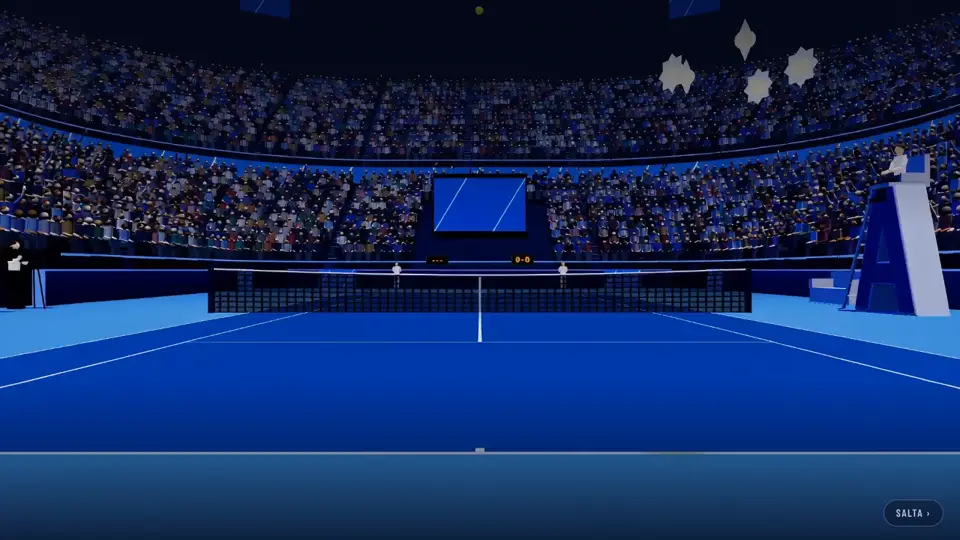
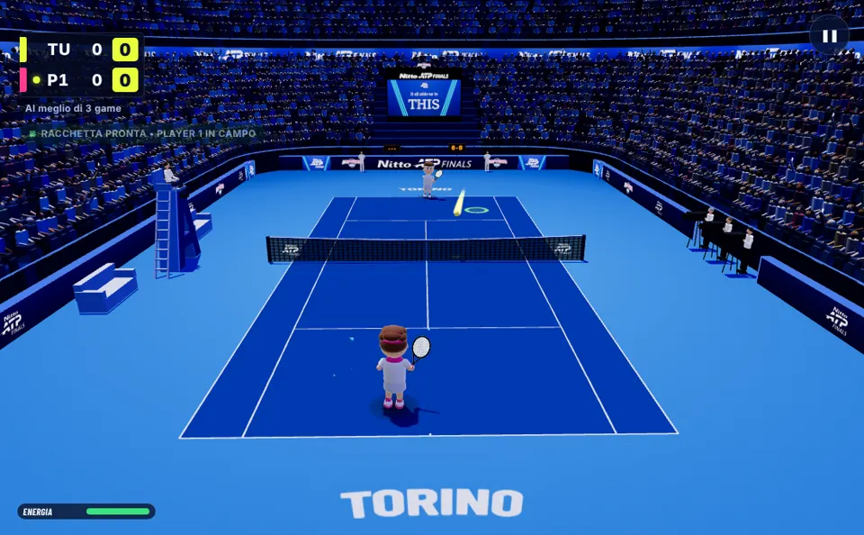

# B21 · Video nel gioco — B22 · Scia luminosa della palla

Richieste dell'utente dell'11/11/2026. Lavoro fatto sul commit `4dc6ae7` (versione 2026-11-11.1), **senza cambiare la
versione**: i pacchetti con il numero nuovo li fa chi integra il ramo.

## In breve

| Cosa | Com'è adesso | Si spegne? |
|---|---|---|
| **Intro** | Parte il **trailer** (10 s). Se non arriva, non parte o la rete è troppo lenta per vederlo senza scatti, parte il video di prima, come prima. | `?trailer=0` nell'indirizzo |
| **Tutorial «Come si gioca»** | Dietro la scheda dei gesti scorrono due clip di gioco **sfocate**. I gesti restano l'animazione 3D e le foto. | Da solo con «riduci movimento» del sistema; nello stesso schermo non c'è |
| **Scia della palla** | La palla in gioco lascia una **scia gialla luminosa**, più lunga e più forte quanto più è veloce. | **Opzioni → «Scia della palla» → No** |

---

## B22 · Scia luminosa della palla

### Cosa cambia

> **Aggiornato dal B26** (collaudo dell'utente dell'11/11: la scia era «gialla ma poco diversa» da quella bianca): ora
> è più larga, più lunga, gialla piena con l'alone, e piena già alle velocità normali di scambio. I numeri di questo
> paragrafo sono quelli di prima; quelli di adesso sono in fondo, in «Dopo il collaudo dell'utente dell'11/11».

Dietro la palla in gioco c'è un nastro giallo luminoso, come nel trailer ma un po' meno forte (opacità massima 0,8
al centro, bordi sfumati; nel trailer è piena e più larga).

- Vale per **ogni colpo in gioco**: di chi gioca, del Player 2 e della CPU, servizio compreso.
- **Lunghezza e intensità seguono la velocità**: lunghezza = velocità × 0,22 s (al più 6 m); sotto 7 m/s niente scia
  (lancio del servizio, pallonetti lenti, palla che rotola), da 24 m/s in su intensità piena.
- **La palla non è coperta**: nei primi 28 cm dietro la palla la scia parte da zero. **Le righe si vedono sotto**: la
  scia non è mai piena.
- **Colpo potente, colpo super, scambio caldo si riconoscono ancora**: hanno la loro scia di prima, bianca e azzurra,
  più lunga, con le scintille; in quei colpi la scia gialla sta *sotto* e fa solo da alone.
- Al colpo la scia **riparte dalla racchetta** (non resta un pezzo di scia davanti alla palla); al rimbalzo continua.
- La scia sottile bianca di prima c'è sempre, uguale.

Sopra a sinistra com'era (e com'è con l'opzione su «No»), a destra con la scia; sotto a sinistra un colpo potente, a
destra lo stesso schermo (le due viste):

### Come si attiva / come si spegne

1. Dal menu principale: **Opzioni**.
2. Riga **«Scia della palla»**: **Sì** · **No**.
3. Vale subito e **resta salvata** su quel computer. (La riga è nelle Opzioni del menu; nel foglio della pausa non
   c'è.)

- Di base è **Sì**.
- È salvata nel browser con la chiave `natpf-tennis.sciaPalla` (`0` = spenta, `1` = accesa; niente = accesa).
- Su **No** il gioco è **esattamente com'era**: il nastro non è nella scena.

### Verifiche

- **Su «No» il disegno è identico a prima, pixel per pixel.** Sei scene ferme e ripetibili (palla che va, che torna,
  colpo potente, pallonetto lento, rimbalzo, due viste dello stesso schermo) disegnate sul commit `4dc6ae7` e sul ramo:
  stessa impronta di tutti i pixel del campo. Prova: `tools/e2e/natpf-scia-palla.mjs` con `BASELINE=` (sul commit di
  prima) e `CONFRONTA=` (sul ramo). Nelle scene i personaggi sono nascosti (respirano e sbattono gli occhi: non sono
  ripetibili).
- **Il gioco non cambia** con nessuno dei due valori:
  - la scia non legge e non scrive niente della fisica e non usa numeri casuali; anche crearla non ne consuma (three.js
    ne userebbe per i nomi interni degli oggetti: lì si usa un generatore a parte);
  - impronte dei punti con gli stessi semi, prima e dopo: `scripts/audit/b20/impronta-cpu.mjs --punti=120` (12 righe,
    contro la CPU) e `scripts/audit/b20/scambio-caldo.mjs --partite=1 --coppie=medio,amatore` (stesso schermo, opzione
    spenta e accesa): **uscite identiche**;
  - test `natpf-scia-palla.test.mjs`: una partita simulata di 30 punti con la scia accesa, spenta e assente dà gli
    stessi punti, scambi e colpi.
- **Partita vera contro la CPU nel browser**: la scia si vede sui colpi di tutti e due (fotogrammi con la scia dopo i
  colpi di chi gioca 177 su 177, della CPU 344 su 345; con la palla oltre 14 m/s 405 su 409; i pochi che mancano sono
  i primi istanti dopo un colpo o all'inizio dello scambio, quando la scia riparte da zero).
- **Opzione**: clic su «No» → spenta subito e salvata; pagina ricaricata → resta «No»; clic su «Sì» → accesa.

### Prestazioni

Misure nel contenitore di prova, **senza scheda grafica** (il gioco 3D lì va a 1–2 fotogrammi al secondo: è il caso
peggiore per il disegno, non somiglia a un PC vero).

| Misura | Senza scia | Con la scia |
|---|---|---|
| Tempo per disegnare lo stesso fotogramma (mediana di 24), prima esecuzione | 934,4 ms | 940,3 ms (+0,6%) |
| … seconda esecuzione | 895,1 ms | 879,9 ms (−1,7%) |
| Fotogrammi al secondo, stessa scena (2 misure da 6 s per lato), prima esecuzione | 1,27 e 1,07 | 1,24 e 1,21 |
| … seconda esecuzione | 1,30 e 1,27 | 1,29 e 1,32 |
| Calcolo della scia per fotogramma | — | circa 2 milionesimi di secondo (1,8 e 2,2) |

Le differenze sono dentro l'oscillazione della misura (una volta più lenta, una volta più veloce): nessun calo
misurabile. Niente allocazioni per fotogramma (storia
in un anello di numeri, vertici riscritti sul posto; lo controlla un test). Un solo oggetto in più da disegnare, senza
texture. Funziona nelle due viste dello stesso schermo (si orienta verso ogni camera da sola) e sul computer del
Player 2 nella sfida tra due computer (usa la palla disegnata lì, nessuna fisica in più).

### File

- `natpf-tennis/src/natpf/natpf_ball_glow.js`: la scia e l'opzione (in testa al file le misure che si possono ritoccare:
  `BALL_GLOW`).
- `natpf-tennis/src/game_engine.js`: la scia riceve gli stessi punti della scia di prima e un fotogramma da
  `_updateEffects`.
- `natpf-tennis/index.html`, `src/natpf/natpf_lobby.js`: la riga nelle Opzioni.
- Test: `natpf-tennis/test/natpf-scia-palla.test.mjs`, `natpf-scia-opzione.test.mjs`; nel browser
  `tools/e2e/natpf-scia-palla.mjs`.

---

## B21 · Video nel gioco

### 1. Il trailer come video d'avvio

All'avvio parte il trailer (10 s, quello approvato, senza titolo aggiunto). Il titolo «NATPF Simulator» entra
sull'ultima inquadratura (a 8,5 s), poi «Premi un tasto per iniziare» (a 10,6 s).

Non cambia niente del resto dell'intro: un tasto, un clic o un tocco porta subito al titolo; «Salta ›»; la seconda volta
nella stessa sessione si vede solo il titolo (sull'ultima inquadratura del video visto prima); `?intro=0` la salta;
«Rivedi l'intro» nelle Opzioni la rifà.

#### Dove sta il trailer

Il trailer pesa 2.258.622 byte: **nello zip Cloudflare non entra** (vedi il peso più sotto).

| Versione | Da dove arriva il trailer |
|---|---|
| **Programma Windows** | È **dentro il programma**: nessuna rete. |
| **Web (Cloudflare)** | Si scarica dal bucket pubblico R2, lo stesso degli aggiornamenti: `https://pub-96b3cd8975b6434aaeac3ecfcca14a19.r2.dev/media/trailer-aad6b9311db4.mp4` |
| **Un altro computer che apre il gioco dal programma Windows** (indirizzo di rete del programma, con `?lan=1`) | Prima il file che il programma stesso serve (nessuna rete esterna); se non c'è, il bucket R2. |

Il gioco capisce da solo dov'è: nel programma Windows c'è `window.natpfDesktop`; il programma apre il gioco con `?lan=1`,
e chi lo apre da un altro computer ha `?lan=1` senza `window.natpfDesktop`.

Il file nel repository è `natpf-desktop/media/trailer-aad6b9311db4.mp4`. Il nome porta i primi 12 caratteri della sua
impronta (sha256): un trailer nuovo ha un nome nuovo, quindi nessuno riceve mai byte vecchi dalla cache.

#### Come funziona il ripiego

> **Aggiornato dal B26** (collaudo dell'utente dell'11/11: nel programma Windows è partito il video di prima). Quello
> che segue vale **sul web**. **Nel programma Windows** il file è locale: il trailer parte appena può partire, senza
> la regola dei «6 secondi scaricati», e ha 8 s (non più 1,5) per farlo; il video di prima resta solo per un errore
> vero del file. Dettagli in fondo, in «Dopo il collaudo dell'utente dell'11/11».

1. Il gioco prova il trailer. L'intro parte con il trailer **solo se è sicuro che arrivi in fondo senza fermarsi**
   (corretto dopo la revisione, vedi «Revisione» in fondo). Vuol dire tutte e due le cose:
   - il browser stima di poterlo mostrare tutto di fila;
   - il filmato è già scaricato tutto, oppure ne sono già arrivati almeno **6 secondi su 10**.

   Finché non è così il trailer resta fermo all'inizio e **non si vede**: sullo schermo c'è il primo fotogramma del
   video di prima, come quando il gioco si sta avviando.
2. Parte il **video di prima** (`intro.mp4`, l'arena che si accende), esattamente come prima, se:
   - il trailer dà errore (404, rete assente, file rovinato): **subito**;
   - il browser rifiuta di farlo partire: subito;
   - dopo **2,5 s** (nel programma Windows 8 s, dal B26; prima 1,5 s) non è ancora sicuro che arrivi in fondo: **rete
     lenta**, o risposta che non arriva. Il tempo si conta a passi di un quarto di secondo: quando il gioco che si
     avvia tiene occupata la pagina il tempo non scorre (senza questo il trailer veniva scartato per colpa dell'avvio,
     misurato). Dal B26 un passo arrivato in ritardo non conta affatto (prima contava come un passo).
3. Se nemmeno il video di prima parte resta l'**immagine finale** con il titolo, come prima.
4. Se il trailer si ferma a metà per più di 2 s (rete caduta) o dà errore a metà (file tronco): immagine finale, titolo
   e **subito** «Premi un tasto».

**Con che rete si vede il trailer.** Il trailer chiede in media 226 kB al secondo (1,8 Mbit/s), di più verso la fine.
Misurato con Chromium, mandando il trailer a velocità fissa all'indirizzo del bucket:

| Velocità del trailer | Cosa si vede | Fermate del trailer |
|---|---|---|
| 40, 100, 180, 200, 260, 300, 350 kB/s | il **video di prima**, dopo i 2,5 s di attesa | — (non parte) |
| 400 kB/s (3,2 Mbit/s) | il trailer, dopo circa 2 s di attesa in più | 0 |
| 600 kB/s | il trailer, dopo circa 1 s di attesa in più | 0 |
| 1 MB/s, 4 MB/s | il trailer, subito | 0 |

In pratica: da circa **3–4 Mbit/s in su** si vede il trailer; sotto, il video di prima. Con una rete lenta l'intro
comincia 2,5 s più tardi (il tempo dell'attesa), poi è identica a prima.

Mentre il trailer si carica il video di prima è già pronto sotto: il ripiego non ha attese sue.

Per **non** avere il trailer: aggiungere `?trailer=0` all'indirizzo del gioco.

#### Cosa serve su R2

- Il file `media/trailer-aad6b9311db4.mp4` sul bucket, con tipo `video/mp4`.
- **Lo carica il workflow** `.github/workflows/natpf-windows.yml` («NATPF eseguibili Windows»), con i segreti R2 che ci
  sono già: parte da solo quando il ramo arriva su `natpf-simulator` (cambia `natpf-desktop/**`), o a mano da GitHub →
  Actions.
  - Se il file c'è già con lo stesso peso non lo ricarica.
  - Lo carica anche quando l'installer di quella versione è già pubblicato.
  - **Se il caricamento fallisce l'installer si pubblica lo stesso**: resta un avviso giallo nell'esecuzione.
  - Alla fine un passo controlla l'indirizzo pubblico (solo avviso). Controlla l'indirizzo **che usa il gioco**
    (`TRAILER.base` in `natpf_intro.js`); se la variabile `NATPF_AGGIORNAMENTI_URL` o `aggiornamenti.json` ne indicano
    un altro lo dice con un avviso in più.
- **Se il video su R2 manca** (workflow non ancora girato, bucket spento, indirizzo cambiato): il gioco sul web usa il
  video di prima. Nessun errore, nessuna attesa in più (il 404 fa partire subito il ripiego).
- **Se il video su R2 arriva piano** (rete lenta di chi gioca, bucket rallentato): 2,5 s di attesa sul primo fotogramma,
  poi il video di prima. Il trailer non si vede mai a scatti.
- Ordine consigliato: prima il ramo su `natpf-simulator` (il workflow carica il trailer), poi lo zip su Cloudflare. Al
  contrario funziona lo stesso: finché il trailer non è sul bucket si vede il video di prima.
- Nota: gli indirizzi `r2.dev` hanno limiti di traffico messi da Cloudflare (sono pensati per prove). Con tanta gente
  insieme il trailer può non arrivare in tempo: il gioco ripiega. Un dominio proprio sul bucket toglierebbe il limite
  (in quel caso va cambiato `base` in `natpf-desktop/aggiornamenti.json` e in `TRAILER.base` di `natpf_intro.js`: un
  test controlla che siano uguali).
- Intestazioni: `site/_headers` non ha una Content-Security-Policy, quindi il video dal bucket è permesso. Lo script del
  pacchetto ora si ferma se un giorno ne comparisse una che non lo permette, e se un trailer finisse nel pacchetto.

### 2. Sfondo sfocato del tutorial «Come si gioca»

Dietro la scheda dei gesti scorrono due clip di gioco già sfocate (8 s l'una), una dopo l'altra, in ciclo, mute, con un
velo scuro sopra. La scheda ha il suo fondo pieno: testi e animazione 3D dei gesti sono quelli di prima.

- Le clip **non mostrano i gesti**: sono solo uno sfondo (regola del 28/10: i gesti li mostrano l'animazione 3D e le
  foto).
- Le due clip **si alternano**: finita una parte l'altra; alla riapertura si riparte dall'altra.
- **A tutorial chiuso i video sono fermi**: nessuna decodifica in partita (lo controlla la prova nel browser).
- **Ripiego**: se il video non parte (file mancante, riproduzione rifiutata) resta lo sfondo di prima (il velo scuro
  sul campo). Sotto: con le clip che danno 404.
- Con **«riduci movimento»** del sistema: niente video, le clip non si scaricano nemmeno.
- **Nello stesso schermo (due tutorial affiancati): niente video.** Misurato: con un video per metà le due animazioni
  dei gesti scendevano da 59,9 a **30,2** fotogrammi al secondo. Lì resta lo sfondo di prima. (Per riprovarci:
  `TUT_BG.half` in `natpf_tutorial_bg.js`.)
- Non c'è un'opzione nelle Opzioni per spegnerlo (non richiesta).

Fotogrammi al secondo con la modale aperta (`tools/e2e/natpf-modale-gesti.mjs`, senza scheda grafica):

| Caso | Prima | Dopo |
|---|---|---|
| Modale sopra il menu, 1280×720 | 59,9 | 59,9 · 59,9 · 59,9 · 60,1 (quattro esecuzioni) |
| Modale sopra il menu, 1920×1080 | 60,2 | 60,1 · 58,9 · 60,1 · 60,2 |
| Stesso schermo, due modali, **con** un video per metà | 59,9 | 30,2 → **scartato** |
| Stesso schermo, due modali, senza video (com'è ora) | 59,9 | 60,0 · 59,6 · 59,9 |
| Modale sopra il campo che gioca, 1280×720 | 2,2 (campo da solo 2,4) | 2,3–2,4 (campo da solo 2,4–2,6) |

### Dove stanno i file

| File | Peso | Dove | Nello zip Cloudflare |
|---|---|---|---|
| `trailer-aad6b9311db4.mp4` | 2.258.622 byte | `natpf-desktop/media/` | **no** |
| `trailer-fine.webp` (ultima inquadratura) | 95.634 byte | `natpf-tennis/public/media/` | sì |
| `tutorial-sfondo-1.mp4` | 227.356 byte | `natpf-tennis/public/media/` | sì |
| `tutorial-sfondo-2.mp4` | 333.566 byte | `natpf-tennis/public/media/` | sì |
| `intro.mp4`, `intro-fine.webp` (ripiego) | come prima | `natpf-tennis/public/media/` | sì |

Tutti i video sono 1280×720, 24 fotogrammi al secondo, senza audio, fatti con fotogrammi veri del gioco. Provenienza in
`natpf-tennis/public/media/LEGGIMI.txt`.

Codice:

- Intro: `natpf-tennis/src/natpf/natpf_intro.js` (in testa al file come funziona; `TRAILER` ha nome, impronta, tempi),
  ritardi delle animazioni in `natpf-ui.css` (`--intro-shift`).
- Sfondo del tutorial: `natpf-tennis/src/natpf/natpf_tutorial_bg.js`, acceso e spento da `natpf_tutorial.js`.
- Programma Windows: `natpf-desktop/scripts/prepara.mjs` copia il trailer in `app/natpf-tennis/dist/media/` e si ferma se
  il nome non corrisponde al contenuto o se il gioco non conosce quel nome.
- Pacchetto Cloudflare: `natpf-tennis/scripts/pacchetto-cloudflare.mjs` (i due controlli nuovi).
- Workflow: `.github/workflows/natpf-windows.yml` (funzione `carica_trailer` e passo «Trailer dell'intro dall'indirizzo
  pubblico»).

Per **cambiare il trailer**: mettere il file nuovo in `natpf-desktop/media/` con il nome
`trailer-<primi 12 caratteri dello sha256>.mp4`, togliere il vecchio, aggiornare `file`, `sha256` e `bytes` di
`TRAILER` in `natpf_intro.js` (e `shiftMs` se l'ultima inquadratura comincia in un altro momento), rifare
`trailer-fine.webp` dall'ultimo fotogramma. I test dicono se qualcosa non torna.

### Peso dello zip Cloudflare

Zip di prova fatto con `natpf-tennis/scripts/pacchetto-cloudflare.mjs` (Node 22.22.0, versione 2026-11-11.1):

| | Byte |
|---|---|
| Limite | 25.000.000 |
| Prima (`4dc6ae7`) | margine 2.366.189 |
| **Ora** (dopo la revisione) | **23.292.887** (131 file) |
| **Margine** | **1.707.113** (1,71 MB) |

Sono 659.076 byte in più: le due clip sfocate, l'ultima inquadratura del trailer, il codice. Il trailer non è nello zip
(controllato).

---

## Test

| Cosa | Risultato |
|---|---|
| `npm test` in `natpf-tennis` | 1.158 su 1.158, 0 falliti, 0 saltati (dopo la revisione; prima della revisione 1.154) |
| `npm run build` | riuscita |
| `node --test tools/test/*.test.mjs` | 205 su 205 |
| `natpf-desktop`: `npm test` | 29 su 29 |
| `tools/lan`: `node --test test/*.test.mjs` | 12 su 12 |
| `natpf-desktop/scripts/prepara.mjs` | il trailer finisce in `app/natpf-tennis/dist/media/`; il gestore del gioco del programma lo serve (200 e 206, `video/mp4`) |
| Blocco `carica_trailer` del workflow con un `aws` finto | primo caricamento, secondo giro senza ricaricare, caricamento fallito, file tronco, nome sbagliato, nessun file: in tutti i casi il passo continua |

Test di unità nuovi: `natpf-intro-trailer.test.mjs` (sorgente del video e ripiego, con una pagina finta),
`natpf-tutorial-sfondo.test.mjs`, `natpf-scia-palla.test.mjs`, `natpf-scia-opzione.test.mjs`; aggiunte a
`turn-worker.test.mjs` (pacchetto) e a `natpf-desktop/test/desktop-core.test.mjs`.

Prove nel browser (`CHROMIUM_PATH=/opt/pw-browsers/chromium node tools/e2e/<nome>.mjs`):

| Prova | Verifiche superate |
|---|---|
| `natpf-intro-trailer` (nuova) | 71 su 71 (dopo la revisione; prima 52 su 52) |
| `natpf-scia-palla` (nuova, con `CONFRONTA=` sulle impronte di `4dc6ae7`) | 45 su 45 |
| `natpf-modale-gesti` (con le verifiche dello sfondo) | 29 su 29 |
| `natpf-tutorial-phone` | 52 su 52 |
| `natpf-training-flow` | 22 su 22 |
| `natpf-menu` | 28 su 28 |
| `natpf-rally` | 9 su 9 |
| `natpf-split-ready` | 34 su 34 |
| `natpf-schermo` (in più: usa l'intro vera) | 41 su 41 |

`natpf-intro-trailer` prova: trailer che parte e titolo sull'ultima inquadratura; trailer 404, rete bloccata, bucket che
non risponde (in tutti e tre parte il video di prima, titolo a 5,8–5,9 s del video e «Premi un tasto» a 7,8 s, come
prima); un tasto durante il trailer; «Rivedi l'intro» e «Salta ›»; `?intro=0`; `?trailer=0`; programma Windows (file
locale, e file mancante); riproduzione rifiutata (immagine finale); dopo la revisione anche rete lenta, trailer tronco
e `?lan=1` (vedi «Revisione»).

Schermate guardate: intro con il trailer (a 3 s, sul titolo, a «Premi un tasto», intro breve), ripiego, tutorial con lo
sfondo a 1280×720 e a 720×720, tutorial senza video, partita con la scia, le sei scene ferme con e senza scia, le
Opzioni.

## Cosa NON è provato

- **Windows vero**: l'installer non è stato costruito né avviato. È provato che `prepara.mjs` mette il trailer nella
  cartella del programma e che il server del programma lo serve; nel browser di prova, con `window.natpfDesktop` finto,
  il gioco prende il file locale.
- **R2 vero**: il trailer **non è ancora sul bucket**. Il caricamento parte solo con il workflow su GitHub; qui è stato
  provato con un `aws` finto e nel browser intercettando l'indirizzo del bucket (file vero, 404, rete bloccata, risposta
  che non arriva).
- **Scheda grafica vera**: tutte le misure dei fotogrammi al secondo sono senza GPU. In particolare il calo nello stesso
  schermo con due video (30 fotogrammi al secondo) potrebbe non esserci su un PC vero: la scelta di non metterli lì è
  prudente.
- **Telefoni** (Android, iPhone): la pagina del telefono non è stata toccata; il gioco aperto dal browser di un telefono
  non è stato provato (riproduzione automatica dei video muti, peso del trailer in rete mobile).
- **Ledwall**: non provato. Lo sfondo del tutorial usa solo misure dell'area di gioco; l'intro è a tutto schermo come
  prima.
- **Safari e Firefox**: provato solo Chromium. In particolare la regola «il trailer parte solo se arriva in fondo» è
  misurata solo lì; per gli altri browser c'è il conto fatto nei test con il peso vero del file. Su iPhone e iPad il
  browser può non scaricare il video finché è fermo: in quel caso si vedrebbe sempre il video di prima.
- **Rete lenta vera**: le misure sono fatte con un server locale che manda il trailer a velocità fissa. Una rete vera
  va a strappi: se rallenta molto dopo che il trailer è partito, il trailer può ancora fermarsi (oltre 2 s di fermo
  passa all'immagine finale con il titolo).
- **Sfida tra due computer, lato del Player 2**: provato nel browser (`natpf-1v1-p2p` con una sonda in più, non nel
  repository) che la scia si costruisce anche lì, dopo i colpi di tutti e due, e una schermata vera del Player 2 con
  la scia (vedi «Revisione»). Non c'è una verifica fissa nel repository per questo.
- **Gusto**: quanto è luminosa la scia e quanto è scuro il velo del tutorial li ho scelti guardando le schermate; si
  ritoccano in `BALL_GLOW` (`natpf_ball_glow.js`) e in `.tut-bg-veil` (`natpf-ui.css`).

---

## Revisione (11/11/2026)

Un revisore indipendente ha riprovato tutto sul commit `da4e827`. Ha trovato **un difetto bloccante** e alcuni minori.

### Bloccante: rete lenta verso il trailer (corretto)

**Com'era.** Il trailer contava come «partito» al primo fotogramma, che arriva con i primi 100 kB. Con una rete più
lenta del trailer (che chiede in media 226 kB al secondo) l'intro partiva con il trailer e poi andava **a scatti** per
tutta la durata; le fermate duravano meno di 2 s l'una, quindi nemmeno il controllo «fermo a metà» interveniva, e il
titolo entrava su un fotogramma qualunque. Misure del revisore: a 100 kB/s 10 fermate, a 40 kB/s 9 fermate, con tutta
la pagina a 180 kB/s 4 fermate proprio mentre entra il titolo.

**Com'è ora.** L'intro parte con il trailer solo quando è sicuro che arrivi in fondo senza fermarsi (vedi «Come
funziona il ripiego»). Altrimenti, dopo l'attesa di 2,5 s, parte il video di prima, come prima del B21.

Il revisore proponeva di aspettare la stima del browser («posso mostrarlo tutto di fila»). L'ho provata e **da sola non
basta**: a 200 kB/s Chromium dice di sì dopo 1,4 s e poi il trailer si ferma due volte verso la fine (la stima è larga, e
il trailer pesa di più alla fine che all'inizio). Per questo c'è una seconda condizione, che non dipende dal browser:
il filmato deve essere già tutto scaricato, oppure devono esserne arrivati almeno 6 secondi su 10 entro 7 secondi. Con
6 secondi già scaricati basta una rete da 125 kB/s per non fermarsi più, e chi li scarica in quel tempo ne ha almeno
150: c'è margine. Il conto è rifatto nei test con il peso vero del file, secondo per secondo, per tutte le velocità da
40 kB/s a 3 MB/s: quando la regola dice «parti» il trailer non si ferma mai.

Misure nel browser (Chromium, gioco dalle sorgenti, trailer mandato a velocità fissa all'indirizzo del bucket; tempi
dall'inizio dell'intro, senza scheda grafica):

| Velocità | Prima della correzione | Ora |
|---|---|---|
| 40 kB/s | trailer a scatti (9 fermate, revisore) | video di prima a 3,8 s |
| 100 kB/s | trailer a scatti (10 fermate, revisore) | video di prima a 3,6 s |
| 180 kB/s | trailer a scatti (4 fermate, revisore) | video di prima a 4,4 s |
| 200 kB/s | — | video di prima a 3,5 s (con la sola stima del browser: 2 fermate) |
| 260, 300, 350 kB/s | — | video di prima a 3,5–3,6 s |
| 400 kB/s | — | trailer a 3,5 s, **0 fermate** |
| 600 kB/s | — | trailer a 2,3 s, 0 fermate |
| 1 MB/s | — | trailer a 1,35 s, 0 fermate |
| 4 MB/s | — | trailer a 1,4 s, 0 fermate (come senza controllo) |

Di quei tempi circa 1,2 s sono l'avvio del gioco in questo ambiente di prova (senza scheda grafica), che c'era anche
prima.

Altre due cose cambiate insieme:

- mentre aspetta, il trailer **non si vede** (prima si vedeva il suo primo fotogramma fermo): sullo schermo resta il
  primo fotogramma del video di prima, che poi parte da lì;
- se il trailer riceve il via all'ultimo momento ha ancora mezzo secondo per ripartire, non viene scartato.

Test: di unità in `natpf-intro-trailer.test.mjs` (la regola da sola, il conto con il peso del file nei due modi in cui i
browser dicono quanto hanno scaricato, l'intro con la pagina finta: rete lenta, rete lenta che poi basta, via
all'ultimo momento, tasto premuto durante l'attesa); nel browser la parte **J** di `natpf-intro-trailer.mjs` (server
locale a 100 kB/s: video di prima e trailer mai visto; a 1,5 MB/s: trailer senza fermate e titolo sull'ultima
inquadratura; a 800 kB/s: trailer senza fermate dopo un'attesa).

### Minori

| Cosa ha trovato | Cosa ho fatto |
|---|---|
| Errore del trailer a metà (file tronco): il titolo compariva subito ma «Premi un tasto» aspettava il timer (6,4 s misurati). | **Corretto**: ora «Premi un tasto» arriva subito, come per il fermo a metà. Test di unità e parte **K** della prova nel browser (0 ms dopo l'errore). |
| Il controllo finale del workflow guardava l'indirizzo della variabile `NATPF_AGGIORNAMENTI_URL`, non quello scritto nel gioco. | **Corretto**: guarda `TRAILER.base` di `natpf_intro.js`; se gli altri indirizzi sono diversi lo dice. Provato con un `curl` finto (indirizzi uguali, diversi, peso sbagliato): il passo non ferma mai niente. |
| Un altro computer che apre il gioco dal programma Windows cercava il trailer su R2 anche se il programma lo serve. | **Fatto** (era facoltativo): con `?lan=1` senza `window.natpfDesktop` prova prima il file dello stesso server, poi R2, poi il video di prima. Test di unità e parte **L** della prova nel browser. Se il server non ha il file risponde 404 e si passa subito a R2. |
| Il documento non diceva della rete lenta né che il lato del Player 2 non era provato nel browser. | **Aggiunto** (qui e in «Cosa NON è provato»). |
| `natpf-tennis/public/media/LEGGIMI.txt` modificato: è il file di provenienza dei video, non quello di versione (`natpf-tennis/lan/LEGGIMI.txt`, non toccato). | Lasciato com'è. Precisazione: l'obbligo di elencare lì i file nuovi lo mettono i test nuovi di questo ramo, non un test che c'era già. Se il divieto valeva anche per questo file basta togliere le righe aggiunte e le due verifiche nei test. |

### Lato del Player 2 nella sfida tra due computer

Prima era affermato solo dalla lettura del codice. Ora è provato nel browser, con due sessioni vere collegate tra
loro (la prova `natpf-1v1-p2p` con una sonda in più; il file con la sonda era temporaneo e **non è nel repository**).

| Sessione | Campioni con la palla veloce in gioco | Con la scia costruita | Dopo un colpo proprio | Dopo un colpo dell'altro |
|---|---|---|---|---|
| Player 1 (chi ospita) | 158 | 151 | 107 su 113 | 44 su 45 |
| Player 2 (solo disegno, niente fisica) | 92 | 87 | 41 su 45 | 46 su 47 |

I pochi campioni senza scia sono i primi istanti dopo il colpo, quando la scia è ancora troppo corta. Sul Player 2
l'opzione è accesa di base e la scia arriva fino a 30 tratti, come sul Player 1 (31).

Questa volta c'è anche una schermata vera del Player 2, con il disegno acceso per un fotogramma:

Resta vero che nel repository **non c'è una verifica fissa** per questo caso: la scia del Player 2 usa lo stesso codice
di disegno del Player 1, già coperto da `natpf-scia-palla`.

### Verifiche rifatte dopo la revisione

Tutte rifatte sul codice corretto (commit `ef72c28`), una sola volta alla fine.

| Cosa | Risultato |
|---|---|
| `npm ci` e `npm test` in `natpf-tennis` | 1.158 su 1.158, 0 falliti, 0 saltati |
| `npm run build` | riuscita |
| `node --test tools/test/*.test.mjs` | 205 su 205 |
| `natpf-desktop`: `npm ci` (senza scaricare Electron) e `npm test` | 29 su 29 |
| `tools/lan`: `node --test test/*.test.mjs` | 12 su 12 |
| Zip Cloudflare di prova | 23.292.887 byte, 131 file, margine **1.707.113** byte; dentro non c'è il trailer, ci sono le due clip (`tutorial-sfondo-1.mp4`, `tutorial-sfondo-2.mp4`) e `trailer-fine.webp` |
| Workflow | YAML valido, `bash -n` pulito su tutti i passi; il passo del controllo finale provato con un `curl` finto (risposta giusta, peso sbagliato, 404; indirizzi uguali e diversi): esce sempre con 0 |

Prove nel browser:

| Prova | Verifiche superate |
|---|---|
| `natpf-intro-trailer` (con le parti nuove J, K, L) | 71 su 71 |
| `natpf-scia-palla` (con `CONFRONTA=` sulle impronte di `4dc6ae7`: opzione spenta identica pixel per pixel nelle 6 scene) | 45 su 45 |
| `natpf-modale-gesti` | 29 su 29 |
| `natpf-tutorial-phone` | 52 su 52 |
| `natpf-training-flow` | 22 su 22 |
| `natpf-menu` | 28 su 28 |
| `natpf-rally` | 9 su 9 |
| `natpf-split-ready` | 34 su 34 |
| `natpf-schermo` (usa l'intro vera) | 41 su 41 |

Misure di questa esecuzione:

- Rete lenta (parte J, trailer dal server locale rallentato, nel programma Windows finto): a 100 kB/s il trailer non si
  è mai visto e il video di prima è partito a 2,4 s, con «Premi un tasto» 7,8 s dopo; a 1,5 MB/s il trailer è partito a
  1,2 s, 0 fermate, titolo a 8,6 s del filmato, «Premi un tasto» 10,6 s dopo la partenza; a 800 kB/s è partito a 1,8 s
  dopo essere stato tenuto fermo, 0 fermate.
- Trailer tronco (parte K): errore 4,1 s dopo la partenza, «Premi un tasto» 0 ms dopo l'errore.
- Tutorial: 60,2 fotogrammi al secondo a 1280×720 e 60,1 a 1920×1080 con lo sfondo; 59,7 nello stesso schermo (dove
  non c'è video). Senza scheda grafica.

Schermate riguardate: attesa con la rete lenta, trailer con il titolo sull'ultima inquadratura, tutorial con lo sfondo
a 720×720, partita con la scia, schermo del Player 2 con la scia.

Non rifatte, perché il codice del gioco in partita non è cambiato dopo la revisione (sono cambiati solo l'intro, una
riga del foglio di stile, il workflow e i test): le impronte dei punti (`impronta-cpu.mjs`, `scambio-caldo.mjs`), che
il revisore ha trovato identiche tra `4dc6ae7` e il ramo.

Una nota sulla prova `natpf-modale-gesti`: se si passa `OUT=` con una cartella che non esiste, la prova supera le 29
verifiche e poi esce con errore perché non riesce a scrivere il file delle misure (era così anche prima di questo ramo).
Con la cartella esistente, o senza `OUT=`, esce pulita.

## Dopo il collaudo dell'utente dell'11/11 (B26)

Collaudo sulla 2026-11-11.2 nel programma Windows: all'avvio è partito il video di prima, e la scia era «gialla ma
poco diversa» da quella bianca.

**Trailer nel programma Windows.** La causa non è stata vista su un PC Windows vero (qui non c'è): è la più
probabile letta dal codice e dall'avvio del programma su Linux. Il trailer aveva 1,5 s per partire e doveva anche
risultare scaricato per 6 s su 10; con il gioco che si avvia e tiene occupata la pagina poteva non bastare, e
scattava il ripiego. Ora, solo nel programma (file locale):

- parte appena il primo fotogramma è pronto, senza la regola della rete lenta;
- ha 8 s di pagina libera (`TRAILER.waitLocalMs`), contati solo nei passi arrivati puntuali, con limite assoluto 4 volte;
- se era già avanzato mentre la pagina era occupata, torna all'inizio (`TRAILER.lateS`);
- il ripiego sul video di prima resta solo per un errore vero del file;
- la cronaca dell'intro finisce in `programma.log` (righe `[natpf-intro]`): se su un PC parte ancora il video di
  prima, lì c'è scritto perché.

Sul web e dal computer del Player 2 non cambia niente.

**Scia.** Rifatta sul modello del trailer (`BALL_GLOW` in `natpf_ball_glow.js`):

| | prima | ora |
|---|---|---|
| larghezza del nastro alla testa | 0,42 m con i bordi sfumati | 0,8 m pieno, più l'alone (2,2 volte) |
| lunghezza | velocità × 0,22 s, al più 6 m | velocità × 0,42 s, al più 10 m |
| intensità piena | da 24 m/s | da 14 m/s (scambio normale) |
| sotto questa velocità niente scia | 7 m/s | 10 m/s |
| opacità massima | 0,8 | 0,92 |

Nei colpi potenti, super e nello scambio caldo sta sotto la scia bianca e azzurra, attenuata (`powerAlpha` 0,5).
Con l'opzione «Scia della palla» su «No» il disegno è quello di prima. Confronto: `img/scia-confronto-b26.webp`.

Verifiche: test del gioco 1159 su 1159, del sito 205 su 205. Non provato: PC Windows vero.
