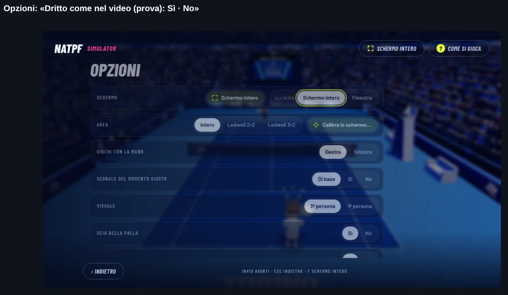
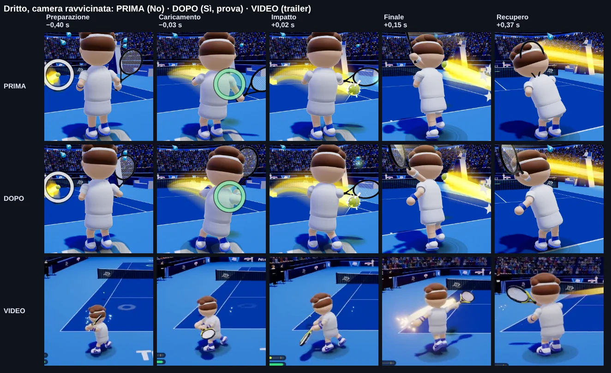
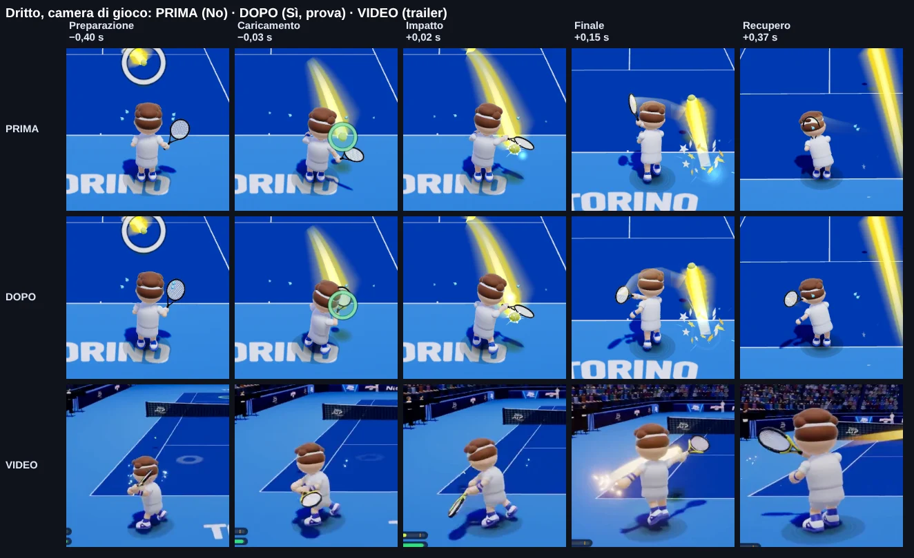
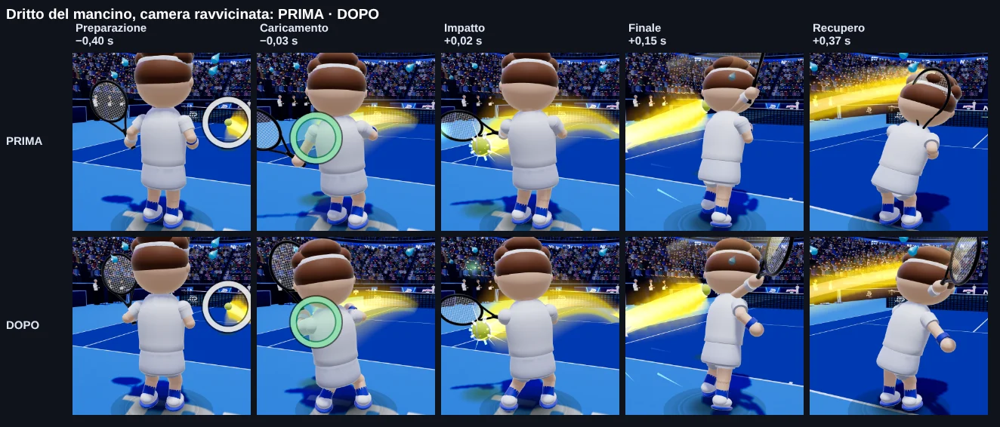
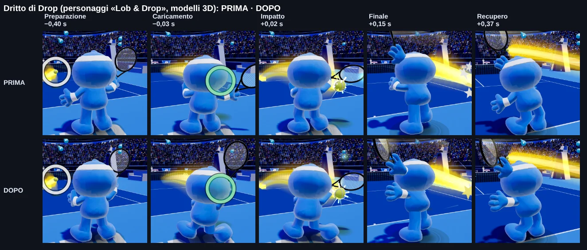

# B23 · Prova: il dritto con le movenze del video

Richiesta dell'utente dell'11/11/2026, dopo aver visto il trailer generato: «Proviamo l'opzione movimento con il
dritto, se non mi convince lo togliamo, se mi piace lasciamo agli altri». Questa è quindi una **prova su un colpo
solo** (il dritto), facile da confrontare e facile da togliere.

Lavoro fatto sul ramo `b23-dritto-video`, partito da `9b8f9cb` (versione 2026-11-12.2) e unito poi con
`natpf-simulator` due volte: a `ae68759` (versione 2026-11-12.7, Lob & Drop dai modelli 3D) e a `25e46ed` (solo
documenti). I file di versione e i documenti di piano non sono stati toccati.

**Base dei confronti: `ae68759`** (il `natpf-simulator` unito). Tra `ae68759` e `25e46ed` cambia solo un documento;
tra `9b8f9cb` e `ae68759` l'animazione dei personaggi non è cambiata (le «impronte» delle ossa fatte sui due commit sono
identiche, fotogramma per fotogramma).

## In breve

- Nel **dritto in campo** il personaggio adesso usa tutto il corpo, come nel trailer: si gira con il busto e porta il
  peso sulla gamba dietro mentre la palla arriva, alza la racchetta accanto alla testa con la mano libera che la
  accompagna; all'impatto il peso va in avanti e il tallone dietro si alza; nel finale il busto passa, la racchetta
  resta **sopra la spalla opposta** e il braccio libero si apre all'indietro; poi un **piccolo saltello** di recupero
  (5,5 cm) riunisce i piedi. La testa resta girata verso la palla mentre il busto ruota.
- Vale per **chi gioca, la CPU e il Player 2** (stesso codice), per **destri e mancini**, e anche per **Lob & Drop**
  (modelli 3D e mascotte nel codice: le loro ossa seguono quelle del tennista).
- Vale per il dritto **in topspin e piatto** (e la palla corta, che usa lo stesso movimento). Il tagliato, il
  pallonetto, il rovescio, la volée, la schiacciata e il servizio sono quelli di prima.
- È **solo disegno**: palla, tempi del colpo, punto d'impatto, esito, punteggio, riconoscimento dei gesti, movimento in
  campo, webcam e rete **non cambiano** (partite a sorteggi fissi identiche con la prova accesa e spenta, e identiche
  alla base).
- Al momento del colpo **la racchetta è sulla palla esattamente come prima**, anche con il colpo in anticipo o in
  ritardo: attorno all'impatto la prova non tocca la racchetta, aggiunge solo il corpo.

## Come si attiva / come si spegne

| cosa | come |
|---|---|
| Accendere | È **già accesa** di base. Menu → **Opzioni** → **«Dritto come nel video (prova)»** → **«Sì»**. |
| Spegnere | Stessa riga → **«No»**: il dritto torna **esattamente** quello di prima, subito, anche a metà partita. |
| La scelta resta | Sì: è salvata nel browser (o nel programma Windows) e vale anche alla volta dopo. |
| Confrontare senza toccare il menu | Aggiungere all'indirizzo del gioco `?dritto=video` (accesa) oppure `?dritto=prima` (spenta). Vale finché la pagina resta aperta con quell'indirizzo e **non cambia** la scelta salvata. Altri valori sono ignorati. |

Quando si tocca Sì o No compare un avviso breve: «Dritto come nel video (prova) acceso» oppure «Dritto come nel video
spento: il dritto è quello di prima».



Nota sulla LAN e sul gioco tra due dispositivi: ogni schermo disegna i personaggi con la propria scelta. Siccome è solo
disegno, due dispositivi con scelte diverse giocano la stessa partita; cambia solo come si vede il dritto su ciascuno.

## Il foglio di confronto

Cinque istanti del dritto, gli stessi per tutte le righe: **preparazione** (0,40 s prima del colpo), **caricamento**
(0,03 s prima), **impatto** (0,02 s dopo), **finale** (0,15 s dopo), **recupero** (0,37 s dopo).
Righe: **PRIMA** (prova spenta), **DOPO** (prova accesa), **VIDEO** (lo stesso momento nel trailer).

Camera ravvicinata (dietro il giocatore):



Camera di gioco (quella che si vede giocando):



Lo stesso per il mancino e per Drop (personaggi «Lob & Drop», modelli 3D):





Cosa si vede: nella preparazione il personaggio è più girato e più basso, con la racchetta alta; al caricamento la
mano libera è davanti con la racchetta; all'impatto racchetta e palla sono **nello stesso punto** in PRIMA e DOPO; nel
finale la racchetta resta sopra la spalla opposta (PRIMA tornava subito davanti); al recupero il braccio libero è
ancora aperto e i piedi si riuniscono.

Il trailer è inquadrato con un'altra camera (più bassa e di lato) e tiene il finale molto più a lungo: per questo il
fotogramma VIDEO del «recupero» è preso quando la racchetta torna davanti (vedi sotto).

## Da dove vengono le pose

Il video usato è il trailer (`natpf-desktop/media/trailer-aad6b9311db4.mp4`, 1280 × 720, 24 fotogrammi al secondo),
con il dritto del personaggio nei primi tre secondi.

**Misura automatica: non affidabile.** È stata provata la misura delle pose usata per i gesti del tutorial
(`natpf-tennis/scripts/video/estrai-posa.mjs`, MediaPipe) su sei fotogrammi del dritto: il programma trova un «corpo» in
cinque fotogrammi su sei ma **nessuna mano**, e i personaggi hanno proporzioni da cartone (testa grande, mani e piedi
staccati dal corpo) che il programma, fatto per persone vere, non sa leggere. Per questo **le pose sono state ricavate a
mano**, guardando i fotogrammi uno per uno e ritagliati attorno al giocatore, e poi tarate confrontandole con il gioco.

Tempi e pose letti nel trailer (fotogrammi a 24 al secondo):

| momento | fotogrammi del trailer | che cosa fa il personaggio | come è nel gioco |
|---|---|---|---|
| Preparazione | 6–12 | busto girato verso la racchetta, peso sulla gamba dietro (bacino più basso e indietro), piedi larghi, racchetta alta accanto alla testa, mano libera vicino alla racchetta | cresce con l'arrivo della palla (la «carica» che il gioco calcola già), piena prima del colpo; busto girato di circa 0,6 rad in più |
| Caricamento e accelerazione | 13–16 | il busto comincia a tornare, la racchetta scende dietro | come prima: lo swing del gioco, con il corpo che segue |
| Impatto | 17–18 | peso in avanti, anche aperte, tallone dietro alzato, palla davanti al corpo, mano libera raccolta al fianco | all'istante del colpo del gioco (0,34 dello swing); la racchetta è quella di prima |
| Finale | 20–30 | busto passato, racchetta avvolta sopra la spalla opposta, braccio libero aperto dietro, in punta di piedi | la racchetta arriva lì e ci resta 0,12 s, poi in 0,32 s torna in attesa |
| Recupero | fino al 62 | piedi che si riuniscono con un saltello, racchetta che torna davanti (circa 1,8 s dopo il colpo) | saltello di 5,5 cm da 0,1 a 0,4 s dopo il colpo |

I numeri esatti delle pose (rotazioni e spostamenti) sono nel modulo, `FV_POSE` e `FV_RACKET` in
`natpf-tennis/src/natpf/natpf_forehand_video.js`.

## Cosa del video NON è stato riprodotto, e perché

- **Il finale tenuto a lungo.** Nel trailer il personaggio resta in posa per più di un secondo; in partita la palla
  dell'avversario torna presto e il giocatore deve essere pronto a correre. Nel gioco il finale dura 0,12 s più 0,32 s
  di ritorno.
- **L'arco più ampio della racchetta vicino all'impatto.** Nel trailer la racchetta gira più larga; nel gioco, attorno
  all'impatto, la racchetta è **quella di prima** (è il vincolo della prova: deve trovarsi sulla palla vera, anche con il
  colpo in anticipo o in ritardo). Il corpo cambia, la traiettoria della racchetta nell'impatto no.
- **Ginocchia e gomiti.** I personaggi non hanno gambe e braccia (mani e piedi sono staccati dal corpo): il piegamento
  delle ginocchia è reso abbassando il bacino e spostando e alzando i piedi.
- **In corsa.** Il dritto colpito correndo tiene i passi della corsa: la posa delle gambe vale solo da fermi o quasi
  (busto, testa e braccio libero cambiano comunque). Altrimenti i piedi «scivolerebbero» sul campo.
- **In prima persona** (quando si vedono solo racchetta e avambracci) il saltello e le pose della racchetta non ci sono.
- **Gli effetti del trailer** (scia luminosa, scintille, camera più bassa) non fanno parte della prova: la scia della
  palla ha già una sua opzione.
- **A fine punto** (esultanza o delusione) le pose del dritto lasciano subito il posto all'animazione di sempre.

## Che cosa è stato verificato

Prove automatiche, tutte verdi:

- **Su «No» identico a prima.** Una sequenza registrata (attesa, corsa, palla sul dritto, dritto, recupero, rovescio,
  dritto piatto, dritto tagliato, servizio, esultanza; 470 fotogrammi) fatta girare per destro, mancino e avversario:
  l'impronta di ogni osso è **identica** a quella del commit di base, fotogramma per fotogramma
  (`natpf-tennis/test/natpf-dritto-video.test.mjs`). Nel browser, con il gioco vero: 4 sequenze da 160 fotogrammi
  (in tempo, anticipo, ritardo, mancino) e uno scambio di 900 fotogrammi, **0 fotogrammi diversi** dalla base.
- **Il gioco non cambia.** Partite a passi e sorteggi fissi (senza persone, contro la CPU, stesso schermo) con la prova
  accesa e spenta: stessa impronta di palla, giocatori e punteggio (`e515d6ce`, `985e79ef`, `6736c2b6`), uguale alla
  base. Con Lob & Drop la partita contro la CPU è la stessa. `npm run audit:legend`: uscita **identica**, riga per riga,
  a quella di `natpf-simulator` (`25e46ed`).
- **Racchetta sulla palla all'impatto come prima** (tolleranza: quella di oggi + 1 mm): nel fotogramma del colpo il
  centro delle corde è alla stessa distanza dal punto della palla con la prova accesa e spenta, in tempo (361 mm),
  in anticipo (469 mm), in ritardo (598 mm), mancino (361 mm), e con Drop (361 mm).
- **Nessuno scatto.** Quello che la prova aggiunge alle ossa del corpo cambia poco tra un fotogramma e l'altro: fuori
  dallo swing al massimo 38 mm e 0,05 rad (soglie 50 mm e 0,08 rad), nello swing al massimo 117 mm e 0,21 rad (soglie
  170 mm e 0,26 rad). Lo scatto più grande della racchetta in uno scambio è lo stesso di prima (624 mm, quello dello
  swing veloce di sempre).
- **Accesa, cambia solo il dritto.** Le ossa diverse da prima sono solo attorno al dritto (preparazione, colpo,
  finale); attesa, rovescio, servizio ed esultanza sono identici.
- **Prestazioni.** Nessun oggetto creato a ogni fotogramma (uno stato per personaggio, creato una volta). Costo
  dell'animazione dei due personaggi: 70,0 µs a fotogramma con la prova, 77,8 µs senza (la differenza è rumore della
  misura; il limite della prova era +50 µs). Fotogrammi interi (calcolo + disegno, 8 blocchi alterni, mediane): 328 al
  secondo con la prova, 290 senza; anche qui la differenza è rumore (il browser della prova disegna senza scheda video).
- **Interruttore.** Di base Sì; clic su No e su Sì; la scelta resta dopo aver ricaricato; `?dritto=prima|video` vale
  più della scelta salvata e non la cambia.

Comandi:

```sh
cd natpf-tennis
node --import ./test/register.mjs --test test/natpf-dritto-video.test.mjs test/natpf-dritto-video-opzione.test.mjs
cd ../tools/e2e
CHROMIUM_PATH=/opt/pw-browsers/chromium node natpf-dritto-video.mjs        # tutte le parti (SOLO=ossa, partite, ...)
FOGLI=/cartella CHROMIUM_PATH=/opt/pw-browsers/chromium node natpf-dritto-video.mjs
FOGLI=/cartella CHROMIUM_PATH=/opt/pw-browsers/chromium node natpf-dritto-video-foglio.mjs   # rifà i fogli in docs/b23/img
```

## Come si toglie la prova

Se la prova non convince, si toglie così (nessun altro file dipende da lei):

1. cancellare `natpf-tennis/src/natpf/natpf_forehand_video.js`;
2. in `natpf-tennis/src/player_body_animation.js` togliere la riga `import { fvPre, fvPost } ...` e le due chiamate
   `fvPre(t, e, n);` e `fvPost(t, e);` (tutte segnate «NATPF B23»);
3. in `natpf-tennis/src/natpf/natpf_lobby.js` togliere l'`import` di `natpf_forehand_video.js`, la riga con
   `data-natpf-dritto` nel clic, il metodo `setForehandVideo` e la riga `data-natpf-dritto` in `paint`;
4. in `natpf-tennis/index.html` togliere il blocco «Dritto come nel video (prova)» nelle Opzioni;
5. cancellare le prove: `natpf-tennis/test/natpf-dritto-video.test.mjs`, `natpf-tennis/test/natpf-dritto-video-opzione.test.mjs`,
   la cartella `natpf-tennis/scripts/audit/b23/`, `tools/e2e/natpf-dritto-video.mjs`,
   `tools/e2e/natpf-dritto-video-foglio.mjs`, `tools/e2e/dati/dritto-video-base-ae68759.json`.

Il valore salvato nei browser (`natpf-tennis.drittoVideo`) resta lì ma non viene più letto: non dà fastidio.

In alternativa, per tenerla ma spenta per tutti, basta cambiare in `natpf_forehand_video.js` la riga
`return storage?.getItem(FV_KEY) !== '0';` in `return storage?.getItem(FV_KEY) === '1';` (di base No).

## Come si estenderebbe agli altri colpi

Il modulo è già fatto per crescere: per ogni colpo servono tre pose chiave (preparazione, impatto, finale) lette dal
video, i momenti dello swing in cui entrano ed escono, una zona attorno all'impatto in cui la racchetta resta quella di
prima, e le stesse prove (ossa identiche su «No», racchetta sulla palla, scatti, partite identiche, fogli).

Stima del lavoro, per un agente:

| colpo | stima | note |
|---|---|---|
| Rovescio (a due mani e a una mano) | circa una giornata | le pose sono lo specchio del dritto, ma la mano libera va sulla racchetta (due mani) o all'indietro (una mano) |
| Tagliato e pallonetto (dritto e rovescio) | mezza giornata | stesse pose del dritto e del rovescio con la racchetta che parte alta e finisce bassa |
| Volée | mezza giornata | movimento corto, poco corpo, soprattutto passo in avanti |
| Servizio e schiacciata | una giornata e mezza | lancio della palla, braccio libero in alto, salto: si intrecciano con i tempi del servizio del gioco, da controllare con più attenzione |

Se l'utente decide di tenerla, conviene anche spostare la voce delle Opzioni da «Dritto come nel video (prova)» a
qualcosa come «Movimenti come nel video», valida per tutti i colpi.

## Cosa non è provato

- **Non provato con il telefono vero, con la webcam vera, in LAN o nel programma Windows installato:** le prove sono nel
  browser del computer di prova, con il gesto dato dalla tastiera del gioco (lo stesso swing che parte dal telefono).
- **Non provato su ledwall, su Android né con una scheda video vera:** i fotogrammi al secondo sono misurati nel
  browser di prova, che disegna senza scheda video.
- **Non guardato a occhio in una partita lunga** da una persona: i fogli mostrano cinque istanti e le prove misurano gli
  scatti, ma il giudizio «è più vivo / mi convince» spetta all'utente.
- Le pose sono state ricavate **a mano** dai fotogrammi del trailer (la misura automatica non legge i personaggi
  cartoon): sono fedeli nello spirito, non al millimetro.
