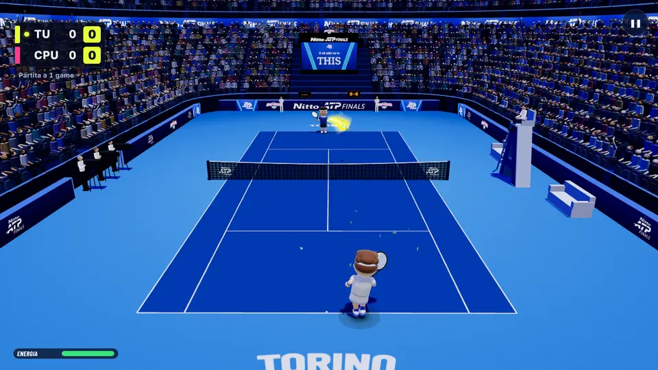
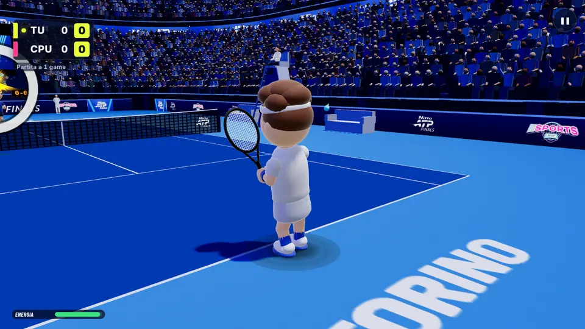
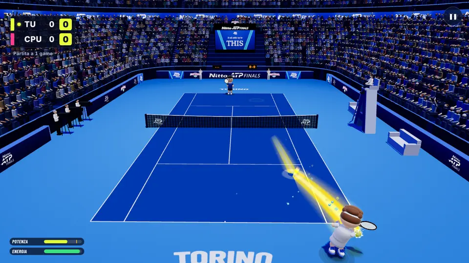
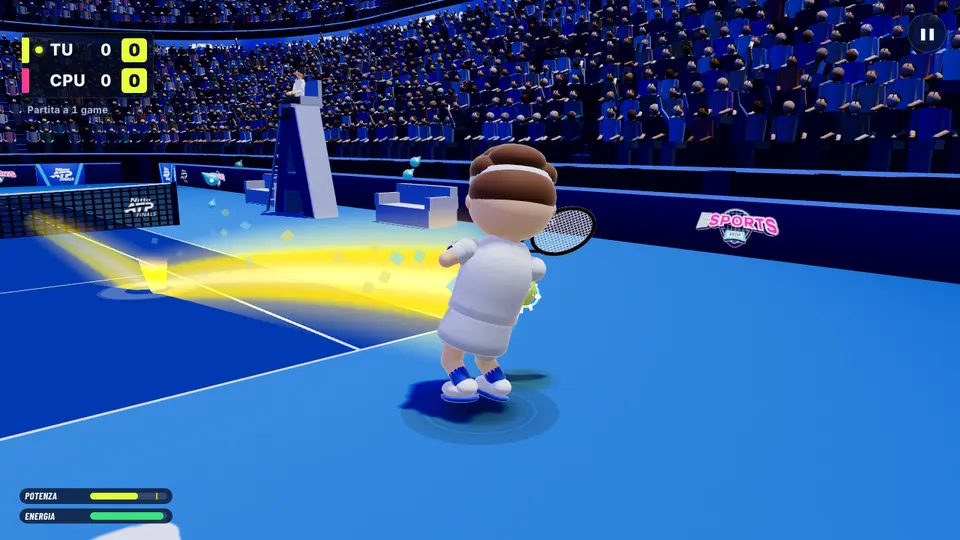
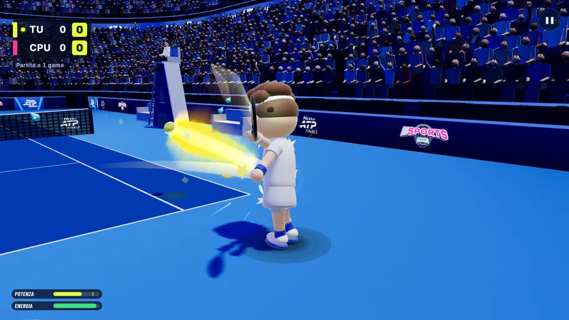
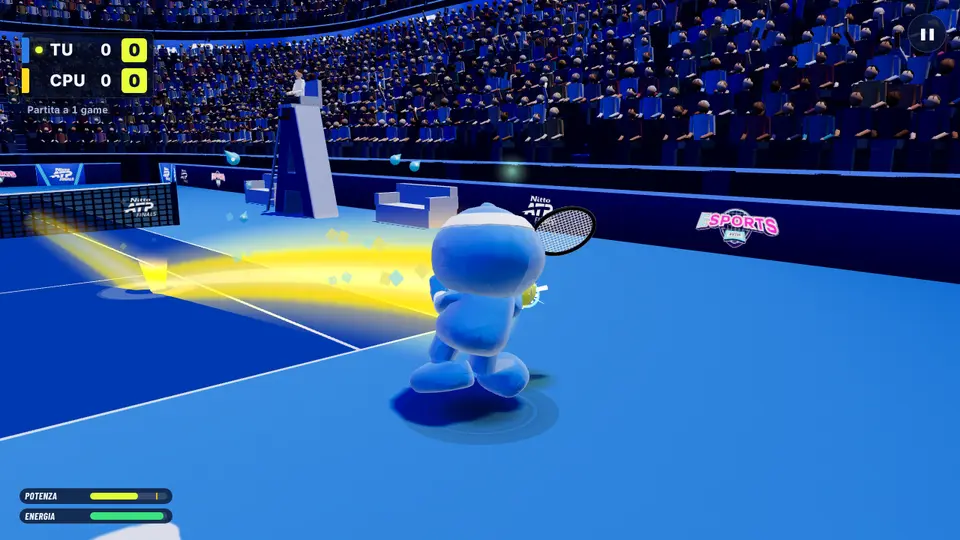
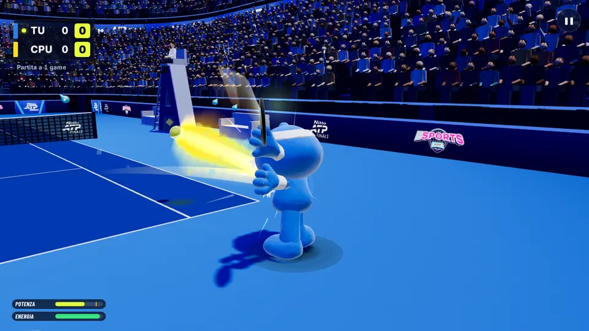

# B32 · Tappa 3.2 · Movimento con accelerazione e colpi in corsa

Tappa 3, punto 2 del rapporto `docs/b16/rapporto-gameplay.md` (§3 punto 7 «Movimento più naturale», §4 tappa 3 punto 2,
appendice M7, schede MOV-5 e MOV-9). Lavoro fatto nel ramo `b32-movimento`, partito da `fa2482c` (versione
2026-11-13.3), senza push e senza toccare `natpf-simulator`, `main`, i file di versione e i documenti di ripresa.

**Tutti i numeri qui sotto vengono dal gioco simulato** (il motore vero senza disegno, con i giocatori simulati del
banco). Non sono misure di persone vere, telefoni veri, del PC dell'evento o del ledwall.

## In breve

- **Il personaggio di chi gioca contro la CPU ora accelera e frena.** Al colpo della CPU fa un piccolo «passo di
  attesa» (split-step), poi parte: prima piano, poi sempre più veloce; si ferma frenando. Prima partiva subito a velocità
  piena, cambiava direzione in un istante e poi aspettava fermo quasi un secondo.
- **Arriva giusto in tempo.** Sulla palla vicina va al passo e si ferma un attimo prima del colpo; sulla palla lontana
  corre al massimo.
- **Il colpo in corsa esiste.** Se la palla è lontana e non c'è il tempo di fermarsi, il personaggio arriva sulla palla
  correndo: il colpo è più debole e meno preciso, la scritta dell'esito lo dice («in corsa») e l'animazione lo mostra (i
  piedi continuano a correre durante il colpo).
- **La palla angolata e lontana costa di più**: più colpi «in allungo» e «in corsa». Le palle che non si prendono proprio
  sono rimaste rare come prima (vedi «Cosa non è riuscito»).
- **Non cambia niente** per il livello Bambini, lo stesso schermo (campo aperto spento e acceso, aiuto al più giovane),
  la sfida tra due computer, il doppio, l'allenamento, la demo e il movimento a rete del B31. Il riconoscimento dei gesti
  non è toccato. Il movimento resta automatico: chi gioca non muove il personaggio con il telefono.

## Cosa cambia per chi gioca

### 1. Partenza: split-step e lettura della palla

Quando la CPU colpisce, il personaggio resta fermo un attimo (0,05 s), come il saltello di un tennista prima di partire.
Se la palla è veloce resta fermo un poco di più (fino a +0,04 s con la palla oltre 32 m/s): la palla veloce «si legge»
dopo. Se stava correndo (per esempio stava tornando al centro), in quell'attimo frena.

### 2. Accelerazione, frenata, cambio di direzione

Dopo il primo passo il personaggio accelera fino alla velocità massima di sempre (Casual 10,2 m/s, Pro e Leggenda
8,8 m/s): ci mette circa 0,4 s. Per fermarsi frena. Se correva dalla parte sbagliata, prima deve frenare e poi ripartire:
nella prova nel browser, da 7 m/s verso destra a fermo servono 0,22 s, poi riparte verso sinistra.

La CPU di Leggenda resta più lenta di chi gioca: velocità massima 8,0 contro 8,8 m/s, e chi gioca accelera almeno
quanto lei (24 contro 22 m/s²).

### 3. Arrivo giusto in tempo

Se la palla arriva tra un secondo e il punto è a due metri, il personaggio non scatta più a tutta: va al passo
(almeno 2,5 m/s) e si ferma 0,2 s prima del colpo. Nella prova nel browser la partenza verso una palla comoda arriva a
3,8 m/s invece di 8,8.

### 4. Colpo in corsa e colpo in allungo

- **In corsa**: quando la corsa è lunga (almeno 3,2 m) e il margine è piccolo (meno di 0,2 s tra quando si arriverebbe e
  quando arriva la palla), il personaggio non frena: arriva sulla palla correndo. La corsa al momento del colpo toglie
  qualità come è sempre stato scritto nel gioco (fino a −15% a velocità piena; prima non capitava quasi mai perché il
  personaggio era sempre fermo): palla più corta, più lenta e più dispersa. La scritta dell'esito lo dice nella riga
  piccola: **«Perfetto · in corsa · 181 km/h»** (la scritta grande resta il voto del tempo, come nel B18).
- **In allungo**: quando il margine è piccolo anche senza corsa lunga (o la palla proprio non si raggiunge), la
  qualità scende come prima (allungo, −40% al limite) e la riga piccola dice **«in allungo»**.
- Se il colpo fallisce, la scritta dice la causa come prima («palla debole: in corsa», «in allungo»…).
- **Palla non raggiunta**: quando il piano dice che la palla non si raggiunge, la racchetta arriva solo a 2,0 m di lato
  (Pro, Leggenda) o 2,1 m (Casual) invece di 2,4 m: come il campo aperto dello stesso schermo (1,7 m), un poco più largo.

### 5. L'animazione

Non serviva un'animazione nuova: i piedi dei personaggi corrono finché il personaggio si muove, anche durante il colpo.
Prima il colpo in corsa non si vedeva mai perché il personaggio era sempre fermo al momento del colpo. Vale per i
personaggi Classici, per Lob & Drop con i modelli 3D (le ossa seguono le parti del personaggio) e con la prova del dritto
dal video (in corsa le gambe restano quelle della corsa). Nessun oggetto nuovo a ogni fotogramma.

### 6. Stanchezza

Con l'accelerazione il personaggio passa meno tempo fermo per la stessa strada, e la stanchezza (che recuperava solo da
fermo) saliva senza motivo (Leggenda, «tennista»: «Stanco!» dal 3 al 13% del tempo nella prima prova). Ora il riposo
dipende da quanto il personaggio va piano rispetto alla sua velocità massima: per la stessa strada il riposo è lo stesso
di prima. Resta più stanchezza dove si corre davvero di più (vedi le misure).

### 7. Il registro dello stand

Ogni colpo di chi gioca contro la CPU porta il campo nuovo `mov` («corsa» o «allungo»). Lo strumento di riassunto
(`natpf-tennis/scripts/registro/riassunto.mjs`) ha la sezione nuova **«Movimento»**: quanti colpi in corsa e in
allungo, e quanti di questi finiti in rete, fuori o deboli. Il campo è aggiunto anche all'elenco del worker
(`natpf-tennis/cloudflare/registro-worker.js`) e del formato (`registro_formato.js`).

## Come si attiva / come si spegne

- **Si attiva da solo** nelle partite contro la CPU a Casual, Evento (Adulto), Pro e Leggenda. Non c'è un'opzione nel
  menu.
- **Non vale** (movimento di prima) a: livello Bambini (Chi gioca → Bambino), stesso schermo, sfida tra due computer,
  doppio, allenamento, minigiochi ed eventi, demo, e quando chi gioca o il punto dove deve andare sono entro 7 m dalla
  rete (lì resta il movimento del B31).
- **Valori**: `natpf-tennis/src/natpf/natpf_skill.js`, campo `playerRun` dei livelli (Casual; Pro e Leggenda in
  `EXPERT_PLAYER`; Evento è la media tra Casual e Pro come il resto del livello; Bambini `playerRun: null`).
- **Per spegnerlo del tutto** (solo prove e banchi): `movementRules.off = true` in
  `natpf-tennis/src/natpf/natpf_movement.js`. Da riga di comando: `npm run audit:movimento -- --senza-b32`, oppure
  `node --import ./test/register.mjs --import ./scripts/audit/senza-b32.mjs <banco>` per qualsiasi banco. Per
  spegnerlo a un solo livello nel gioco basta mettere `playerRun: null` in quel livello.

## Misure prima e dopo

Banco nuovo: `npm run audit:movimento` (`natpf-tennis/scripts/audit/movimento.mjs`), 3 semi × 300 punti per casella,
due serie di semi (serie 1: 2001, 2038, 2075; serie 2: 5003, 5044, 5085). «Prima» = la base `fa2482c` con lo stesso
banco. Tabelle intere in `natpf-tennis/scripts/audit/results/b32/` (`prima-s1.txt`, `prima-s2.txt`, `dopo-s1.txt`,
`dopo-s2.txt`); il confronto si rifà con `node scripts/audit/movimento-confronto.mjs "<colonne>" [--serie=2]`.
In ogni casella: **serie 1 prima → dopo · serie 2 prima → dopo**. Con le regole spente (`--senza-b32`) la tabella della
serie 1 è **identica** a quella della base, riga per riga.

Profili del banco: «tennista» (bravo), «amatore» e «umano» (adulto medio; «umano» colpisce dal rimbalzo come nel video
del 23/10), «bambino», «piazza» (amatore che cerca sempre il lato libero), «centro» (amatore che non mira mai).

### Partite: punti e game vinti da chi gioca, colpi e secondi per punto

| livello / profilo | punti G% | game G% | colpi/p | s/p |
|---|---|---|---|---|
| bambini/bambino | 79,7 → 79,7 · 82,5 → 82,5 | 96,6 → 96,6 · 99,3 → 99,3 | 9,7 → 9,7 · 10,2 → 10,2 | 12,42 → 12,42 · 13,03 → 13,03 |
| bambini/amatore | 98,1 → 98,1 · 99,5 → 99,5 | 100 → 100 · 100 → 100 | 9,27 → 9,27 · 9,52 → 9,52 | 10,86 → 10,86 · 11,19 → 11,19 |
| casual/bambino | 48,8 → 46,8 · 50,4 → 51,9 | 47,4 → 40,6 · 50,7 → 55,4 | 7,23 → 7 · 7,08 → 7,35 | 8,94 → 8,64 · 8,68 → 9,08 |
| casual/amatore | 85,2 → 84,3 · 87,4 → 86,6 | 99,4 → 98,2 · 99,5 → 99,5 | 8,79 → 9,35 · 8,71 → 8,56 | 10,29 → 10,95 · 10,18 → 10,02 |
| casual/umano | 88,3 → 89,6 · 85,9 → 87 | 100 → 100 · 98,9 → 99,5 | 9,04 → 8,81 · 9,11 → 8,83 | 10,55 → 10,3 · 10,6 → 10,25 |
| evento/amatore | 64,9 → 65 · 65,1 → 65,2 | 82,7 → 81,5 · 84,2 → 83 | 13,65 → 13,41 · 13,82 → 12,97 | 14,93 → 14,79 · 15,12 → 14,35 |
| evento/umano | 67,4 → 67 · 68,7 → 67,5 | 93,1 → 86,2 · 89,9 → 90,5 | 16,28 → 17,74 · 17,3 → 17,25 | 17,69 → 19,16 · 18,71 → 18,77 |
| evento/bambino | 46,6 → 45,7 · 45,8 → 47 | 41 → 41,1 · 39,6 → 42,5 | 7,41 → 7,05 · 8,02 → 7,35 | 9,13 → 8,65 · 9,88 → 8,97 |
| pro/amatore | 54,6 → 52,7 · 56,5 → 53,6 | 62,9 → 54,7 · 67 → 59,1 | 13,31 → 14,08 · 14,17 → 13,82 | 14,53 → 15,51 · 15,64 → 15,19 |
| pro/umano | 65,5 → 61,8 · 66,1 → 61,7 | 81,6 → 76,7 · 86 → 77,1 | 15,38 → 16,14 · 16,17 → 16,33 | 16,93 → 17,7 · 17,74 → 17,93 |
| pro/tennista | 96,8 → 92,8 · 96,7 → 93,9 | 100 → 100 · 100 → 100 | 8,86 → 7,96 · 8,66 → 8,15 | 8,96 → 8,07 · 8,76 → 8,25 |
| leggenda/umano | 22,3 → 21,3 · 20,1 → 21,3 | 3,1 → 1,1 · 3,1 → 3,2 | 18,2 → 18,88 · 18,9 → 18,69 | 20 → 20,72 · 20,85 → 20,63 |
| leggenda/tennista | 29,9 → 28,7 · 31,2 → 29,9 | 12,5 → 10,2 · 12,2 → 8,6 | 21,89 → 21,26 · 21,44 → 21,08 | 21,91 → 21,42 · 21,48 → 21,09 |

- **Bambini identico**, numero per numero (le regole lì non valgono). Il test lo controlla con le impronte.
- **Casual**: quasi uguale (±2 punti, dentro il rumore di ±3).
- **Evento**: i punti restano gli stessi perché il livello si regola da solo; dentro la partita ci sono molti più colpi in
  allungo e in corsa (tabella sotto).
- **Pro**: un poco più difficile per l'adulto medio, 2–4 punti su 100 in meno («umano» 66 → 62, «amatore» 55–56 → 53–54).
  Il Pro resta nella fascia del criterio (Pro contro «medio» 78,7% dei game, fascia 70–85; prima 77,9%).
- **Leggenda**: uguale entro il rumore.

### Movimento: metri per punto, palle non prese, colpi in allungo e in corsa, stanchezza

«non prese»: palle della CPU passate senza che chi gioca le tocchi, su 100 palle della CPU (senza contare i colpi a
vuoto fuori tempo). «allungo» e «corsa»: quota dei colpi di chi gioca in allungo (piano con stretch ≥ 0,5) e in corsa
(velocità al colpo oltre metà della massima); «corsa fall.»: quota dei colpi in corsa falliti (in rete, fuori o deboli
per regola); «stanco»: quota del tempo di gioco su «Stanco!».

| livello / profilo | m/p | non prese% | allungo% | corsa% | corsa fall.% | stanco% |
|---|---|---|---|---|---|---|
| bambini/bambino | 18,5 → 18,5 · 19,3 → 19,3 | 0,5 → 0,5 · 0,3 → 0,3 | 10,6 → 10,6 · 12,1 → 12,1 | 0,6 → 0,6 · 0,9 → 0,9 | 0 → 0 · 0 → 0 | 0 → 0 · 0 → 0 |
| bambini/amatore | 17,3 → 17,3 · 17,7 → 17,7 | 0,1 → 0,1 · 0 → 0 | 11,5 → 11,5 · 10,7 → 10,7 | 0,1 → 0,1 · 0,2 → 0,2 | 0 → 0 · 0 → 0 | 0 → 0 · 0 → 0 |
| casual/bambino | 14,3 → 14 · 14,1 → 14,7 | 5,3 → 5,8 · 4,8 → 4,1 | 3,3 → 5,5 · 4 → 7,6 | 0,1 → 3,3 · 0 → 3,1 | 0 → 0 · 0 → 0 | 0 → 0 · 0 → 0 |
| casual/amatore | 16,3 → 17,6 · 16 → 15,6 | 0,5 → 0,3 · 0,3 → 0,2 | 4 → 5,9 · 4 → 5 | 0 → 2,2 · 0,1 → 2,6 | 0 → 0 · 0 → 0 | 0 → 0 · 0 → 0 |
| casual/umano | 16,5 → 16,1 · 17 → 16 | 0 → 0,1 · 0,1 → 0 | 2,6 → 3,6 · 3,8 → 3,8 | 0,1 → 1,9 · 0 → 2,2 | 0 → 0 · 0 → 0 | 0 → 0,2 · 0 → 0 |
| evento/amatore | 31,8 → 31,1 · 32 → 30,5 | 0,7 → 0,8 · 0,7 → 0,6 | 3,8 → 22,3 · 3,9 → 24,2 | 0,1 → 16,3 · 0,1 → 18,2 | 0 → 0 · 0 → 0 | 2,3 → 1,1 · 2,3 → 0,5 |
| evento/umano | 36,9 → 44,4 · 40,7 → 41,9 | 0,2 → 0,5 · 0,2 → 0,3 | 2,4 → 28,1 · 3,1 → 25,4 | 0,1 → 22 · 0 → 19,8 | 0 → 1,2 · 0 → 0,3 | 0,6 → 2,8 · 3,1 → 2,5 |
| evento/bambino | 14,8 → 14,4 · 16,6 → 15,2 | 5,6 → 6,3 · 5,6 → 5,4 | 4 → 8,5 · 2,9 → 8,6 | 0,1 → 4,5 · 0 → 5,7 | 0 → 0 · 0 → 0 | 0 → 0 · 0 → 0,1 |
| pro/amatore | 29,8 → 32,2 · 32 → 32,1 | 0,8 → 0,6 · 0,6 → 0,6 | 7 → 10,7 · 5,6 → 10,9 | 0,2 → 7,2 · 0,1 → 8,3 | 0 → 1 · 0 → 2,9 | 1,4 → 1,2 · 1,7 → 1,3 |
| pro/umano | 33,3 → 35,7 · 35,3 → 36,7 | 0,1 → 0,1 · 0,2 → 0,1 | 4,8 → 9,4 · 5,7 → 9 | 0 → 7,5 · 0 → 7,7 | 0 → 1,6 · 0 → 2,4 | 1,1 → 1,9 · 1 → 3,2 |
| pro/tennista | 17,9 → 16,1 · 17,2 → 16,3 | 0 → 0 · 0 → 0 | 4,4 → 7,1 · 4 → 7,1 | 0 → 4,6 · 0 → 4,4 | 0 → 0 · 0 → 0 | 0 → 0 · 0 → 0 |
| leggenda/umano | 61,5 → 61,1 · 65,2 → 60,9 | 0,2 → 0,3 · 0,2 → 0,4 | 26,7 → 26,8 · 27,6 → 28,2 | 0 → 3,8 · 0 → 3,5 | 0 → 10,9 · 0 → 6,6 | 0 → 0,1 · 0 → 0 |
| leggenda/tennista | 64,9 → 62,3 · 64,8 → 61,7 | 0 → 0 · 0 → 0 | 19,2 → 21,5 · 20,6 → 20,3 | 0 → 3,8 · 0,2 → 4,5 | 50 → 14,1 · 0 → 9,5 | 3,1 → 0,6 · 3,6 → 1,2 |

(Leggenda/tennista «corsa fall.» 50% prima è 1 colpo su 2.)

- **Colpi in corsa**: prima 0–0,3%, ora 2–3% a Casual, 4–8% a Pro, 3–5% a Leggenda, 16–22% a Evento. Quelli falliti:
  1–3% a Pro, 7–14% a Leggenda (la Leggenda tira più forte e angolato).
- **Colpi in allungo**: prima 3–7% a Casual, Pro ed Evento, ora 4–8% a Casual, 9–11% a Pro, 22–28% a Evento.
- **Palle non prese**: uguali a prima (sotto l'1% per gli adulti, 4–6% per «bambino», che sono quasi tutte palle forti
  contro un gesto lento).
- **Metri per punto** e **secondi per punto**: quasi uguali; a Evento «umano» +4–20% di metri (scambi più lunghi).
- **Stanchezza**: a Pro e a Evento per «umano» un poco di più (1 → 2–3% del tempo su «Stanco!»): corre di più per
  punto (+7% di metri a Pro, +3–20% a Evento). Per gli altri profili uguale o meno di prima.

### Evento: perché tanti colpi in corsa

A Evento la CPU si fa più forte quando chi gioca vince (livello adattivo) e, verso l'alto, tira più veloce che a Pro
(tempo di volo × 0,8). Con palle più veloci il margine per fermarsi manca più spesso: un colpo su cinque è in corsa. I
punti vinti non cambiano perché il livello si regola da solo; si vede che la partita è più «tennis vero» e che chi gioca
corre di più.

### «Piazzare» contro «rimandare al centro» contro la CPU

| livello / profilo | punti G% | game G% |
|---|---|---|
| casual/piazza | 87,2 → 85,4 · 89,6 → 85,5 | 100 → 99,4 · 100 → 100 |
| casual/centro | 78,2 → 80,8 · 84,2 → 83,3 | 95,7 → 98,6 · 99,4 → 100 |
| evento/piazza | 66,5 → 64,3 · 66,1 → 66 | 86,2 → 84,6 · 85,1 → 84,3 |
| evento/centro | 63,4 → 64,7 · 64,4 → 63,9 | 83,5 → 84,2 · 85,7 → 81,5 |
| pro/piazza | 57,2 → 58,7 · 58,2 → 51,3 | 67,3 → 70,7 · 71 → 53,3 |
| pro/centro | 51 → 46,5 · 52,6 → 51,6 | 53,6 → 42,1 · 57,1 → 53,8 |
| leggenda/piazza | 11,7 → 9,5 · 10,2 → 11,3 | 0,6 → 0 · 0 → 0 |
| leggenda/centro | 20,2 → 20,4 · 22,4 → 20,6 | 2,8 → 1 · 3,1 → 4,1 |

Piazzare contro la CPU conveniva già prima a Casual (+5–9 punti su 100), a Pro (+6) e poco a Evento (+2–3); a Leggenda
no (il profilo che mira le righe sbaglia di più con le regole di Esperto). Dopo: a Casual +2–4, a Evento −1…+2, a Pro
+12 nella serie 1 e 0 nella serie 2. **Non è dimostrato** che con il movimento nuovo piazzare convenga di più contro la
CPU: le due serie non vanno d'accordo (vedi «Cosa non è riuscito»).

### Stesso schermo, aiuto al più giovane, gioco a rete

- **Stesso schermo** (campo aperto spento e acceso) e **aiuto al più giovane** (HELP.G): le regole non valgono lì. Il
  test nuovo gioca le stesse partite con le regole accese e spente (campo aperto spento, acceso, bambino contro adulto
  con l'aiuto) e controlla che siano identiche colpo per colpo; il test `natpf-b25-stesso-schermo` (impronte di
  `f08243a` e del B31) passa senza cambiare niente. Le misure B25 dello stesso schermo sono quindi quelle di prima.
- **Gioco a rete (B31)**: `npm run audit:rete` prima e dopo (`results/b32/rete-prima.txt`, `rete-dopo.txt`, serie 1).
  Chi è a rete o va a rete si muove come nel B31. Le volée per game: Casual 0,6–0,8 come prima; Pro «amatore» 1,6 →
  1,2 (meno attacchi riusciti: chi arriva in corsa colpisce più debole e sale meno a rete); punti vinti quando si è
  stati a rete: Pro «amatore» 61,5 → 61,8%, Casual «amatore» 87,4 → 83,5%. Schiacciate, palle corte e salite a rete
  della CPU come prima. Con il movimento accelerato anche a rete le volée crollavano (54 → 13 piani di volée su 300
  punti): per questo a rete resta il movimento del B31.

### Leggenda e criteri dei livelli (`npm run audit:legend`)

**Tutti i criteri rispettati**, prima e dopo (`results/b32/legend-prima.txt`, `legend-dopo.txt`; «prima» = stesso
codice con le regole spente). Game vinti dalla CPU di Leggenda: «medio» 100 → 99,2%, «amatore» 98,9 → 99,5%,
«tennista» 88,9 → 88,9%, «preciso» 83,5 → 82,5% (criterio ≥ 60%), «bambino» 99,8 → 100%, «impreciso» 100 → 100%.
Pro contro «medio» 77,9 → 78,7% dei game (fascia 70–85). Casual contro «medio» 99,8 → 99,8% (≥ 95). Velocità massima
della CPU 8,6 m/s, sotto quella di chi gioca (8,8). Nessun criterio allentato.

## Prove

- `npm test` (natpf-tennis): **1408 superati, 0 falliti** (1 saltato, come prima). `npm run build`: riuscito.
  `node --test tools/test/*.test.mjs`: **226 superati**. `npm run audit:legend`: tutti i criteri rispettati. Il
  programma Windows (`natpf-desktop`) non è toccato e non l'ho provato. Prove nuove: `test/natpf-b32-movimento.test.mjs` (12: valori
  per livello, tempi di corsa, primo passo, colpo in corsa, scritta dell'esito, a chi valgono le regole, passo del
  movimento senza oggetti nuovi, arrivo giusto in tempo, stanchezza, impronte di Bambini, partenza graduale in partita,
  stesso schermo identico).
- Prove cambiate (con il perché):
  - `test/natpf-b18-t2-cpu-pressione.test.mjs`: le tre caselle di Casual («medio», «umano», «bambino») misurate su 16
    semi invece di 5 (come già le due di Pro). Con 5 semi le palle facili sbagliate dalla CPU erano 3,1% per «medio»
    (n 836: una palla oltre la soglia del 3%) e, dal 17° colpo, 3,5% per «bambino» (n 144: 5 palle) e 3,2% per
    «umano» (n 347). Con 16 semi 2,4%, 2,2% e 2,4% (senza B32 1,8%, 1,5% e 1,9%): la soglia resta 3%. La regola della
    CPU non è cambiata; sulle palle facili sbaglia 0,4–0,7 punti in più perché cambiano i colpi che riceve.
  - `test/natpf-b18-t2-servizio.test.mjs`, banco del servizio: a Leggenda 8 semi invece di 2. Con 2 semi il servizio
    perfetto faceva 3,6% di punti diretti contro 2,4% di quello insegnato (margine richiesto 1,5 punti, rumore ±3); con
    8 semi 4,7 contro 1,9% (senza B32 5,2 contro 1,4%). Le fasce e i margini non cambiano.
  - `test/natpf-b18-t2-servizio.test.mjs`: il controllo «con i valori di prima» del servizio si fa con il movimento di
    prima (`movementRules.off`), come il B31 lo fa con le regole di rete spente.
  - `test/natpf-b18-t2-evento-bambini.test.mjs`: la prova «colpo super spiegato» si fa con il movimento di prima: con
    l'accelerazione a Evento un colpo su quattro è in allungo e la scritta «allungo» copre le altre (la prova vuole
    scritte di tutti i tipi).
- Prove nel browser (Chromium), schermate guardate una per una:
  - **nuova** `tools/e2e/natpf-movimento.mjs`: **15/15** (partenza con split-step e accelerazione, cambio di direzione,
    colpo in corsa con la scritta «in corsa», piedi che corrono durante il colpo; Classici con il dritto dal video e
    Lob & Drop 3D; nessun errore in pagina);
  - `natpf-rally.mjs` **9/9**, `natpf-rete.mjs` **9/9**;
  - `natpf-stesso-schermo-b25.mjs` **53/54**: il controllo che non passa («pannello dello stand a 720×720… niente
    scorrimento») non passa **identico anche sulla base `fa2482c`** (scorrimento di 38 px): non dipende dal B32;
  - `natpf-lob-drop.mjs` (parte 3D compresa): **120/124**. Non passano quattro controlli «al colpo le corde sono dove
    erano (punto d'impatto non cambiato)» (la racchetta scostata dalla testa grande della mascotte, `natpf_racket_clear.js`,
    al momento del colpo). **Sulla base `fa2482c` ne falliscono già tre su quattro** (121/124: partita contro la CPU,
    partita nello stesso schermo, 3D nello stesso schermo), con le stesse mascotte e scostamenti simili. Con il B32 fallisce
    anche il quarto (3D contro la CPU) perché la partita contro la CPU si gioca diversamente e cambiano i colpi misurati. Il
    B32 non tocca la racchetta né le mascotte: è un difetto che c'era già, da guardare a parte.

### Schermate

Partenza (dopo 0,25 s: il personaggio sta accelerando verso la palla larga):

Cambio di direzione (correva verso destra, la palla va a sinistra: sta frenando):

Colpo in corsa, Classici con il dritto dal video (al contatto corre a 6,5 m/s; esito «Perfetto · in corsa · 181 km/h»):

Colpo in corsa con Lob & Drop 3D:

Nelle schermate la scritta dell'esito non si vede (nella prova il tempo è fermo e la scritta non ha finito di
comparire); il testo è letto dalla pagina e controllato dalla prova.

## Cosa non è riuscito, e perché

1. **La palla lontana «non presa» non è aumentata.** Il personaggio corre a 8,8–10,2 m/s e le palle della CPU danno in
   media un secondo per 2–3 metri: anche con l'accelerazione arriva quasi sempre. Per avere palle davvero imprendibili
   bisognava rallentarlo molto (accelerazione 12 m/s²): l'ho provato, e a Pro «umano» passava dall'82 al 48% dei game
   e «medio» usciva dalla fascia 70–85 del criterio (53%). Visto che **il Pro resta com'è** (decisione dell'11/11) ho
   tenuto un'accelerazione da atleta (22–24 m/s²): la palla lontana costa con l'allungo e la corsa (più deboli e meno
   precisi), non con il punto perso subito.
2. **«Piazzare conviene di più contro la CPU» non è dimostrato.** La CPU non è cambiata (ha già accelerazione,
   lettura in ritardo della palla larga e portata limitata); le due serie di semi danno risultati opposti a Pro.
3. **Un costo in più per il colpo in corsa** (oltre al −15% che il gioco aveva già) l'ho provato e tolto: con un −15% in
   più Pro «medio» scendeva al 66% dei game, fuori dalla fascia.
4. **Evento ha molti colpi in corsa** (16–22%): è la conseguenza della CPU più veloce in alto. Se sono troppi per
   l'evento, si può alzare `throughFrom` o abbassare `through` solo per Evento (va chiesto: cambierebbe solo la
   frequenza della scritta «in corsa», non i punti).
5. **Gioco a rete**: a Pro un poco meno volée per «amatore» (1,6 → 1,2 a game), perché chi arriva in corsa attacca meno.
6. **`natpf-lob-drop.mjs`**: quattro controlli della racchetta scostata dalla testa delle mascotte non passano; tre su
   quattro non passano già sulla base (vedi «Prove»). Non l'ho corretto: non c'entra con il movimento.

## Cosa non è provato

- Niente è provato con persone vere, telefoni veri, il PC Windows dell'evento o il ledwall.
- La sensazione del movimento nuovo (partenza e frenata) è guardata solo nelle schermate e nei numeri, non in una
  partita vera a velocità normale.
- La Leggenda stima ancora se chi gioca arriva sulla palla con il movimento di prima (velocità costante): con il movimento
  nuovo la stima è un poco ottimista per chi gioca. I criteri della Leggenda restano rispettati.
- La scritta «in corsa» / «in allungo» compare sul computer; il telefono riceve l'esito come prima (colore e scritta
  grande), senza la riga piccola.
- Il registro dello stand con il campo `mov` è provato con i test del registro, non su uno stand vero.

## File toccati

- Nuovi: `natpf-tennis/src/natpf/natpf_movement.js` (regole), `natpf-tennis/scripts/audit/movimento.mjs` (banco,
  `npm run audit:movimento`), `movimento-confronto.mjs`, `movimento-piani.mjs`, `senza-b32.mjs`,
  `natpf-tennis/scripts/audit/results/b32/`, `natpf-tennis/test/natpf-b32-movimento.test.mjs`,
  `tools/e2e/natpf-movimento.mjs`, `docs/b32/`.
- Cambiati: `natpf-tennis/src/game_engine.js` (passo del movimento, scritta, campo `move`), `natpf_impact.js` (piano
  con i tempi nuovi, portata della palla non raggiunta), `natpf_skill.js` (valori `playerRun`, riposo della
  stanchezza), `natpf_shot_feedback.js` (scritta «in corsa» / «in allungo»), registro (`registro_registratore.js`,
  `registro_formato.js`, `cloudflare/registro-worker.js`, `scripts/registro/riassunto.mjs`), `package.json`
  (`audit:movimento`), tre test (vedi «Prove»).
