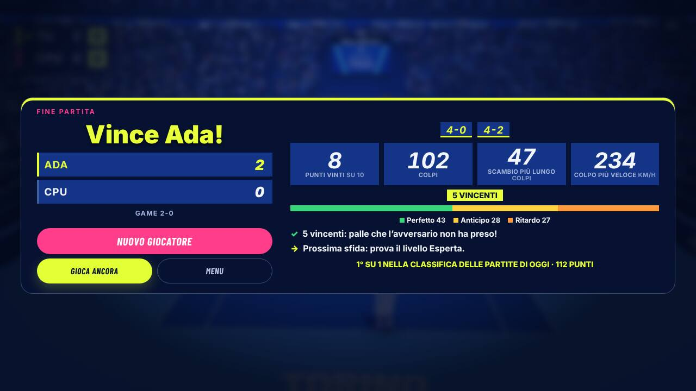
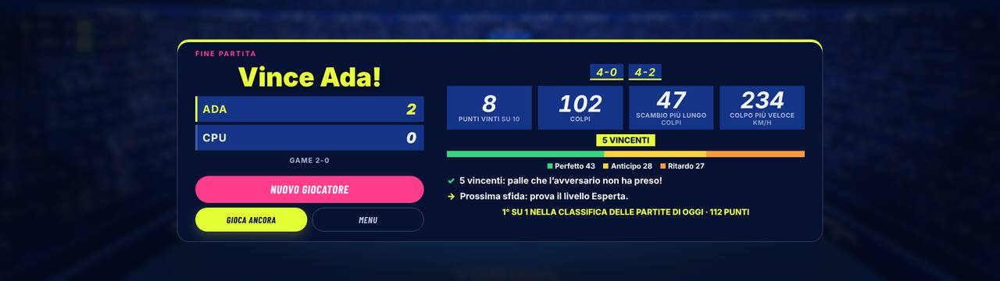
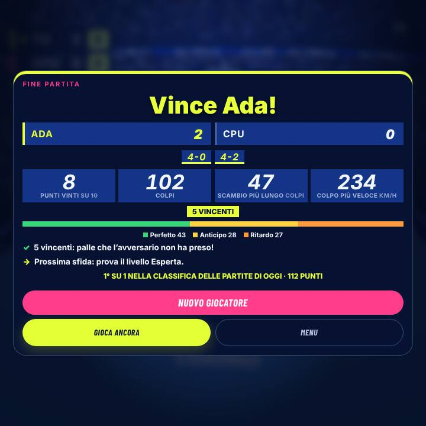
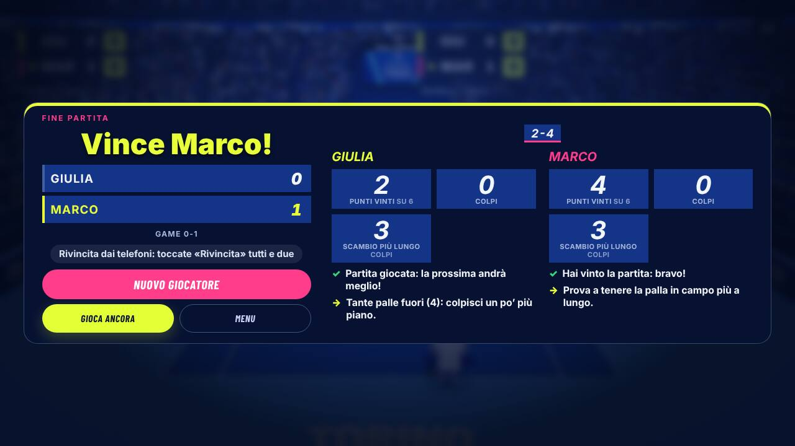
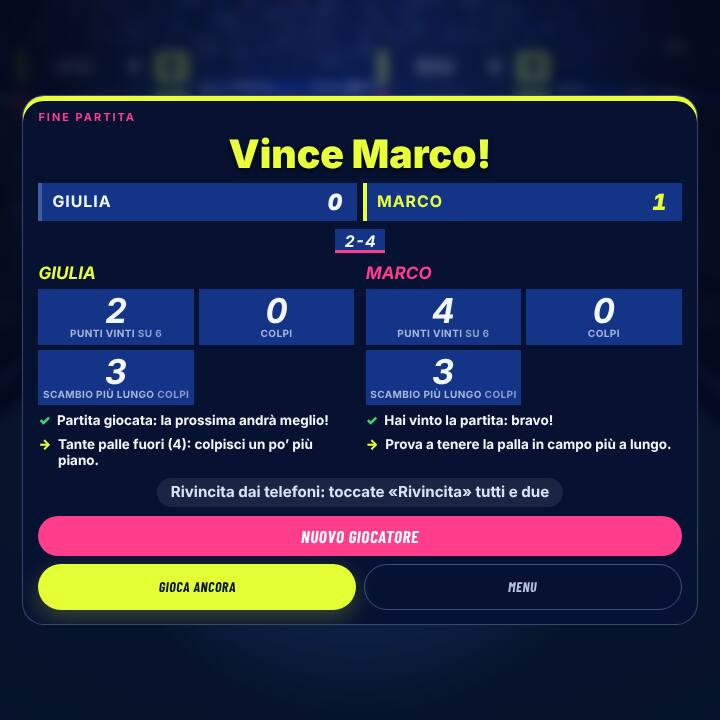
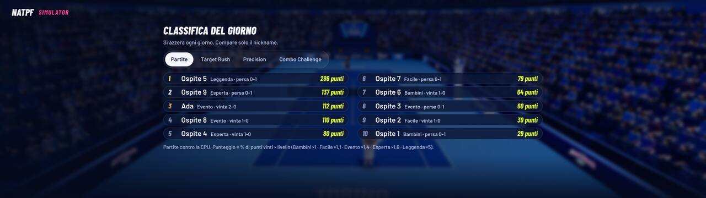
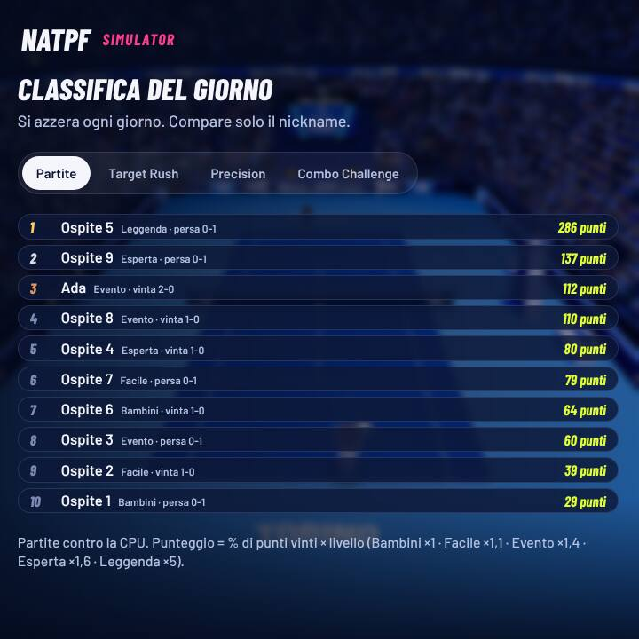

# B33 · Fine partita con dati veri e classifica delle partite

Tappa 3, punto 3 del rapporto `docs/b16/rapporto-gameplay.md` (miglioramento 5). Ramo `b33-fine-partita`.

## In breve

- A fine partita, sotto «Vince …», ci sono i **numeri veri della partita appena giocata**: i punti di ogni game, i
  punti vinti, i colpi, lo scambio più lungo, il colpo più veloce, ace, vincenti e colpi super, e il **voto del tempo**
  (quanti Perfetto, Anticipo e Ritardo). Sotto, **una frase su cosa è andato bene** e **una su cosa migliorare**.
- Ogni partita contro la CPU entra in una **classifica delle partite di oggi**, nella stessa pagina «Classifica del
  giorno» (prima scheda: «Partite»). Il punteggio è **uguale per tutti i livelli** a parità di bravura (spiegato in una
  riga sotto la classifica).
- Il gioco non cambia: stessi colpi, stessi punti (provato con le partite simulate a sorteggi fissi).

## Cosa cambia per chi gioca

**Schermata di fine partita** (contro la CPU, nello stesso schermo, nella sfida tra due computer):

| Cosa si vede | Da dove viene |
|---|---|
| Un riquadro per game con i punti (es. `4-1  2-4  4-0`), verde se l'hai vinto | i punti contati dal gioco, game per game |
| **Punti vinti** «su» quelli giocati | i punti dati dal gioco |
| **Colpi** | i colpi fatti (servizi compresi): uno per ogni scritta del colpo che compare in partita |
| **Scambio più lungo** | quanti colpi nello scambio più lungo |
| **Colpo più veloce** (km/h) | lo stesso numero di km/h che compare nella scritta del colpo (revisione finale: **non sono km/h veri**, vedi sotto) |
| Ace, vincenti, colpi super (solo se ce ne sono) | come è finito ogni punto (servizio non toccato = ace; palla non presa = vincente) |
| Barra colorata del **tempo**: Perfetto · Anticipo · Ritardo | il voto della scritta di ogni colpo nello scambio (il servizio no) |
| ✓ una frase su cosa è andato bene, → una su cosa migliorare | regole semplici sui numeri qui sopra (vedi sotto) |
| «1° su 4 nella classifica delle partite di oggi · 93 punti» | solo contro la CPU |

Esempi di frasi: «5 vincenti: palle che l’avversario non ha preso!», «Gran tempo: 12 colpi perfetti su 20.», «Colpisci
un po’ prima: tanti colpi in ritardo.», «Aspetta un attimo la palla: tanti colpi in anticipo.», «Tante palle in rete
(4): colpisci un po’ più in alto.», «Prossima sfida: prova il livello Esperta.».

- **Contro la CPU**: una colonna, la tua.
- **Stesso schermo**: due colonne, una per giocatore, con il nome e le sue frasi.
- **Sfida tra due computer**: ognuno vede solo i suoi numeri. Sul computer di chi ha creato la sfida tutto come contro la
  CPU. Sul computer del Player 2 (quello che si è unito) si vedono punti, game, scambio più lungo, colpi, colpo più
  veloce e voto del tempo, ma **non ace e vincenti** e niente frasi sugli errori: quel computer non decide i punti e il
  messaggio che riceve non dice sempre come è finito il punto (sul punto che chiude un game arriva solo «Game»).
  Mandare questi dati in rete vorrebbe dire cambiare i messaggi tra i due computer: non l'ho fatto (vincolo del compito).
- Allenamento, minigiochi e scambi di prova non contano: solo la partita.

**Classifica delle partite** (pagina «Classifica del giorno», scheda «Partite»):

- Una riga per partita singola contro la CPU: nickname (o «Ospite»), livello, «vinta 2-1» o «persa 0-2», punteggio.
- **Punteggio = % di punti vinti × valore del livello** (Bambini ×1 · Facile ×1,1 · Evento ×1,4 · Esperta ×1,6 ·
  Leggenda ×5). Esempio: 65% dei punti a Evento = 91; 30% dei punti a Leggenda = 150.
- I valori dei livelli vengono dalle misure qui sotto: lo **stesso giocatore medio** prende circa lo **stesso
  punteggio a ogni livello** (da 88 a 109), quindi chi sceglie un livello facile non passa davanti per forza; chi è
  bravo guadagna a scegliere un livello difficile.
- Non entrano: il doppio (2 contro 2 con la CPU in squadra), lo stesso schermo e la sfida tra due computer (lì non c'è
  un livello della CPU da confrontare).
- Sta solo su questo computer come la classifica dei minigiochi; il **registro dello stand non riceve nomi** (provato:
  nelle righe del registro e nella sua coda il nome non c'è).

## Come si attiva / come si spegne

È **sempre acceso**, non c'è niente da accendere.

- **Vedere la classifica**: Menu principale → «Classifica» → scheda «Partite» (è la prima).
- **A schermo intero sullo stand**: pannello dello stand (Ctrl+Maiusc+K, oppure tenere premuto 3 secondi il marchio
  NATPF in alto a sinistra nel menu) → «Classifica: **A schermo intero**». Si apre sulla classifica delle partite; le
  schede dei minigiochi restano accanto. Con il **telecomando dello staff**: tasto del pannello dello stand, poi le frecce
  fino a «A schermo intero» e OK (è un pulsante del pannello come gli altri; non ho aggiunto un tasto apposta e questo
  passaggio preciso non ha una prova sua).
- **Scaricare**: pannello dello stand → «**Scarica CSV**». Il file di prima ha tre colonne in più (livello, risultato,
  punti vinti); le righe delle partite si chiamano «Partite contro la CPU».
- **Azzerare**: pannello dello stand → «**Azzera oggi**» (azzera insieme minigiochi e partite). Si azzera anche da sola
  ogni giorno.
- **Spegnere**: non c'è un interruttore. Per togliere tutto si torna alla versione prima di questo ramo (i commit sono
  separati: `git revert` dei commit «B33»).

## Misure

### Il gioco non cambia (impronte delle partite a sorteggi fissi)

Banco `scripts/audit/fine-partita.mjs --impronte`: cinque partite simulate da 120 punti con semi fissi; l'impronta
riassume punti, colpi di ogni scambio, voti, motivi dei punti e colpi della racchetta.

| Profilo | Livello | Seme | Prima (base `1906562`) | Dopo, con i numeri della partita accesi | Punti |
|---|---|---|---|---|---|
| umano | Evento | 7 | `6acd6ece0b93e734` | `6acd6ece0b93e734` uguale | 80/120 |
| tennista | Leggenda | 11 | `c942a63d763678bb` | `c942a63d763678bb` uguale | 36/120 |
| bambino | Bambini | 23 | `d0dacfb9f45bc053` | `d0dacfb9f45bc053` uguale | 85/120 |
| medio | Esperta | 31 | `6d8d57e86caadfd2` | `6d8d57e86caadfd2` uguale | 73/120 |
| amatore | Facile | 37 | `0a5f9928e6c49cf2` | `0a5f9928e6c49cf2` uguale | 103/120 |

Lo stesso confronto (con e senza) è anche un test che gira con `npm test` (tre partite).

Nota onesta: la prima volta l'impronta di Evento «con» era diversa da quella «senza». La causa non era questo blocco:
il livello Evento si regola da solo e ricorda il suo stato tra una partita simulata e l'altra nello stesso processo. Il
banco ora riparte da capo prima di ogni partita (come il gioco a ogni visitatore) e le impronte sono uguali.

### Valori dei livelli nel punteggio della classifica

Banco `scripts/audit/fine-partita.mjs --livelli`: percentuale di punti vinti dai giocatori simulati del banco
(`rally-balance.mjs`) a ogni livello, 200 punti per seme, due serie di semi (A: 7, 11, 23 · B: 31, 37, 41).

| Profilo | Serie | Bambini | Facile | Evento | Esperta | Leggenda |
|---|---|---|---|---|---|---|
| bambino | A | 76,2% | 48,5% | 45,2% | 14,2% | 6,5% |
| bambino | B | 74,8% | 46,5% | 45,3% | 18,0% | 7,3% |
| amatore | A | 97,3% | 87,5% | 65,8% | 53,5% | 15,3% |
| amatore | B | 96,5% | 87,2% | 65,3% | 55,5% | 13,7% |
| umano (adulto medio) | A | 89,2% | 86,2% | 67,3% | 64,4% | 22,4% |
| umano (adulto medio) | B | 86,8% | 85,7% | 67,3% | 61,1% | 21,3% |
| tennista | A | 100% | 99,2% | 96,7% | 95,8% | 37,3% |
| tennista | B | 100% | 100% | 95,8% | 95,5% | 34,1% |

Punteggio della classifica con i valori scelti (media delle due serie):

| Profilo | Bambini ×1 | Facile ×1,1 | Evento ×1,4 | Esperta ×1,6 | Leggenda ×5 |
|---|---|---|---|---|---|
| bambino | 76 | 52 | 63 | 26 | 35 |
| amatore | 97 | 96 | 92 | 87 | 73 |
| umano (adulto medio) | **88** | **95** | **94** | **100** | **109** |
| tennista | 100 | 110 | 135 | 153 | 179 |

Come si legge: l'adulto medio prende quasi lo stesso punteggio a ogni livello (88–109); il giocatore bravo sale
scegliendo livelli più difficili. Leggenda vale ×5 perché lì anche l'adulto medio vince circa un punto su cinque.

**Revisione finale (13/11): la media è equa, la singola partita no.** Le tabelle sono medie su 200 punti per seme
(rifatte dal revisore a 7c72b70: umano 91/96/96/102/97, ancora piatte). Una partita della fiera dura 1 game (4–7 punti):
a Leggenda un punto in più vale circa 70 punti di classifica. Il massimo di una vittoria perfetta è 100 a Bambini, 110 a
Facile, 140 a Evento, 160 a Esperta; a Leggenda una sconfitta 3-4 vale 214. Simulazione del revisore (20 000 partite
per caso, probabilità dei punti misurate a 7c72b70), formato a 1 game: l'adulto medio che perde a Leggenda ha mediana
100, 90° percentile 167 e nel 25% delle partite supera 160, cioè ogni vittoria perfetta degli altri livelli; il
«tennista» a Leggenda supera 160 nel 50% dei casi, l'«amatore» nel 14%. Con 2 game: umano 13,6%, tennista 44%. Quindi la
parte alta della classifica del giorno la possono occupare partite perse a Leggenda. Le possibili regole sono una
decisione dell'utente (`docs/revisione-finale-2026-11-13.md`, decisione 1).

### Prove

| Prova | Risultato |
|---|---|
| `npm test` (gioco) | vedi «Verifiche finali» qui sotto |
| Test nuovi `test/natpf-b33-fine-partita.test.mjs` | 10/10: tre partite registrate a sorteggi fissi (Evento, Leggenda, Bambini) dove punti, colpi, servizi, scambio più lungo, colpo più veloce, ace, voto del tempo e game contati coincidono con il motore e con le scritte dei colpi; impronte uguali; regole delle frasi; punteggio; stesso schermo; sfida tra due computer (host e Player 2) sul motore vero; classifica, CSV e azzeramento |
| Nuova prova nel browser `tools/e2e/natpf-fine-partita.mjs` | 33/33: partita contro la CPU giocata davvero dal motore (giocatore simulato): punti, colpi, scambio più lungo, km/h e voto del tempo della schermata uguali al motore; scheda dentro lo schermo senza scorrere e senza testi tagliati a 1280×720, 1920×1080, 1920×540, 1024×600, 720×720; classifica a schermo intero dal pannello dello stand con dieci partite dentro lo schermo alle stesse misure; CSV; «Azzera oggi»; registro senza il nome; stesso schermo con due colonne; «Nuovo giocatore» |

## Schermate (guardate una per una)

Contro la CPU, 1280×720: `img/cpu-1280x720.jpg`

Ledwall 1920×540: `img/cpu-1920x540.jpg` · 1024×600: `img/cpu-1024x600.jpg` · quadrato 720×720: `img/cpu-720x720.jpg`

Stesso schermo, 1280×720 e 720×720 (nella prova i punti sono dati direttamente al motore, per questo «Colpi 0»):

Classifica delle partite a schermo intero con dieci partite, ledwall 1920×540 e 720×720:

## Cosa non è riuscito e perché

- **Ace e vincenti sul computer del Player 2** della sfida tra due computer: non si mostrano (vedi sopra). Per averli
  bisognerebbe aggiungere il motivo del punto al messaggio che l'host manda al Player 2.
- **La classifica a schermo intero prima non stava sullo schermo** con dieci righe (si vedevano sei righe a 1280×720,
  anche per i minigiochi). Ora nelle aree larghe le righe sono su due colonne (1–5 e 6–10) e la dimensione segue
  l'altezza: ci stanno tutte a tutte le misure provate. È un cambiamento anche per le classifiche dei minigiochi.
- Il **colpo più veloce** usa i km/h della scritta del colpo così come sono: con colpi molto forti la scritta del gioco
  arriva anche oltre 200 km/h (nella prova 221–240 km/h). Non li ho corretti: la schermata deve dire lo stesso numero che
  si è visto in partita.
- **Correzione della revisione finale (13/11)**: questi numeri **non sono km/h veri**. Il campo del gioco è in metri e la
  velocità della palla in m/s; i km/h veri sarebbero velocità × 3,6, la scritta del colpo usa velocità × 6,8
  (`game_engine.js`, `Math.round(ball.vel.length()*6.8)`), cioè **1,89 volte la palla del motore**. Nelle partite vere del
  revisore: Evento fino a 233 (123 km/h veri), **Leggenda fino a 334** (177 veri), oltre il record del servizio (263); i
  servizi escono a 126–145 (67–77 veri), più lenti dei colpi di scambio, il contrario del tennis vero. Il colpo più
  veloce conta anche un colpo finito fuori o in rete (nelle partite provate veniva da colpi riusciti). La scala e il
  riquadro «Colpo più veloce» sono una **decisione dell'utente** (`docs/revisione-finale-2026-11-13.md`, decisione 2):
  il codice non è cambiato.

## Cosa non è provato

- Nessuna prova con persone vere, telefoni veri, il PC Windows dell'evento o il ledwall vero: le partite sono del
  motore con un giocatore simulato e le misure dello schermo sono finestre del browser della stessa grandezza.
- La sfida tra due computer è provata solo con il motore senza grafica e snapshot scritti a mano (test), non con due
  browser: la prova `natpf-1v1-p2p` non l'ho rifatta.
- I valori dei livelli vengono da giocatori simulati: con persone vere i rapporti tra i livelli possono essere diversi.
  Se in fiera la classifica sembra ingiusta, si cambiano i cinque numeri in `natpf_match_stats.js` (`LEVEL_WEIGHT`).
- La rivincita dai telefoni nello stesso schermo e il chiosco che torna al menu non hanno una prova nuova: passano da
  `startNewMatch` e dal menu come prima (provati dalle prove esistenti elencate in «Verifiche finali»).

## Verifiche finali

| Verifica | Risultato |
|---|---|
| `npm test` (gioco) | 1385 test, 1385 passati (prima del blocco 1375: +10 test nuovi; un test esistente aggiornato, `natpf-minigiochi-nascosti`, perché ora le schede della classifica cominciano con «Partite») |
| `npm run build` | riuscita |
| `npm run audit:legend` | «Tutti i criteri rispettati» |
| `node --test tools/test/*.test.mjs` (sito e telefono) | 226/226 |
| Impronte a sorteggi fissi (`fine-partita.mjs --impronte`) | 5/5 uguali alla base |
| Nuova prova `natpf-fine-partita` | 33/33 (rifatta dopo l'ultimo cambiamento) |
| `natpf-tabellone` | 42/42 |
| `natpf-nuovo-giocatore` | 28/28 |
| `natpf-menu` | 45/45 |
| `natpf-telecomando` | 81/81 (la prima volta non è partita: mancavano le dipendenze del server LAN e la build in questa copia di lavoro; dopo `npm ci --prefix tools/lan` e `npm run build` è passata) |

Il programma Windows (`natpf-desktop/`) non è toccato. Il pacchetto cresce di pochi kB (un modulo JavaScript e poche
regole CSS; le schermate stanno solo in `docs/`).
