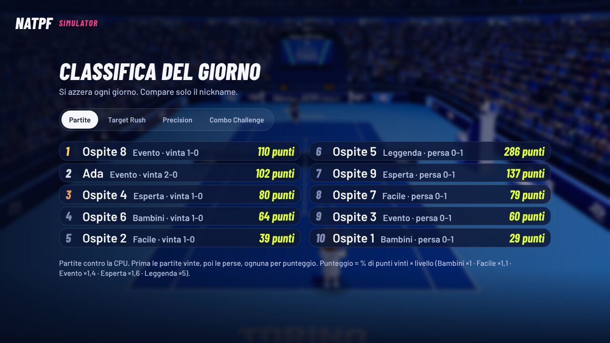
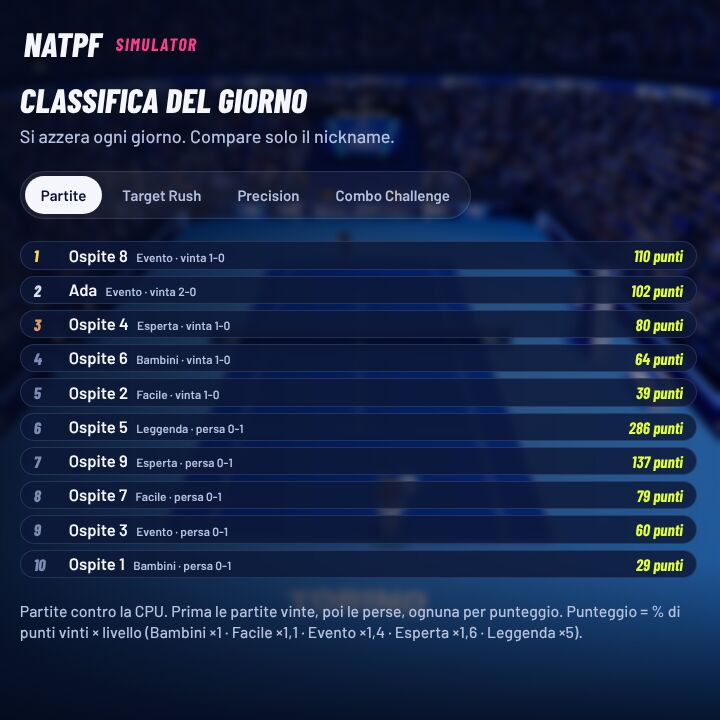

# B34 · Le quattro decisioni dell'utente sulla revisione finale

Ramo `b34-decisioni` (da `95a8712`). Decisioni dell'utente del 13/11/2026 sulla revisione finale
(`docs/revisione-finale-2026-11-13.md` §3): n. 9 (classifica), n. 10 (km/h), n. 1 (Leggenda e gioco a rete),
n. 2 e 11 (scritte «in corsa»). Le altre decisioni (3–8, 12, 13) restano come sono.

## In breve

| Decisione | Cosa cambia per chi gioca |
|---|---|
| **1. Classifica delle partite** | In cima **tutte le partite vinte**, ordinate per punteggio; sotto **le perse**, ordinate per punteggio. Una sconfitta a Leggenda non passa più sopra le vittorie. Lo stesso ordine vale per la frase di fine partita («1° su N…») e per il CSV. |
| **2. km/h veri** | Le scritte dei colpi dicono la **velocità vera della palla**: scambi circa 60–125 km/h, servizi circa 70 (prima 130–240 e 133). Il **colpo più veloce** di fine partita conta solo i colpi **finiti in campo**. |
| **3. Leggenda senza salita a rete** | A Leggenda chi gioca **non sale più a rete da solo** dopo un attacco: torna in fondo come la CPU. Agli altri livelli resta tutto com'era. |
| **4. «in corsa» solo con la corsa forte** | La scritta «in corsa» compare solo quando si arriva sulla palla **correndo forte**. A Evento si passa da quasi 2 scritte per punto a circa 0,1–0,2. Il colpo in corsa vale come prima (stessa forza, stessa precisione). |

Il riconoscimento dei gesti non è toccato. Bambini, stesso schermo, aiuto al più giovane e sfida tra due computer
giocano **esattamente** come prima (partite a sorteggi fissi identiche, sotto).

## 1. Classifica delle partite: prima le vinte, poi le perse

**Prima.** Contava solo il punteggio (% di punti vinti × valore del livello, Leggenda × 5): una sconfitta 3-4 a
Leggenda (214 punti) stava sopra una vittoria perfetta a Esperta (160).

**Ora.**
- Nella scheda «Partite» della «Classifica del giorno» ci sono **in cima tutte le partite vinte**, dalla più alta alla
  più bassa per punteggio, e **sotto tutte le perse**, anche loro per punteggio. A parità, prima chi ha giocato prima.
- La riga sotto la classifica lo dice in una frase: «Partite contro la CPU. **Prima le partite vinte, poi le perse,
  ognuna per punteggio.** Punteggio = % di punti vinti × livello (Bambini ×1 · Facile ×1,1 · Evento ×1,4 · Esperta ×1,6 ·
  Leggenda ×5).»
- La frase di fine partita («3° su 7 nella classifica delle partite di oggi · 128 punti») usa lo stesso ordine.
- «Scarica CSV» (pannello dello stand) ha le partite nello stesso ordine e la colonna «posizione» uguale alla
  classifica.
- Il tabellone di oggi salvato prima di questo aggiornamento (se il gioco viene aggiornato a metà giornata) si
  riordina da solo quando lo si guarda.
- Restano le 50 partite migliori del giorno, ora secondo questo ordine (oltre la 50ª: «Fuori dalle prime 50 partite di
  oggi»).

**Come si attiva / come si spegne.** È sempre attivo, non c'è un'opzione. Si vede in Menu → «Classifica del giorno» →
scheda «Partite», oppure dal pannello dello stand (tasto «A schermo intero»). Per tornare all'ordine di prima bisogna
cambiare il codice (`natpf-tennis/src/natpf/natpf_events.js`, funzione `matchOrder`).

**Prove.**
- Test nuovo «B34: classifica delle partite, prima tutte le vinte…» (`natpf-tennis/test/natpf-b33-fine-partita.test.mjs`):
  sei partite (una persa a Leggenda con 214 punti, vinte a Bambini, Facile, Esperta, perse a Evento e Leggenda):
  posizione al momento di ogni partita, ordine della classifica, CSV nello stesso ordine, parità, tabellone vecchio
  riordinato, frase della regola. Il test B33 di prima ora si aspetta la vinta sopra la persa.
- Prova nel browser `natpf-fine-partita`: controlli nuovi B3c (dieci partite vere e finte: prima tutte le vinte, poi le
  perse, ognuna per punteggio, anche se una persa ha più punti di una vinta) e B4b (CSV nello stesso ordine).

Schermate della prova nel browser (guardate): dieci partite di oggi, la persa a Leggenda con 286 punti è sesta, sotto
tutte le vinte; la riga sotto la classifica dice l'ordine. Anche nel riquadro del ledwall (720 × 720) tutto sta nello
schermo.

## 2. km/h veri della palla

**Prima.** Le scritte dei colpi usavano velocità × 6,8 invece di × 3,6, cioè **1,89 volte** la palla vera; il
servizio senza il gesto del telefono (tastiera, Player 2 della sfida senza telefono) aveva numeri fissi tra 128 e 210.
Il «colpo più veloce» contava anche un colpo finito fuori o in rete.

**Ora.**
- **Tutte** le scritte dei colpi dicono i km/h veri della palla (metri al secondo × 3,6): servizio e scambio con la
  stessa scala, chi gioca, il Player 2 (stesso schermo e sfida tra due computer), il servizio della CPU sul tabellone
  dell'arena.
- **Colpo più veloce** (schermata di fine partita): conta un colpo solo quando si sa che è finito in campo, cioè quando
  qualcuno colpisce la palla dopo, oppure quando il punto finisce in un altro modo che con quella palla fuori o in rete
  (vincente, ace, l'avversario non ci arriva). Se il punto finisce perché quella palla è fuori o in rete, non conta.
  Sul computer del Player 2 della sfida il motivo del punto non arriva: lì un colpo conta solo se chi l'ha fatto vince il
  punto (può mancare qualche colpo buono, uno fuori non entra mai). Una palla che stava andando fuori ma che
  l'avversario colpisce lo stesso conta: per il gioco la palla è in gioco.
- **Il telefono** non scrive i km/h (scrive voto, colpo e motivo): niente da cambiare. Il vecchio messaggio al telefono
  con la velocità (`speedKmh`, collegamento di prima) ora porta anche lui il valore vero.
- **Registro dello stand**: il servizio scrive nel campo `kmh` il valore vero (la velocità della palla in arrivo, campo
  `in` dei colpi, era già vera). Lo strumento di riassunto (`natpf-tennis/scripts/registro/riassunto.mjs`) riporta alla
  scala vera anche i registri delle versioni fino alla **2026-11-13.5** compresa (÷ 1,89), così le misure di prima e di
  dopo si possono sommare; la riga del servizio nel riassunto lo dice.

**Le soglie del gioco non cambiano.** Ho cercato tutti i posti che usavano quei km/h:
- la **minaccia del servizio** (quanto il servizio fa sbagliare o ritardare la CPU, `natpf_skill.js` SERVE_WEIGHT) aveva
  le soglie sulla scala × 6,8 (160 e 190): ora sono scritte in km/h veri (84,7 e 100,6), cioè **le stesse velocità della
  palla**. Test nuovo: per 2 000 velocità tra 15 e 35 m/s il risultato è identico a quello della regola di prima;
- le **medaglie del minigioco «Radar del servizio»** (nascosto dal 30/10): 110 · 140 · 165 diventano 58 · 74 · 87, le
  stesse velocità della palla;
- il servizio senza il gesto aveva un sorteggio per il numero finto: il sorteggio resta (senza usarlo), così le partite
  a sorteggi fissi restano identiche;
- la Leggenda usa già i km/h veri per le sue stime (`natpf_legend.js`): niente da cambiare;
- la scheda del tempo del servizio (nascosta in NATPF) diceva «SWEET SPOT! (198 KM/H)» fisso: tolto il numero.

**Misure: i km/h che si leggono** (partite simulate, 3 semi × 120 punti per riga; due serie di semi; p10/p50/p90 e
massimo; «colpo più veloce» = il numero della schermata finale nelle tre partite).

| Livello / giocatore | Servizi prima → ora | Scambio prima → ora | Colpo più veloce prima → ora |
|---|---|---|---|
| Evento / umano (serie A) | 132/133/134 max 134 → 70/70/71 max 71 | 136/169/183 max 268 → 72/89/97 max 142 | 268 239 257 → 142 127 136 |
| Evento / umano (serie B) | 132/133/134 → 70/70/71 | 138/169/182 max 297 → 73/89/97 max 157 | 264 263 297 → 140 139 157 |
| Facile / amatore (A) | 132/133/133 → 70/70/71 | 135/160/190 max 327 → 72/85/101 max 173 | 327 262 290 → 173 139 154 |
| Esperta / medio (A) | 125/134/144 max 152 → 66/71/76 max 80 | 130/168/201 max 344 → 69/89/107 max 182 | 344 341 341 → 182 181 181 |
| Leggenda / tennista (A) | 132/133/133 → 70/70/71 | 140/194/238 max 399 → 74/103/126 max 211 | 390 399 364 → 207 211 193 |
| Leggenda / tennista (B) | 133/133/133 → 70/70/71 | 134/194/236 max 407 → 71/103/125 max 215 | 407 368 375 → 215 195 199 |
| Bambini / bambino (A) | 132/133/133 → 70/70/71 | 111/128/156 max 327 → 59/68/82 max 173 | 289 327 317 → 153 173 168 |

Ora = prima × 3,6 / 6,8 (lo stesso colpo). I massimi oltre 150 km/h sono colpi rari (colpo super, schiacciate):
sono la velocità vera della palla del gioco, non l'ho cambiata. Nelle 30 partite simulate il colpo più veloce «solo in
campo» è uguale al più veloce di tutti: i colpi più veloci di quelle partite sono finiti in campo. Che la regola tolga
i colpi fuori e in rete lo provano i test (sotto), dove nelle stesse partite ci sono colpi fuori o in rete con i loro km/h.

**Come si attiva / come si spegne.** Sempre attivo, nessuna opzione.

**Prove.**
- `natpf-b33-fine-partita.test.mjs`: test nuovo «B34: colpo più veloce solo con i colpi finiti in campo» (servizio
  buono, risposta, colpo fuori, servizio in rete, servizio rifatto, ace, vincente, punto perso senza palla fuori, computer
  del Player 2); nelle tre partite simulate a sorteggi fissi il colpo più veloce è uguale a quello calcolato dal motore
  (solo colpi non seguiti da «fuori» o «in rete») e ci sono colpi fuori o in rete con i loro km/h.
- `natpf-b18-t2-servizio.test.mjs`: test nuovo sulla conversione delle soglie (identiche per 2 000 velocità × 3
  posizioni × 2 tempi); i test di prima riscritti con la conversione.
- `registro-riassunto.test.mjs`: test nuovo (versione vecchia 170 → 90; versione nuova 90 → 90).
- Prove nel browser: `natpf-fine-partita` (colpo più veloce come le scritte, solo colpi in campo; km/h veri sotto 200 a
  Evento), `natpf-formato-fiera` (servizio della CPU sul tabellone tra 79 e 138 km/h veri), `natpf-servizio-peso`
  (soglie del servizio in km/h veri).

Schermata della prova nel browser (guardata): partita a Evento giocata dal motore, colpo più veloce **143 km/h**
(prima sarebbe stato circa 270); «1° su 1 nella classifica delle partite di oggi · 102 punti».

## 3. Leggenda: chi gioca non sale a rete da solo

**Prima (dal B31).** Dopo un attacco riuscito (palla corta presa alta e giocata profonda, tagliato d'approccio, colpo
forte e profondo da dentro il campo) il personaggio saliva da solo verso la rete, e dopo una volée riuscita ci restava.
A Leggenda «tennista» giocava circa 6 volée a game.

**Ora.** Solo a **Leggenda contro la CPU**: dopo il colpo il personaggio torna sempre verso il fondo (come prima del
B31, e come la CPU, che a Leggenda resta in fondo). Se arriva vicino alla rete per prendere una palla corta, poi torna
indietro. A Bambini, Facile, Evento ed Esperta, nello stesso schermo e nella sfida tra due computer la salita a rete
resta com'era.

**Come si attiva / come si spegne.** Sempre attivo a Leggenda. Il punto nel codice è
`natpf-tennis/src/natpf/natpf_net_play.js`, funzione `playerApproachOff`.

**Misure prima/dopo.** `npm run audit:legend` (8 semi, 300 punti; criteri del livello) e la stessa misura su altri
semi (`scratchpad`: sonda `legp.mjs` con le funzioni di `scripts/audit/legend.mjs`). «Game della CPU» = quota dei game
vinti dalla CPU.

| Giocatore simulato | Semi | Prima (salita a rete) | Ora (niente salita) | Criterio |
|---|---|---|---|---|
| preciso | 8 di base (7…83) | 76,7% | 84,8% | ≥ 60% |
| preciso | altri 8 (97…163) | 73,7% | 69,3% | |
| preciso | altri 24 (173…443) | 76,0% | 78,0% | |
| tennista | 8 di base | 86,6% | 86,1% | ≥ 85% |
| tennista | altri 8 | 87,7% | 90,3% | |
| tennista | altri 24 | 89,8% | 90,9% | |
| medio | 8 di base | 99,0% | 99,3% | ≥ 90% |
| amatore | 8 di base | 98,7% | 99,2% | ≥ 90% |
| bambino, impreciso | 8 di base | 100% | 100% | ≥ 98% |
| Esperta contro «medio» (chi gioca vince) | 8 di base | 75,2% | 75,2% | 70–85% |
| Facile contro «medio» (chi gioca vince) | 8 di base | 100% | 100% | ≥ 95% |

`npm run audit:legend -- --profiles=…` e il banco della rete (`npm run audit:rete -- --difficulty=leggenda
--profiles=tennista,preciso,amatore,umano`, due serie di semi, 3 × 300 punti) a Leggenda:

| Leggenda / giocatore | Serie | Punti di chi gioca | Game di chi gioca | Colpi a rete di chi gioca | Volée per game |
|---|---|---|---|---|---|
| tennista | 1 | 33,8% → 28,0% | 17,8% → 8,1% | 15,5% → 4,2% | 6,22 → 1,88 |
| tennista | 2 | 32,3% → 29,1% | 13,6% → 10,0% | 14,6% → 3,7% | 6,05 → 1,42 |
| preciso | 1 | 37,9% → 32,7% | 20,0% → 10,1% | 7,2% → 4,6% | 4,06 → 2,65 |
| preciso | 2 | 39,8% → 38,9% | 23,9% → 26,4% | 7,5% → 6,4% | 4,14 → 3,64 |
| amatore | 1 | 13,5% → 12,5% | 0,7% → 1,4% | 2,1% → 0,2% | 0,32 → 0,08 |
| umano | 1 | 22,2% → 22,6% | 5,1% → 7,4% | 2,3% → 0,1% | 0,56 → 0,23 |
| umano | 2 | 21,1% → 19,9% | 4,0% → 3,0% | 3,2% → 0,2% | 0,77 → 0,12 |

**Cosa non è andato come previsto (da leggere).**
- La revisione prevedeva con questa scelta «preciso» al **62,6%** dei game della CPU e «tennista» all'**89,0%** («circa
  come prima del B31»). **Non l'ho ritrovato.** «tennista» sì (86–91%, media circa 89–90%), ma «preciso» resta intorno
  al **77%** (84,8%, 69,3% e 78,0% sulle tre serie di semi, prima 76,7%, 73,7% e 76,0%): la differenza è dentro il
  rumore, e se c'è va nel verso opposto (la Leggenda un poco più difficile, non più facile). Il banco della rete lo
  conferma: senza la salita chi gioca bene vince **meno** punti (tennista 33,8 → 28,0% nella serie 1), perché a rete
  vinceva il 69% dei punti in cui c'era. Non so con quale codice o quali semi la revisione abbia misurato il 62,6%: nei
  file della revisione non c'è la misura. I criteri del livello per «preciso» (≥ 60%) e «tennista» (≥ 85%) sono
  rispettati.
- **`npm run audit:legend` ora ha un criterio rosso**: «amatore, errori della CPU 2–6% per colpo» è **1,9%** con gli 8
  semi di base (prima 2,2%). Sugli altri semi è 2,2% (altri 8: prima 2,1%) e 2,1% (altri 24: prima 2,1%). Il motivo
  probabile: senza chi gioca a rete la CPU tira meno passanti, che sono i colpi in cui sbaglia di più. Non ho ritarato la
  Leggenda (il compito dice che il resto non cambia): **è da decidere** se accettare il criterio a 1,9% sugli 8 semi di
  base o ritarare gli errori della Leggenda (`natpf_legend.js`).
- Volée a Leggenda: «tennista» passa da circa 6 a 1,4–1,9 per game, non a 0,8 come prima del B31: le volée che restano
  sono palle prese al volo vicino alla rete dopo una palla corta.

**Gli altri livelli identici.** Impronte delle partite a sorteggi fissi (sotto): tutte le righe di Bambini, Facile,
Evento, Esperta, 1v1, stesso schermo, aiuto al più giovane e sfida tra due computer sono **identiche alla base**;
cambiano solo le 6 righe di Leggenda.

**Prove.** Test nuovo «B34: a Leggenda nessuna salita a rete automatica…» (`natpf-b31-rete.test.mjs`): la regola vale
solo a Leggenda contro la CPU (non agli altri livelli, non nello stesso schermo, non nella sfida, non con le regole del
B31 spente); in una partita vera a Leggenda, dopo i colpi giocati da oltre 8 m dalla rete chi gioca va verso la rete
**0 volte su oltre 200**; a Esperta, stessa partita, la salita c'è ancora. Prove nel browser `natpf-rete` e
`natpf-leggenda`.

## 4. «in corsa» solo con la corsa forte

**Prima (B32).** La riga piccola della scritta del colpo diceva «in corsa» quando al contatto chi gioca correva a più
di metà della sua velocità massima. A Evento capitava a un colpo su cinque: quasi 2 scritte per punto, fino a 22 in
un punto.

**Ora.** La scritta «in corsa» compare solo quando al contatto chi gioca corre ad almeno **0,8** della velocità massima
(la corsa forte). Tra 0,5 e 0,8 il colpo **resta un colpo in corsa per il gioco** (stessa forza, stessa precisione:
la regola usa la velocità vera al contatto, non la scritta), ma la scritta non dice niente. «In allungo» resta come
prima. Se il colpo fallisce, la scritta dice la causa come prima (es. «palla debole: in corsa»).
Il registro dello stand continua a scrivere `mov: corsa` per tutti i colpi in corsa del gioco (da 0,5), come prima: il
riassunto lo dice in una riga («a schermo se ne vedono meno»).

**Come si attiva / come si spegne.** Sempre attivo. Il valore è `runShow: .8` in `natpf-tennis/src/natpf/natpf_skill.js`
(righe `playerRun` di Facile e di Esperta; Evento e Leggenda li prendono da lì); la regola resta `runSay: .5`.

**Misure** (stesse partite simulate: per ogni colpo la scritta di prima e quella di ora; 3 semi × 200 punti per riga,
due serie di semi; «per punto» = scritte diviso punti giocati).

| Livello / giocatore | Serie | «in corsa» per punto prima → ora | «in allungo» per punto | Totale per punto prima → ora | Al massimo in un punto prima → ora | Colpi in corsa per il gioco |
|---|---|---|---|---|---|---|
| Evento / umano | 1 | 1,89 → 0,14 | 0,08 | 1,98 → 0,23 | 22 → 6 | 22,9% (uguale) |
| Evento / umano | 2 | 1,60 → 0,07 | 0,07 | 1,67 → 0,15 | 15 → 5 | 19,4% |
| Evento / amatore | 1 | 1,03 → 0,04 | 0,10 | 1,14 → 0,14 | 15 → 5 | 18,1% |
| Evento / amatore | 2 | 1,20 → 0,05 | 0,12 | 1,32 → 0,17 | 13 → 6 | 18,3% |
| Esperta / umano | 1 | 0,67 → 0,06 | 0,06 | 0,74 → 0,12 | 13 → 5 | 8,4% |
| Esperta / umano | 2 | 0,69 → 0,07 | 0,07 | 0,76 → 0,15 | 14 → 5 | 9,3% |
| Esperta / amatore | 1 | 0,52 → 0,02 | 0,15 | 0,67 → 0,17 | 9 → 5 | 8,2% |
| Esperta / amatore | 2 | 0,49 → 0,03 | 0,12 | 0,61 → 0,15 | 10 → 4 | 8,1% |
| Esperta / medio | 1 | 0,33 → 0,03 | 0,08 | 0,42 → 0,11 | 8 → 3 | 6,5% |
| Esperta / medio | 2 | 0,27 → 0,03 | 0,07 | 0,34 → 0,10 | 8 → 5 | 6,0% |
| Facile / umano | 1 | 0,12 → 0,01 | 0,04 | 0,15 → 0,05 | 4 → 3 | 2,8% |
| Facile / umano | 2 | 0,09 → 0,01 | 0,07 | 0,16 → 0,08 | 4 → 4 | 2,3% |
| Facile / amatore | 1 | 0,13 → 0,02 | 0,08 | 0,21 → 0,09 | 4 → 4 | 3,2% |
| Facile / amatore | 2 | 0,13 → 0,01 | 0,06 | 0,20 → 0,07 | 4 → 3 | 3,2% |
| Leggenda / tennista | 1 | 0,57 → 0,05 | 0,78 | 1,36 → 0,83 | 9 → 8 | 6,3% |
| Leggenda / tennista | 2 | 0,60 → 0,04 | 0,80 | 1,40 → 0,84 | 9 → 6 | 6,8% |

(«Al massimo in un punto» conta le scritte tra un cambio di punteggio e l'altro.) A Evento l'obiettivo «molto meno di
1 per punto» è raggiunto: 0,04–0,14 «in corsa» per punto. Punti vinti e giocati di ogni riga sono gli stessi di prima
(es. Evento/umano serie 1: 350 su 518 prima e dopo), e le impronte delle partite sono identiche (sotto). A Leggenda
restano tante scritte «in allungo» (0,8 per punto): non erano nella decisione, non le ho toccate.

**Prove.** Test nuovo «B34: «in corsa» scritto solo da 0,8…» (`natpf-b32-movimento.test.mjs`): valori per livello,
regola e registro da 0,5, scritta da 0,8, «in allungo» come prima, colpo fallito con la causa come prima; in una partita
a Evento le scritte «in corsa» sono meno di un quarto di prima e meno di 0,35 per punto, e ogni scritta «in corsa» è su
un colpo in corsa per il gioco. Prova nel browser `natpf-movimento`: cerca una palla larga e veloce e la gioca finché
trova il colpo con la corsa forte: al contatto 7,64 m/s su 8,8 (0,87 della massima), scritta letta nella pagina
«Perfetto · in corsa · 91 km/h»; poi un colpo con la corsa media (5,35 m/s, 0,61): colpo in corsa per il gioco, scritta
«Perfetto · 94 km/h» senza «in corsa». Le schermate di quella prova non mostrano la scritta (nella schermata il
personaggio si vede, la scritta no: la prova la legge dalla pagina), per questo non le metto qui.

## Impronte: cosa non cambia

Impronta (sha1) di tutto quello che succede in partite a sorteggi fissi, sulla base `95a8712` e sul ramo (sonda
`scratchpad/imp.mjs`): contro la CPU 6 livelli (Bambini, Facile, Evento, Esperta, Leggenda, 1v1) × 6 giocatori × 2
semi × 80 punti; stesso schermo (bambino–bambino in fiera, medio–medio classico, amatore–medio in fiera), aiuto al più
giovane (bambino con adulto, variante in gioco), sfida tra due computer (medio–amatore); 8 partite × 2 semi ciascuna.

| Passo | Righe uguali alla base | Righe diverse |
|---|---|---|
| Classifica e km/h veri (decisioni 1 e 2) | 41 su 41 | nessuna |
| + Leggenda senza salita (decisione 3) | 35 su 41 | le 6 righe di Leggenda (attese) |
| + scritta «in corsa» (decisione 4) | 41 su 41 rispetto al passo prima | nessuna |

Anche `scripts/audit/fine-partita.mjs --impronte` (5 partite, statistiche accese e spente): uguale alla base nei passi
1–2; con le statistiche accese sempre «uguale» a quelle spente.

## Verifiche fatte (ramo `b34-decisioni`)

| Verifica | Risultato |
|---|---|
| `npm test` (gioco) | 1416 su 1417 superati, 0 falliti, 1 saltato (come prima) |
| `node --test tools/test/*.test.mjs` (sito e telefono) | 226/226 |
| `npm run build` | riuscita |
| `npm run audit:legend` | **esce con «1 criteri non rispettati»**: «amatore, errori della CPU 2–6%» a 1,9% (prima 2,2%); tutti gli altri rispettati (vedi decisione 3) |
| Prova nel browser `natpf-fine-partita` | 38/38 |
| Prova nel browser `natpf-movimento` | 17/17 |
| Prova nel browser `natpf-rete` | 11/11 |
| Prova nel browser `natpf-leggenda` | 7/7 |
| Prova nel browser `natpf-formato-fiera` (servizio della CPU in km/h veri) | 22/22 |
| Prova nel browser `natpf-servizio-peso` (soglie del servizio) | 8/8 |
| Impronte delle partite a sorteggi fissi | come nella tabella sopra |

Il programma Windows (`natpf-desktop/`) non è toccato: non ho rifatto i suoi test.

## Cosa non è provato

- **Persone vere**: tutte le misure sono partite simulate con giocatori simulati. Non ho provato con un telefono vero,
  su Windows, sul ledwall o in fiera.
- **La scritta «in corsa» guardata a schermo**: la prova nel browser la legge dalla pagina, ma non ho una schermata in
  cui si veda.
- **Leggenda**: il 62,6% della revisione non è ritrovato (sopra); il criterio «errori della CPU» dell'amatore è a 1,9%
  sugli 8 semi di base (da decidere).
- **Colpo più veloce nella sfida tra due computer**: provato con i test di unità (sul computer del Player 2 conta solo
  se chi ha colpito vince il punto), non con due computer veri in rete.
- **Registro dello stand**: provato il riassunto con righe di prova di una versione vecchia e di una nuova; non ho un
  registro vero dello stand con la versione nuova.
- Un tabellone «Partite» salvato oggi prima dell'aggiornamento si riordina quando lo si guarda (test); non provato
  aggiornando davvero un computer dello stand a metà giornata.
- Il personaggio a Leggenda dopo la palla corta: torna indietro anche se è vicino alla rete; guardato nelle misure, non
  in una partita vera guardata a schermo.
