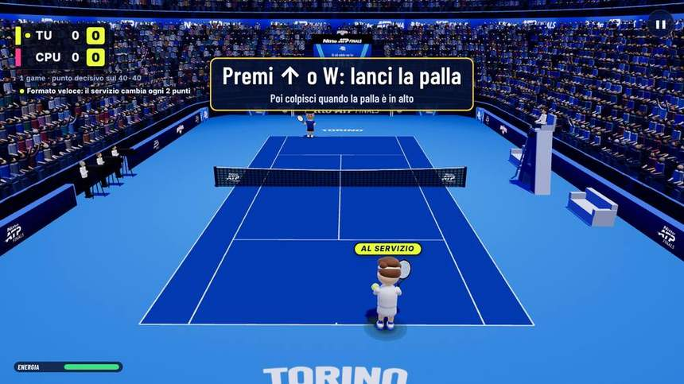
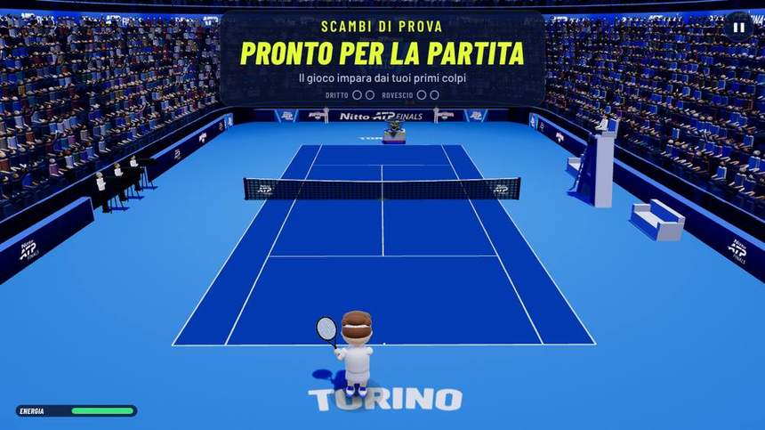
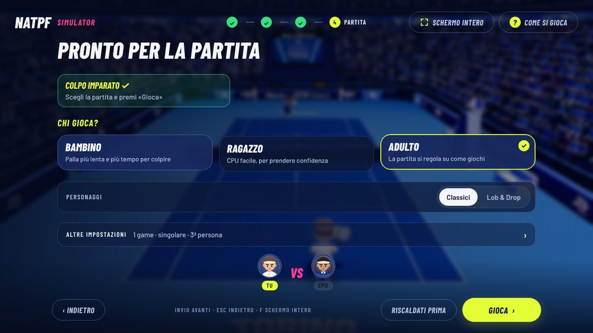
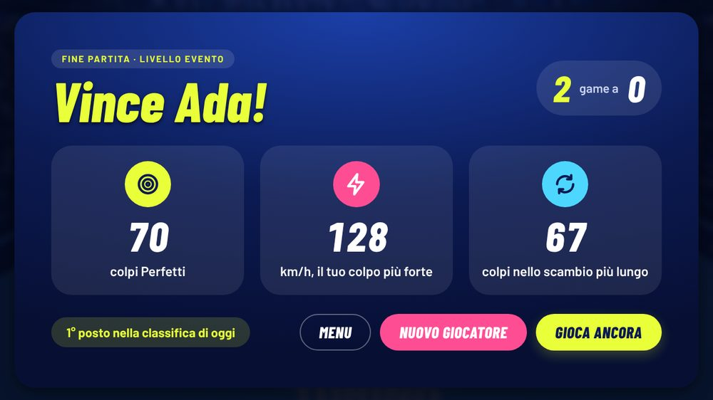
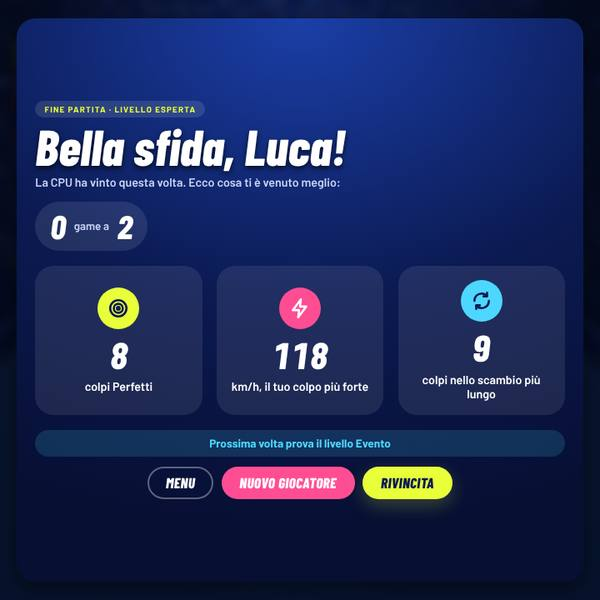
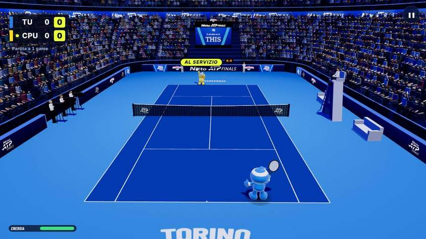
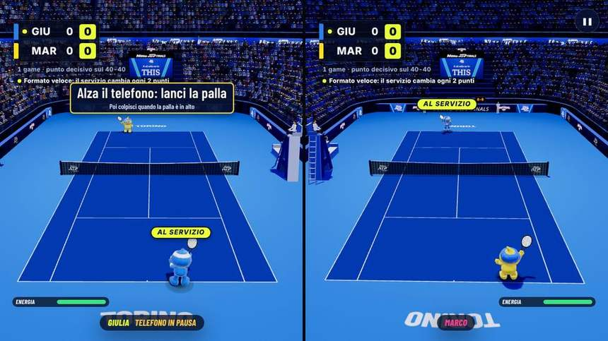
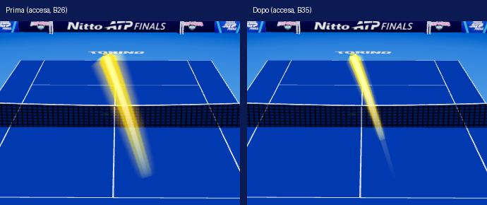

# B35b · Correzioni dal collaudo del 13/11 (battuta, impostazioni, chi serve, scia, fine partita)

Collaudo dell'utente con un telefono vero sulla versione 2026-11-13.6 (programma Windows). Questo blocco corregge
cinque punti: **3** la battuta che passava da un giocatore all'altro, **4** la partita che partiva da sola dopo gli
scambi di prova, **5** la schermata di fine partita, **6** chi serve con i personaggi Lob & Drop, **7** la scia della
palla. La precisione dei colpi dal telefono è un altro blocco (B35a, `docs/b35/precisione-telefono.md`): qui il
riconoscimento dei gesti non è stato toccato.

Commit di questo blocco (ramo `b35-collaudo`, partito da `d152035`): `46cb949` (scia), `0e8782e` (battuta e chi serve),
`1b603a7` (impostazioni dopo gli scambi di prova), `77bda09` (fine partita), `d5830f6` («Ricalibra» sulla pagina «Pronto
per la partita»); poi le prove nel browser (`fbc4026`, `4578ca1`, `d2a0aad`, `ca87f62`) e questo documento.

## In breve: cosa cambia per chi gioca

| Punto | Prima | Adesso |
|---|---|---|
| 3 · battuta | Nello stesso schermo il servizio passava ogni 2 punti (formato in fiera) senza che nessuno lo dicesse | Quando il servizio passa ogni 2 punti lo dicono il banner d'inizio e una riga sotto il tabellone: «Formato veloce: il servizio cambia ogni 2 punti». Contro la CPU, con le opzioni di base, batte sempre lo stesso giocatore per tutto il game (com'era già) |
| 4 · impostazioni | Dopo gli scambi di prova la partita partiva subito, senza poter scegliere niente | Dopo gli scambi di prova si arriva alla pagina «Pronto per la partita» con «Chi gioca», «Personaggi» e «Altre impostazioni»; la partita parte solo con «Gioca» |
| 5 · fine partita | Tanti numeri (game, punti, colpi, km/h, barra Anticipo/Ritardo, una frase su cosa migliorare) | Titolo grande, game in una pillola, al massimo **tre** riquadri tondi con le cose migliori della partita, mai numeri negativi |
| 6 · chi serve | Nello stesso schermo la scritta «Al servizio» non c'era (né con i Classici né con Lob & Drop); la pallina del tabellone si perdeva sul giallo di Lob | «Al servizio» sopra chi batte in tutte e due le metà, con tutti i personaggi; pallina del tabellone con il bordo scuro |
| 7 · scia | Accesa di base, larga e luminosa | **Spenta di base**; se la si accende è più sottile, più corta e meno luminosa. Chi l'aveva scelta resta con la sua scelta |

## Come si attiva / come si spegne

- **Formato in fiera** (servizio ogni 2 punti e punto decisivo sul 40-40): pannello dello stand (Ctrl+Maiusc+K, oppure
  tenere premuto 3 secondi il marchio NATPF in alto a sinistra nel menu; dal telecomando dello staff il tasto
  «Pannello dell'addetto») → riga **«Formato in fiera»**. Ogni clic cambia valore: «No» → «Solo stesso schermo» → «Sì · punto
  decisivo». Di base vale **«Solo stesso schermo»**: contro la CPU e nella sfida tra due computer il servizio resta a un
  giocatore per game. **Per spegnerlo del tutto: «Formato in fiera: No».** Se il pannello mostra «Sì · punto decisivo»
  (scelta salvata sul computer, anche da una versione di prima), anche contro la CPU il servizio passa ogni 2 punti:
  la riga «Formato veloce» adesso lo dice.
- **Campo aperto** (solo stesso schermo, servizio ogni 2 punti anche lui): pannello dello stand → «Campo aperto». Di base
  è spento.
- **Scambi di prova e pagina «Pronto per la partita»**: con «Calibrazione: Giocando» (valore di base, pannello dello
  stand → «Calibrazione») dopo «Collega» e il tutorial corto si fanno gli scambi di prova, poi si arriva alla pagina.
  «Salta ›» (sul computer, «Avanti» sul telefono, «Salta» sul telecomando dello staff) porta subito alla pagina. Per
  rifarli stando sulla pagina (per esempio se il telefono passa a un'altra persona): telecomando dello staff → «Ricalibra
  il telefono», oppure «Ricalibra» nel pannello del telefono quando è aperto; finiti gli scambi si torna alla pagina. Non
  c'è niente da accendere: è il percorso nuovo. Per tornare agli scambi di prova dopo «Gioca» come prima del B35 non c'è
  un interruttore; con «Calibrazione: Nessuna» (pannello dello stand) gli scambi di prova non si fanno: la pagina
  arriva dopo «Collega» e il tutorial corto, e il gioco impara dai primi colpi veri.
- **Scia della palla**: menu → **Opzioni** → riga **«Scia della palla: Sì · No»**. Di base No. «Sì» la accende (resta
  salvata sul computer), «No» la spegne.
- **Riga «Formato veloce: il servizio cambia ogni 2 punti»**: compare da sola quando il servizio passa ogni 2 punti
  (formato in fiera o campo aperto); non ha un interruttore suo: sparisce con «Formato in fiera: No» (e «Campo aperto»
  spento), cioè quando il servizio resta a un giocatore per game.
- **«Al servizio» nelle due metà dello stesso schermo e pallina del tabellone con il bordo scuro**: sempre, non ci sono
  opzioni.
- **Fine partita**: compare da sola alla fine di ogni partita, non ci sono opzioni.

## Punto 3 · «Su un game BO1 la battuta era alternata e non fissa ad un giocatore»

**Cosa ho controllato.** Ho rifatto con il motore vero, con le opzioni di base, chi batte punto per punto in ogni modo
(test `natpf-b35-battuta.test.mjs`, A = chi batte per primo, B = l'altro):

| Modo (opzioni di base) | Chi batte, punto per punto | Perché |
|---|---|---|
| Contro la CPU, partita a 1 game | A A A A A A A (sempre lo stesso) | formato in fiera «Solo stesso schermo»: qui non vale |
| Sfida tra due computer | A A A A A A A | come sopra |
| Stesso schermo | A B B A A B | formato in fiera di base: il servizio passa ogni 2 punti |
| Stesso schermo con «Campo aperto: Sì» | ogni 2 punti | regola del campo aperto (B25), spento di base |
| Contro la CPU con «Formato in fiera: Sì» salvato | A B B A | scelta dello staff (o salvata da una versione di prima) |
| Qualunque modo con «Formato in fiera: No» | A A A A A A | formato classico |
| Scambi di prova (B28) | non cambiano niente: la partita parte da 0-0 con le regole del modo | |

**Conclusione.** Contro la CPU con le opzioni di base il servizio **non** alterna: non è un difetto del gioco. Il
servizio alterna ogni 2 punti nello stesso schermo (voluto: formato in fiera di base dal B20) o quando sul computer è
salvato «Formato in fiera: Sì». Il gioco però non lo diceva da nessuna parte, quindi sembrava un errore.

**Correzione.** Quando il servizio passa ogni 2 punti, a inizio partita il banner sotto «Si gioca» e una riga sotto il
tabellone (in tutte e due le metà nello stesso schermo) dicono **«Formato veloce: il servizio cambia ogni 2 punti»**.
Quando non passa, nessuna riga: il tabellone è quello di prima. Il gioco non cambia (impronte uguali, vedi sotto).

## Punto 4 · Impostazioni dopo gli scambi di prova

**Prima:** «Collega» → tutorial corto → pagina «Partita» → «Gioca» → scambi di prova → «Si comincia!» → la partita
partiva subito, senza poter scegliere chi gioca, personaggi o lunghezza.

**Adesso (contro la CPU, calibrazione «Giocando»):** «Collega» → tutorial corto → **scambi di prova** → scritta grande
**«Pronto per la partita»** → pagina «Pronto per la partita» con **«Chi gioca»**, **«Personaggi»**, **«Altre
impostazioni»** e la riga «Colpo imparato ✓ · Scegli la partita e premi «Gioca»» → la partita parte **solo con
«Gioca»**, subito, senza rifare gli scambi.

- **«Gioca ancora» / «Rivincita»** a fine partita contro la CPU: di nuovo gli scambi di prova (molte persone, un
  telefono: come dal B28), poi la pagina, poi «Gioca».
- **«Ricalibra» sulla pagina «Pronto per la partita»** («Ricalibra il telefono» dal telecomando dello staff, o
  «Ricalibra» nel pannello del telefono quando è aperto): si rifanno subito gli scambi di prova con il profilo da capo e
  si **torna alla pagina**; la partita parte con «Gioca». Il telecomando lo dice: «Scambi di prova: poi la pagina
  «Pronto per la partita»».
- Se si arriva alla pagina senza scambi fatti (per esempio dopo «Ricalibra» dal menu principale), «Gioca» fa prima gli
  scambi di prova e **riporta alla pagina**; la partita parte con il «Gioca» dopo.
- **Telecomando dello staff**: durante gli scambi di prova «Salta» porta alla pagina «Pronto per la partita» (il
  telefono dello staff scrive «Scambi di prova saltati: pagina «Pronto per la partita»») e la partita parte con «Gioca!»
  dal telecomando.
- **«Ricalibra» a partita in corso** (pausa → Telefono → «Ricalibra»): resta come dal B28, si rifanno gli scambi di
  prova e si **rigioca il punto con il punteggio com'era**. Non porta alla pagina, perché la partita è già cominciata e
  le impostazioni sono già scelte (tornare alla pagina vorrebbe dire buttare la partita in corso). Se l'utente lo vuole
  diverso, è una modifica piccola.
- Stesso schermo e sfida tra due computer: come prima (nello stesso schermo gli scambi di prova sono dopo il conto alla
  rovescia; chi invita nella sfida tra due computer li faceva già prima della pagina).

| Misura (telefono simulato, 1280×720) | Prima | Adesso |
|---|---|---|
| Dove si arriva dopo gli scambi di prova | partita già partita | pagina «Pronto per la partita» (partita non partita: 0 partite iniziate) |
| Secondi degli scambi di prova (4 palle colpite) | 10–15 s, poi la partita | 14,3 e 14,5 s fino alla pagina (due giri; la prima palla aspetta il profilo da capo del telefono, chiesto alla chiusura del tutorial) |
| Da «Gioca» al primo punto | 10–15 s (c'erano gli scambi in mezzo) | 0,1–0,2 s |
| «Ricalibra» sulla pagina | profilo da capo; gli scambi di prova poi con «Gioca» e subito la partita | scambi di prova subito (profilo da capo, 4 palle colpite in circa 10 s), poi di nuovo la pagina; la partita parte con «Gioca» in 0,1 s |

## Punto 5 · Fine partita

La schermata segue la proposta grafica mostrata all'utente (tre tavole: vittoria contro la CPU, sconfitta, stesso
schermo):

- in alto una pillola piccola «Fine partita · livello Evento» e il **titolo grande**: «Vince Ada!» se vince (con il nome
  scelto, altrimenti «Hai vinto!»), **«Bella sfida, Luca!»** se perde, con sotto «La CPU ha vinto questa volta. Ecco cosa
  ti è venuto meglio:»;
- a destra i **game in una pillola** («2 game a 0»);
- al massimo **tre riquadri tondi** con le cose migliori della partita, scelti da soli tra quelle positive e non nulle:
  colpi Perfetti, km/h del colpo più forte (km/h veri, solo colpi finiti in campo), colpi nello scambio più lungo (da 3
  in su), vincenti («che la CPU non ha preso»), ace, colpi super riusciti, punti vinti. Si scelgono le più «grosse»
  (un ace vale come 3 Perfetti, come 40 km/h, come 2 vincenti, come uno scambio di 8 colpi o 8 punti vinti) e si
  mostrano sempre nello stesso ordine. Se non c'è niente da mostrare, un riquadro con i colpi giocati o «1 partita
  giocata»: mai un numero brutto;
- **mai numeri negativi**: niente errori, niente barra Anticipo/Ritardo, niente «cosa migliorare»;
- una **pillola in basso**: se vince il posto nella classifica di oggi («1° posto nella classifica di oggi»; fuori
  dalle prime, i punti della partita, mai «fuori»); se perde un consiglio gentile («Prossima volta prova il livello
  Evento», il livello sotto; al livello più facile «Prossima volta andrà ancora meglio!»);
- **bottoni a pillola**: Menu, Nuovo giocatore, «Gioca ancora» (se vince contro la CPU) o «Rivincita»;
- **stesso schermo**: «Fine partita · 1 game a 0», «Vince Marco!», due schede tonde (chi vince con il bordo giallo e
  «Vince», l'altro «Bella sfida»), **due cose belle per giocatore**, e nella pillola in basso «Scambio più lungo della
  partita: N colpi» (per questo non si ripete nelle schede);
- **sfida tra due computer**: ognuno vede le sue cose sul suo computer (il Player 2 senza ace e vincenti, che sul suo
  computer non si sanno).

I numeri sono quelli veri del motore (stessi conti del B33): cambia solo cosa si mostra. Tutto con misure legate allo
schermo (`cqw/cqh`, `@container natpf`): ci sta senza scorrere a 1280×720, 1920×1080, 1920×540 (ledwall), 1024×600 e
720×720, guardato su ogni schermata. Il registro dello stand non è cambiato e non ha nomi (provato).

**Quanti numeri mostra la parte centrale della schermata**, stessa partita a sorteggi fissi con il codice di prima
(`d152035`) e con quello di adesso (partite lunghe da 90 punti del banco, chi gioca è un robot: servono per contare, non
sono partite vere):

| Serie di semi | Partite | Numeri prima | Cose negative prima | Numeri adesso | Cose negative adesso |
|---|---|---|---|---|---|
| 7, 11, 23 | 9 (tre livelli) | da 38 a 50 | 3 in ogni partita (Anticipo, Ritardo, cosa migliorare) | 3 | 0 |
| 31, 37, 41 | 9 | da 37 a 52 | 3 in ogni partita | 3 | 0 |

(Adesso in più ci sono i 2 numeri dei game nella pillola e, se vince, il posto in classifica.) Nella partita vera
dell'ultimo giro della prova nel browser (Evento, 2 game a 0) i riquadri sono stati: 70 colpi Perfetti, 128 km/h, 67
colpi nello scambio più lungo, tutti uguali a quelli contati dalle scritte dei colpi e dai punti del motore. A ogni giro
la partita è diversa (il giocatore simulato sbaglia il tempo a caso): in un giro prima erano 7 vincenti, 69 Perfetti e
100 colpi nello scambio più lungo, 2 game a 1.

## Punto 6 · Chi serve con Lob & Drop

Contro la CPU la scritta «Al servizio» c'era già con tutti e due i personaggi; nello stesso schermo **non c'era con
nessuno** (il motore la toglie perché è di una vista sola). Adesso nello stesso schermo ci sono due scritte, una per
metà, sopra chi batte, con Classici e con Lob & Drop. La pallina gialla del tabellone e la scritta hanno un bordo scuro,
così si vedono anche accanto al giallo di Lob.

| Prova nel browser (partita vera, al servizio) | Classici | Lob & Drop |
|---|---|---|
| Contro la CPU, batte chi gioca | ✓ scritta e pallina | ✓ scritta e pallina |
| Contro la CPU, batte la CPU | ✓ | ✓ |
| Stesso schermo, batte il Player 1 | ✓ due scritte (prima: nessuna) | ✓ due scritte (prima: nessuna) |
| Stesso schermo, batte il Player 2 | ✓ due scritte (prima: nessuna) | ✓ due scritte (prima: nessuna) |

## Punto 7 · Scia della palla

Spenta di base. Chi aveva scelto «Sì» nelle Opzioni la ritrova accesa (la scelta è salvata sul computer); chi non
aveva mai toccato l'opzione la trova spenta. Accesa è a metà strada tra quella del B22 e quella del B26:

| | Prima (B26) | Adesso (B35) |
|---|---|---|
| Valore di base | Sì | **No** |
| Larghezza del nastro | 0,8 m | 0,55 m |
| Alone | 2,2 volte, intensità 0,5 | 1,7 volte, intensità 0,32 |
| Lunghezza | 0,42 s di volo, al massimo 10 m | 0,3 s, al massimo 8 m |
| Opacità | 0,92 | 0,7 |
| Piena da | 14 m/s | 18 m/s |

Pixel della scia nelle stesse scene ferme (prova nel browser `natpf-scia-palla`, accesa, 1280×720):

| Scena | Prima | Adesso | Differenza |
|---|---|---|---|
| Andata (27 m/s) | 8312 | 2919 | −65 % |
| Ritorno (25 m/s) | 2203 | 993 | −55 % |
| Colpo potente (33 m/s) | 6434 | 2269 | −65 % |
| Rimbalzo (23 m/s) | 6192 | 2835 | −54 % |
| Stesso schermo | 7800 | 2982 | −62 % |
| Palla lenta (9,5 m/s) | 0 | 0 | niente scia sotto 10 m/s, come prima |

Costo con la scia accesa: +3 % del disegno di un fotogramma, 2 µs di calcolo (grafica in software, il caso peggiore).

## Il gioco non cambia: impronte delle partite

Le stesse partite a sorteggi fissi giocate con il codice di prima (`d152035`) e con quello di adesso (dopo l'ultimo
commit) hanno la stessa impronta (punti, scambi, voti dei colpi, motivi dei punti, racchetta):

| Serie di semi | Partite (5 profili × 5 semi, 80 punti) | Impronte |
|---|---|---|
| 7, 11, 23, 31, 37 | 25 | @@IMP1@@ |
| 41, 43, 47, 53, 59 | 25 | @@IMP2@@ |

`npm run audit:legend`: @@LEG@@ Il riconoscimento dei gesti non è toccato (nessuno dei file del telefono e dei gesti
cambiato; i file della direzione dei colpi cambiati dal B35a non sono toccati da questo blocco).

## Verifiche

| Cosa | Risultato |
|---|---|
| Test del gioco (`npm test`) | @@NPM@@ |
| Test del sito (`node --test tools/test/*.test.mjs`) | @@SITO@@ |
| Build (`npm run build`) | riuscita |
| Peso | i file del gioco toccati crescono di circa 7,9 KB compressi (sorgenti con i commenti; niente immagini, font o librerie nuove) |
| Unione di prova con `natpf-simulator` (dove c'è già il B35a) | @@UNIONE@@ |

Test nuovi: `natpf-b35-fine-partita.test.mjs` (7: cose migliori solo positive, pillola, vittoria, sconfitta e doppio,
stesso schermo, sfida tra due computer, numeri veri a sorteggi fissi), `natpf-b35-battuta.test.mjs` (punti 3 e 6);
aggiornati i test degli scambi di prova (anche «Ricalibra» sulla pagina «Pronto per la partita»), del telecomando e
della scia.

Prove nel browser (telefono simulato, mouse):

| Prova | Risultato | Quando |
|---|---|---|
| `natpf-scambi-di-prova` contro la CPU, 4 palle colpite (con «Ricalibra» sulla pagina) | 30/30 | dopo l'ultimo commit |
| `natpf-telecomando` | 85/85 | dopo l'ultimo commit |
| `natpf-fine-partita` (cinque misure, partita vera contro la CPU, classifica, registro senza nomi, stesso schermo) | 47/47 | dopo l'ultimo commit |
| `natpf-scambi-di-prova` senza colpi, con schermate | 19/19 | prima di `d5830f6` (che non tocca questo percorso) |
| `natpf-scambi-di-prova` stesso schermo | 12/12 | prima di `d5830f6` (idem) |
| `natpf-lob-drop` parte 7 (chi serve, Classici e Lob & Drop) | 13/13 | |
| `natpf-lob-drop` intera | 131/136: vedi «Cosa non è riuscito» | |
| `natpf-formato-fiera` | 25/25 | |
| `natpf-scia-palla` | 39/39 | |
| `natpf-menu` | 45/45 | |
| `natpf-chi-gioca` | 55/55 | |

## Cosa non è riuscito e perché

- **«Ricalibra» a partita in corso non porta alla pagina «Pronto per la partita»**: scelta voluta (vedi punto 4), per
  non buttare una partita già cominciata. Prima della partita «Ricalibra» porta alla pagina (subito dalla pagina, con
  «Gioca» dal menu principale).
- **`natpf-lob-drop` intera: 5 controlli su 136 non passano, nessuno per questo blocco.** Quattro sono «al colpo le
  corde sono dove erano» (la racchetta scostata dalla testa grande della mascotte): è un difetto noto dal B32
  (`docs/b32/movimento.md`). I due senza modelli 3D falliscono **uguali, con gli stessi numeri, sul codice di prima**
  (`d152035`); i due con i modelli 3D non li ho rifatti sul codice di prima, ma questo blocco non tocca personaggi,
  modelli né racchetta (solo la scritta «Al servizio» e il tabellone). Il quinto è il tempo di disegno con i modelli
  3D (+14 % contro il 12 % ammesso), misurato con la grafica in software e la macchina carica da un altro agente;
  chiamate e triangoli sono nei limiti.
- **Prove fermate dal carico della macchina** (un altro agente lavorava in parallelo): `natpf-telecomando` al primo giro
  si è fermata all'abbinamento (tempo scaduto) e la parte 7 di `natpf-lob-drop` al primo giro per il browser chiuso;
  rifatte uguali, verdi.
- Con le partite lunghe del banco i riquadri sono quasi sempre colpi Perfetti, vincenti e punti vinti (sono i numeri
  più grossi); nelle partite vere da 1–3 game compaiono più spesso km/h e scambio più lungo. La proposta grafica
  mostrava un esempio: la scelta vera dipende dai numeri della partita.

## Cosa non è provato

- **Telefono vero, programma Windows vero, ledwall vero e persone vere**: tutte le prove sono nel browser con un
  telefono simulato (eventi di movimento finti) e mouse; l'installer non è stato rifatto in questo blocco.
- **«Ricalibra il telefono» dal telecomando sulla pagina «Pronto per la partita»**: provato con i test di unità
  (suggerimento e risposta del telecomando) e, nel browser, con la stessa funzione del gioco dal pannello del telefono
  (aperto dal codice della prova); non premendo il tasto sul telecomando nel browser.
- La **sconfitta** nella schermata finale è provata con i test di unità e con una schermata fatta con numeri di prova
  (le tavole «sconfitta» qui sopra), non con una partita persa giocata dal motore nel browser.
- La **sfida tra due computer** alla fine della partita è provata solo con i test di unità (motore senza grafica), non
  con due browser.
- La scia e i modelli 3D di Lob & Drop sono provati con la grafica in software del banco di prova, non con una scheda
  grafica vera.
