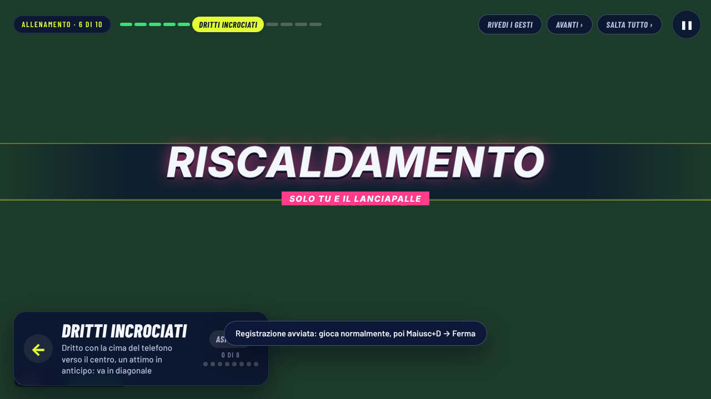

# B35a · Direzione e precisione dei colpi con il telefono

Collaudo dell'utente del 13/11/2026 con un telefono vero, programma Windows 2026-11-13.6:

1. «Ho provato a fare un dritto che partiva da destra andando verso sinistra per incrociare e ho ottenuto un dritto
   lungolinea. Lo stesso vale per i rovesci.»
2. «Molti dei colpi che facevo uscivano, io invece cercavo di farli quanto più precisi possibili.»

In breve: con il telefono simulato ho trovato **tre cause** che danno proprio questi due difetti e le ho corrette. Non
ho potuto provare con un telefono vero: per sapere quale delle tre cause valeva per il telefono del collaudo serve una
sessione registrata (istruzioni subito qui sotto).

---

## 1. Per l'utente: registrare una sessione con il telefono vero (5 minuti)

Serve per vedere, colpo per colpo, cosa voleva chi gioca e cosa ha fatto il gioco. Si fa nel programma Windows.

1. Apri il gioco e collega il telefono come sempre (QR, poi «Attiva» sul telefono).
2. Dal **menu principale** premi **Maiusc+D**: si apre il pannello «Diagnostica».
3. Metti la spunta su **«campioni dei sensori del telefono»**. Le altre due spunte (video) puoi lasciarle spente.
4. Scegli **uno** dei due modi:
   - **A. Prova guidata (consigliata).** Premi **«▶ Prova guidata dei colpi (dal menu, ~5 min)»**. Il lanciapalle chiede
     i colpi uno alla volta: dritti, rovesci, …, poi **dritti incrociati, dritti lungolinea, rovesci incrociati, rovesci
     lungolinea**. Fai ogni colpo come lo faresti per davvero. Alla fine la registrazione si ferma da sola.
   - **B. Partita normale con i «segni».** Premi **«● Avvia registrazione»** e gioca. Prima di ogni gruppo di colpi
     premi **Maiusc+M** (compare «Momento segnato nella registrazione»), poi fai almeno 6 colpi dello stesso tipo. L'ordine
     consigliato è: dritti incrociati, dritti lungolinea, rovesci incrociati, rovesci lungolinea. Alla fine riapri il
     pannello con **Maiusc+D** e premi **«■ Ferma la registrazione»**.
5. Nel pannello, sotto «Sessione appena registrata», premi **«⬇ Scarica il pacchetto»** e salva lo zip (per esempio sul
   Desktop).
6. Mandaci lo zip e scrivi tre cose: se sei destro o mancino, il livello (Casual, Pro, Leggenda…) e, se hai usato i segni,
   l'ordine dei gruppi.

Come lo analizziamo (dalla cartella `natpf-tennis`, serve Node):

```sh
node scripts/diag/diag.mjs direzione sessione.zip                    # prova guidata
node scripts/diag/diag.mjs direzione sessione.zip --blocchi=di,dl,ri,rl   # partita con i segni Maiusc+M
```

`di` = dritto incrociato, `dl` = dritto lungolinea, `ri` = rovescio incrociato, `rl` = rovescio lungolinea, `dc`/`rc` al
centro, `-` salta un gruppo. Il rapporto dice, per ogni colpo voluto, cosa è uscito (incrociato, centro, lungolinea,
fuori, rete), se il telefono puntava dalla parte giusta, se il tempo era in anticipo o in ritardo, quanti colpi erano
oltre la finestra del tempo, il ritardo mediano in millisecondi, la causa di ogni fuori, se i sensori del telefono danno
il segno al contrario e se il gioco ha tolto un ritardo abituale (vedi §4). In fondo ci sono frasi semplici con cosa fare.

---

## 2. Cosa vuol dire «incrociato» e «lungolinea»

Si guarda sempre **dalla parte di chi gioca, verso la rete**.

| Chi gioca | Colpo | Come gira il braccio | Incrociato (diagonale) | Lungolinea (lungo la riga) |
|---|---|---|---|---|
| destro | dritto | da destra verso sinistra | verso **sinistra** | dritto davanti, lungo la riga di **destra** |
| destro | rovescio | da sinistra verso destra | verso **destra** | dritto davanti, lungo la riga di **sinistra** |
| mancino | dritto | da sinistra verso destra | verso **destra** | lungo la riga di **sinistra** |
| mancino | rovescio | da destra verso sinistra | verso **sinistra** | lungo la riga di **destra** |

Regola facile: **l'incrociato va dalla parte verso cui gira il braccio**, il lungolinea resta dalla parte dove colpisci.

«Da destra verso sinistra», come ha scritto l'utente, quindi vuol dire cose diverse:

- per il **dritto di un destro** è il giro normale del braccio, e la palla mandata verso sinistra è l'**incrociato**;
- per il **rovescio di un destro** la palla mandata verso sinistra è il **lungolinea** (l'incrociato va a destra);
- per un **mancino** è il contrario: il rovescio va da destra verso sinistra e l'incrociato del rovescio va a sinistra.

**Cosa legge il gioco.** Il gioco non legge la strada che fa il braccio prima o dopo il colpo (il «da dove a dove»): legge
due cose al momento del colpo.

1. **Dove punta il telefono** (la cima del telefono, cioè la testa della racchetta): verso il centro del campo →
   incrociato; verso l'esterno → lungolinea. È il comando più forte (lo stesso del tutorial: «cima verso il centro» e
   «verso l'esterno»). Circa 17° di differenza rispetto al proprio colpo solito portano la palla vicino alla riga (opzione
   dello staff «Mira del telefono», alta 17°, media 20°, bassa 23°).
2. **Il tempo**: colpire un attimo prima (palla davanti al corpo) → incrociato; un attimo dopo (palla vicina al corpo) →
   lungolinea. Il tempo si misura rispetto al proprio ritmo: chi colpisce sempre un po' prima non va sempre incrociato.

Il gesto naturale di chi vuole incrociare (palla presa davanti e racchetta che a contatto «guarda» la diagonale) fa
tutte e due le cose, e ora il gioco lo legge incrociato con tutti i telefoni (vedi §4, causa 1). Un giro più lungo del
braccio *dopo* il colpo invece non cambia niente.

---

## 3. Cosa cambia per chi gioca

- **Incrociato voluto, mai più lungolinea** con un gesto buono, per destri e mancini, dritto e rovescio, con tutte le
  calibrazioni (anche con i telefoni che danno i sensori al contrario). Nel banco l'incrociato voluto finiva lungolinea
  un colpo su quattro (25%), ora 0%.
- **L'incrociato tenuto resta incrociato**: dieci incrociati di fila non diventano più colpi al centro dal settimo in poi
  (con la calibrazione «scambi di prova»).
- **Chi colpisce sempre un poco in ritardo** (per esempio perché lo schermo o il televisore mostra la palla in ritardo)
  dopo 8 colpi non manda più tutto lungolinea e fuori: con un ritardo costante di circa 95 ms i colpi fuori o in rete con
  il gesto buono passano dal 24% all'8%.
- **La prova guidata** ora dice anche dove puntare il telefono: «Dritto con la cima del telefono verso il centro, un attimo
  in anticipo: va in diagonale» (prima diceva solo il tempo).
- Il **voto** del colpo (anticipo, perfetto, ritardo) resta sul tempo vero. Nessun vantaggio di punti: le regole sono le
  stesse per tutti e due i giocatori, e chi non è sempre in ritardo gioca esattamente come prima (impronte delle partite
  identiche, §6).
- La **precisione resta un merito**: chi cerca le righe con il telefono girato del tutto e il tempo nello stesso verso
  può ancora mandarla fuori, soprattutto a Leggenda e in corsa.

---

## 4. Le tre cause trovate e le correzioni

La catena completa, dal sensore al colpo: il telefono (`site/js/tennis/swing-detect.js`, `racchetta.js`) riconosce il
gesto, misura dove punta all'impatto (piatto, `face`) e la direzione assoluta (`heading`) e manda il messaggio «sw»
(`swing-message.js`, `link.js`); il computer lo legge in `natpf-tennis/src/natpf/natpf_phone_racket.js` (con i
riferimenti che imparano giocando: centro della mira in `natpf_gestures.js`, profilo degli scambi di prova in
`natpf_trial_learn.js`, sensibilità «Mira» in `natpf_aim_level.js`), lo tiene in attesa fino all'arrivo della palla
(`natpf_impact.js`, che misura il tempo) e infine `natpf_stroke_outcome.js` decide dove cade: **mira = spinta naturale
verso l'incrociato (piccola) + tempo rispetto al proprio ritmo + piatto**, poi la spinta fuori se il tempo è oltre la
finestra, poi l'aiuto del livello che tiene la palla in campo se il colpo è pulito (non in corsa forte, non in allungo). Il
lato (dritto/rovescio) e la mano decidono solo il verso: per il dritto del destro l'incrociato è a sinistra.

### Causa 1 · Telefoni con i sensori al contrario: direzione specchiata (corretta)

Alcuni telefoni danno l'accelerazione con il segno opposto. Il gioco se ne accorge (voto del telefono, o scambi di prova)
e gira il verso del colpo, ma **non girava la direzione del piatto**: l'incrociato voluto si leggeva lungolinea e il
lungolinea incrociato. È esattamente il difetto 1, per dritto e rovescio insieme.

Correzione: quando il verso si gira, si gira anche la direzione del piatto (`signedSwing` in `natpf_trial_learn.js`,
messaggio «sw» con `sg` in `swing-message.js` e `swing-detect.js`, profilo imparato). Commit `fb4ee73`.

### Causa 2 · Il centro della mira inseguiva una mira tenuta (corretta)

Il gioco impara il «proprio colpo solito» per misurare il piatto rispetto a quello. Con la calibrazione «scambi di prova»
chi faceva sette incrociati di fila spostava il centro verso l'incrociato, e dall'ottavo la palla andava al centro.
Correzione: con il centro imparato dagli scambi di prova (affidabile) una mira tenuta dentro la mira piena non lo sposta
più (`natpf_gestures.js`, `biasDevTrusted` 22°, `alphaTrusted` 0,03); con i gesti a vuoto e «Salta» resta la regola di
prima. Commit `fb4ee73`.

### Causa 3 · Schermo in ritardo non misurato: tutto lungolinea e fuori (corretta)

Il tempo si misura in «finestre»: in anticipo la finestra è di circa 0,15 s, in ritardo solo di circa 0,08 s (la palla
passa il corpo). Il gioco già si adattava al ritmo di chi gioca, ma con un tetto uguale in finestre: prendeva fino a 90 ms
di anticipo e **solo circa 45 ms di ritardo**. Chi vede la palla in ritardo (televisore, programma Windows, schermo non
misurato: «Ritardo dello schermo» è 0 finché non lo si misura) colpisce sempre un po' tardi: tutto lungolinea, e oltre la
finestra la palla viene spinta fuori di lato. È il difetto 1 *e* il difetto 2 insieme.

Correzione: **ritardo abituale** (`natpf_stroke_outcome.js`, `RHYTHM` e `createRhythm().lag`; motore in
`game_engine.js`). Il gioco guarda gli ultimi 10 colpi **in secondi**; se anche i colpi più in anticipo (il 90°
percentile) arrivano più di 45 ms in ritardo, è un ritardo che sposta tutti i colpi, non una scelta: il gioco toglie il
ritardo mediano × 0,8 (al massimo 0,1 s; da 45 a 75 ms comincia piano, poi per intero) per la direzione, per la spinta fuori e per l'aiuto che tiene la palla in campo.
Servono almeno 8 colpi; si ricomincia a ogni partita. Il voto e la qualità del tempo restano sul tempo vero. Chi va
lungolinea apposta colpendo tardi ha anche colpi in tempo o in anticipo, quindi la regola non scatta. Commit `e47d200`.

Nel registro della diagnostica ogni colpo con il ritardo tolto ha `ritardoAbitualeMs`, e l'analisi lo dice in una frase.

### Cose controllate e non cambiate

- **Il riconoscimento dei gesti** (dritto/rovescio, tipo di colpo, forza) non cambia: le correzioni toccano solo la
  direzione. Le dimostrazioni del tutorial restano giuste («cima verso il centro» per l'incrociato, «verso l'esterno» per
  il lungolinea, che è ciò che il gioco legge).
- **Leggenda in corsa**: chi gira il telefono quasi del tutto e colpisce anche in anticipo può mandarla fuori (18–22% dei
  colpi nel banco, uguale a prima). È la regola del livello: a Leggenda la palla è tenuta in campo solo con un colpo
  pulito (qualità sopra 0,8), e in corsa non lo è. Un gesto verso il centro-incrociato («vicino») esce il 5%, solo quando
  il rumore porta piatto e tempo tutti e due al massimo. Non l'ho cambiata: la mira limitata era già stata provata e
  scartata (rendeva il giocatore troppo forte nel banco di Leggenda, vedi `OUTCOME.faceAim` in `natpf_stroke_outcome.js`).
- **Pro, 1v1, Casual**: con il gesto buono nessun colpo fuori, prima e dopo (anche in corsa).

---

## 5. Come si attiva / come si spegne

Non c'è un'opzione da accendere: le tre correzioni valgono sempre, con il telefono, nello stesso schermo (per tutti e due
i telefoni) e nella sfida tra due computer.

- **Sensori al contrario** e **centro della mira**: automatici, non si spengono.
- **Ritardo abituale**: si accende da solo dopo 8 colpi solo se *tutti* i colpi arrivano in ritardo; si spegne da solo
  appena i colpi tornano in tempo, e riparte da zero a ogni partita. Non c'è un interruttore per spegnerlo.
- Per togliere la causa invece di lasciarla correggere al gioco: **Maiusc+D → «Ritardo dello schermo» → scrivi i
  millisecondi → «Salva»**. Si misura con la prova guidata (tempo mediano dei colpi del telefono) o con un video a 240 fps
  del telefono e dello schermo insieme. Con il ritardo misurato il gioco lo conta già prima, e il ritardo abituale di
  solito non scatta.
- **Sensibilità della mira** (invariata): pannello dello stand, **Ctrl+Maiusc+K** (o 3 s sul marchio NATPF del menu) →
  «Mira del telefono»: alta 17°, media 20°, bassa 23°.

---

## 6. Misure prima e dopo

Banco `natpf-tennis/scripts/audit/direzione-telefono.mjs` (deterministico, sulle regole vere): telefono simulato con il
braccio, destro e mancino, dritto e rovescio, cinque calibrazioni (rapida con 2 gesti, «Salta», scambi di prova, e le
ultime due con i sensori al contrario), cinque modi di chiedere la direzione (piatto, polso, tempo, naturale, riga), 4 colpi
per voluto e lato, Pro, motore vero con il ritmo. «Gesto buono»: piatto ±5°, tempo ±0,25 finestre. «Persona vera» (dalle
diagnostiche): piatto ±12°, tempo +0,35 ±0,45. «Prima» = commit `d152035` con lo stesso banco. Due serie di semi (1,2 e
3,4). Percentuali sulle righe: per ogni voluto, dove è finita la palla.

```sh
cd natpf-tennis
node --import ./test/register.mjs scripts/audit/direzione-telefono.mjs --seeds=1,2 --fuori --ritardo --serie
```

### 6.1 Tutti i colpi, Pro, gesto buono

| Voluto → ottenuto | prima (semi 1,2) | dopo (semi 1,2) | prima (semi 3,4) | dopo (semi 3,4) |
|---|---|---|---|---|
| incrociato → incrociato / centro / **lungolinea** | 51 / 25 / **25** | 75 / 26 / **0** | 49 / 27 / **24** | 72 / 28 / **0** |
| centro → incrociato / centro / lungolinea | 7 / 77 / 16 | 10 / 78 / 13 | 16 / 67 / 17 | 17 / 68 / 16 |
| lungolinea → **incrociato** / centro / lungolinea | **19** / 35 / 47 | **0** / 34 / 66 | **17** / 31 / 52 | **2** / 25 / 73 |
| giusti | 58% | 73% | 56% | 71% |
| fuori o in rete | 0% | 0% | 0% | 0% |

### 6.2 Incrociato voluto, per mano e colpo (gesto buono): % incrociato / % lungolinea

| | prima 1,2 | dopo 1,2 | prima 3,4 | dopo 3,4 |
|---|---|---|---|---|
| destro, dritto | 57 / 24 | 85 / 0 | 46 / 26 | 65 / 1 |
| destro, rovescio | 42 / 32 | 68 / 0 | 57 / 30 | 89 / 0 |
| mancino, dritto | 59 / 16 | 76 / 0 | 50 / 19 | 70 / 0 |
| mancino, rovescio | 46 / 27 | 70 / 0 | 45 / 20 | 65 / 0 |

Quello che non diventa incrociato va al centro, mai lungolinea.

### 6.3 Telefoni con i sensori al contrario (causa 1), incrociato voluto: % incrociato / % lungolinea

| | prima 1,2 | dopo 1,2 | prima 3,4 | dopo 3,4 |
|---|---|---|---|---|
| «Salta», gesto buono | 11 / 66 | 70 / 0 | 8 / 67 | 62 / 1 |
| scambi di prova, gesto buono | 18 / 57 | 78 / 0 | 13 / 51 | 75 / 0 |
| «Salta», persona vera | 19 / 59 | 64 / 14 | 16 / 55 | 58 / 12 |
| scambi di prova, persona vera | 23 / 49 | 67 / 9 | 19 / 44 | 68 / 6 |

Con le altre calibrazioni (sensori giusti) i numeri erano già buoni e restano uguali: rapida 76%, «Salta» 72%, scambi di
prova 78% di incrociati voluti incrociati (semi 1,2).

### 6.4 Persona vera (rumore grande), tutti i colpi

| | prima 1,2 | dopo 1,2 | prima 3,4 | dopo 3,4 |
|---|---|---|---|---|
| incrociato → lungolinea | 28% | 11% | 23% | 6% |
| lungolinea → incrociato | 33% | 19% | 29% | 20% |
| giusti | 40% | 49% | 42% | 52% |

### 6.5 Schermo in ritardo (causa 3): ritardo costante, Pro, gesto «naturale», tre calibrazioni

A 18 m/s una finestra in ritardo vale circa 78 ms: 0,6 finestre ≈ 47 ms, 1,2 ≈ 93 ms, 1,8 ≈ 140 ms.

| Ritardo | incrociato → incrociato / lungolinea | lungolinea → fuori | giusti | fuori o in rete |
|---|---|---|---|---|
| 0 | 82 / 0 → 82 / 0 | 0 → 0 | 76% → 76% | 0% → 0% |
| 0,6 finestre | 74 / 0 → 74 / 0 | 6 → 6 | 78% → 79% | 2% → 2% |
| 1,2 finestre | **28 / 21 → 64 / 2** | 63 → 20 | **27% → 66%** | **24% → 8%** |
| 1,8 finestre | **0 / 77 → 44 / 1** | 100 → 41 | **0% → 50%** | **60% → 15%** |

(semi 1,2; con i semi 3,4: 1,2 finestre giusti 29% → 69%, fuori 23% → 6%; 1,8 finestre giusti 1% → 51%, fuori 60% → 17%.)
Fino a 0,6 finestre il gioco si adattava già: lì non cambia niente.

### 6.6 Lo stesso voluto 14 volte di fila (dritto del destro, scambi di prova, gesto «naturale»)

I = incrociato, c = centro, L = lungolinea.

| | semi 1 | semi 3 |
|---|---|---|
| incrociato, prima | I I I I I I I c c c c c c c | I I I c I c I I I I I c I I |
| incrociato, dopo | I I I I I I I c I I c I I I | I I I c I I I I I I I I I I |

Il lungolinea tenuto resta come prima (circa metà lungolinea e metà centro con un piatto di 12°): per un lungolinea
sicuro serve girare il telefono di più (circa 15°) o colpire un attimo più tardi.

### 6.7 Colpi fuori con il gesto buono (difetto 2)

| Situazione | prima (1,2 · 3,4) | dopo (1,2 · 3,4) |
|---|---|---|
| Pro, Casual, 1v1, da fermo e in corsa | 0% · 0% | 0% · 0% |
| Pro, tempo sempre in ritardo di 1,2 finestre | 25% · 24% | 9% · 10% |
| Leggenda in corsa, mira alta 17° | 18% · 22% | 19% · 22% (regola del livello, non cambiata) |
| Leggenda in corsa, mira bassa 23° | 11% · 14% | 11% · 14% |

### 6.8 Il resto del gioco non cambia

- **Impronte delle partite** a sorteggi fissi, prima (`d152035`) e dopo: partite simulate dei profili `tennista`,
  `amatore`, `bambino`, `umano` e `medio` a Casual, Pro e Leggenda (semi 3 e 11, 40 punti, banco `rally-balance`):
  **identiche** (stessa impronta per tutte le 30 partite). Stesso schermo tra due persone: test
  `natpf-b25-stesso-schermo` (partite identiche a `f08243a` punto per punto) verde. I profili simulati dei banchi non
  attivano mai il ritardo abituale (controllato colpo per colpo: 0 colpi su 4452 nel banco dei due umani).
- `npm run audit:legend`: **uscita identica** a quella di `d152035`, tutti i criteri rispettati (Leggenda contro
  «tennista» 86,6% dei game alla CPU, Pro contro «medio» 75,2% al giocatore, Casual contro «medio» 100%).
- Casual e 1v1 nel banco della direzione: stessi numeri di Pro (la direzione è in finestre, uguale a tutti i livelli),
  0% fuori con il gesto buono, prima e dopo.

---

## 7. Schermata

La prova guidata (diagnostica, Maiusc+D → «Prova guidata dei colpi»), richiesta «Dritti incrociati» con il suggerimento
nuovo (prova nel browser `tools/e2e/natpf-diag-session.mjs`, parte C, telefono simulato):



---

## 8. Verifiche fatte

| Verifica | Risultato |
|---|---|
| `cd natpf-tennis && npm test` | 1426 test: 1425 verdi, 1 saltato (era già saltato), 0 rossi |
| test nuovi `test/natpf-b35-direzione.test.mjs` | 10 verdi: segno dei sensori, profilo degli scambi di prova, messaggio «sw», centro della mira, tutte le combinazioni mano/colpo/calibrazione, motore, analisi della sessione, ritardo abituale (misura, esito, tetto, identico a prima senza ritardo, mancino allo specchio, banco con 1,2 finestre di ritardo) |
| `npm run build` | riuscita |
| `npm run audit:legend` | tutti i criteri rispettati, uscita identica a `d152035` |
| `node --test tools/test/*.test.mjs` (sito e pagina del telefono) | 226 verdi |
| prove nel browser (telefono simulato) | `natpf-gesti-speciali` 9 OK, `natpf-rally` 9 OK, `natpf-training-flow` 21 OK, `natpf-tutorial-phone` 46 OK, `natpf-scambi-di-prova` 25 OK, `natpf-phone-keep` 13 OK, `natpf-diag-session` parti B e C (con la prova nuova del suggerimento) e parte A tutte OK |
| impronte delle partite e banco dei due umani | identiche alla base (§6.8) |

Nota onesta sulla prova `natpf-diag-session`, parte A: due volte su tre è uscito un KO sul «costo del registratore»
(massimo 20,2 ms al secondo con soglia 20; scrittura più lunga 8,2 ms con soglia 8) mentre sulla macchina (4 processori)
lavorava un altro agente (carico 7–8). Rifatta da sola: OK (massimo 10 ms al secondo, scrittura 4,7 ms). Questo blocco
aggiunge al registro solo un campo (`ritardoAbitualeMs`) e solo quando il ritardo abituale è attivo.

Il programma Windows (`natpf-desktop`) non è stato toccato e non è stato provato.

---

## 9. Cosa non è riuscito e cosa non è provato

- **Non provato con un telefono vero, né sul programma Windows.** Tutte le misure sono del telefono simulato e del motore
  senza grafica. Non so quale delle tre cause valeva per il telefono del collaudo: lo dirà la sessione registrata (§1).
- **Il ritardo dello schermo vero non è misurato**: la correzione automatica lo compensa solo in parte (circa l'80%, al
  massimo 0,1 s) e solo dopo 8 colpi; con un ritardo molto grande (circa 140 ms) quasi metà dei lungolinea voluti esce ancora (41–47%).
  La cura vera è misurarlo e scriverlo in «Ritardo dello schermo».
- **Il lungolinea tenuto** con un piatto di 12° finisce al centro circa una volta su due: è la sensibilità della mira
  (17° per la riga), non l'ho cambiata.
- **Leggenda in corsa**: con il telefono girato quasi del tutto e il tempo in anticipo la palla esce ancora; è la regola
  del livello, lasciata com'è (§4).
- **Il «da dove a dove» del braccio** non entra nella direzione: il gioco legge il piatto e il tempo all'impatto. Un
  giro più lungo del braccio dopo il colpo non sposta la palla.
- **Webcam**: passa dalla stessa regola del tempo; se la webcam arriva sempre in ritardo il ritardo abituale può
  scattare anche lì (non peggiora). Non provato con una webcam vera.
- Il banco è deterministico ma non è una misura di persone: i numeri dicono se le regole fanno quello che devono, non
  quanto sarà facile per un visitatore.
