# B37 · Collaudo del 13/11, seconda parte (fuori vero, chi serve, segnale spiegato, pannello dal programma Windows)

Collaudo dell'utente del 13/11 (11:25 UTC) su una versione con B35a e B35b uniti (base `1043c85`). Quattro punti, tutti
fatti in questo blocco (ramo `b37-collaudo-bis`):

1. **«Fuori» e punto solo quando la palla esce davvero** (anche quando finisce la partita);
2. **chi deve servire con un elemento di gioco**: una gemma sopra il personaggio e il riquadro di servizio colorato a terra;
3. **il «cerchietto bianco che segue la palla» spiegato** le prime volte che compare;
4. **pannello dello stand dal programma Windows**: tasto **F9** e voce del menu.

Il gioco non cambia: esito dei colpi, direzione (B35a), punti, livelli e CPU sono quelli di prima (impronte e
`audit:legend` uguali, più sotto). Il riconoscimento dei gesti non è toccato.

## In breve: cosa cambia per chi gioca

| Punto | Prima | Adesso |
|---|---|---|
| 1 · fuori | Appena colpita la palla compariva «Fuori» (o «In rete»), un anello rosso a terra dove sarebbe caduta e il telefono vibrava l'errore, quasi un secondo prima che la palla cadesse | «Fuori» / «In rete», l'anello rosso (dove è caduta davvero), il telefono (scritta e vibrazione dell'errore), il punto e la voce arrivano **insieme, quando la palla tocca terra fuori o tocca la rete**. Al colpo solo il colpo (scritta neutra sul telefono). Se l'avversario prende la palla al volo, nessun «Fuori» |
| 1 · fine partita | La schermata di fine arrivava 1,8 s dopo l'ultima palla, ma il «Fuori» si leggeva già al colpo | L'ultima palla atterra, poi «Fuori» e «Partita della CPU», e la schermata di fine 1,8 s dopo: si vede tutta |
| 2 · chi serve | Solo la scritta «Al servizio» sopra chi batte | Una **gemma gialla (accento #E8FF3A) con il bordo scuro** gira sopra la testa di chi deve battere e il **riquadro dove deve cadere il servizio** è colorato a terra con il contorno luminoso; spariscono quando parte la palla. La scritta «Al servizio» resta, più piccola, sopra la gemma |
| 3 · cerchietto bianco | Un anello bianco seguiva la palla senza spiegazione | Nelle prime 3 palle di ogni partita in cui compare, in alto al centro: **«Colpisci quando il cerchio diventa verde»** (con un cerchio bianco e uno verde disegnati); poi sparisce. La guida dice le stesse parole |
| 4 · pannello | Solo Ctrl+Maiusc+K (sul PC dello stand non funzionava) o 3 s sul marchio NATPF | Nel programma Windows anche **F9** (funziona anche a schermo intero) e il menu **NATPF → «Pannello dello stand (F9)»**. Ctrl+Maiusc+K resta |

## Come si attiva / come si spegne

- **Punto 1 · fuori all'atterraggio**: sempre, in partita (contro la CPU, stesso schermo, sfida tra due computer). Non ci
  sono opzioni. Nell'**allenamento**, nei **minigiochi** e negli **scambi di prova** resta come prima (l'esito subito fa
  parte della lezione: la scheda dell'esercizio dice «Fuori: troppo presto» al colpo).
- **Punto 2 · gemma e riquadro**: sempre, quando qualcuno deve battere (prima che lanci la palla e mentre la palla è in
  aria), in partita e anche nell'esercizio «Servizio» dell'allenamento (lì non provato nel browser). Non ci sono opzioni.
  In **prima persona** la gemma non sta sopra di sé (la camera è lì): resta il riquadro. Nella moviola e nella
  dimostrazione dietro il menu non ci sono.
- **Punto 3 · scritta del cerchio**: compare da sola quando il segnale del momento giusto è acceso: menu → **Opzioni** →
  **«Segnale del momento giusto: Di base · Sì · No»** (di base acceso con «Bambino» e «Adulto», spento con gli altri
  livelli). Le prime 3 palle di ogni partita; si rivede con una partita nuova e con **«Nuovo giocatore»**. Per non vedere
  né la scritta né l'anello: **«Segnale del momento giusto: No»**.
- **Punto 4 · pannello dello stand dal programma Windows**: tasto **F9** (da solo, senza Ctrl, Maiusc o Alt), anche a
  schermo intero; oppure, in finestra, menu **NATPF → «Pannello dello stand (F9)»** (la barra del menu compare con Alt).
  Un altro F9 lo chiude. Valgono ancora **Ctrl+Maiusc+K** e **3 secondi sul marchio NATPF** del menu, e dal telecomando
  dello staff il tasto «Pannello dell'addetto». Nel browser (zip Cloudflare) F9 non fa niente: resta del browser.

## Punto 1 · «Fuori» e punto solo quando la palla esce davvero

**Dove il gioco anticipava.** Il punto vero (punteggio, scritta grande «Punto della CPU», voce «Out!», game, fine
partita, statistiche, registro dello stand) il motore lo assegnava già quando la palla tocca terra fuori o tocca la rete
(`game_engine._awardPoint`): quello non anticipava. Anticipavano le cose che il gioco mostrava **al colpo**, perché sa già
dove cadrà la palla (`natpf_stroke_outcome.strokeOutcome`, `ball.targetLanding`, rimbalzo previsto):

| Dove | Prima, al colpo | Adesso |
|---|---|---|
| Scritta dell'esito nell'angolo | «Fuori · troppo presto», «In rete · in ritardo» in rosso | niente al colpo; la stessa scritta quando la palla tocca terra fuori o la rete |
| Anello a terra | rosso nel punto (fuori dal campo) dove sarebbe caduta | niente al colpo; rosso dove è caduta, quando cade (con la pulsazione del rimbalzo) |
| Lampo sulla racchetta | rosso | bianco (neutro): dice solo «colpita» |
| Etichetta del gesto (in basso) | «Fuori · troppo presto» | «Colpita», poi «Fuori · troppo presto» quando la palla cade |
| Telefono | «Fuori» con la vibrazione dell'errore | al colpo «Colpo!» (o il nome del colpo) con una vibrazione breve; quando la palla cade «Fuori» con la vibrazione dell'errore, poi «Punto avversario» con il motivo («Fuori · In anticipo») |
| Stesso schermo | come sopra, in tutte e due le metà e sul telefono del Player 2 | come sopra, per tutti e due i giocatori: la scritta nella propria metà e il proprio telefono quando la palla cade (il Player 2 non ha l'anello a terra, né prima né adesso) |
| Sfida tra due computer | il Player 2 vedeva «Fuori» al suo colpo sul suo computer; l'host vedeva «Fuori» del Player 2 al colpo | l'host decide il punto quando la palla cade (come prima); il Player 2 vede il verdetto quando la palla cade sul suo computer o, se lì non è ancora caduta, quando arriva la scritta del punto dall'host |
| Palle della CPU | niente scritte: il punto arrivava già quando la palla toccava terra | come prima (provato: nessun segno prima dell'atterraggio, punto e «Punto tuo» sul telefono quando cade) |
| Servizio fuori, doppio fallo | non esistono: il servizio dal gesto e quello della CPU cadono sempre nel riquadro (provato con 400 servizi dal gesto a caso e 24 servizi veri del motore, di chi gioca e della CPU) | come prima |
| Punteggio, voce, scritta del punto, game, set, partita, statistiche, registro dello stand | quando la palla tocca terra o la rete | uguale |

Se la previsione diceva «fuori» ma la palla cade dentro (di rado, a pochi centimetri dalle righe), al primo rimbalzo
compare l'esito in campo («Anticipo», «Buono»…). Se l'avversario prende al volo una palla che sarebbe uscita, nessun
«Fuori»: la palla è in gioco. Il volo della palla e l'esito dei colpi sono quelli di prima (impronte uguali).

**Fine partita.** Sul punto della partita la palla cade, nello stesso istante compaiono «Fuori», «Partita della CPU» e il
tabellone finale, e la schermata di fine arriva 1,8 s dopo (come prima): la palla ferma a terra e la scritta si vedono.

**Misure (prova nel browser `natpf-fuori-vero`).** Partita vera a 1 game contro la CPU con il telefono simulato (pagina del
telefono e collegamento veri). Batte la CPU; il primo colpo di chi gioca è lasciato com'è, i quattro dopo sono mandati
apposta fuori largo, in rete, fuori largo e fuori largo sul 0-40 (punto della partita): si cambia solo dove cade la palla
di quel colpo, poi tutto il resto è il gioco vero. Millisecondi dal colpo, orologio del computer (il telefono è una seconda
pagina nello stesso browser); due giri prima e due dopo.

| Che cosa (ms dal colpo) | Prima, giro 1 | Prima, giro 2 | Adesso, giro 1 | Adesso, giro 2 |
|---|---|---|---|---|
| **Palla a terra fuori** (largo) / **sulla rete** | 967, 815, 849 / 534 | 994, 833, 850 / 484 | 946, 830, 866 / 517 | 947, 848, 816 / 515 |
| Scritta «Fuori» / «In rete» nell'angolo | **7, 9, 9 / 7** (al colpo) | **11, 7, 6 / 6** (al colpo) | 959, 837, 874 / 525 | 968, 855, 823 / 524 |
| Anello rosso a terra | **5, 7, 8** (al colpo, dove cadrà) | **10, 5, 4** (al colpo) | 949, 833, 869 (dove è caduta); rete: nessuno | 956, 851, 819; rete: nessuno |
| Telefono: «Fuori» / «In rete» e vibrazione dell'errore | **11, 8, 11 / 6** (al colpo) | **10, 7, 5 / 6** (al colpo) | 951, 834, 869 / 521 | 958, 852, 820 / 527 |
| Tabellone (punto assegnato) | 970, 816, 851 / 536 | 997, 834, 852 / 486 | 952, 834, 871 / 522 | 961, 853, 821 / 521 |
| Scritta grande del punto | 973, 817, 852 / 537 | 998, 835, 852 / 488 | 957, 835, 872 / 523 | 964, 854, 822 / 522 |
| Voce «Out!» / «Net!» (sul punto della partita la voce della fine partita) | 974, 817, – / 537 | 998, 835, – / 488 | 957, 835, – / 523 | 964, 854, – / 522 |
| Telefono «Punto avversario» | 971, 816, 852 / 537, sotto «Fuori» | 997, 835, 854 / 486, sotto «Fuori» | 959, 836, 871 / 524, sotto «Fuori» o «Fuori · In anticipo» | 970, 854, 824 / 527, sotto «Fuori» o «… · In anticipo» |
| Schermata di fine partita (ultima palla) | 2654 (1,80 s dopo la palla a terra) | 2654 (1,80 s dopo) | 2673 (1,81 s dopo) | 2623 (1,81 s dopo) |
| Scritta di un colpo rimasto in campo | 17 | 18 | 20 | 21 |

In breve: **prima** la scritta, l'anello rosso e il telefono dicevano l'errore 4–11 ms dopo il colpo, cioè da mezzo
secondo a un secondo **prima** che la palla toccasse terra o la rete; **adesso** arrivano 3–21 ms **dopo**, nello stesso giro
del gioco in cui la palla tocca terra (i millisecondi sono il tempo di calcolo di quel giro sulla macchina di prova); il
telefono 3–12 ms dopo. Il punto, il tabellone, la voce e la schermata di fine partita arrivano quando arrivavano prima. I
colpi che restano in campo hanno la scritta subito, come prima.

**Schermate** (`natpf-fuori-vero` con `SHOTS=1`: il gioco si ferma un attimo subito dopo il primo colpo mandato fuori
largo e subito dopo che quella palla ha toccato terra; gioco a 1280×720 ridotto a 960 pixel, telefono a 260):

| | Gioco | Telefono |
|---|---|---|
| Subito dopo il colpo | 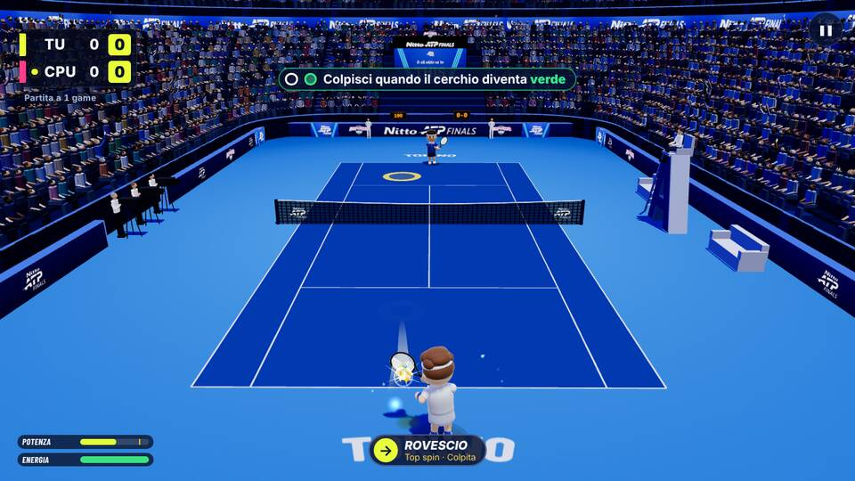 | 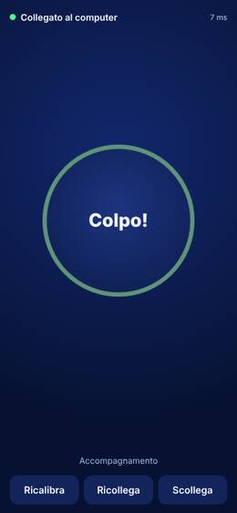 |
| Palla appena caduta fuori | 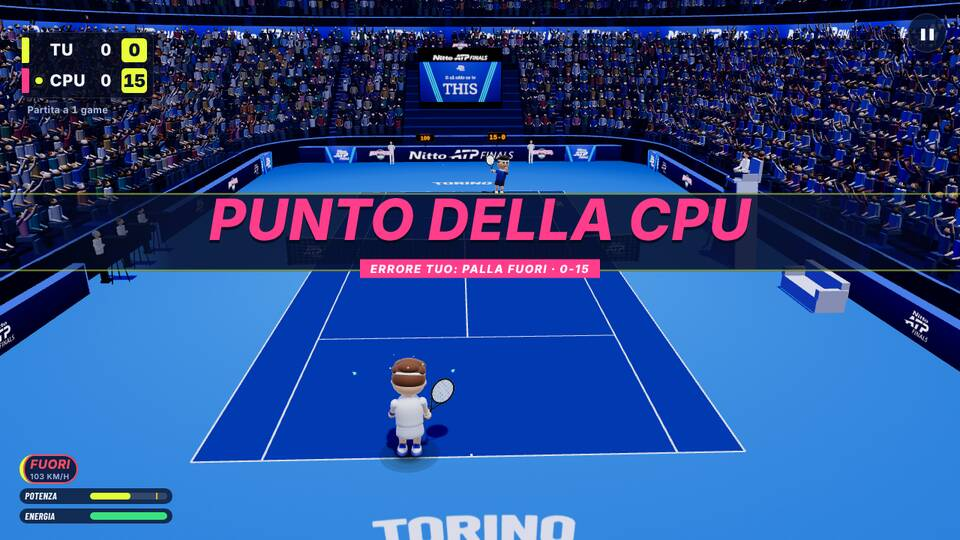 | 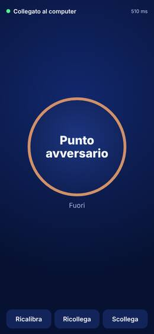 |

Cosa si vede, guardate una per una. **Al colpo**: la palla appena partita dalla racchetta con il lampo bianco, l'etichetta
in basso «Rovescio · Top spin · Colpita», il punteggio 0-0, nessun «Fuori» e nessun anello rosso (l'anello giallo in fondo
al campo è quello del colpo di prima, finito dentro); il telefono dice «Colpo!». **Con la palla a terra**: tabellone 0-15
per la CPU, la scritta grande «Punto della CPU · Errore tuo: palla fuori · 0-15», in basso a sinistra «Fuori · 103 km/h»;
il telefono «Punto avversario» con «Fuori» sotto.

**Da sapere**: la palla di chi gioca cade nella metà lontana, e lì la scritta grande del punto, che compare nello stesso
istante (com'era già prima), copre il punto dove è caduta: l'anello rosso a terra resta sotto la scritta e quasi non si
vede. Si vede la palla scendere fino a terra, poi la scritta. Prima del B37 l'anello si vedeva durante il volo, ma era
proprio l'anticipo da togliere. Se si vuole vedere anche la palla ferma e l'anello prima della scritta grande, la scritta
del punto potrebbe arrivare qualche decimo di secondo dopo: non fatto, è una scelta da fare con l'utente (cambia il ritmo
del punto, insieme alla voce).

## Punto 2 · Chi deve servire: gemma sopra il personaggio e riquadro a terra

- **Gemma** (`natpf_serve_marker.js`): due piramidi unite a punta in giù, gialla accento con il bordo blu scuro, che gira e
  oscilla piano sopra la testa di chi deve battere. Si misura la cima del personaggio (Classici, mascotte di Lob & Drop
  con la testa grande e la racchetta alzata) e la gemma sta 34 cm più su. Per ogni camera ha quasi la stessa misura a
  schermo: quando chi batte è lontano (la CPU in fondo, il Player 2 visto dalla metà del Player 1) la gemma si ingrandisce
  fino a 2,6 volte, solo per quella camera; nello stesso schermo ogni metà la vede della misura giusta.
- **Riquadro di servizio**: il quadrato in diagonale nella metà di chi riceve, dove deve cadere il servizio, con un
  riempimento giallo leggero che pulsa e il contorno giallo appena dentro le righe bianche del campo. È lo stesso
  quadrato dove il gioco manda davvero il servizio (provato con 24 servizi veri: chi gioca e CPU, lato della parità e del
  vantaggio, servizio dal gesto e senza).
- Si vedono solo prima che la palla parta (giocatore fermo al servizio e palla lanciata), poi spariscono.
- **La scritta «Al servizio» resta**, più piccola e scura (testo giallo su blu), sopra la gemma: è secondaria.
- Contro la CPU (batte chi gioca o la CPU), nello stesso schermo (tutte e due le metà, batte il Player 1 o il Player 2),
  nella sfida tra due computer (la gemma è nella scena: ogni computer la disegna sopra chi batte secondo il punteggio che
  arriva dall'host) e nell'allenamento.

**Prova nel browser `natpf-chi-serve` (36 controlli, tutti superati)**: partita vera al servizio, per ogni caso la gemma
è sopra la testa di chi batte (in tutte e due le metà nello stesso schermo), la scritta «Al servizio» è sopra la gemma, il
riquadro è nella metà di chi riceve in diagonale e si vede; quando la palla parte spariscono. Schermate guardate una per
una (1920×1080 ridotte qui a 960 pixel; area stretta 640×800 ridotta a 480):

| | Batte chi gioca / il Player 1 | Batte la CPU / il Player 2 |
|---|---|---|
| Classici, contro la CPU | 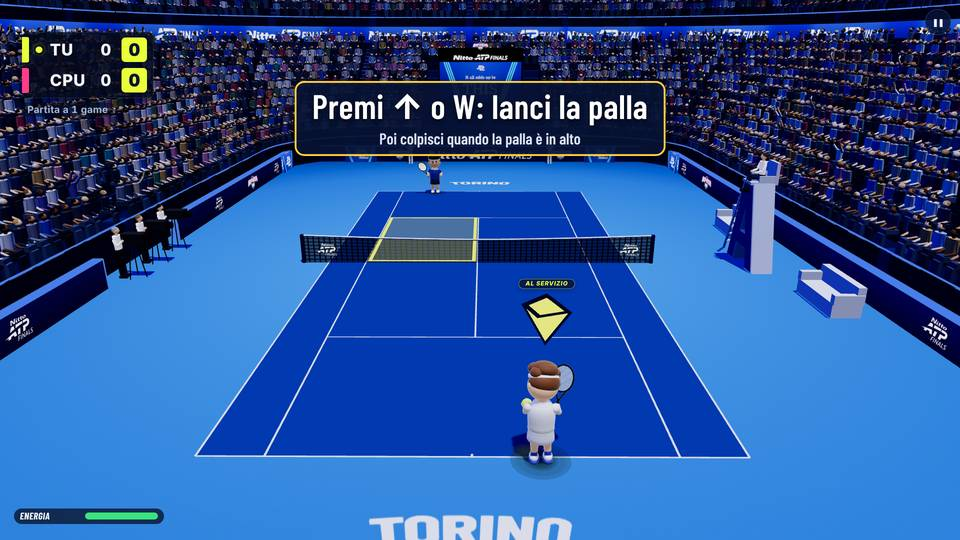 | 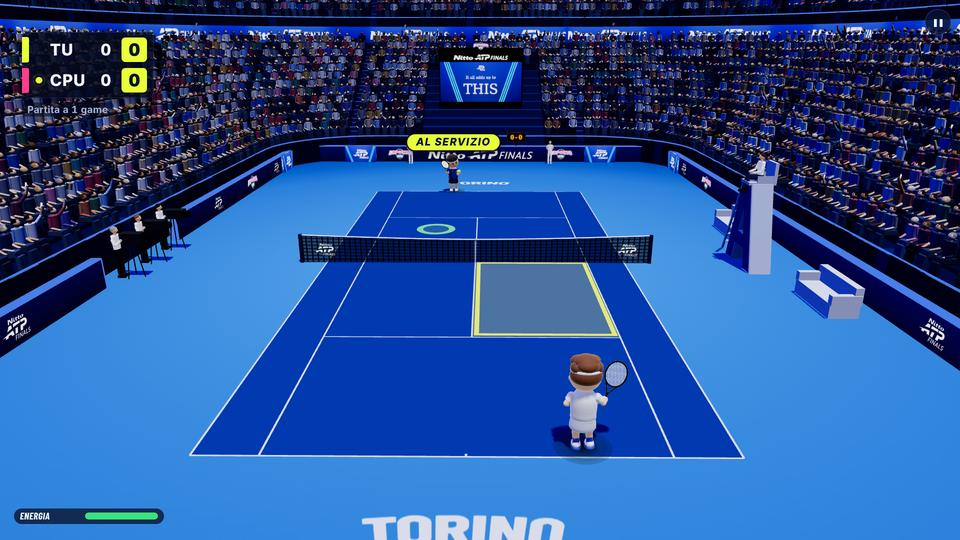 |
| Lob & Drop, contro la CPU | 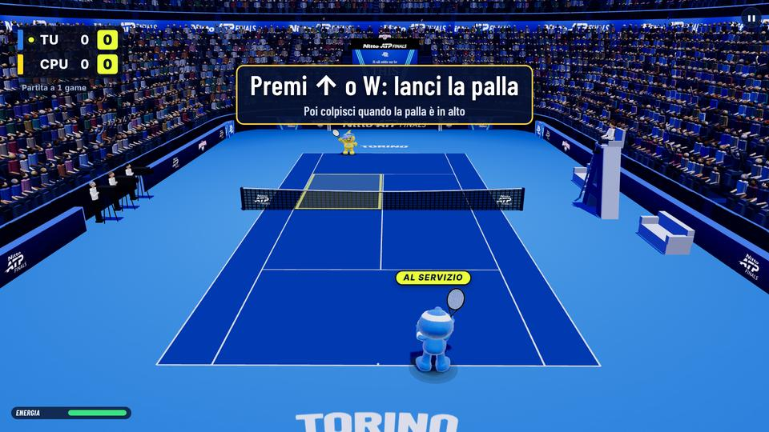 | 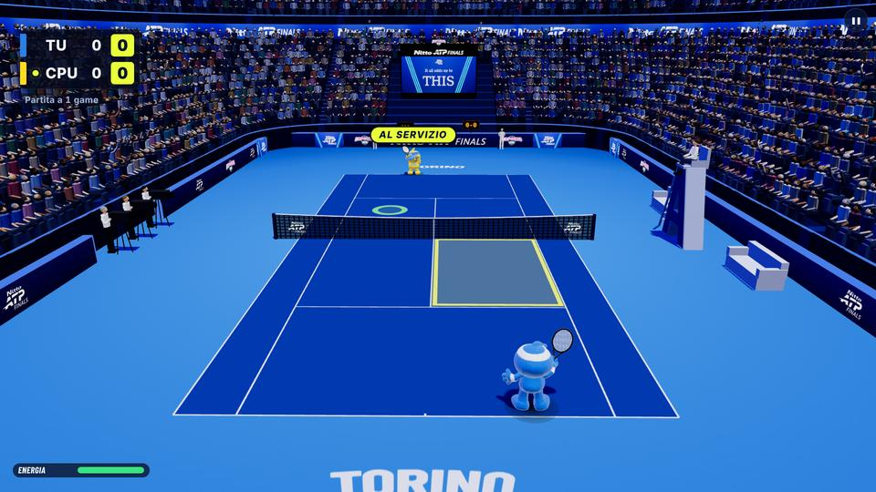 |
| Classici, stesso schermo | 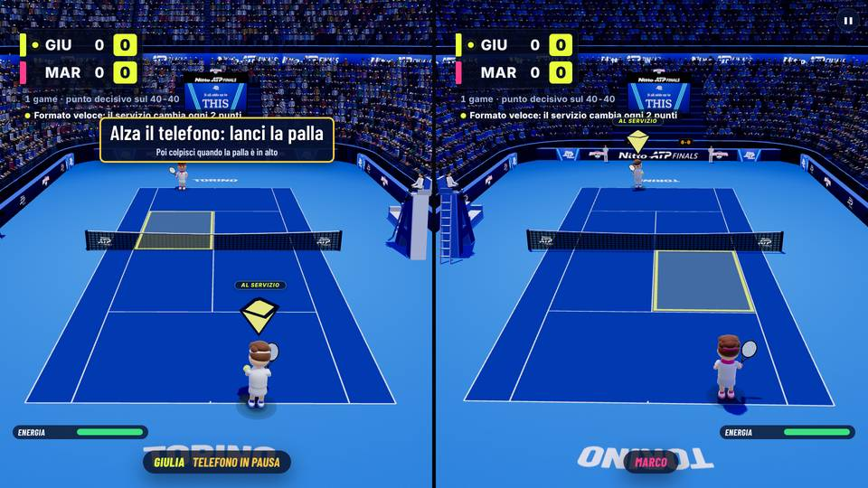 | 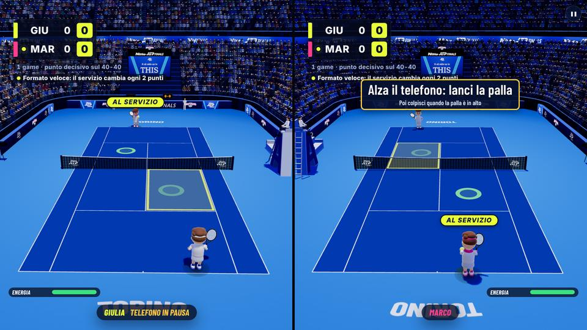 |
| Lob & Drop, stesso schermo | 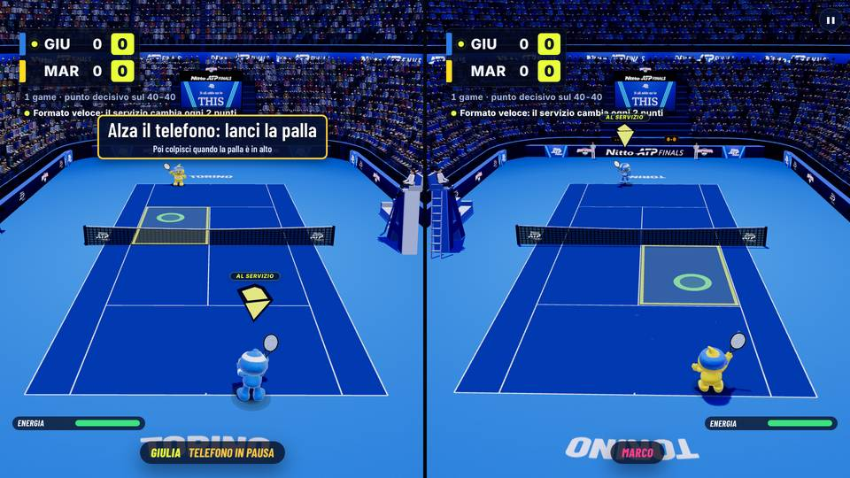 | 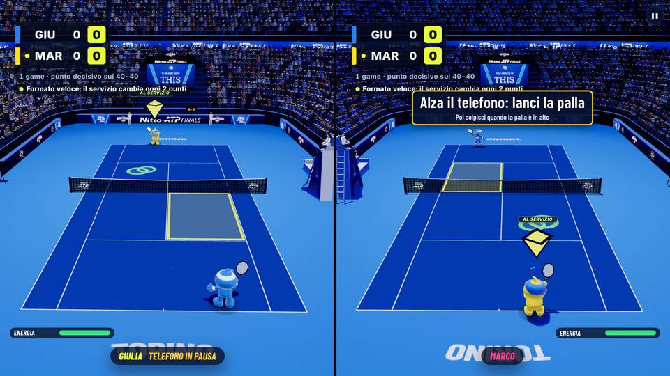 |
| Area stretta 640×800, Lob & Drop contro la CPU | 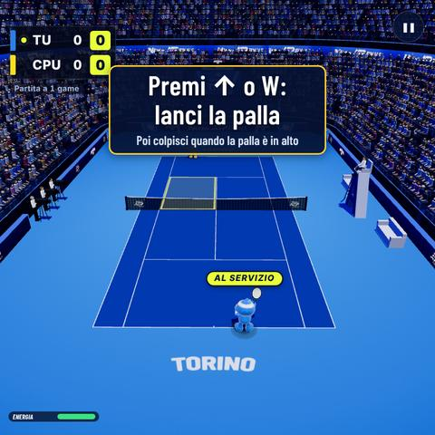 | 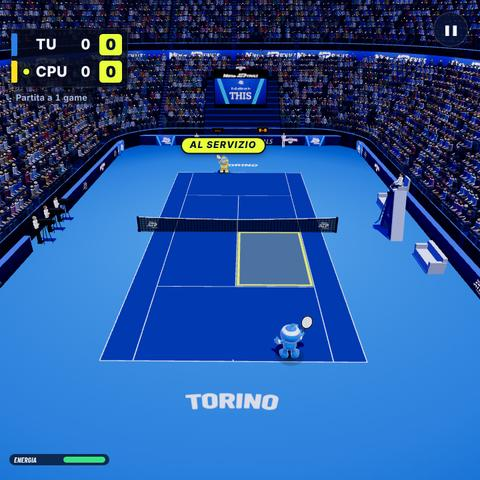 |
| Area stretta 640×800, Classici stesso schermo | 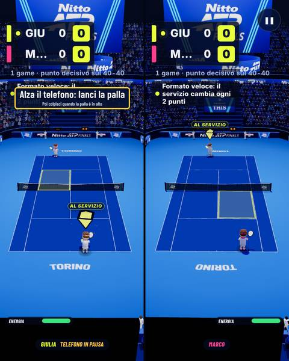 | 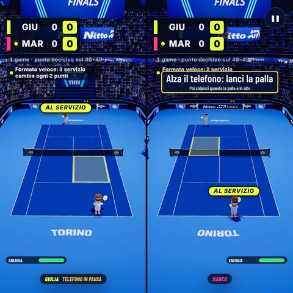 |

Cosa si vede: la gemma gialla con il bordo scuro sopra chi batte (lontano è più grande, così si vede come quella vicina),
la scritta piccola «Al servizio» sopra; il riquadro giallo dall'altra parte della rete in diagonale (quando batte chi è
lontano, il riquadro è vicino, nella propria metà). Nelle schermate a volte resta un anello verde a terra: è l'anello di
rimbalzo del servizio provato nel caso prima (la prova serve due volte nella stessa pagina), non un elemento nuovo.
Riguardate tutte e dodici alla chiusura del blocco: è così in tutte. Nell'area stretta, con la CPU che batte dal fondo, la
gemma sopra Lob è piccola (si legge soprattutto la scritta «Al servizio»); il riquadro a terra si vede bene.

**Costo.** 9 oggetti in più nella scena, solo al servizio, materiali senza luci, nessuna ombra. Misurato nel browser
con la grafica in software del banco (il caso peggiore: niente scheda grafica) a 1920×1080 con Lob & Drop, mediana di 10
giri di 10 disegni: giro 1 spenti 3,17 ms, solo gemma 3,10, solo riquadro 3,19, tutti e due 3,40 ms a disegno; giro 2
(macchina più carica) spenti 6,40 ms, tutti e due 4,51 ms; giro 3 (alla chiusura del blocco) spenti 3,43 ms, solo gemma
3,89, solo riquadro 3,94, tutti e due 3,73 ms. La differenza sta dentro il rumore della macchina (un altro agente
lavorava in parallelo; a volte con tutti e due accesi costa meno che con uno solo): al massimo mezzo millisecondo per
disegno, e solo mentre si aspetta il servizio.

## Punto 3 · Il «cerchietto bianco che segue la palla»

È il **segnale del momento giusto** (B18.2): un anello bianco che si stringe sulla palla e diventa verde quando è il
momento di colpire. Non è cambiato niente su quando è acceso e su come si stringe. Adesso **le prime volte si spiega**:

- nelle **prime 3 palle di ogni partita** in cui l'anello compare, in alto al centro (sopra il campo: in basso copriva il
  proprio giocatore) c'è la scritta **«Colpisci quando il cerchio diventa verde»** con un cerchio bianco e uno verde
  disegnati accanto; resta finché c'è l'anello e 0,7 s dopo, poi sparisce; dalla quarta palla niente;
- si rivede con una **partita nuova** e con **«Nuovo giocatore»**;
- la **guida** (passo «Colpisci quando la palla arriva») e l'avviso delle **Opzioni** dicono le stesse parole: «un cerchio
  bianco si stringe sulla palla: colpisci quando il cerchio diventa verde»;
- con il segnale spento (di base con «Ragazzo» e con i livelli Facile, Esperta e Leggenda, oppure sempre con «Segnale del
  momento giusto: No») né anello né scritta.

**Prova nel browser `natpf-segnale-spiegato` (14 controlli, tutti superati)**, livello «Adulto» (Evento), palle della CPU
verso chi gioca, a 1280×720 e 1920×1080: l'anello c'è su ogni palla; la scritta c'è nelle palle 1, 2 e 3 e non nella 4 e
nella 5; sparisce dopo la palla; sta tutta nello schermo, in alto al centro; una partita nuova e «Nuovo giocatore» la
fanno rivedere; a livello Esperta (segnale spento di base) né anello né scritta; la guida dice le stesse parole.
Prima versione guardata: la scritta stava in basso al centro e copriva il proprio giocatore (che in terza persona sta
proprio lì): spostata in alto.

| Prima palla: anello bianco e scritta | Quarta palla: solo l'anello |
|---|---|
| 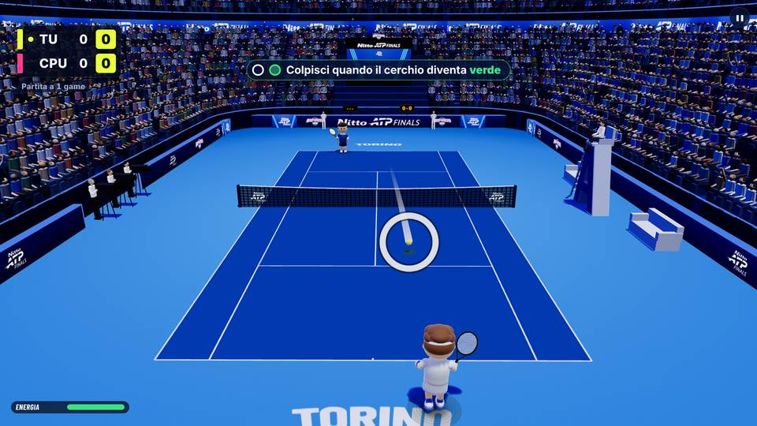 | 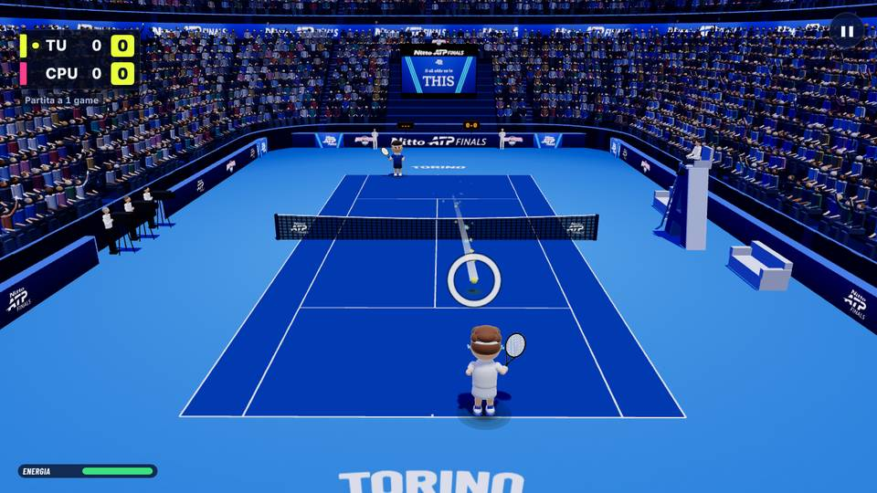 |

## Punto 4 · Pannello dello stand dal programma Windows

Sul PC dello stand Ctrl+Maiusc+K non apriva il pannello (nel gioco la scorciatoia è giusta: un altro programma del PC la
prende prima). Nel programma Windows adesso:

- **F9** apre e chiude il pannello. Lo legge il programma prima della pagina (`before-input-event`), quindi funziona anche
  a schermo intero, dove la barra del menu non c'è; F9 con Ctrl, Maiusc o Alt non fa niente (arriva al gioco);
- la voce **NATPF → «Pannello dello stand (F9)»** fa la stessa cosa (in finestra, con la barra del menu);
- il comando va solo alla finestra del gioco e solo se mostra una pagina del proprio server (stesse regole degli altri
  canali del programma: `natpf:staff-panel`, `window.natpfDesktop.staffPanel.onToggle` del ponte del preload, versione 5);
- nel gioco (`natpf_kiosk.js`) solo l'aggancio al ponte: Ctrl+Maiusc+K e i 3 secondi sul marchio restano com'erano;
- i testi che citano Ctrl+Maiusc+K dicono anche «F9 nel programma Windows» (nota della diagnostica, pagina del
  telecomando dello staff, guide del telecomando, del registro, della mira e del collaudo Windows, LEGGIMI del programma).

## Il gioco non cambia: impronte delle partite e Leggenda

Le stesse partite a sorteggi fissi, giocate dal motore vero senza grafica con il codice di prima (`1043c85`) e con
quello di adesso, hanno la stessa impronta (punti, vinti, scambi, motivi dei punti, voti dei colpi, colpi della
racchetta, cadute, colpi a vuoto): `scripts/audit/b37/impronte.mjs`, risultati in `scripts/audit/b37/risultati/`.

| Serie di semi | Partite (3 livelli × 5 profili × 3 semi, 80 punti) | Impronte |
|---|---|---|
| 7, 11, 23 | 45 | tutte uguali, 15 righe su 15 (impronta di tutto `a5c9e11211f7f618` prima e dopo) |
| 31, 37, 41 | 45 | tutte uguali, 15 righe su 15 (impronta di tutto `86df03aa53e1f297` prima e dopo) |

`npm run audit:legend`: **stesso risultato del codice di prima, riga per riga** (87 righe uguali: 69 controlli superati,
nessuno mancato, «Tutti i criteri rispettati»). Rifatto alla chiusura del blocco sul codice finale e sulla base `1043c85`
(estratta a parte): di nuovo uguale riga per riga. Le impronte non sono state rifatte alla chiusura: dopo `bdb56cb` il
codice del gioco non è cambiato (solo la prova `natpf-fuori-vero`, un test di unità e documenti).

Il blocco non tocca l'esito dei colpi, la direzione (B35a), la fisica, le regole del punteggio né la CPU: il motore
chiama solo il verdetto rimandato (`natpfUi.shot.settle`) all'inizio di `_awardPoint` e alza la scritta «Al servizio».
Senza grafica (impronte) quelle parti non ci sono; nel gioco cambiano solo quello che si vede e quando, non quello che
succede in campo.

## Verifiche

Fatte alla chiusura del blocco sul codice finale del ramo (dopo il commit «IN CORSO» `2bfe09a`, ricontrollato), su una
macchina condivisa con un altro agente che lavorava in parallelo (carico fino a 13 su 4 processori). Prove nel browser
con Chromium e la grafica in software, il telefono simulato e il mouse.

| Verifica | Risultato |
|---|---|
| Test del gioco (`cd natpf-tennis && npm test`) | 1463 su 1463 al primo giro; 1463 su 1464 al secondo (con il test nuovo), con un solo controllo non passato: un tempo della LAN (`natpf-lan-letture`, «prima lettura entro 30 ms») con la macchina a carico 13; rifatto da solo, 5 su 5 per tre volte |
| Test del sito (`node --test tools/test/*.test.mjs`) | 226 su 226 |
| Programma Windows (`cd natpf-desktop && npm test`) | 43 su 43 |
| Server LAN (`cd tools/lan && node --test test/*.test.mjs`) | 12 su 12 |
| Build (`npm run build`) | riuscita (10 s) |
| `npm run audit:legend` | uguale alla base `1043c85` rifatta adesso, riga per riga (87 righe, 69 controlli superati) |

| Prova nel browser | Risultato | Note |
|---|---|---|
| `natpf-fuori-vero` (nuova) | 10 su 10 | girata quattro volte: com'era nel commit «IN CORSO», normale e con `SHOTS=1`, poi corretta, con `SHOTS=1` e normale: sempre 10 su 10. Giro finale: palla a terra 962, 850, 813 / 517 ms dal colpo; scritta, anello e telefono 3–15 ms dopo; fine partita 1,81 s dopo l'ultima palla; colpo rimasto in campo: scritta dopo 24 ms |
| `natpf-chi-serve` (nuova) | 36 su 36 | 20 minuti (grafica in software a 1920×1080, modelli 3D di Lob & Drop nello stesso schermo, macchina carica); costo misurato di nuovo (punto 2) |
| `natpf-segnale-spiegato` (nuova) | 14 su 14 | |
| `natpf-rally` | 9 su 9 | |
| `natpf-servizio-lancio` | 12 su 12 | |
| `natpf-1v1-p2p` | 39 su 39 | sulla build |
| `natpf-formato-fiera` | 25 su 25 | |
| `natpf-fine-partita` | 47 su 47 | |
| `natpf-tabellone` | 42 su 42 | |
| `natpf-menu` | 45 su 45 | |
| `natpf-telecomando` | 85 su 85 | sulla build |
| `natpf-stesso-schermo-b20` | 50 su 52, poi 52 su 52 | i 2 controlli non passati volevano il testo del banner d'inizio di prima del B35b (vedi sotto); aggiornati, rifatta: 52 su 52 |
| `natpf-lob-drop` (intera) | 131 su 136, poi 133 su 136 | restano i 3 controlli «al colpo le corde sono dove erano», difetto noto dal B32, uguali sulla base; il primo giro e la correzione della prova sono spiegati sotto |

Test nuovo in `natpf-b37-collaudo.test.mjs` (24 test): nello stesso schermo il «Fuori» del Player 2 aspetta la palla a
terra, nella scritta della sua metà e sul suo telefono (il telefono del Player 1 non riceve niente).

## Cosa non è riuscito e perché

- **Schermate di `natpf-fuori-vero` lasciate a metà** (commit «IN CORSO»): con `SHOTS=1` la prova passava, ma la
  schermata «palla a terra» non mostrava né «Fuori» né la scritta del punto né l'anello rosso, e il telefono era già
  tornato a «Pronto» anche in quella del colpo. Perché: il disegno con la grafica in software dura 2–3 s e nel frattempo
  le scritte, che si nascondono da sole dopo 0,65–2,6 s, erano sparite; l'anello prende colore solo al primo
  aggiornamento del gioco dopo la caduta, che il gioco fermo non faceva. Corretto nella prova, non nel gioco: si ferma un
  aggiornamento dopo l'evento, i timer delle due pagine stanno fermi con il gioco, il telefono si fotografa per primo.
  Riprovata: 10 su 10 e le schermate del punto 1.
- **`natpf-stesso-schermo-b20`: 2 controlli su 52 non passavano, non per questo blocco.** Volevano il sottotitolo del
  banner d'inizio esattamente «Sorteggio: batte Giulia» (e «… Marco»), ma dal B35b (`0e8782e`, già nella base) con il
  servizio che cambia ogni 2 punti il banner aggiunge « · Formato veloce: il servizio cambia ogni 2 punti», come voluto.
  Rifatta sulla base `1043c85`: gli stessi 2 controlli non passano, con lo stesso testo (in quel giro, con la macchina
  molto carica, anche 6 controlli di tempi e visibilità). I 2 controlli adesso vogliono il testo intero di oggi, parola
  per parola (non sono stati allargati): 52 su 52.
- **La scritta grande del punto copre la caduta nella metà lontana** (schermate del punto 1): non cambiato, da decidere
  con l'utente.
- **`natpf-lob-drop` intera: al primo giro 131 su 136.** Quattro sono i controlli «al colpo le corde sono dove erano»,
  il difetto noto dal B32 (`docs/b32/movimento.md`, già così nel B35): falliscono uguali sulla base. Il quinto, «3D,
  partita schermo: piedi sul campo» (94 passi su 2600 con tutti e due i piedi alzati, il limite è il 3 %, cioè 78),
  veniva da una partita diversa, non da un gioco diverso. La prova sorteggia con un `Math.random` a seme fisso da quando
  si apre la pagina; la gemma e il riquadro sono 9 oggetti three.js nuovi, creati prima dei personaggi, che consumano
  sorteggi per il loro nome; così cambiava il primo battito delle palpebre dei personaggi, che sorteggia ancora durante
  la partita, e da lì tutta la sequenza dei sorteggi si spostava (sulla base la stessa partita dava 66 passi). Provato
  con una sonda (partita senza persone, 3600 passi): con le palpebre uguali prima del seme base e ramo giocano la stessa
  identica partita (stessa impronta, stessi 5215 sorteggi). Corretta la prova, non il gioco: `play()` mette le palpebre
  uguali prima del seme (come già il disegno «a vuoto» dello stesso schermo). Rifatte le parti 3D (`TRE_D=1`) sulla base
  e sul ramo con la prova corretta: le tre partite sono identiche (impronte `7bf8d71a`, `daab2297`, `7031e211`, stessi
  numeri del rig; piedi: 71 passi su 2600, sotto il limite) e resta su tutti e due solo un controllo «corde». Nel giro
  sul ramo, fatto in parallelo con quello sulla base e con l'altro agente, non passava anche il tempo di disegno (1263 →
  1668 ms); rifatto da solo (`COSTO=1`): 15 su 15. Con la prova corretta la prova intera sul ramo, da sola: 133 su 136,
  e i 3 che non passano sono solo «corde» (le due partite con le mascotte costruite nel codice e quella con i modelli
  contro la CPU).

## Cosa non è provato

- **Telefono vero, programma Windows vero, ledwall vero e persone vere**: le prove sono nel browser con un telefono
  simulato (eventi di movimento finti) e il mouse; l'installer non è stato rifatto in questo blocco.
- **F9 nel programma Windows**: provato con i test del programma (scorciatoia, voce del menu, canale solo verso la pagina
  del proprio server, ponte del preload) e del gioco (il pannello si apre e si chiude dal ponte); non premendo F9 in
  Electron su Windows. Se F9 non funzionasse sul PC dello stand (un altro programma che prende anche F9), resta la voce
  del menu NATPF (in finestra) e il marchio da tenere premuto.
- **Sfida tra due computer**: il verdetto rimandato sul computer del Player 2 è provato con i test di unità (anche con la
  scritta del punto dall'host) e con la prova `natpf-1v1-p2p` (che non manda palle fuori apposta). Un caso raro non è
  provato: se il Player 1 prende al volo una palla del Player 2 che sarebbe uscita e la rete è lenta, sul computer del
  Player 2 la palla può cadere fuori «da sola» prima che arrivi la palla dell'host, e lì comparirebbe «Fuori» (prima
  compariva sempre, al colpo).
- **Stesso schermo con palle mandate fuori**: provato con i test di unità (anche quello nuovo del Player 2), non nel
  browser: `natpf-stesso-schermo-b20` non manda palle fuori apposta.
- **Esercizio «Servizio» dell'allenamento**: gemma e riquadro ci sono per il codice (è la stessa fase del servizio della
  partita), non provati nel browser.
- **Schermate del fuori**: un colpo solo (fuori largo contro la CPU, 1280×720); rete, palle della CPU, stesso schermo e
  ledwall non sono stati fotografati.
- **Gemma e riquadro con una scheda grafica vera** e su Android: il costo è misurato con la grafica in software del banco.
- **La scritta del segnale con persone vere**: non si sa se 3 palle bastano; il numero è una costante
  (`CUE_HINT.balls` in `natpf_timing_cue.js`).
