# B38 · Tastiera a schermo e «Gioca come Ospite»

Compito: `docs/coda/B38-tastiera-a-schermo.md`. Ramo `b38-tastiera`, base 2026-11-14.1 (`889cb25`). Richieste dell'utente:

- 13/11: «Prevedi tra le varie anche una tastiera su schermo che compaia quando devo digitare, perché ho solo un mouse e
  non ho una tastiera wireless»;
- 14/11: «la scrittura dei nomi vorrei che si potesse modificare da tastiera su schermo»;
- 14/11, domanda a scelta del B39: **«Gioca come Ospite»** nella pagina del nome (un clic, senza nome; il punteggio
  dell'ospite resta fuori classifica).

Allo stand c'è il PC con il programma Windows, il ledwall e **solo un mouse**: prima nessuno poteva scrivere un nome
(i minigiochi non partivano: il nome è obbligatorio), i due nomi dello stesso schermo, il codice della sfida tra due
computer, i campi della diagnostica. Il gioco non cambia (esiti, direzione, scambio caldo, fuori, tabellone).

## In breve

| | Prima | Adesso |
|---|---|---|
| Clic su un campo di testo con il mouse | il cursore entra, ma senza tastiera non si scrive | compare la **tastiera a schermo del gioco**, grande, in basso; il campo resta in vista sopra |
| Nome dei minigiochi («Il tuo nickname») | obbligatorio: con il solo mouse il minigioco non partiva | si scrive con i tasti a schermo, oppure **«Gioca come Ospite»** accanto al campo |
| «Come ti chiami?» di «Nuovo giocatore» | «Salta» in basso: si giocava come «Ospite», **in classifica** | al posto di «Salta», **«Gioca come Ospite»** accanto al campo: **fuori classifica** |
| Nomi dello stesso schermo | solo con una tastiera vera | tastiera a schermo **nella metà di chi scrive** (Player 1 a sinistra, Player 2 a destra) quando la metà è larga almeno 560 px; nelle aree strette sotto, senza coprire i due nomi. Il conto alla rovescia aspetta finché la tastiera è aperta |
| Codice della sfida | campo stretto (si vedevano 5 caratteri su 7) e niente tastiera | tasti del codice (maiuscole, cifre, trattino; niente accenti né spazio), codice intero nel campo |
| Diagnostica | nota e ritardo solo con la tastiera | nota con la tastiera, **ritardo con il tastierino numerico** (al più tre cifre: 0–200) |
| Maiusc+D in un nome | apriva la diagnostica e la D si perdeva («Dario» → «ario») | mentre si scrive in un campo Maiusc+D e Maiusc+M sono lettere |
| Senza nome | in classifica come «Ospite» (anche cinque «Ospite» di fila) | **fuori classifica** (regola sotto) |

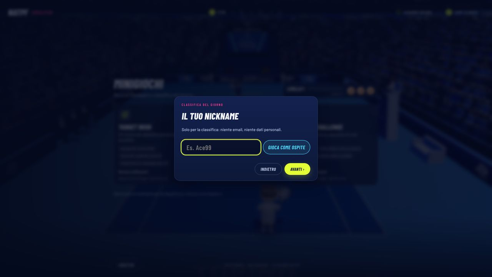

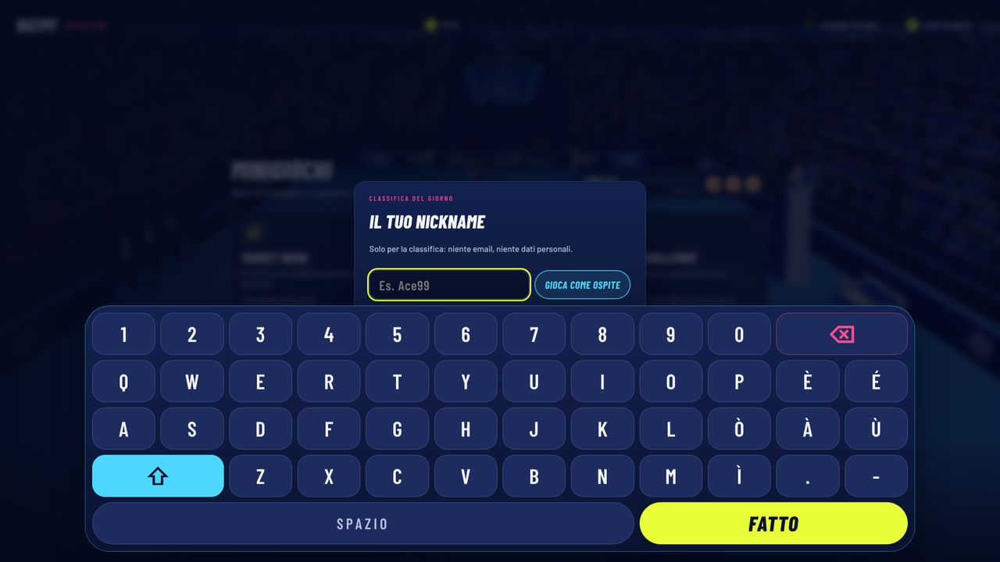

## Come si usa

1. **Clic sul campo** (o un tocco, su uno schermo tattile): la tastiera compare in basso. Se coprirebbe il campo, il
   foglio sale quanto basta (e torna giù alla chiusura).
2. **Clic sui tasti.** Tasti: cifre, righe italiane `q w e r t y u i o p`, `a s d f g h j k l`, `z x c v b n m`, le
   lettere accentate **à è é ì ò ù** sui loro tasti, punto e trattino, **⇧** (maiuscola per la lettera dopo; nei nomi la
   maiuscola viene da sola all'inizio e dopo uno spazio: «Anna Maria»), **spazio**, **⌫** (cancella) e **«Fatto»**. Un
   tasto rifiutato (campo pieno, carattere che il campo non vuole) dà una piccola scossa alla tastiera.
3. **«Fatto»** chiude la tastiera (come Esc o un clic fuori). Per andare avanti c'è il pulsante del foglio: «Avanti ›»,
   «Entra ›». «Fatto» non manda il modulo da solo: nel foglio di «Nuovo giocatore» sotto il nome c'è ancora la mano.
4. Con una **tastiera vera** basta scrivere: al primo tasto la tastiera a schermo sparisce e la lettera arriva al campo;
   per 30 s un clic sul campo non la riapre (chi ha la tastiera non la vede).

Altri dettagli: i tasti scattano alla pressione del pulsante del mouse (anche due volte di fila per le doppie, «Anna»);
non prendono il fuoco (resta nel campo); mandano al campo gli stessi eventi di una tastiera vera (`beforeinput` e `input`
a ogni tasto, `change` alla chiusura), così nomi, targhette e codice si aggiornano come prima. Dopo «Fatto», per mezzo
secondo, un secondo clic **proprio dove c'era «Fatto»** si scarta: il doppio clic non arriva al pulsante che c'è sotto
(controllo «solo mouse» del B39, n. 10). Il tasto destro resta libero (nel programma Windows è il menu dello staff).

### Campi coperti

| Campo | Regole |
|---|---|
| Nome del giocatore (`#nick-input`, foglio «Come ti chiami?» e «Il tuo nickname») | nome: 14 caratteri, maiuscola da sola all'inizio e dopo uno spazio |
| I due nomi dello stesso schermo (`.split-name-input`) | nome: 24 caratteri; tastiera nella metà di chi scrive (o sotto, nelle aree strette) |
| Codice della sfida tra due computer (`#join-code`) | codice: solo maiuscole, cifre e trattino, 8 caratteri |
| Nota della diagnostica (`[data-label]`) | testo: 80 caratteri, maiuscola solo all'inizio |
| Ritardo dello schermo della diagnostica (`[data-lag]`, numero) | cifre: tastierino numerico, al più 3 cifre (max 200) |
| Ogni altro campo di testo del gioco | regole prese dal campo (maxlength, `type=number`); `data-osk="no"` esclude un campo, `data-osk="name|text|code|digits"` sceglie le regole |

Cercati con `git grep '<input'` e `createElement('input')` in `natpf-tennis/index.html` e `src/`: gli altri `input` del
gioco sono cursori (volumi, allineamento della webcam) e caselle di spunta, non campi di testo. La pagina del telefono e
il telecomando dello staff non cambiano (sul telefono c'è la tastiera del telefono).

## Opzione dello stand: «Tastiera a schermo: Automatica · Sempre · Mai»

Nel pannello dello stand (F9 nel programma Windows, Ctrl+Maiusc+K nel browser, 3 s sul marchio NATPF, telecomando), un
clic passa al valore dopo; resta salvata (`localStorage`, `natpf-tennis.tastiera`) e vale subito.

- **Automatica** (di base): compare quando si clicca (o si tocca) un campo; sparisce con un tasto vero.
- **Sempre**: compare anche quando il campo prende il fuoco in altro modo (Tab, il gioco, il telecomando) e resta anche
  quando si usa una tastiera vera (si può scrivere con tutte e due).
- **Mai**: non compare (serve una tastiera vera).

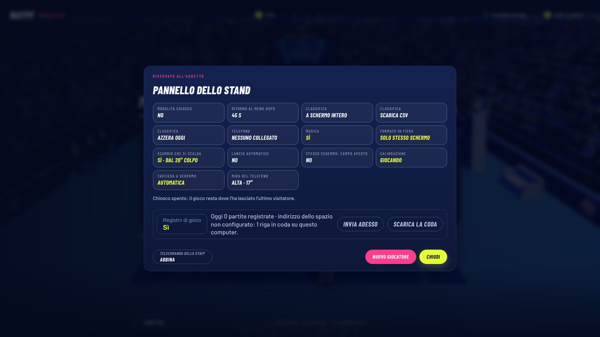

## «Gioca come Ospite» e la classifica

Il pulsante **«Gioca come Ospite»** sta accanto al campo del nome, nei due fogli del nome:

- **«Il tuo nickname»** (minigiochi): un clic e si va avanti senza nome; resta «Indietro» per tornare ai minigiochi.
- **«Come ti chiami?»** (Nuovo giocatore): prende il posto di «Salta» (che faceva la stessa cosa e ora è nascosto; il
  telecomando dello staff lo usa ancora per «Salta il nome», che quindi gioca come Ospite). Restano la mano e «Avanti ›».
- Chi ha scelto «Ospite» non si sente chiedere il nome al minigioco dopo («Giochi come Ospite: fuori classifica» nella
  pagina dei minigiochi). Un nome scritto dopo, «Nuovo giocatore» e il chiosco (stand libero) lo azzerano.
- Funziona con il solo mouse e con il telecomando dello staff: il pulsante è nel foglio del nome, le frecce del telefono
  dello staff lo raggiungono e OK lo preme.

**Regola, resa esplicita (`natpf_events.ranked`): senza nome = «Ospite» = fuori classifica.**

| | Prima | Adesso |
|---|---|---|
| Classifica del giorno dei minigiochi | riga «Ospite» | **nessuna riga**; il risultato dice «Fuori classifica: hai giocato come Ospite» al posto di «N° posto su M» |
| Classifica delle partite contro la CPU (B33) | riga «Ospite» | **nessuna riga**; la schermata finale (vinta) dice «N punti · Ospite, fuori classifica» |
| CSV della classifica | righe «Ospite» | nessuna (è la stessa classifica) |
| Record personali, medaglie, esperienza | nel contenitore «Ospite» di oggi | **come prima**: si vedono nel risultato («Bronzo, Ospite!», «Record personale») e nelle tessere; «Nuovo giocatore» e il chiosco li cancellano |
| Partita contro la CPU dal menu senza passo del nome | riga «Ospite» | fuori classifica (in classifica serve il nome: «Nuovo giocatore» lo chiede) |

Vale anche per chi non ha scelto «Ospite» ma gioca senza nome: il nome «Ospite» non compare più nelle classifiche, e non
si può nemmeno scrivere come nickname (««Ospite» è per chi gioca senza nome: scegline un altro»). Le righe «Ospite» già
salvate oggi prima dell'aggiornamento restano fino a domani (o fino a «Classifica · Azzera oggi»). Con la modalità fiera
(B41, seconda parte) i visitatori numerati («Visitatore 12») avranno un nome e torneranno in classifica.

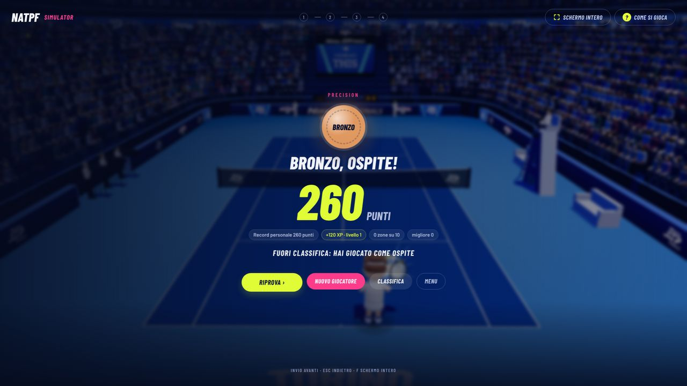

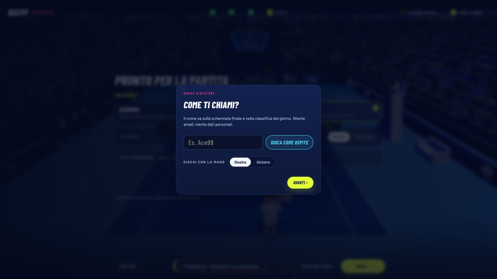

## Schermate (guardate)

| | |
|---|---|
| Stesso schermo, Player 1: tastiera nella metà sinistra | 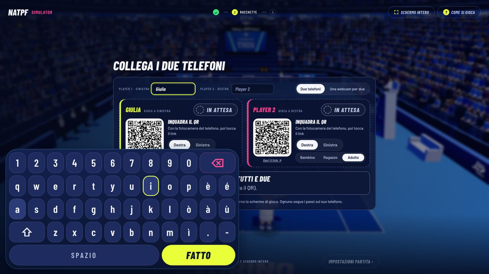 |
| Stesso schermo, Player 2: tastiera nella metà destra (il nome del Player 1 resta scoperto) | 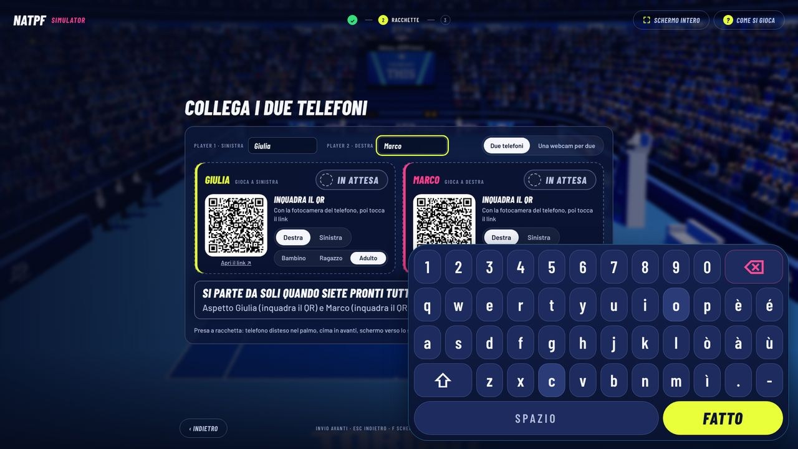 |
| Codice della sfida: tasti del codice, la pagina sale e il campo resta sopra | 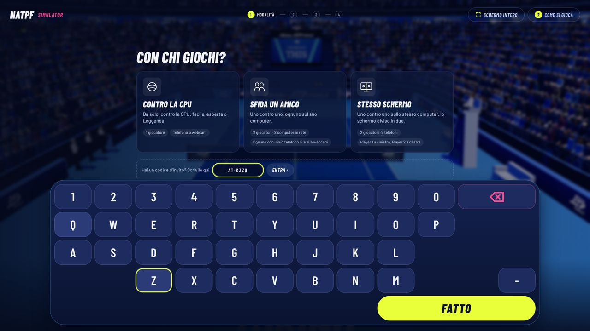 |
| Diagnostica: tastierino numerico per il ritardo | 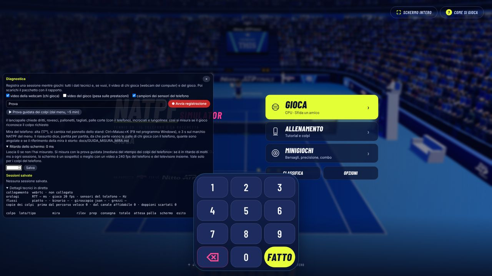 |
| Classifica con il nome scritto con il mouse | 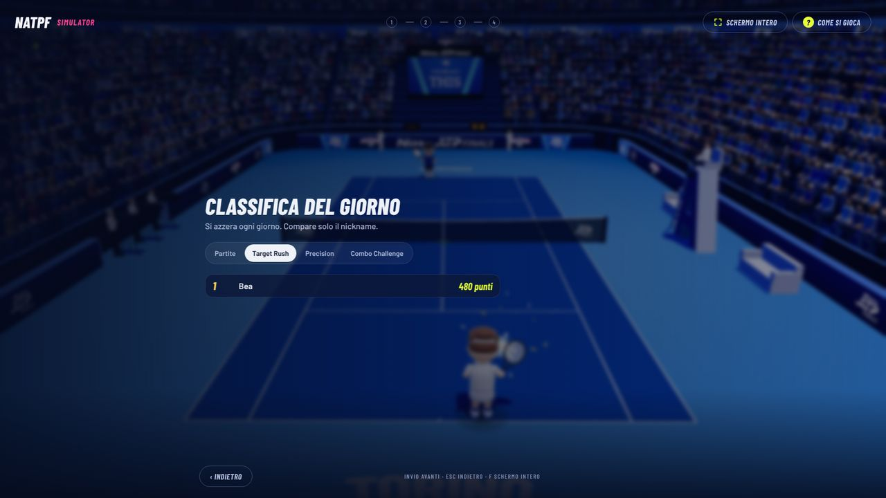 |
| Finestra 720 × 720 | 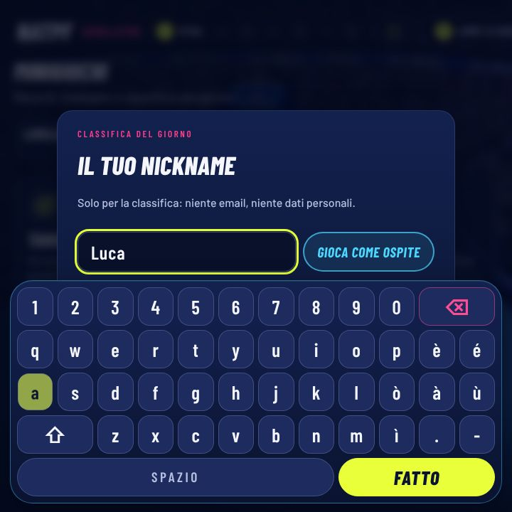 |
| Stesso schermo a 720 × 720 (metà troppo stretta: tastiera sotto i due nomi) | 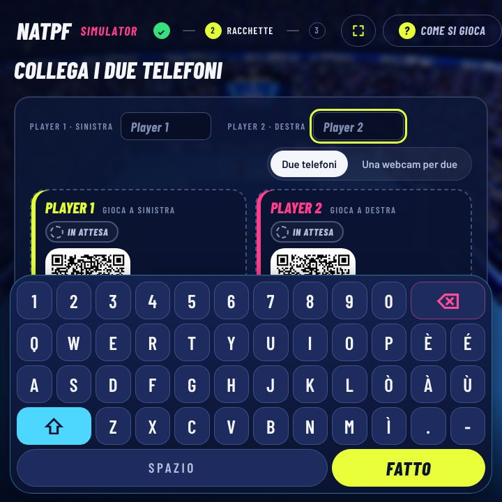 |
| Area di ledwall 720 × 720 dentro 1920 × 1080 (`?area=0,0,720,720`): la tastiera resta nell'area | 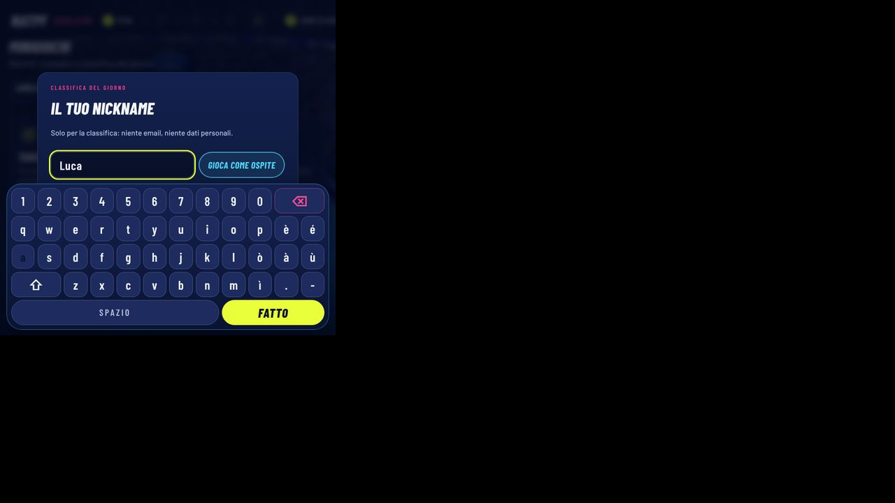 |
| Striscia 1920 × 540: tasti più bassi, campo in vista |  |

Misure (1920 × 1080): tasti alti 81 px (7,5% dell'area, tra 30 e 92 px), «Fatto» largo 515 px; tastiera 1594 × 473 px.
A 720 × 720 tasti di 54 px, a 1920 × 540 di 40 px. Le misure le mette il modulo in px da `viewport()` (l'area del gioco,
anche un'area di ledwall); nel foglio di stile i valori di riserva sono in `cqw`/`cqh` (`@container natpf`).

## File

- `natpf-tennis/src/natpf/natpf_tastiera.js` (nuovo): regole pure (`applyKey`, `fieldRules`, `oskOpens`, `oskLayout`…)
  e la tastiera nella pagina (`NatpfTastiera`); `natpf-tennis/natpf-tastiera.css` (nuovo).
- `natpf_ui.js` (la crea, presto: Esc e i tasti veri la vedono prima del menu), `natpf_kiosk.js` (opzione),
  `index.html` (foglio di stile, pulsante dell'opzione, «Gioca come Ospite»), `natpf_split_ui.js` (il conto alla
  rovescia aspetta), `natpf_diag.js` (Maiusc+D/M nei campi), `natpf_lobby.js` (foglio del nome, risultato),
  `natpf_events.js` (`ranked`, `guest`, `playAsGuest`), `natpf_match_stats.js` (pillola finale), `natpf_new_player.js`.
- Prove: `natpf-tennis/test/natpf-tastiera.test.mjs`, `natpf-ospite.test.mjs`, `natpf-nuovo-giocatore.test.mjs`
  (aggiornato), `tools/e2e/natpf-tastiera-schermo.mjs` (nuova, solo mouse).

## Prove

- Test di unità: `natpf-tastiera` 10/10 (lettere, ⇧, accenti, ⌫, maxlength, regole dei campi, eventi verso il campo,
  tasto vero, Esc, clic fuori, doppio clic su «Fatto», Mai/Sempre, disposizione a 1920 × 1080, 720 × 720, 1920 × 540,
  metà dello stesso schermo), `natpf-ospite` 4/4 (regola della classifica, minigioco, partita, «Nuovo giocatore», chiosco).
- Nel browser, `tools/e2e/natpf-tastiera-schermo.mjs` con il solo mouse: **53/53** (vedi `docs/WORK_PROGRESS.md`).
- Non provato: un PC Windows vero con il mouse a qualche metro dal ledwall, uno schermo tattile vero (la tastiera del
  sistema dovrebbe restare nascosta: `inputmode="none"` al tocco), il doppio clic con i tempi di Windows.
