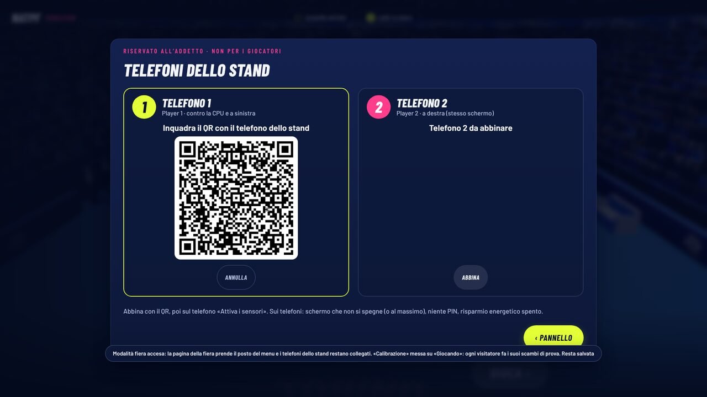
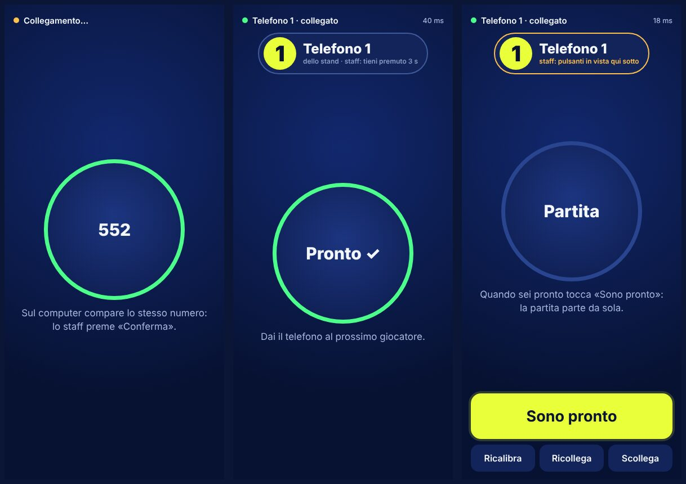
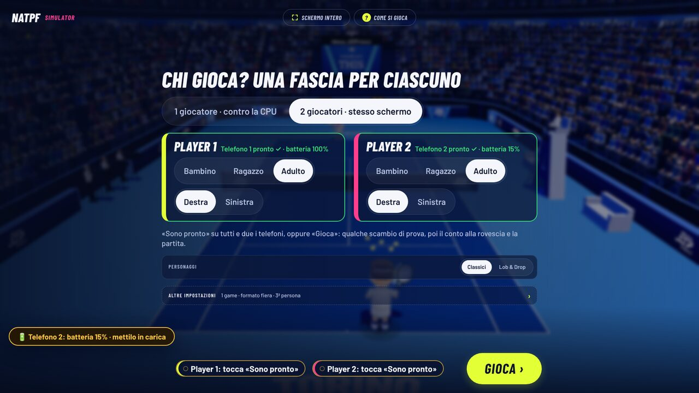
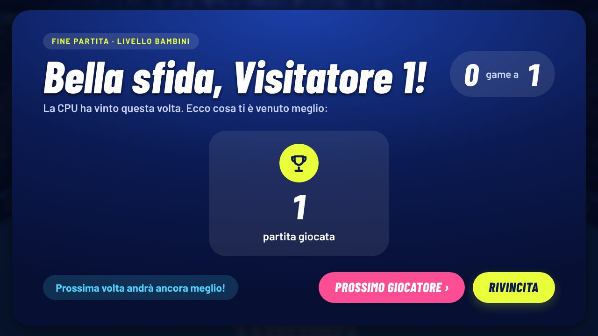

# B41 seconda parte · Modalità fiera con il solo mouse (14/11/2026)

Ramo `b41-fiera-2` partito da `natpf-simulator` @ `6348253` (2026-11-14.2 con il B47 unito) e poi unito con
`natpf-simulator` @ `ff90b5a` (2026-11-14.3: B45.1 fase A, telefono che non si scollega più per un buco della Wi-Fi né per
il chiosco) e alla fine con `natpf-simulator` @ `9bfa9cf` (solo la traccia dei passi). Correzioni della revisione
indipendente: **B41.3**, §8 (ramo unito prima con `natpf-simulator` @ `3d92ce1`, B45.1 fase B e B45.2). Progetto completo:
`docs/b41/progetto-modalita-fiera.md` (§2, §4, §5, §6: tappe B41.4 e B41.5). Prima parte: `docs/b41/modalita-fiera-1.md`.
Richieste dell'utente del 14/11 già fatte con il B47 (`docs/b47/fiera-subito.md`): battuta a un solo giocatore, conto alla
rovescia grande, livello dopo «Rivincita». Niente file di versione: la versione nuova la mette chi unisce.

Decisione dell'utente confermata il 14/11 (domande a scelta): **lo staff prepara i telefoni una volta, ogni visitatore fa i
suoi scambi di prova** (circa 10 s, calibrazione «Giocando»); né il profilo dello staff per tutti né «Nessuna».

## 1. In breve, per lo staff

**Una volta (all'inizio della giornata, o la prima volta)**
1. Apri il **pannello dello stand** con il mouse: nel programma Windows tasto destro sul gioco → «Pannello dello stand»;
   ovunque, tieni premuto 3 secondi il titolo grande «NATPF Simulator» del menu (o il marchio in alto a sinistra nelle
   altre pagine) finché l'anello giallo si riempie. Con la modalità fiera già accesa il menu non c'è: il marchio «NATPF
   Simulator» in alto a sinistra della pagina della fiera.
2. Clicca la prima voce, **«Modalità fiera: No»** → diventa «Sì» e resta salvata. Se la «Calibrazione» non era «Giocando»
   ci va da sola (ogni visitatore fa i suoi scambi di prova). Si apre il foglio **«Telefoni dello stand»**.
3. Nella scheda **Telefono 1** clicca **«Abbina»**: compare un QR (solo lì, solo con il foglio aperto, valido 5 minuti).
   Inquadralo con il telefono dello stand e tocca il link.
4. Sul telefono e nella scheda compare **lo stesso numero** (per esempio 482). Se è uguale clicca **«Conferma»** (con il
   mouse, o con Invio sulla tastiera del PC: l'OK del telecomando dello staff non vale); se è diverso «Rifiuta».
5. Sul telefono tocca **«Attiva i sensori»**. La scheda dice «Telefono 1 pronto ✓ · batteria 82%» (la batteria solo con
   Android).
6. Se si gioca anche in due, lo stesso con la scheda **Telefono 2**.
7. **«‹ Pannello»** → **«Chiudi»**. Al posto del menu c'è la **pagina della fiera**.

Dal giorno dopo niente QR: il programma riparte già in modalità fiera, i telefoni si ricollegano da soli (sul telefono
basta riaprire la pagina e, se lo chiede, «Attiva i sensori»).

**Per ogni visitatore (contro la CPU: al massimo 2 clic e 1 tocco)**
- Pagina della fiera: clicca **chi gioca** (Bambino, Ragazzo, Adulto; già scelto Adulto) e, se serve, «Sinistra» per un
  mancino; dai il telefono.
- Il visitatore tocca **«Sono pronto»** sul telefono, oppure clicchi tu **«Gioca»**.
- Partono gli **scambi di prova** (circa 10 secondi, il gioco impara il colpo di chi gioca), poi il **conto alla rovescia
  grande** e la partita. Contro la CPU **batte sempre il visitatore**.
- A fine partita: **«Prossimo giocatore ›»** per la persona dopo (i telefoni restano collegati), o **«Rivincita»**
  («Gioca ancora» se ha vinto) per la stessa persona (si sceglie di nuovo il livello, B47).
- Chi gioca contro la CPU senza un nome scritto diventa **«Visitatore 12»** (numerati da capo ogni giorno) e va nella
  classifica del giorno con quel nome. «Nome» accanto (tastiera a schermo del B38) per scriverlo, facoltativo.

**In due** (Telefono 1 a sinistra, Telefono 2 a destra): «2 giocatori · stesso schermo» (resta scelto), per ciascuno la
fascia e la mano, poi «Sono pronto» sui due telefoni o «Gioca». Al massimo 3 clic per coppia.

**Se qualcosa non va**
- Un telefono dello stand scollegato o con lo schermo spento: «Gioca» è grigio e la pagina dice perché, con il pulsante
  **«Telefoni dello stand ›»** (in due, B41.3: il perché nella scheda di quel giocatore e il pulsante in alto a destra,
  accanto a «2 giocatori»); mai un QR per il pubblico. Di solito il telefono si ricollega da solo.
- **Batteria sotto il 20 %** e non in carica (Android): sulla pagina della fiera, cioè tra un visitatore e l'altro, in
  basso a sinistra (nelle aree strette come 720×720 in basso a destra, accanto a «Gioca ›») «🔋 Telefono 2: batteria 15% ·
  mettilo in carica»; nella scheda del foglio la batteria è in arancione. In partita e sulla fine partita l'avviso non c'è.
- Telefono perso o rotto: nel foglio «Abbina un altro telefono» su quel posto (il telefono di prima non vale più), oppure
  **«Scollega»** (due clic: «Sicuro? Clicca ancora»; dal telecomando dello staff due OK). Un telefono che non ha mai fatto
  da racchetta su quel PC vuole prima il certificato (guida dello stand, capitolo 6.1, passo 1).
- In fiera pausa → «Torna al menu» (o «Torna al menu» dal telecomando) fa «Prossimo giocatore» (B41.3).
- Per allenamento, minigiochi, sfida tra due computer, webcam o le Opzioni: pannello → «Modalità fiera: No» (il menu di
  sempre torna identico; B41.3: anche «Con cosa giochi» e «Calibrazione» tornano come prima della fiera). Con la modalità
  accesa la «Calibrazione» resta «Giocando (fiera)».

Schermate delle prove nel browser (telefoni simulati), del 14/11 sera:

## 2. Che cosa è stato fatto

### B41.4 · Interruttore e foglio «Telefoni dello stand»
- **Pannello** (`natpf_kiosk.js`, `index.html`): voce nuova in testa «Modalità fiera: No · Sì» (`data-staff="fiera"`,
  salvata in `natpf-tennis.fiera`; con `?stand=fiera|normale` nell'indirizzo vale l'indirizzo e la voce dice «(indirizzo)»).
  Accesa: calibrazione su «Giocando» se non lo era (una volta, `writeCalMode('play')` e lo stesso giro dei telefoni della
  voce «Calibrazione», `_calChanged`), si apre il foglio, la pagina della fiera prende il posto del menu. Spenta: il menu di
  sempre. Con la modalità accesa la voce «Telefono» diventa **«Telefoni dello stand»** con il riassunto dei due posti
  («1 ✓ · 2 da abbinare ›») e apre il foglio (niente da confermare, niente scollegato). Le voci sono 16: stanno senza
  scorrere a 1024×600, 1280×720, 1366×657, 1920×1080, 1024×1024 e 720×720 (prova `natpf-menu`). A 720×720 (tre colonne)
  diventano sei file e con le quattro opzioni del B25 accese il foglio scorreva di 28 px con «Chiudi» sotto il bordo (con
  15 voci stava): lì i pulsanti sono un poco più bassi (`min-height` 48 px invece di 54, sempre più di 5,5 cqh) e «Chiudi»
  ha 50 px di margine. Le prove `natpf-stesso-schermo-b25` e `-b20` contano 16 voci e misurano con il puntatore fuori dal
  pannello (§6).
- **Foglio** (`natpf_fiera_sheet.js`, `#natpf-fiera`): due schede (Telefono 1 giallo, Telefono 2 rosa) con lo stato in
  parole (`natpf_fiera.standSlotView`), la batteria (`batteryText`), il perché di un QR scaduto. Azioni per scheda
  (`sheetSlotView`): «Abbina» / «Abbina un altro telefono» (QR del posto, **uno alla volta**: aprendo l'altro il primo si
  chiude; chiudendo il foglio non vale più), «Annulla», «Rifiuta» e **«Conferma»** (`NatpfFiera.confirm` vuole
  `ev.isTrusted`; il pulsante ha `data-no-remote`: il telecomando non lo raggiunge né lo preme), **«Scollega»** in due clic
  (`TwoStep`). Il foglio è un foglio dello staff come il pannello: ferma la partita (`staffOpen`), Esc e Indietro del
  telecomando tornano al pannello (strato `fiera` di `natpf_remote_map.js`), il chiosco aspetta.
- **Avviso della batteria** (`NatpfFiera.tick`, `#natpf-fiera-alert`): telefoni dello stand collegati sotto il 20 % e non in
  carica (`batteryAlert`), **solo sulla pagina della fiera** (tra un visitatore e l'altro, quando lo staff può mettere in
  carica il telefono), in basso a sinistra; nelle aree strette (`@container natpf (max-width: 820px)`, classe `on-page`) in
  basso a destra, accanto a «Gioca ›», perché a 720×720 in basso a sinistra copriva «Telefono: tocca «Sono pronto»». Non
  prende i clic; una riga `stand.batteria` nella diagnostica quando diventa bassa. Correzione dopo la sonda delle misure:
  prima si vedeva ovunque e sulla fine partita copriva il consiglio «Prossima volta prova il livello Facile» (1280×720,
  1920×1080, 1366×768, 1024×600, 1920×540), stava sopra l'intro (z-index 240 contro 200), gli scambi di prova e il campo.
  Ora lasciando la pagina sparisce al giro dopo (100 ms), e torna con la pagina.
- **Niente «Sono pronto» con un foglio dello staff aperto** (`natpf_ready_go._ids`): un tocco del visitatore farebbe partire
  la partita sotto il pannello; l'offerta torna alla chiusura (il telefono intanto dice «Dai il telefono al prossimo
  giocatore»).

### B41.5 · Pagina della fiera e «Prossimo giocatore»
- **Pagina della fiera** (`natpf_fiera_page.js`; `natpf_lobby.go`/`paint`): con la modalità accesa `go('menu')` porta alla
  pagina «Pronto per la partita» in versione fiera (`#title-modal[data-fair="1"]`), così «Sono pronto», scambi di prova,
  conto alla rovescia, «Rivincita» e telecomando restano quelli di sempre. Titolo «Chi gioca?» con chi gioca adesso
  («Visitatore 12» o il nome, «Nome»), «1 giocatore · contro la CPU» / «2 giocatori · stesso schermo» (salvato,
  `natpf-tennis.fiera.gioco`), mano (CPU) o per ciascuno fascia e mano (stesso schermo), tessere grandi, stato dei telefoni
  con il perché e «Telefoni dello stand ›». **«Gioca» è spento** finché i telefoni che servono non sono pronti
  (`fairGate`); niente «‹ Indietro», «Riscaldati prima», barra dei passi e ritratti; Esc non porta via. Nessun QR: il
  telefono dello stand scollegato non apre mai il pannello del telefono (al suo posto il foglio dello staff).
- **«Gioca» o «Sono pronto» → scambi di prova → conto alla rovescia → partita** (`natpf_ui._bindStart`): in fiera gli scambi
  di prova portano dritti alla partita (non alla pagina come fuori dalla fiera, B35).
- **Correzione trovata con le prove nel browser**: dalla pagina della fiera «Sono pronto» saltava subito gli scambi di prova
  (il tocco del telefono è un «next», e gli scambi di prova, partiti dentro quel «next», lo ricevevano come il loro «Salta ›»).
  Ora il clic di «Gioca» del conto arriva dopo il tocco (`natpf_ready_go._fire`); test nuovo che senza la correzione fallisce.
- **Visitatori numerati** (`NatpfFiera.claimVisitor`, `natpf-tennis.fiera.visitatori` = `{ day, n }`): al primo «Gioca»
  contro la CPU, chi non ha un nome scritto (né «Gioca come Ospite») prende «Visitatore N» come nome della partita e della
  classifica del giorno; un giorno nuovo riparte da 1; «Prossimo giocatore» libera il numero (chi arriva prende il
  successivo quando gioca). Nello stesso schermo restano Player 1 e Player 2 (non c'è classifica).
- **Contro la CPU batte sempre il visitatore** anche con «Battuta: Alternata» (`natpf_battuta.matchServe({ fair })`,
  `game_engine.startNewMatch`); in due vale la regola del pannello.
- **«Prossimo giocatore»** (`natpf_new_player.resetFairVisitor`; `NatpfUi.newPlayer` in fiera): a fine partita
  («Prossimo giocatore ›» al posto di «Nuovo giocatore», «Menu» nascosto), dal pannello, dal telecomando dello staff (che lo
  chiama così) e dal chiosco in fiera. Azzera nome e «Ospite», record dell'ospite e colpi speciali imparati, «Chi gioca»
  (Adulto) e livello Evento, mano di Player 1 e Player 2 (`resetHands(ui, 'fiera')`, `'chiosco'` dal chiosco), nomi e fasce
  dello stesso schermo, numero del visitatore, quello che i telefoni dello stand hanno imparato (`resetPlayer({ gate: false,
  causa })` del B45.1, con causa `fiera` o `chiosco`: profilo semplice da capo, senza tutorial), «Sono pronto». **I telefoni
  restano collegati**; si torna alla pagina della fiera. Il chiosco alla pagina della fiera senza un visitatore in corso è
  «a riposo» (con il B45.1: `clean`, non riazzera di continuo).
- **Telecomando dello staff**: «Chi gioca» e «Gioca!» funzionano già sulla pagina (passo `match`); «Nuovo giocatore» si
  chiama «Prossimo giocatore» e fa quello della fiera; la pagina si chiama «Pagina della fiera»; nello stesso schermo le
  fasce si scelgono con frecce e OK (Invio su fasce, mani e «1 o 2 giocatori» le sceglie, non fa partire).
- **Mano**: le scelte si chiamano «Destra · Sinistra» come in tutto il gioco (test `natpf-mancini`); «Mancino» resta
  l'etichetta che si vede in campo (B46).
- **Fine partita con «Visitatore N»** (`HudUI._fitEndTitle`, `natpf_match_stats.titleFit`, `--fit` in `natpf-hud.css`):
  «Bella sfida, Visitatore 10!» a 16:9 (1280×720, 1920×1080, 1366×768, 1024×600) andava su due righe e la scheda della fine
  partita (centrata, senza scorrere, B35) tagliava la pillola «Fine partita» in alto e i pulsanti in basso. Ora il titolo
  si misura con la schermata in vista e, se su una riga non ci sta, si rimpicciolisce in proporzione (con un po' di
  margine, mai sotto metà); si rimisura quando arrivano i caratteri e quando la scheda cambia grandezza. I titoli che ci
  stavano non cambiano; vale anche per i nomi lunghi fuori dalla fiera. Sonda a 7 misure e 9 titoli: prima 12 casi su 63
  tagliati, dopo 0 (test `natpf-b41-fine-titolo`).
- **Restano sulla pagina** «Personaggi: Classici · Lob & Drop» e «Altre impostazioni» (durata, singolare o doppio, visuale,
  livelli Esperta e Leggenda): il progetto (§4.2) le voleva nel pannello, che non le ha; restano dove lo staff le trova già.

## 3. Codice
- Nuovi: `natpf-tennis/src/natpf/natpf_fiera_sheet.js`, `natpf_fiera_page.js`, `test/natpf-b41-fine-titolo.test.mjs`.
- Cambiati: `natpf_fiera.js` (funzioni pure, visitatori, avviso, 1 o 2 giocatori), `natpf_kiosk.js`, `natpf_lobby.js`,
  `natpf_ui.js`, `natpf_new_player.js`, `natpf_ready_go.js`, `natpf_remote.js`, `natpf_remote_map.js`,
  `natpf_stand_mouse.js` (spiegazione della voce), `natpf_battuta.js`, `game_engine.js` (una riga: `fair`), `index.html`,
  `natpf-ui.css` (misure in `cqw`/`cqh` e `@container natpf`); per il titolo della fine partita `hud_ui.js`
  (`_fitEndTitle`), `natpf_match_stats.js` (`titleFit`) e `natpf-hud.css` (`--fit`).
- Prove: `test/natpf-fiera.test.mjs` (+10), `test/ui-world.mjs` (foglio nuovo tra i fogli nascosti),
  `tools/e2e/natpf-fiera-telefoni.mjs` (riscritta: tutto con il mouse), `tools/e2e/natpf-flusso-tocchi.mjs` (`FLOW=fiera`,
  `FLOW=fiera-due`), `test/natpf-b41-fine-titolo.test.mjs`, `tools/e2e/natpf-stesso-schermo-b25.mjs` e `-b20.mjs` (16 voci,
  puntatore fuori dal pannello prima delle misure).

## 4. Verifiche

Ultime corse (14/11, 22:00–23:45 UTC; la macchina era carica, 3–11, per un altro agente che lavorava in parallelo):

| Prova | Esito |
|---|---|
| gioco, `npm test` | 1621/1621 tre volte: su `8c37a98`, dopo l'avviso della batteria (`bee3649`) e dopo l'unione finale (`da243e0`) |
| sito, `node --test tools/test/*.test.mjs` | 265/265 su `8c37a98`; dopo l'unione 265/265 (al primo giro 264/265 con la macchina carica: `remote-pairing.test.mjs` «chiave sbagliata, risposta riusata», di tempi; da sola 18/18 tre volte) |
| programma Windows (`natpf-desktop`, `npm test`) | 51/51 |
| server LAN (`tools/lan`) | 13/13 |
| build | ok (prima e dopo l'unione) |
| `npm run audit:legend` | 69 OK, 0 KO: uguale alla base del B47 (tolte le righe dei tempi) |
| test che leggono `natpf-ui.css` (dopo il pannello a 720×720) | 105/105 |
| `natpf-fiera-telefoni` | 48/48 (nuovo: in campo nessun avviso della batteria) |
| `natpf-flusso-tocchi` `FLOW=fiera` (10 visitatori di fila) | 46/46: 1 o 2 clic e 0 o 1 tocco a visitatore, «Visitatore 1» … «Visitatore 10», scambi di prova interi (15,7–16,3 s senza colpire), nessun QR, nessuna calibrazione né tutorial, telefoni sempre collegati (stesso collegamento); doppio clic a 110, 250 e 300 ms su «Prossimo giocatore» e su «Gioca»: un passo solo |
| `natpf-flusso-tocchi` `FLOW=fiera-due` (3 coppie) | 13/13: da 1 a 3 clic e da 0 a 2 tocchi a coppia |
| `natpf-fine-partita` | 47/47 |
| `natpf-b47-fiera` | 20/20 |
| `natpf-menu` | 45/45 (rifatta dopo il pannello a 720×720: 45/45) |
| `natpf-nuovo-giocatore` | 28/28 |
| `natpf-mano-sicura` (1280×720 e `AREA=720`) | 17/17 e 17/17 |
| `natpf-solo-mouse` | 42/42 (e 42/42 dopo il pannello) |
| `natpf-telecomando` (porte 4902/4903 con `flock`) | 91/91 da sola; 90/91 nel primo giro con il carico a 9–11 («Salta» dal telecomando, già visto sulla 14.3) |
| `natpf-stesso-schermo-b25` | 54/55 come sulla 14.3: resta il pannello a 1024×600 con le opzioni accese (5 px, lo sistema il B45.2) |
| `natpf-stesso-schermo-b20` | 51/52: resta il punto 6 del B45.1 (titolo «scollegato · si ricollega da solo» con la pagina del telefono chiusa, nel B45.2) |
| sonda delle misure a 7 formati (§5) | 36/36 |

## 5. Misure a 7 formati (sonda con i telefoni simulati, 14/11 sera)

Con il Telefono 1 e il Telefono 2 abbinati dal foglio (il 2 con la batteria al 15 %), a 1280×720, 1920×1080, 1366×768,
1024×600, 720×720, 1920×540 e 1024×1024: pagina della fiera contro la CPU e in due, pannello dello stand con «Modalità
fiera: Sì» (16 voci), foglio «Telefoni dello stand» con i due telefoni pronti, fine partita con «Bella sfida, Visitatore 1!».
Per ogni stato: niente che scorre, niente fuori dallo schermo, niente sovrapposto (pulsanti, scritte, tessere, spunte di
«Sono pronto», avviso della batteria). **36 misure su 36 a posto**, schermate guardate una per una. Il titolo della fine
partita sta su una riga a tutte le misure (rimpicciolito al 96,7 % a 16:9, intero a 720×720, 1920×540 e 1024×1024).

Guardando le schermate è venuto fuori un difetto della B41, corretto: l'avviso della batteria copriva il consiglio «Prossima
volta prova il livello Facile» della fine partita (1280×720, 1920×1080, 1366×768, 1024×600, 1920×540). Ora si vede solo
sulla pagina della fiera (§2, B41.4). Sonda rifatta sul codice finale (dopo l'avviso e il pannello a 720×720): di nuovo
36/36, e la fine partita è senza avviso a tutte e sette le misure.

## 6. Trovato, non della B41 (da sistemare altrove)

Dopo la revisione (B41.3, §8) i primi due e l'ultimo punto sono corretti: la riga sotto le voci ha un'altezza fissa
(difetto 8) e la spiegazione del chiosco l'ha già corretta la B45.2.

- **Pannello dello stand che trema sotto il puntatore fermo** (B39.3, già nella 2026-11-14.3): la riga sotto le voci spiega
  la voce sotto il puntatore; se la spiegazione cambia numero di righe il foglio, centrato, si sposta di 9–12 px, sotto il
  puntatore arriva un'altra voce, e così via. Con il puntatore fermo su una griglia di punti del pannello: sulla 14.3 15
  punti su 280 a 1366×657 e 10 su 280 a 1024×600; su questo ramo 17 a 1366×657 (con o senza la modalità fiera) e 0 a
  1024×600. A 720×720 no: lì il foglio sta già in alto. Una persona che muove il mouse lo vede solo se si ferma proprio sul
  confine tra due voci; Playwright invece aspetta che il pulsante stia fermo e non clicca. Rimedio possibile: foglio in alto
  anche a quelle misure, o riga di altezza fissa (il pannello lo sta toccando il B45.2: meglio lì).
- **Pannello che scorre mentre il puntatore è su una voce con una spiegazione lunga** (stessa causa, B39.3): con le quattro
  opzioni del B25 accese e il puntatore su «Calibrazione» (spiegazione di quattro righe) il foglio scorre di 6 px a
  1920×540 e di 28 px a 1024×600, uguale sulla 14.3; a 720×720 di 15 px sulla 14.3 e di 24 px qui (una fila in più). Passa
  appena il puntatore lascia la voce (la riga torna quella di sempre), quindi «Chiudi» si raggiunge. A riposo, con il
  puntatore fuori, resta solo il difetto noto della 14.3 a 1024×600 (5 px, lo sistema il B45.2). Le prove b25 e b20
  misuravano con il puntatore rimasto dove capitava dopo i clic: ora lo spostano nell'angolo.
- **Avviso della mano a 720×720** (`natpf-mano-sicura` con `AREA=720`): sotto carico (8–10) 16/17, con l'avviso grande del
  cambio di mano misurato a y=256 invece che al centro, uguale sulla base `ff90b5a` senza la B41; con la macchina meno
  carica (3) 17/17, a y=301. Dipende dai tempi della misura, non dalla B41 (in coda nel B50).
- **Spiegazione della voce «Modalità chiosco»** nel pannello (`natpf_stand_mouse.STAFF_HINTS.kiosk`): dice ancora «…e scollega
  il telefono», ma dal B45.1 il chiosco non scollega più nessun telefono (la riga sotto le voci quando il chiosco è acceso
  invece è giusta).

## 7. Non verificato
- **Telefoni veri** (Android e iPhone), persone vere, **programma Windows** e **ledwall** veri, rete dello stand: tutte le
  prove sono con il telefono simulato (eventi devicemotion sintetici), la segnalazione PeerJS locale e Chromium senza
  schermo. La batteria è finta (`navigator.getBattery` sostituito nella pagina del telefono).
- Il tasto destro del programma Windows per aprire il pannello (provato il marchio tenuto 3 s nel browser).
- La LAN (`?lan=1`, programma Windows): i telefoni dello stand usano lo stesso collegamento della prima parte, provato via
  PeerJS locale.
- La «prova dritto e rovescio» nel foglio prevista dal progetto (§3.1) **non c'è**: il telefono manda i colpi solo durante il
  gioco; servirebbe cambiare la pagina del telefono. Il verso di ogni visitatore lo imparano i suoi scambi di prova.

## 8. B41.3 · dopo la revisione (15/11)

Revisione indipendente della B41 seconda parte (sonde del revisore rifatte qui sul codice nuovo, §8.3). Prima di tutto il
ramo è stato unito con `natpf-simulator` @ `3d92ce1` (B45.1 fase B e B45.2: righe delle cadute nel pannello, spiegazione
del chiosco già corretta; conflitti nel pannello dello stand, `natpf_stand_mouse.js`, prove b25 e b20, documenti: tenute le
due parti), e alla fine con `natpf-simulator` (versione 2026-11-14.4 e traccia). Lavoro interrotto dal limite d'uso: un
salvataggio «IN CORSO» (`80239be`, difetto 4 a metà) verificato e chiuso dall'agente dopo.

### 8.1 Difetti e correzioni

| # | Difetto della revisione | Correzione | Prove |
|---|---|---|---|
| 1 | **Medio.** Un visitatore saltava per sbaglio i suoi scambi di prova: due tocchi su «Sono pronto» a 150 o 400 ms, o «Gioca ›» dello staff con il tocco del visitatore 60 ms dopo. Il pulsante del telefono passa da «Sono pronto» a «Salta ›» in pochi millisecondi e il tocco non diceva a quale offerta rispondeva | Ogni offerta del pulsante del telefono ha un numero (`id` nel messaggio `nx`) che il telefono rimanda con il tocco: un tocco per un'offerta che non c'è più non vale (`natpf_phone_racket.nextTapVerdict`). Il telefono spegne il pulsante dopo il tocco fino all'offerta dopo (`phone-screen.nextTap`; con un computer di prima si riaccende dopo 2,5 s). «Salta ›» degli scambi di prova non vale per il primo secondo (`graceMs` 1000, anche con le pagine del telefono di prima). Un tocco solo e «Gioca ›» da solo come prima. Tocchi scartati nella diagnostica (`tel.tocco`) | `natpf-b41-3-tocchi` 12/12 (i tre casi con la pagina nuova e con quella di prima), `tools/test/b41-3-tocchi` 3/3, `natpf-fiera-telefoni` §5b (tre visitatori, uno per caso), sonda p2 del revisore |
| 2 | «Scollega» nel foglio «Telefoni dello stand» con un OK solo dal telecomando dello staff | Ogni clic sul pulsante vuole il secondo clic, anche quello non vero del telecomando (due OK); dal codice, senza clic, subito | `natpf-b41-3-fiera`, sonda p8 |
| 3 | In fiera pausa → «Torna al menu» (o dal telecomando) tornava alla pagina della fiera senza azzerare il visitatore: chi arrivava dopo giocava con il nome di prima e, se destro, con la mano sinistra (il caso del B46) | `NatpfUi.backToMenu` con la modalità fiera chiude tutto e poi fa «Prossimo giocatore» (`resetFairVisitor`, causa `menu`); i telefoni restano collegati. Anche dalla pagina della fiera con «Torna al menu» del telecomando | `natpf-b41-3-fiera` (3 test), sonda p9 |
| 4 | Pagina della fiera «2 giocatori» con un telefono non pronto: la riga «Telefono N non pronto · Telefoni dello stand ›» faceva scorrere la pagina di 26 px a 1920×540 e tagliava «Altre impostazioni» sopra «Gioca ›» | Il perché vero nella scheda di quel giocatore (`natpf_fiera_page.splitCardState`: prima uno schermo spento diceva ancora «pronto ✓»), «Telefoni dello stand ›» nella riga di «2 giocatori»; niente riga in più | `natpf-b41-3-pagina` 2/2; sonda delle sette misure (nove stati) 63/63, prima 58/63; controllo in `natpf-fiera-telefoni` §6; sonda p5 |
| 5 | Modalità accesa e poi spenta: «Con cosa giochi» restava «Smartphone» e «Calibrazione» «Giocando» | All'accensione dal pannello si ricordano (`natpf-tennis.fiera.prima`), allo spegnimento si rimettono e l'avviso lo dice | `natpf-b41-3-fiera`, sonda p3 |
| 6 | Con la modalità fiera un clic su «Calibrazione» la portava a «Con i gesti» e la pagina della fiera diceva il falso | In fiera la voce dice «Giocando (fiera)» e un clic lo spiega senza cambiarla; modalità già accesa all'avvio con un'altra calibrazione salvata: «Giocando», quella di prima ricordata | `natpf-b41-3-fiera`, sonda p6 |
| 7 | Testi | §1 passo 4: «Conferma» vale con un clic vero del mouse (o Invio sul pulsante), l'OK del telecomando no. Non è una difesa contro chi usa la console del browser: `NatpfFiera.confirm` guarda solo il campo `isTrusted` dell'evento che riceve. Guida 8.4 «Telefono rotto o perso»: un telefono nuovo vuole prima il certificato (capitolo 6.1). La spiegazione di «Modalità chiosco» non dice più «scollega il telefono» (corretta dalla B45.2) | — |
| 8 | Pannello dello stand che trema e scorre con il puntatore sulle voci (B39.3, già nella 14.3): la riga sotto le voci cambiava altezza con la spiegazione della voce sotto il puntatore | `natpf_kiosk._fitNote`: la riga ha l'altezza fissa della spiegazione più alta (misurata con le scritte vere alla larghezza di adesso, rimisurata quando cambiano); nelle aree basse foglio più compatto (720×720 quattro colonne). Dopo l'unione con la B45.2 anche 1280×720 con le righe delle cadute (§8.2) | `natpf-b41-3-pannello` 3/3; sonda del pannello con il puntatore su ogni voce (§8.2); `natpf-pannello-cadute` |
