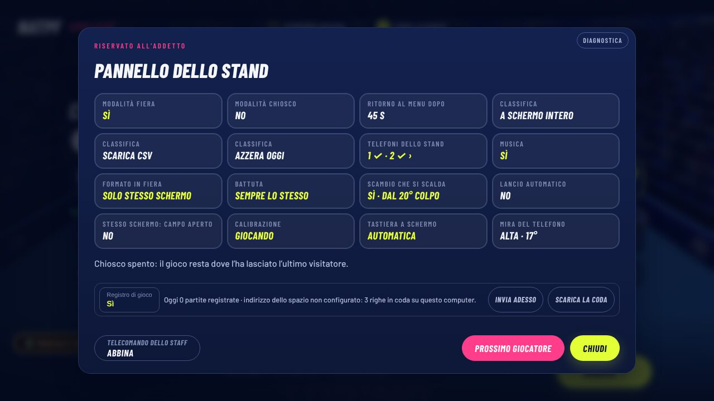
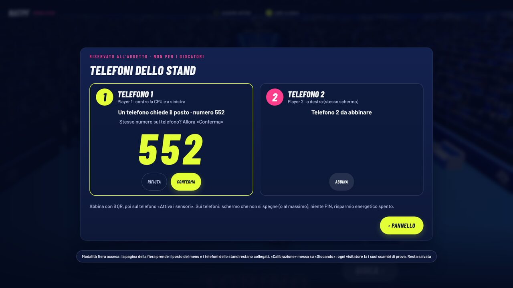
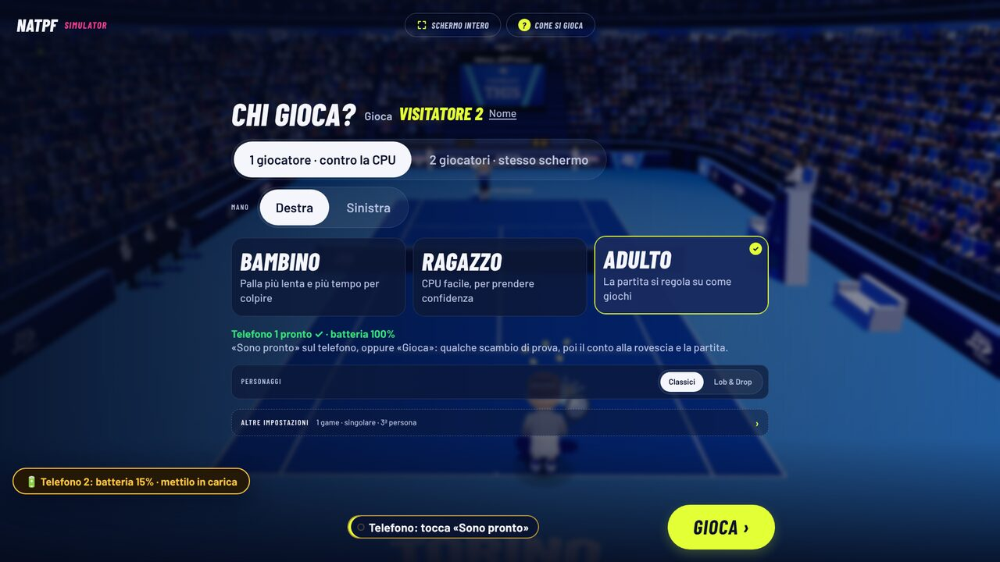

# B41 seconda parte · Modalità fiera con il solo mouse (14/11/2026)

Ramo `b41-fiera-2` partito da `natpf-simulator` @ `6348253` (2026-11-14.2 con il B47 unito) e poi unito con
`natpf-simulator` @ `ff90b5a` (2026-11-14.3: B45.1 fase A, telefono che non si scollega più per un buco della Wi-Fi né per
il chiosco). Progetto completo: `docs/b41/progetto-modalita-fiera.md` (§2, §4, §5, §6: tappe B41.4 e B41.5). Prima parte:
`docs/b41/modalita-fiera-1.md`. Richieste dell'utente del 14/11 già fatte con il B47 (`docs/b47/fiera-subito.md`): battuta a
un solo giocatore, conto alla rovescia grande, livello dopo «Rivincita». Niente file di versione: la versione nuova la mette
chi unisce.

Decisione dell'utente confermata il 14/11 (domande a scelta): **lo staff prepara i telefoni una volta, ogni visitatore fa i
suoi scambi di prova** (circa 10 s, calibrazione «Giocando»); né il profilo dello staff per tutti né «Nessuna».

## 1. In breve, per lo staff

**Una volta (all'inizio della giornata, o la prima volta)**
1. Apri il **pannello dello stand** con il mouse: nel programma Windows tasto destro sul gioco → «Pannello dello stand»;
   ovunque, tieni premuto 3 secondi il titolo grande «NATPF Simulator» del menu (o il marchio in alto a sinistra nelle
   altre pagine) finché l'anello giallo si riempie.
2. Clicca la prima voce, **«Modalità fiera: No»** → diventa «Sì» e resta salvata. Se la «Calibrazione» non era «Giocando»
   ci va da sola (ogni visitatore fa i suoi scambi di prova). Si apre il foglio **«Telefoni dello stand»**.
3. Nella scheda **Telefono 1** clicca **«Abbina»**: compare un QR (solo lì, solo con il foglio aperto, valido 5 minuti).
   Inquadralo con il telefono dello stand e tocca il link.
4. Sul telefono e nella scheda compare **lo stesso numero** (per esempio 482). Se è uguale clicca **«Conferma»** (con il
   mouse: dal telecomando o da uno script non vale); se è diverso «Rifiuta».
5. Sul telefono tocca **«Attiva i sensori»**. La scheda dice «Telefono 1 pronto ✓ · batteria 82%» (la batteria solo con
   Android).
6. Se si gioca anche in due, lo stesso con la scheda **Telefono 2**.
7. **«‹ Pannello»** → **«Chiudi»**. Al posto del menu c'è la **pagina della fiera**.

Dal giorno dopo niente QR: il programma riparte già in modalità fiera, i telefoni si ricollegano da soli (sul telefono
basta riaprire la pagina e, se lo chiede, «Attiva i sensori»).

**Per ogni visitatore (contro la CPU: al massimo 2 clic e 1 tocco)**
- Pagina della fiera: clicca **chi gioca** (Bambino, Ragazzo, Adulto; già scelto Adulto) e, se serve, «Sinistra» per un
  mancino; dai il telefono.
- Il visitatore tocca **«Sono pronto»** sul telefono, oppure clicchi tu **«Gioca»**.
- Partono gli **scambi di prova** (circa 10 secondi, il gioco impara il colpo di chi gioca), poi il **conto alla rovescia
  grande** e la partita. Contro la CPU **batte sempre il visitatore**.
- A fine partita: **«Prossimo giocatore ›»** per la persona dopo (i telefoni restano collegati), o **«Rivincita»** per la
  stessa persona (si sceglie di nuovo il livello, B47).
- Chi gioca contro la CPU senza un nome scritto diventa **«Visitatore 12»** (numerati da capo ogni giorno) e va nella
  classifica del giorno con quel nome. «Nome» accanto (tastiera a schermo del B38) per scriverlo, facoltativo.

**In due** (Telefono 1 a sinistra, Telefono 2 a destra): «2 giocatori · stesso schermo» (resta scelto), per ciascuno la
fascia e la mano, poi «Sono pronto» sui due telefoni o «Gioca». Al massimo 3 clic per coppia.

**Se qualcosa non va**
- Un telefono dello stand scollegato o con lo schermo spento: «Gioca» è grigio e la pagina dice perché, con il pulsante
  **«Telefoni dello stand ›»**; mai un QR per il pubblico. Di solito il telefono si ricollega da solo.
- **Batteria sotto il 20 %** e non in carica (Android): in basso a sinistra sul ledwall «🔋 Telefono 2: batteria 15% ·
  mettilo in carica», e nella scheda del foglio.
- Telefono perso o rotto: nel foglio «Abbina un altro telefono» su quel posto (il telefono di prima non vale più), oppure
  **«Scollega»** (due clic: «Sicuro? Clicca ancora»).
- Per allenamento, minigiochi, sfida tra due computer, webcam o le Opzioni: pannello → «Modalità fiera: No» (il menu di
  sempre torna identico).

## 2. Che cosa è stato fatto

### B41.4 · Interruttore e foglio «Telefoni dello stand»
- **Pannello** (`natpf_kiosk.js`, `index.html`): voce nuova in testa «Modalità fiera: No · Sì» (`data-staff="fiera"`,
  salvata in `natpf-tennis.fiera`; con `?stand=fiera|normale` nell'indirizzo vale l'indirizzo e la voce dice «(indirizzo)»).
  Accesa: calibrazione su «Giocando» se non lo era (una volta, `writeCalMode('play')` e lo stesso giro dei telefoni della
  voce «Calibrazione», `_calChanged`), si apre il foglio, la pagina della fiera prende il posto del menu. Spenta: il menu di
  sempre. Con la modalità accesa la voce «Telefono» diventa **«Telefoni dello stand»** con il riassunto dei due posti
  («1 ✓ · 2 da abbinare ›») e apre il foglio (niente da confermare, niente scollegato). Le voci sono 16: stanno senza
  scorrere a 1024×600, 1280×720, 1366×657, 1920×1080, 1024×1024 e 720×720 (prova `natpf-menu`).
- **Foglio** (`natpf_fiera_sheet.js`, `#natpf-fiera`): due schede (Telefono 1 giallo, Telefono 2 rosa) con lo stato in
  parole (`natpf_fiera.standSlotView`), la batteria (`batteryText`), il perché di un QR scaduto. Azioni per scheda
  (`sheetSlotView`): «Abbina» / «Abbina un altro telefono» (QR del posto, **uno alla volta**: aprendo l'altro il primo si
  chiude; chiudendo il foglio non vale più), «Annulla», «Rifiuta» e **«Conferma»** (`NatpfFiera.confirm` vuole
  `ev.isTrusted`; il pulsante ha `data-no-remote`: il telecomando non lo raggiunge né lo preme), **«Scollega»** in due clic
  (`TwoStep`). Il foglio è un foglio dello staff come il pannello: ferma la partita (`staffOpen`), Esc e Indietro del
  telecomando tornano al pannello (strato `fiera` di `natpf_remote_map.js`), il chiosco aspetta.
- **Avviso della batteria** (`NatpfFiera.tick`, `#natpf-fiera-alert`): telefoni dello stand collegati sotto il 20 % e non in
  carica (`batteryAlert`), in basso a sinistra, sopra campo e menu, senza prendere i clic; una riga `stand.batteria` nella
  diagnostica quando diventa bassa.
- **Niente «Sono pronto» con un foglio dello staff aperto** (`natpf_ready_go._ids`): un tocco del visitatore farebbe partire
  la partita sotto il pannello; l'offerta torna alla chiusura (il telefono intanto dice «Dai il telefono al prossimo
  giocatore»).

### B41.5 · Pagina della fiera e «Prossimo giocatore»
- **Pagina della fiera** (`natpf_fiera_page.js`; `natpf_lobby.go`/`paint`): con la modalità accesa `go('menu')` porta alla
  pagina «Pronto per la partita» in versione fiera (`#title-modal[data-fair="1"]`), così «Sono pronto», scambi di prova,
  conto alla rovescia, «Rivincita» e telecomando restano quelli di sempre. Titolo «Chi gioca?» con chi gioca adesso
  («Visitatore 12» o il nome, «Nome»), «1 giocatore · contro la CPU» / «2 giocatori · stesso schermo» (salvato,
  `natpf-tennis.fiera.gioco`), mano (CPU) o per ciascuno fascia e mano (stesso schermo), tessere grandi, stato dei telefoni
  con il perché e «Telefoni dello stand ›». **«Gioca» è spento** finché i telefoni che servono non sono pronti
  (`fairGate`); niente «‹ Indietro», «Riscaldati prima», barra dei passi e ritratti; Esc non porta via. Nessun QR: il
  telefono dello stand scollegato non apre mai il pannello del telefono (al suo posto il foglio dello staff).
- **«Gioca» o «Sono pronto» → scambi di prova → conto alla rovescia → partita** (`natpf_ui._bindStart`): in fiera gli scambi
  di prova portano dritti alla partita (non alla pagina come fuori dalla fiera, B35).
- **Correzione trovata con le prove nel browser**: dalla pagina della fiera «Sono pronto» saltava subito gli scambi di prova
  (il tocco del telefono è un «next», e gli scambi di prova, partiti dentro quel «next», lo ricevevano come il loro «Salta ›»).
  Ora il clic di «Gioca» del conto arriva dopo il tocco (`natpf_ready_go._fire`); test nuovo che senza la correzione fallisce.
- **Visitatori numerati** (`NatpfFiera.claimVisitor`, `natpf-tennis.fiera.visitatori` = `{ day, n }`): al primo «Gioca»
  contro la CPU, chi non ha un nome scritto (né «Gioca come Ospite») prende «Visitatore N» come nome della partita e della
  classifica del giorno; un giorno nuovo riparte da 1; «Prossimo giocatore» libera il numero (chi arriva prende il
  successivo quando gioca). Nello stesso schermo restano Player 1 e Player 2 (non c'è classifica).
- **Contro la CPU batte sempre il visitatore** anche con «Battuta: Alternata» (`natpf_battuta.matchServe({ fair })`,
  `game_engine.startNewMatch`); in due vale la regola del pannello.
- **«Prossimo giocatore»** (`natpf_new_player.resetFairVisitor`; `NatpfUi.newPlayer` in fiera): a fine partita
  («Prossimo giocatore ›» al posto di «Nuovo giocatore», «Menu» nascosto), dal pannello, dal telecomando dello staff (che lo
  chiama così) e dal chiosco in fiera. Azzera nome e «Ospite», record dell'ospite e colpi speciali imparati, «Chi gioca»
  (Adulto) e livello Evento, mano di Player 1 e Player 2 (`resetHands(ui, 'fiera')`, `'chiosco'` dal chiosco), nomi e fasce
  dello stesso schermo, numero del visitatore, quello che i telefoni dello stand hanno imparato (`resetPlayer({ gate: false,
  causa })` del B45.1, con causa `fiera` o `chiosco`: profilo semplice da capo, senza tutorial), «Sono pronto». **I telefoni
  restano collegati**; si torna alla pagina della fiera. Il chiosco alla pagina della fiera senza un visitatore in corso è
  «a riposo» (con il B45.1: `clean`, non riazzera di continuo).
- **Telecomando dello staff**: «Chi gioca» e «Gioca!» funzionano già sulla pagina (passo `match`); «Nuovo giocatore» si
  chiama «Prossimo giocatore» e fa quello della fiera; la pagina si chiama «Pagina della fiera»; nello stesso schermo le
  fasce si scelgono con frecce e OK (Invio su fasce, mani e «1 o 2 giocatori» le sceglie, non fa partire).
- **Mano**: le scelte si chiamano «Destra · Sinistra» come in tutto il gioco (test `natpf-mancini`); «Mancino» resta
  l'etichetta che si vede in campo (B46).

## 3. Codice
- Nuovi: `natpf-tennis/src/natpf/natpf_fiera_sheet.js`, `natpf_fiera_page.js`.
- Cambiati: `natpf_fiera.js` (funzioni pure, visitatori, avviso, 1 o 2 giocatori), `natpf_kiosk.js`, `natpf_lobby.js`,
  `natpf_ui.js`, `natpf_new_player.js`, `natpf_ready_go.js`, `natpf_remote.js`, `natpf_remote_map.js`,
  `natpf_stand_mouse.js` (spiegazione della voce), `natpf_battuta.js`, `game_engine.js` (una riga: `fair`), `index.html`,
  `natpf-ui.css` (misure in `cqw`/`cqh` e `@container natpf`).
- Prove: `test/natpf-fiera.test.mjs` (+10), `test/ui-world.mjs` (foglio nuovo tra i fogli nascosti),
  `tools/e2e/natpf-fiera-telefoni.mjs` (riscritta: tutto con il mouse), `tools/e2e/natpf-flusso-tocchi.mjs` (`FLOW=fiera`,
  `FLOW=fiera-due`).

## 4. Verifiche

| Prova | Esito |
|---|---|
| gioco, `npm test` | VEDI_GIOCO |
| sito, `node --test tools/test/*.test.mjs` | VEDI_SITO |
| programma Windows, `npm test` | VEDI_DESKTOP |
| build | VEDI_BUILD |
| `npm run audit:legend` | VEDI_LEGEND |
| `natpf-fiera-telefoni` | VEDI_FT |
| `natpf-flusso-tocchi` `FLOW=fiera` (10 visitatori) | VEDI_FF |
| `natpf-flusso-tocchi` `FLOW=fiera-due` (3 coppie) | VEDI_FD |
| regressione nel browser | VEDI_REG |

## 5. Non verificato
- **Telefoni veri** (Android e iPhone), persone vere, **programma Windows** e **ledwall** veri, rete dello stand: tutte le
  prove sono con il telefono simulato (eventi devicemotion sintetici), la segnalazione PeerJS locale e Chromium senza
  schermo. La batteria è finta (`navigator.getBattery` sostituito nella pagina del telefono).
- Il tasto destro del programma Windows per aprire il pannello (provato il marchio tenuto 3 s nel browser).
- La LAN (`?lan=1`, programma Windows): i telefoni dello stand usano lo stesso collegamento della prima parte, provato via
  PeerJS locale.
- La «prova dritto e rovescio» nel foglio prevista dal progetto (§3.1) **non c'è**: il telefono manda i colpi solo durante il
  gioco; servirebbe cambiare la pagina del telefono. Il verso di ogni visitatore lo imparano i suoi scambi di prova.
