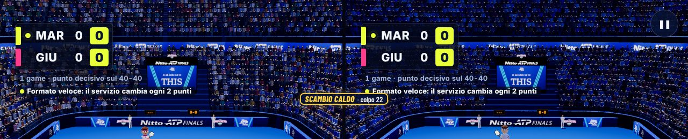
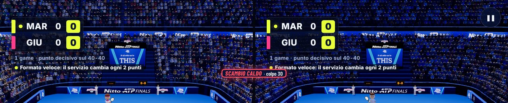
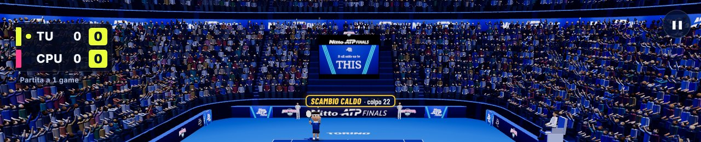

# B42 · Scambi lunghi che si chiudono

Richiesta dell'utente del 13/11 (dopo la partita con la versione 2026-11-13.9): «Direi bene con la precisione però i match
possono essere ancora molto lunghi, soprattutto gli scambi: fai sì che per scambi prolungati dopo 20 colpi consecutivi la
probabilità di usare colpi speciali o forti aumenti progressivamente o del doppio, in modo tale che la partita diventi più
spettacolare o veloce e la serie di colpi porti a un risultato».

In breve: lo **«Scambio che si scalda»** (prima un'opzione dello staff, spenta e solo nello stesso schermo) ora è **acceso
di base in tutte le partite**. **Dal 20° colpo** di uno scambio, a ogni colpo, i colpi di **tutti e due** diventano più
forti e veloci, il **colpo super** diventa via via più facile, la **CPU** attacca di più e sbaglia di più sotto pressione,
e anche chi gioca regge meno la palla sempre più veloce. Con i giocatori simulati gli scambi oltre 30 colpi contro la CPU
passano da fino a un quarto dei punti a quasi nessuno, e le partite durano meno; i punti vinti per livello restano quasi
gli stessi (contro la Leggenda i giocatori simulati più forti vincono circa 5 punti su 100 in meno: sezione 4). Prima del
20° colpo non cambia niente. Non è stato provato con persone vere.

---

## 1. Cosa cambia per chi gioca

- **Fino al 19° colpo** dello scambio (il servizio è il 1°) tutto è come prima, colpo per colpo.
- **Dal 20° colpo** compare in alto al centro una scritta piccola, su una riga: **«SCAMBIO CALDO · colpo 23»**. Cambia
  colore man mano (giallo, arancio, rosso dal 28° colpo). Non c'è più la frase «palla sempre più veloce»: l'utente ha
  chiesto meno testi durante la partita.
- **Da lì, a ogni colpo** (uguale per i due lati):
  - i colpi normali (dritto, rovescio, tagliato) passano più bassi sulla rete, con più effetto e più veloci: per chi
    gioca e per la CPU (il tagliato diventa solo più basso e resta un tagliato; pallonetto, palla corta, schiacciata e
    la parabola alta della CPU restano come sono);
  - il **colpo super** è sempre più facile: basta un gesto un po' meno forte, il tempo può essere meno preciso, la
    stanchezza dello scambio lungo non lo toglie più e, dal 23° colpo, va bene anche la palla veloce e bassa (prima
    serviva una palla alta, lenta o corta). Prima del B42, dal 30° colpo circa, il super non poteva più scattare;
  - la **CPU** fa più colpi d'attacco (piatti, profondi e angolati) e sotto pressione sbaglia di più; la **Leggenda**, che
    sceglie i colpi da sé, comincia prima a rischiare per chiudere lo scambio;
  - anche **chi gioca** controlla peggio la palla sempre più veloce: verso il 30°–34° colpo anche un giocatore che non
    sbaglia mai il tempo prima o poi manda una palla in rete o lunga. È la stessa «pressione degli scambi lunghi» che c'era
    già dal 16° colpo, solo più forte.
- **Giusto per tutti e due**: le regole sono le stesse per i due lati, nessun punto regalato a nessuno (decisione del B25).
  Nello stesso schermo valgono identiche per il Player 1 e il Player 2. Nella sfida tra due computer decide l'host, che
  manda la scelta al computer del Player 2 (lì serve solo per la scritta).
- **Dove vale**: contro la CPU (tutti i livelli: Bambini, Evento, Casual, Pro, Leggenda), nello stesso schermo con i due
  telefoni, nella sfida tra due computer, con la webcam di chi gioca da solo. **Non** con la webcam per due: lì il
  Player 2 gioca ancora con le regole vecchie (audit B19, punto 16) e lo scambio caldo varrebbe per uno solo dei due.
- **Riconoscimento dei gesti, direzione dei colpi (B35a), voce, telefono, LAN**: non cambiano.

## 2. Come si attiva / come si spegne

È **acceso di base**: non serve fare niente.

Per spegnerlo (o riaccenderlo):

1. Apri il **pannello dello stand**: **Ctrl+Maiusc+K**, **F9** nel programma Windows (anche la voce del menu NATPF
   «Pannello dello stand (F9)», dal B37), oppure tieni premuto **3 secondi** il marchio **NATPF** in alto a sinistra nel
   menu.
2. Premi il pulsante **«Scambio che si scalda»**: passa da **«Sì · dal 20° colpo»** a **«No»** (e viceversa). Compare un
   avviso che lo dice.
3. Vale **dalla partita dopo** (quella in corso resta com'è) e **resta salvata** su quel computer (nel browser, chiave
   `natpf-tennis.scambioCaldo`: `0` spento, `1` acceso; senza nessun valore salvato è acceso).

Chi l'aveva già scelto prima del B42 resta con la sua scelta: se l'aveva spento resta spento, se l'aveva acceso resta
acceso (e ora vale dal 20° colpo e in tutte le partite). Sul computer dello stand conviene guardare il pulsante una volta:
se dice «No» (scelta rimasta da prima), un clic lo accende.

Nel **registro dello stand** ogni partita dice se lo scambio caldo era acceso (`stand.caldo`, prima solo nello stesso
schermo). Il **riassunto** del registro (`scripts/registro/riassunto.mjs`) ha una sezione nuova **«Scambi lunghi»**: quante
partite con l'opzione accesa, quanti punti oltre 20 e oltre 30 colpi con l'opzione accesa e spenta, quanti colpi super
con la «palla calda».

## 3. Misure prima e dopo

Banco nuovo `natpf-tennis/scripts/audit/b42/scambi-lunghi.mjs` (motore vero senza grafica, giocatori simulati). Due
serie di semi per ogni riga (A e B), 360 punti per serie contro la CPU (partite «Al meglio di 3 game», la scelta di base
contro la CPU), 15–40 partite per seme nello stesso schermo (1 game, formato in fiera) e nella sfida tra due computer.
Le tabelle qui sotto sono la media delle due serie; le tabelle complete serie per serie sono in
`scripts/audit/b42/risultati/prima.md` e `dopo.md` (con «prima → dopo» in ogni casella).

Profili simulati del telefono: **bambino** (gesto piccolo, sbaglia molto il tempo), **amatore** e **umano** (adulto medio;
«umano» fa il gesto dopo il rimbalzo, come nel video del 23/10), **tennista** (preciso e forte). Nello stesso schermo anche
**medio** e **preciso**, e bambino contro medio.

### 3.1 Quanto durano gli scambi

Righe contro la CPU: «livello · profilo»; poi stesso schermo e sfida tra due computer (due persone simulate con lo stesso profilo, o bambino contro medio). «oltre 30»: quota dei punti con più di 30 colpi; «9 su 10 entro»: 9 punti su 10 finiscono entro quel colpo; «il più lungo»: il punto più lungo delle due serie (150 = interrotto dal banco).

| | oltre 20 colpi | oltre 30 colpi | 9 su 10 entro | il più lungo | media colpi |
|---|---|---|---|---|---|
| bambini · bambino | 12,4 → 10,8% | 3,8 → 0,5% | 22 → 21 | 60 → 35 | 10,1 → 9,3 |
| bambini · amatore | 10,6 → 11,4% | 4 → 0,3% | 21 → 21,5 | 50 → 41 | 9,5 → 9,1 |
| bambini · umano | 9,3 → 8,9% | 3,1 → 0,9% | 20 → 19,5 | 60 → 34 | 8,6 → 8,6 |
| bambini · tennista | 0,2 → 0,2% | 0 → 0% | 7,5 → 7,5 | 24 → 21 | 4,2 → 4,2 |
| evento · bambino | 4,9 → 5,7% | 1 → 0,2% | 16 → 16 | 52 → 31 | 7,6 → 7,3 |
| evento · amatore | 23,5 → 20,8% | 8,9 → 1,1% | 30 → 25 | 99 → 34 | 14 → 12 |
| evento · umano | 30,3 → 34,2% | 15,8 → 2,2% | 36,5 → 26,5 | 83 → 39 | 17,3 → 14,9 |
| evento · tennista | 8,6 → 7,4% | 1,5 → 1% | 19,5 → 19 | 73 → 33 | 9,1 → 8,6 |
| casual · bambino | 4,3 → 3,1% | 1 → 0% | 15 → 15,5 | 40 → 29 | 7,1 → 6,8 |
| casual · amatore | 8,2 → 8,1% | 3,4 → 0,3% | 19 → 19,5 | 57 → 35 | 8,8 → 8,7 |
| casual · umano | 8,8 → 7,8% | 3 → 0,5% | 20 → 18,5 | 56 → 33 | 8,9 → 8,3 |
| casual · tennista | 0,3 → 0,3% | 0 → 0% | 8 → 7,5 | 30 → 28 | 4,3 → 4,3 |
| pro · bambino | 5,6 → 5,2% | 0,8 → 0% | 17,5 → 16,5 | 42 → 28 | 7,5 → 7,3 |
| pro · amatore | 23,5 → 23,6% | 9,6 → 0,3% | 30 → 25 | 66 → 31 | 13,9 → 12,8 |
| pro · umano | 28 → 25,8% | 12,5 → 0,3% | 34 → 25 | 132 → 31 | 16,2 → 13,5 |
| pro · tennista | 4,6 → 5,8% | 1,4 → 0% | 16,5 → 17,5 | 44 → 30 | 7,8 → 8,1 |
| leggenda · bambino | 3,4 → 3,9% | 0,2 → 0% | 14,5 → 15 | 35 → 27 | 6,4 → 6,6 |
| leggenda · amatore | 21 → 22,9% | 5,1 → 0% | 26,5 → 25 | 41 → 30 | 12,1 → 12 |
| leggenda · umano | 39,5 → 39,6% | 18,8 → 0,2% | 33,5 → 27 | 46 → 31 | 17,2 → 15,4 |
| leggenda · tennista | 49,3 → 46% | 26,3 → 0,2% | 36 → 27,5 | 48 → 31 | 19,9 → 16,7 |
| bambino (stesso schermo) | 3,7 → 3,5% | 0,5 → 0% | 14 → 14 | 54 → 30 | 6,7 → 6,6 |
| amatore (stesso schermo) | 30,2 → 30,4% | 17,5 → 7,1% | 39,5 → 29,5 | 81 → 34 | 17 → 14,6 |
| medio (stesso schermo) | 14,6 → 13,8% | 5,2 → 1,5% | 24,5 → 23 | 79 → 34 | 11,4 → 10,3 |
| tennista (stesso schermo) | 80,8 → 80% | 67,1 → 35,7% | 91,5 → 33 | 150 → 34 | 48,3 → 26 |
| preciso (stesso schermo) | 62,8 → 63,8% | 46,9 → 29,4% | 72,5 → 33 | 150 → 34 | 35 → 22,8 |
| bambino/medio (stesso schermo) | 7,5 → 6,8% | 2,6 → 0,6% | 18 → 18 | 46 → 33 | 8,5 → 8,1 |
| amatore (due computer) | 37,6 → 38,7% | 23,2 → 7,1% | 43,5 → 30 | 90 → 34 | 19,8 → 16,4 |
| tennista (due computer) | 86,4 → 85% | 76,8 → 30,6% | 95,5 → 32 | 150 → 34 | 53 → 26,8 |

### 3.2 Chi vince e quanto dura la partita

«punti vinti»: da chi gioca contro la CPU, dal Player 1 nello stesso schermo e nella sfida. «secondi a punto»: tempo di gioco diviso i punti (con le pause tra i punti). «partita»: contro la CPU al meglio di 3 game, negli altri modi 1 game (tempo di gioco simulato, senza le schermate d'inizio e di fine).

| | punti vinti da chi gioca (o dal P1) | secondi a punto | partita, media (s) | partita, 9 su 10 entro (s) |
|---|---|---|---|---|
| bambini · bambino | 80 → 79,6% | 16,4 → 15,3 | 174,3 → 160,7 | 254,6 → 209,2 |
| bambini · amatore | 98,4 → 98,1% | 14,7 → 14,2 | 119,4 → 116,7 | 154,6 → 144,6 |
| bambini · umano | 90,3 → 90,6% | 13,7 → 13,6 | 121,8 → 120,1 | 169,5 → 157,5 |
| bambini · tennista | 100 → 100% | 7,9 → 7,9 | 62,8 → 62,8 | 75,2 → 75,2 |
| evento · bambino | 43,2 → 47,3% | 12,8 → 12,4 | 206,7 → 202,4 | 321,8 → 290,2 |
| evento · amatore | 64,6 → 64,8% | 18,9 → 16,6 | 274,6 → 233,7 | 397,2 → 350,9 |
| evento · umano | 67,8 → 68,5% | 22,3 → 19,4 | 299,9 → 253,5 | 437,5 → 356,4 |
| evento · tennista | 92,6 → 92,1% | 12,6 → 12,1 | 108,5 → 105,1 | 145,4 → 134,8 |
| casual · bambino | 52,1 → 48,8% | 12,3 → 11,9 | 200,3 → 210 | 294,7 → 313,7 |
| casual · amatore | 85,9 → 86,5% | 13,8 → 13,6 | 129,9 → 127,9 | 174,1 → 171,1 |
| casual · umano | 88,5 → 90,2% | 13,9 → 13 | 127,1 → 116,4 | 179,2 → 158 |
| casual · tennista | 98,2 → 98,2% | 7,9 → 7,9 | 64,5 → 64 | 75,9 → 77,6 |
| pro · bambino | 16,4 → 14,2% | 12,1 → 11,9 | 116,2 → 112,1 | 150 → 152,7 |
| pro · amatore | 52 → 54,5% | 18,7 → 17,4 | 294,3 → 280,7 | 435,8 → 420,7 |
| pro · umano | 60,2 → 61,7% | 21,2 → 18,1 | 308,3 → 266,7 | 426 → 400,8 |
| pro · tennista | 92,5 → 91% | 11,3 → 11,7 | 98,1 → 103 | 117,9 → 127,4 |
| leggenda · bambino | 9,1 → 9,2% | 11,1 → 11,4 | 97,6 → 100 | 133,2 → 132,9 |
| leggenda · amatore | 14,3 → 15,4% | 17 → 16,7 | 158,5 → 161,4 | 221,4 → 211,4 |
| leggenda · umano | 24,8 → 24,1% | 22,3 → 19,9 | 252,2 → 218,7 | 366,5 → 319,2 |
| leggenda · tennista | 35,4 → 33,8% | 23,3 → 19,7 | 326,3 → 252,3 | 427,7 → 359,1 |
| bambino (stesso schermo) | 48,1 → 49,5% | 11,9 → 11,8 | 69,4 → 67,9 | 98,5 → 99,9 |
| amatore (stesso schermo) | 52,3 → 49,4% | 22,5 → 19,3 | 129,2 → 112,6 | 197,9 → 153,3 |
| medio (stesso schermo) | 48,2 → 52,4% | 15,8 → 14,5 | 91,2 → 84,3 | 129,2 → 116,6 |
| tennista (stesso schermo) | 49,2 → 50,9% | 52,3 → 27,3 | 299,1 → 157,6 | 425,6 → 201,2 |
| preciso (stesso schermo) | 49,7 → 49,8% | 39 → 25,3 | 223,9 → 142,8 | 337,2 → 185,5 |
| bambino/medio (stesso schermo) | 28,8 → 29,1% | 13,4 → 12,9 | 71,3 → 68,5 | 110,3 → 100,9 |
| amatore (due computer) | 40,3 → 40,9% | 26,3 → 21,5 | 180,8 → 135,6 | 304,3 → 203,7 |
| tennista (due computer) | 37,4 → 38,5% | 57,3 → 28,3 | 347,5 → 180,2 | 561 → 275,5 |

Variazione dei punti vinti da chi gioca, per livello (media delle due serie, ogni serie ha un errore di circa ±2–2,5
punti):

- bambini: bambino -0,4, amatore -0,3, umano +0,3, tennista +0
- evento: bambino +4,1, amatore +0,2, umano +0,7, tennista -0,5
- casual: bambino -3,3, amatore +0,6, umano +1,7, tennista +0
- pro: bambino -2,2, amatore +2,5, umano +1,5, tennista -1,5
- leggenda: bambino +0,1, amatore +1,1, umano -0,7, tennista -1,6

Le righe con il profilo «bambino» (Evento +4,1, Casual −3,3) sono il sorteggio, non la regola: lì gli scambi oltre il 20° colpo sono il 3–6% dei punti, e lo scambio caldo cambia la partita solo da quel punto in poi (cambiano i punti dopo perché cambia il sorteggio). Controllo con più punti nella sezione 4.

### 3.3 Come finiscono i punti

Quote di tutti i punti: vincente (la palla non è stata ripresa) di chi gioca e della CPU (o del P1 e del P2), errore in rete e fuori di chi gioca e della CPU.

| | vincenti chi gioca · CPU (o P1 · P2) | in rete | fuori |
|---|---|---|---|
| bambini · bambino | 41,5 → 42,8 · 15,6 → 14,8% | 0,2 → 0 · 7,8 → 6,3% | 4,3 → 5,7 · 30,7 → 30,6% |
| bambini · amatore | 60,1 → 62,9 · 0,9 → 0,6% | 0 → 0 · 7,1 → 5,8% | 0,7 → 1,4 · 31,3 → 29,3% |
| bambini · umano | 53,8 → 52,3 · 6,7 → 5,7% | 0 → 0 · 6,5 → 6,8% | 3,1 → 3,8 · 30 → 31,6% |
| bambini · tennista | 71,5 → 71,4 · 0 → 0% | 0 → 0 · 4,6 → 4,6% | 0 → 0 · 23,9 → 24% |
| evento · bambino | 11,4 → 13,1 · 38,5 → 38,1% | 0,2 → 0 · 6,7 → 6,1% | 18,2 → 14,6 · 25,2 → 28,2% |
| evento · amatore | 30 → 35,7 · 14,2 → 12,8% | 0,2 → 0,6 · 7,7 → 6,7% | 21,1 → 22 · 27 → 22,4% |
| evento · umano | 29,2 → 38,2 · 7 → 7,5% | 3,1 → 2,8 · 6,3 → 6,3% | 22,2 → 21,3 · 32,4 → 24,1% |
| evento · tennista | 81,9 → 82,2 · 1,1 → 0,9% | 0,2 → 0,2 · 1,4 → 0,8% | 6,1 → 7 · 9,3 → 9% |
| casual · bambino | 13,9 → 13,9 · 32,3 → 34,9% | 0,3 → 0 · 8,2 → 5,7% | 15,4 → 16,4 · 30 → 29,2% |
| casual · amatore | 44,1 → 41,5 · 4,2 → 5,2% | 0,2 → 0 · 8,9 → 9,3% | 9,9 → 8,4 · 32,9 → 35,7% |
| casual · umano | 49,5 → 51 · 1 → 1,3% | 0,2 → 0,3 · 6,8 → 6,1% | 10,4 → 8,3 · 32,2 → 33,1% |
| casual · tennista | 69,6 → 69,1 · 0,2 → 0,2% | 0 → 0 · 3,8 → 3,5% | 1,7 → 1,7 · 24,9 → 25,7% |
| pro · bambino | 5,9 → 5,3 · 62 → 61,3% | 0 → 0,2 · 2,5 → 2% | 21,7 → 24,5 · 8,1 → 7% |
| pro · amatore | 33,5 → 38 · 20,2 → 19,2% | 1,5 → 5,4 · 4,9 → 3,6% | 26,4 → 21 · 13,6 → 12,9% |
| pro · umano | 38,2 → 42,4 · 12,5 → 11,4% | 5 → 7,5 · 6,2 → 4,7% | 22,4 → 19,5 · 15,9 → 14,6% |
| pro · tennista | 82,7 → 82,7 · 1,1 → 1,4% | 0 → 1,4 · 1,5 → 1,4% | 6,4 → 6,3 · 8,3 → 6,9% |
| leggenda · bambino | 2,5 → 3,1 · 61,3 → 61,7% | 0,3 → 0,7 · 0 → 0,2% | 29,5 → 28,5 · 6,5 → 6% |
| leggenda · amatore | 4 → 4,3 · 43,8 → 44,8% | 1,3 → 7,3 · 0 → 0,2% | 40,7 → 32,6 · 10,3 → 11% |
| leggenda · umano | 5,7 → 6,1 · 37 → 36,6% | 9,5 → 22 · 0,4 → 0,3% | 28,9 → 17,4 · 18,6 → 17,7% |
| leggenda · tennista | 12,2 → 12,5 · 11,4 → 16,4% | 9,7 → 25,4 · 1,3 → 2,1% | 43,5 → 24,5 · 22 → 19,2% |
| bambino (stesso schermo) | 33,1 → 32,9 · 36,3 → 34,7% | 0,1 → 0,1 · 0,1 → 0,3% | 15,5 → 15,9 · 15 → 16,3% |
| amatore (stesso schermo) | 21 → 19,2 · 18,8 → 19,2% | 1 → 6,4 · 1,4 → 5,6% | 28 → 25 · 30 → 24,6% |
| medio (stesso schermo) | 24,3 → 22,7 · 25 → 24,9% | 1,3 → 2 · 1,4 → 3,4% | 25,6 → 20,7 · 22,5 → 26,4% |
| tennista (stesso schermo) | 6,6 → 4,2 · 5,5 → 3,3% | 5,5 → 29,9 · 2,3 → 31,4% | 39,3 → 16 · 39,1 → 15,2% |
| preciso (stesso schermo) | 11,5 → 8,6 · 11 → 9% | 4,9 → 22,3 · 4,2 → 22,9% | 34,3 → 19 · 33,8 → 18,3% |
| bambino/medio (stesso schermo) | 10,7 → 11,8 · 50,6 → 49,8% | 0,5 → 0,7 · 0,6 → 1,2% | 20,2 → 20,6 · 17,5 → 16,2% |
| amatore (due computer) | 16 → 15,6 · 22,6 → 22,7% | 1,6 → 8,8 · 1,1 → 7,8% | 35,5 → 27,7 · 23,3 → 17,4% |
| tennista (due computer) | 3,9 → 2,8 · 5,3 → 5,1% | 5,9 → 40,6 · 4 → 30,3% | 50,4 → 15,9 · 28 → 5,4% |

### 3.4 Colpo super

Quota dei colpi dei telefoni simulati che sono un colpo super, prima del 20° colpo e dal 20° colpo in poi (righe con almeno 100 colpi dal 20° in poi). Prima del 20° colpo non cambia (la regola lì non c'è); dal 20° il super era quasi impossibile (la pressione degli scambi lunghi lo toglieva) e ora sale, molto più del doppio, per chi fa gesti forti.

| | prima del 20° colpo | dal 20° colpo |
|---|---|---|
| bambini · bambino | 0 → 0% | 0 → 0% |
| bambini · amatore | 0,1 → 0,1% | 0 → 0,8% |
| bambini · umano | 0 → 0% | 0 → 0,5% |
| evento · amatore | 0 → 0,1% | 0 → 0% |
| evento · umano | 0 → 0% | 0 → 0% |
| evento · tennista | 4,8 → 5,1% | 2,1 → 9,6% |
| casual · amatore | 0 → 0% | 0 → 0% |
| casual · umano | 0,1 → 0,1% | 0 → 0% |
| pro · amatore | 0,1 → 0,1% | 0 → 0% |
| pro · umano | 0 → 0% | 0 → 0% |
| pro · tennista | 5,5 → 6,2% | 2,5 → 10,9% |
| leggenda · amatore | 0 → 0% | 0 → 0% |
| leggenda · umano | 0 → 0% | 0 → 0% |
| leggenda · tennista | 2 → 2,1% | 0,3 → 5,7% |
| bambino (stesso schermo) | 1,2 → 1,1% | 0,4 → 4,2% |
| amatore (stesso schermo) | 0,7 → 0,7% | 0,3 → 8,2% |
| medio (stesso schermo) | 0,3 → 0,4% | 0,3 → 6,8% |
| tennista (stesso schermo) | 0 → 0% | 0 → 4,1% |
| preciso (stesso schermo) | 0 → 0% | 0 → 0,5% |
| bambino/medio (stesso schermo) | 0,6 → 0,6% | 0 → 6,3% |
| amatore (due computer) | 0,1 → 0,1% | 0 → 1,7% |
| tennista (due computer) | 0,3 → 0,2% | 0 → 15,6% |

## 4. Gli altri banchi

Prima = base del blocco (`fe6f774`), dopo = questo ramo, sempre con i giocatori simulati. I file sono in
`natpf-tennis/scripts/audit/b42/risultati/`; i «dopo» rifatti sul codice finale e i «prima» rifatti su una copia della
base vengono identici.

**Leggenda** (`npm run audit:legend`, 8 semi × 300 punti per profilo; `legend-prima-fe6f774.txt`, `legend-dopo.txt`):
**tutti i criteri rispettati**, prima e dopo. Cosa si muove:

| contro la Leggenda | punti di chi gioca | game vinti dalla CPU (criterio) | colpi a punto | colpi «per chiudere» della CPU |
|---|---|---|---|---|
| tennista | 33,6 → 28,1% | 86,6 → 92,2% (≥ 85%) | 19,24 → 16,83 | 8,1 → 11,7% |
| preciso | 38 → 32,4% | 76,7 → 83,4% (≥ 60%) | 23,19 → 20,11 | 10,7 → 13,6% |
| medio | 14,4 → 14,4% | 99 → 98,5% (≥ 90%) | 11,74 → 11,74 | 2,3 → 5,3% |
| amatore | 14,8 → 13,9% | 98,7 → 99,8% (≥ 90%) | 12,43 → 11,92 | 2,4 → 4,8% |
| bambino | 7,9 → 6,9% | 100 → 99,8% (≥ 98%) | 6,49 → 6,18 | 0,3 → 0,7% |
| impreciso | 5,4 → 5,6% | 100 → 100% (≥ 98%) | 5,02 → 5,05 | 0,1 → 0,1% |

Gli altri criteri (errori della CPU per colpo, incrociati, lungolinea, schemi, entropia, ripetizioni, velocità, reazione)
si muovono di poco e restano dentro, per esempio entropia contro «tennista» 2,73 → 2,85 e velocità massima di chi gioca
contro «bambino» 8,52 → 8,6 m/s (limite 8,8). Non regressione: Pro contro «medio» 75,2 → 75,9% dei game (70–85%), Casual
contro «medio» 100%. **Da sapere**: contro la Leggenda i profili forti («tennista», «preciso») vincono circa **5 punti su
100 in meno**: negli scambi lunghi la Leggenda comincia prima a chiudere (dal 20° colpo) e chi gioca ha la pressione in
più. La Leggenda resta il livello più duro (decisione B16); nel banco della sezione 3 (3 semi, al meglio di 3) la
differenza era più piccola (35,4 → 33,8%). Per lasciare la Leggenda com'era si toccherebbero `legendQ` e `press`
(sezione 9): non provato.

**CPU sotto pressione** (`npm run audit:cpu`, Casual e Pro, 8 semi × 300 punti; `cpu-pressione-prima-fe6f774.txt`,
`cpu-pressione-dopo.txt`):

| | punti di chi gioca | game di chi gioca | colpi a punto (9 su 10 entro) |
|---|---|---|---|
| casual · umano | 88,7 → 88,6% | 99,6 → 99,6% | 9,13 → 8,53 (19 → 18) |
| casual · medio | 90,6 → 92,1% | 100 → 100% | 7,03 → 6,99 (15 → 15) |
| casual · amatore | 86,1 → 86% | 99 → 99,2% | 8,82 → 8,4 (19 → 20) |
| casual · tennista | 98,5 → 98,4% | 100 → 100% | 4,4 → 4,39 (8 → 8) |
| casual · bambino | 49,3 → 49,1% | 48,2 → 47,4% | 7,11 → 7,18 (16 → 16) |
| pro · umano | 62,4 → 63% | 77,3 → 79,6% | 16,59 → 14,45 (36 → 26) |
| pro · medio | 61,8 → 62,5% | 76,8 → 79,9% | 11,23 → 10,35 (24 → 22) |
| pro · amatore | 53,5 → 52,7% | 59,9 → 56,4% | 13,65 → 12,44 (29 → 25) |
| pro · tennista | 94,1 → 93% | 99,8 → 99,8% | 8,05 → 7,68 (17 → 16) |
| pro · bambino | 15 → 16,1% | 0,4 → 0,4% | 7,8 → 7,61 (17 → 18) |

Obiettivi del banco: prima 2 non raggiunti, dopo 1, lo stesso di prima («palle facili: l'errore non cresce con lo scambio,
dal 17° colpo non oltre il 3%»: casual · bambino 3,4%, come prima). L'altro (Pro, palla a 4–6 m dalla CPU, almeno il 15%
di vincenti contro «umano») passa da 14,9% a 26,3%; Pro contro «medio» 79,9% dei game (obiettivo 70–85%). Pro contro
«amatore» scende di 3,5 game su 100 (59,9 → 56,4%): con 8 semi i game oscillano di ± 3 punti (nota del banco), ma va
tenuto d'occhio (decisione dell'11/11: Pro resta com'è). Da sapere: con lo scambio caldo acceso, dal 20° colpo la CPU
sbaglia di più anche solo perché lo scambio è lungo; prima (D1, D9) la lunghezza dello scambio da sola non contava.

**Livello Bambini** (`npm run audit:evento -- --livelli=bambini --profili=bambino,ragazzo,amatore`, 6 semi × 300 punti
per serie, media delle due serie; `evento-bambini-prima-fe6f774.txt`, rifatto sulla base, e `evento-bambini-dopo.txt`):

| livello Bambini | punti vinti da chi gioca | colpi a punto | partita: 9 su 10 entro · la più lunga (s) |
|---|---|---|---|
| bambino, 1 game | 82,1 → 80,4% | 10,3 → 9,8 | 124,5 → 115 · 204 → 173 |
| bambino, al meglio di 3 | 80,6 → 80,9% | 10,5 → 9,5 | 250,5 → 235 · 433 → 367 |
| ragazzo, 1 game | 90,7 → 92,2% | 11,2 → 9,9 | 117,5 → 99,5 · 213 → 180 |
| ragazzo, al meglio di 3 | 91,9 → 90,9% | 11,4 → 10,2 | 221,5 → 198 · 323 → 295 |
| amatore, 1 game | 98,2 → 97,4% | 9,1 → 9,2 | 90 → 84,5 · 186 → 126 |
| amatore, al meglio di 3 | 97,9 → 98,3% | 9,8 → 8,9 | 168,5 → 151,5 · 304 → 220 |

I bambini vincono sempre circa 8 punti su 10 e le partite più lunghe si accorciano.

**Bambino contro adulto nello stesso schermo** (B25: fasce «Bambino» e «Adulto», aiuto al più giovane acceso;
`scambi-lunghi.mjs --b25`, 300 partite a 1 game per riga, il bambino metà delle volte da Player 1 e metà da Player 2;
spento = scambio caldo spento, cioè la base; `b25-bambino-adulto.md`):

| bambino contro | serie | partite vinte dal bambino | punti del bambino | punti oltre 30 colpi | partita media (s) |
|---|---|---|---|---|---|
| medio | A | 39 → 44% | 44,2 → 46,4% | 4,9 → 2,4% | 93,2 → 90,2 |
| medio | B | 38 → 39% | 44,5 → 44,6% | 5,8 → 2,2% | 95,9 → 84,4 |
| amatore | A | 21,3 → 26,3% | 36,8 → 38,6% | 10,5 → 4,5% | 106,2 → 98,5 |
| amatore | B | 17,7 → 27% | 32,8 → 39,5% | 9,8 → 5% | 106 → 98,6 |

Contro l'adulto medio il bambino resta sotto la metà delle partite (39–44%; obiettivo del 12/11: circa il 40%, mai oltre
il 50%).

**Il bambino contro la CPU, con più punti** (righe «bambino» a Evento e Casual della sezione 3.2; 24 semi × 120 punti,
2.880 punti per riga; `bambino-24-semi.md`): punti vinti dal bambino Evento 45,9 → 47,1% (+1,2), Casual 48,7 → 51,7%
(+3,0). Con le due serie della sezione 3 erano +4,1 e −3,3: il segno di Casual si rovescia, quindi quelle differenze sono
soprattutto sorteggio. Resta possibile un piccolo vantaggio per il bambino, di qualche punto su 100 (con 24 semi i suoi
vincenti a Casual passano dall'11,3 al 15,1% dei punti); le regole sono uguali per tutti e due, nessun punto regalato.

## 5. Prima del 20° colpo non cambia niente (impronte)

Banco `scambi-lunghi.mjs --tracce`: per 13 partite a sorteggi fissi (contro la CPU a tutti i livelli, comprese le cinque
partite delle impronte di `fine-partita.mjs --impronte`, nello stesso schermo e nella sfida tra due computer) il banco
scrive ogni lancio della palla (numero del colpo nello scambio, bersaglio, tempo di volo, velocità) e ogni punto, con lo
scambio caldo **spento** e **acceso**.

- **Spento, uguale alla base.** L'impronta delle 13 partite con lo scambio caldo spento è **identica** a quella della
  versione di partenza (commit `fe6f774`, dove la regola non c'era): 13 su 13 (`risultati/tracce.txt` e
  `risultati/tracce-base-fe6f774.txt`). Spento, il gioco è quello di prima, colpo per colpo.
- **Acceso, cambia solo dal 20° colpo.** In tutte le 13 partite i lanci sono identici fino al primo colpo caldo: il primo
  lancio diverso è **sempre il 20° colpo** di uno scambio (una volta il 21°, perché il 20° era un colpo che lo scambio
  caldo non tocca), dopo 19–150 lanci uguali. Da lì in poi le partite sono diverse anche nei punti dopo, perché cambia il
  sorteggio: per questo le impronte di `fine-partita.mjs --impronte` e di `b20/impronta-cpu.mjs` cambiano (come previsto).

Le stesse prove sono nei test di unità (`natpf-b42-scambi-lunghi.test.mjs`: la palla della CPU al 15° colpo è identica,
il primo lancio diverso è un colpo dal 20° in poi contro la Leggenda e nello stesso schermo).

## 6. Cosa non è riuscito, e perché

- **Solo la palla più veloce non basta con i giocatori simulati.** La prima versione (palla più veloce dal 20° colpo,
  super più facile, CPU che attacca e sbaglia di più, senza la pressione in più per chi gioca) chiudeva bene gli scambi
  contro la CPU, ma nello stesso schermo tra due «tennisti» simulati gli scambi oltre 30 colpi passavano solo da 69% a 64%
  (il più lungo da 150 a 91 colpi). Il motivo: il robot sbaglia il tempo sempre allo stesso modo anche con la palla più
  veloce (una persona vera no) e il movimento automatico lo porta su quasi ogni palla. Per questo c'è anche la pressione in
  più per chi gioca (punto 1, ultimo trattino): con quella lo scambio finisce entro il 34° colpo anche tra due robot che
  non sbagliano mai.
- **Il colpo fallito che diventa una palla corta da attaccare** (invece di finire in rete o lungo), per avere più punti
  chiusi da un attacco e meno errori: provato e tolto. Con i giocatori simulati l'altro non chiudeva quasi mai il punto e
  lo scambio continuava (stesso schermo, «tennista»: oltre 30 colpi 59% invece di 34%; il più lungo di nuovo 150 colpi).
- **Gli scambi lunghissimi tra due robot precisi finiscono soprattutto con un errore in rete**, non con un vincente
  (stesso schermo, «tennista»: in rete dal 4% al 31% dei punti, vincenti dal 6% al 4%). Contro la CPU invece crescono anche i
  vincenti della CPU (Leggenda contro «tennista»: dall'11% al 16%) e, per i giocatori simulati che tirano forte, i colpi
  super (sezione 3.4). Con persone vere, che con la palla più veloce sbagliano di più il tempo e fanno gesti più forti
  quando lo scambio si scalda, ci aspettiamo più colpi forti e super e meno errori «da stanchezza»: non è misurato.
- **Il super resta raro per chi fa gesti piccoli.** Con la soglia più bassa i profili simulati «amatore», «umano» e
  «bambino» contro la CPU arrivano allo 0–0,8% dei colpi (prima 0%): il loro gesto è quasi sempre sotto la soglia anche
  ridotta. Nello stesso schermo, dove il «gesto fortissimo» si misura rispetto al proprio colpo abituale, sale per tutti
  (amatore dallo 0,3% all'8,2% dei colpi dal 20° in poi).
- **Il bambino con l'aiuto (B25) vince un po' di più contro l'adulto** (sezione 4): lo scambio caldo è uguale per i due,
  ma il bambino ha già la finestra del tempo più larga e la palla dell'altro più lenta. Non è un punto regalato: la
  regola agisce solo dal 20° colpo dello scambio, uguale per i due. Contro l'adulto medio il bambino resta sotto la metà
  delle partite (39–44%).

## 7. Prove

**Test di unità** (nuovo `natpf-tennis/test/natpf-b42-scambi-lunghi.test.mjs`, 8 test): calore dal 20° colpo; colpo super
più facile (soglia della forza, tempo, qualità senza la pressione, «palla calda» dal 23° colpo) e identico senza scambio
caldo per ogni combinazione provata; soglia relativa tra due persone da 1,3 a 1,15; attacco ed errori in più della CPU solo
nello scambio caldo; pressione in più per chi gioca che non stringe la finestra di Leggenda; Leggenda con pressione e
chiusura dal 20°; palla della CPU più veloce al 30° colpo e identica al 15°; partite uguali fino al 20° colpo (Leggenda e
stesso schermo); scambi oltre 30 colpi molto meno contro la Leggenda. Aggiornati alla regola nuova: B20 (stesso schermo:
acceso di base, dal 20° colpo, scritta «colpo N»), B25 (le impronte di f08243a con lo scambio caldo spento, come allora),
Leggenda B16 (pressione dal 26° colpo spento, dal 20° acceso), CPU sotto pressione (la lunghezza dello scambio da sola non
conta con lo scambio caldo spento; acceso, la CPU sbaglia di più dal 20° colpo), servizio (misura del servizio con lo
scambio caldo spento: vedi il commento nel test), riassunto del registro (sezione «Scambi lunghi»). In più
`natpf-tennis/test/natpf-b42-sfida.test.mjs` (2 test, mondo di prova): nella sfida tra due computer l'host manda lo
scambio caldo nello snapshot della partita (acceso di base, spento se lo staff l'ha spento) e il computer del Player 2 usa
quello dell'host per la scritta «colpo N», anche se lì era spento; un host di prima, senza il campo, non cambia niente.
Senza le due righe del motore che lo mandano e lo leggono, i due test falliscono (provato).

**Suite e prove sul ramo** (13/11, sul codice finale; macchina a 4 CPU condivisa con un altro agente):

- gioco `npm test`: **1451/1451** (compresi i 2 test nuovi); sito e pagina del telefono
  (`node --test tools/test/*.test.mjs`): **226/226**; programma Windows (`natpf-desktop`): **42/42**; server LAN:
  **12/12**; build: **ok**;
- `npm run audit:legend`: **tutti i criteri rispettati** (sezione 4), uscita identica a `risultati/legend-dopo.txt`;
- misure rifatte sul codice finale, identiche ai file salvati: banco della sezione 3 (56 righe di `dopo.json` e
  `dopo.md`), `--tracce` (13 partite, `tracce.txt`) e le stesse tracce sulla base (`tracce-base-fe6f774.txt`), `--b25`,
  `audit:cpu`, `audit:evento` del livello Bambini; anche `legend-prima-fe6f774.txt` e `cpu-pressione-prima-fe6f774.txt`
  rifatti su una copia della base vengono identici;
- prove nel browser (Chromium; porte 4150–4199; tutte una alla volta):
  - `natpf-rally` **10/10**. Al primo giro 9/10: il controllo nuovo del B42 metteva lo scambio al 22° colpo senza aver mai
    avviato una partita, e lo scambio caldo si decide all'inizio della partita (`startNewMatch`, come con «Gioca»); il
    controllo ora avvia una partita nuova contro la CPU e poi porta lo scambio al 22° colpo (corretta la prova, non il
    gioco). La scritta al 22° colpo è 168 × 23 px a 1280 × 720, in alto al centro, lontana dal tabellone;
  - `natpf-stesso-schermo-b20` **51/53**: falliscono i due controlli del banner del sorteggio, che aspettano «Sorteggio:
    batte Giulia» mentre il banner dice anche «· Formato veloce: il servizio cambia ogni 2 punti» (riga del B35b, versione
    2026-11-13.9). Sulla base `fe6f774` la stessa prova fa 50/52 con gli stessi due KO: non dipende dal B42 e qui non è
    stata toccata. Passano tutti i controlli dello scambio caldo: di base «Sì · dal 20° colpo» senza niente di salvato, un
    clic lo spegne e uno lo riaccende (salvato, con l'avviso), pannello dello stand senza scorrere a sei misure, fino al
    19° colpo nessuna scritta, al 22° la scritta piccola (172 × 24 px) sotto i tabelloni senza coprirli, rossa al 30°,
    sparisce a punto finito;
  - `natpf-leggenda` **6/7** in tre giri (uno con due banchi in parallelo, uno da solo, uno con una copia della prova che
    stampa anche il numero del colpo): fallisce sempre la stessa verifica, la posa della CPU negli allunghi **in corsa**
    durante la partita (centro del piatto della racchetta da +0,00 a +0,04 m oltre il suo posto normale, una volta
    −0,08, invece di almeno +0,05; mano e testa vanno verso la palla). Gli allunghi forzati passano sempre. Sulla base
    `fe6f774` 7/7 in due giri, con meno allunghi in partita (1 e 3, contro 3, 8 e 9) e uno esattamente al limite (+0,05
    al 19° colpo). Nel giro con il numero del colpo l'allungo fuori soglia è al **12° colpo**, dove lo scambio caldo non
    cambia niente (fino al 19° colpo il gioco è quello della base, sezione 5): il B42 non tocca la posa, ma cambiando i
    punti dopo il primo scambio caldo può far capitare più allunghi in corsa. Da decidere: sistemare la posa della
    racchetta nell'allungo in corsa (`legendReachPose` in `natpf_legend.js`, racchetta di `racket_kinematics`) o
    accettarlo. La soglia della prova non è stata toccata;
  - `natpf-formato-fiera` **25/25**, `natpf-1v1-p2p` **39/39** (sulla build), `natpf-menu` **45/45** (pannello dello
    stand senza scorrere e «Chiudi» in vista a 1366 × 657, 1024 × 600, 1280 × 720, 1024 × 1024 e 720 × 720).
- Schermate guardate: contro la CPU al 22° colpo (immagine qui sopra) e nello stesso schermo al 22° e al 30° colpo: la
  scritta è piccola, si legge e non copre i tabelloni. Contro la CPU, quando la CPU è in fondo al centro, la scritta sta
  appena sopra la sua testa.

**Dopo l'unione con il B37** (13/11 sera; `c619266`, cioè il B37 unito in `natpf-simulator`, unito in questo ramo con il
commit `d48155c`; macchina condivisa con un altro agente che faceva girare le sue prove nel browser negli stessi minuti):

- gioco `npm test` **1475/1475** (1451 del B42 + 24 del B37), sito **226/226**, programma Windows **43/43**, server LAN
  **12/12**, build **ok**; `npm run audit:legend` identico a `risultati/legend-dopo.txt` (il B37 non cambia il gioco);
- nel browser (porte 4170–4190, una prova alla volta): `natpf-rally` **10/10**, `natpf-stesso-schermo-b20` **53/53** (i
  due controlli del sorteggio, che qui fallivano, li ha aggiornati il B37), `natpf-fuori-vero` **10/10** (al primo giro
  6/10 mentre girava una prova dell'altro agente: il primo colpo mandato fuori largo ha chiuso il punto con «Nice Shot!»,
  palla passata oltre il fondo a 1,08 m da terra senza rimbalzare; rifatta da sola 10/10, con i tempi del B37),
  `natpf-segnale-spiegato` **14/14**, `natpf-menu` **45/45**, `natpf-formato-fiera` **25/25**, `natpf-1v1-p2p` **39/39**
  (sulla build);
- **due scritte in alto al centro**: quella del segnale del momento giusto del B37 («Colpisci quando il cerchio diventa
  verde», nelle prime 3 palle con l'anello di ogni partita, contro la CPU ai livelli con il segnale acceso) e quella
  dello scambio caldo (dal 20° colpo). Nel gioco non compaiono insieme: per arrivare al 20° colpo chi gioca ha già
  ricevuto almeno 9 palle della CPU, ognuna con l'anello, e la scritta del segnale è già passata (il segnale si accende e
  si spegne solo dalle Opzioni del menu, non a scambio in corso). Stanno anche ad altezze diverse: a 1280 × 720 il segnale
  a 101–136 px dall'alto, lo scambio caldo a 172–197 px. Forzate insieme con una sonda (partita nuova a «Adulto», prima
  palla con l'anello messa al 21° colpo, come fa `natpf-segnale-spiegato` con una partita nuova) restano **36 px** tra le
  due a 1280 × 720 e **53 px** a 1920 × 1080;
- `natpf-leggenda`, tre giri per parte, alternati e uno alla volta, sul codice unito e su `c619266` (il B37 senza il B42,
  copia a parte con le sue dipendenze):

  | giro | codice unito (B42 + B37) | `c619266` (solo B37) |
  |---|---|---|
  | 1 | 7/7: 2 allunghi in partita, nessuno fuori soglia | 7/7: 3 allunghi in partita, nessuno fuori soglia |
  | 2 | 6/7: 4 allunghi, 2 fuori soglia (palla a 1,21 m: piatto −0,06; 1,05 m: −0,07) | 6/7: 11 allunghi, 2 fuori soglia (2,29 m: piatto +0,04 e mano −0,12; 1,75 m: +0,03) |
  | 3 | 6/7: 7 allunghi, 4 fuori soglia (1,40 m: +0,00; 1,86 m: −0,10; 1,28 m: −0,01; 2,26 m: +0,01) | 6/7: 7 allunghi, 3 fuori soglia (1,04 m: −0,10; 1,98 m: +0,03; 1,03 m: −0,13) |

  Le due parti passano una volta su tre e falliscono sempre per la stessa verifica (allunghi in corsa durante la
  partita; gli allunghi forzati passano sempre): **il B42 non la fa fallire più spesso in modo chiaro** (6 fuori soglia
  su 13 allunghi in partita con il B42, 5 su 21 senza: troppo pochi per dire di più). Una copia della prova che stampa
  anche il lato e il numero del colpo (solo letture: la partita e le verifiche sono le stesse; un giro per parte, unito
  6/7 e `c619266` 7/7, poi cancellata) mostra perché la verifica è fragile. Il «posto normale» del piatto è una mediana
  unica degli impatti normali, che mescola dritto (centro del piatto a 0,53–0,54 m dal corpo) e rovescio (0,78–0,79 m):
  secondo quanti dritti e rovesci capitano, il riferimento va da 0,56 a 0,77 m (nei 13 giri fatti per il B42 e per
  questa unione) e un allungo di dritto confrontato con un riferimento quasi tutto di rovescio risulta indietro.
  Esempio, codice unito: palla a 1,29 m di dritto, piatto −0,05 rispetto al riferimento unico, **+0,16** rispetto ai
  soli dritti. Nelle due copie i fuori soglia sono 2 (tutti e due sul codice unito, di dritto): con il riferimento per
  lato il primo passa e resta di poco fuori solo l'allungo corto in corsa (palla a 1,05 m, CPU a 5,3 m/s, 4,7 verso la
  palla: +0,03 invece di +0,05). Per i giri della tabella il lato non è stato stampato: quanto pesi lì il riferimento
  non è misurato. Gli allunghi in partita delle due copie sono tutti prima del 20° colpo (16°, 8°, 12° e 16°, 4°), dove
  lo scambio caldo non cambia niente; il B42 può solo cambiare quali punti si giocano dopo il primo scambio caldo.
  **Dove va la correzione**: soprattutto nella prova (riferimento del piatto per lato, dritto e rovescio, invece della
  mediana unica: non è allargare la soglia); nel disegno, se l'utente vuole, solo l'allungo corto in corsa: i due punti
  da guardare sono `legendReachPose` (`natpf_legend.js`), che stima la distanza dalla palla contando metà della velocità
  della CPU, e la racchetta del motore base (`racket_kinematics.js`), che con la corsa laterale va dalla parte opposta
  (fino a 9 cm) e ruota. In questo passo non è stato cambiato niente, né il gioco né la prova.

## 8. Cosa non è provato

- **Persone vere e telefoni veri**: tutte le misure sono con giocatori simulati (robot). Non so quanto in fretta finisca
  lo scambio con persone vere: credo prima (la palla più veloce fa sbagliare il tempo a una persona, non al robot).
- **Quanto si sente la palla più veloce** a occhio e con il telefono in mano: non provato. Al 30° colpo un colpo normale
  passa da circa 70 a circa 90 km/h (misura su una partita simulata nello stesso schermo).
- **Sfida tra due computer con la webcam del Player 2** e **doppio (2 contro 2)**: la regola vale anche lì ma non è stata
  misurata né provata nel browser.
- **Webcam di chi gioca da solo contro la CPU**: la regola vale (il colpo della webcam passa dallo stesso esito del
  telefono), non provata con una webcam.
- **Programma Windows, ledwall, installer**: non provati (nessun pacchetto nuovo: i file di versione non sono stati toccati,
  come chiesto).
- **La scritta sul computer del Player 2** nella sfida tra due computer: il campo nuovo dello snapshot (`hot`) è provato
  dal test di unità `natpf-b42-sfida.test.mjs` (mondo di prova: l'host lo manda, il P2 lo usa per la scritta), non nel
  browser con due computer (natpf-1v1-p2p non arriva al 20° colpo) né a occhio.
- **Allungo della Leggenda in corsa** (prova natpf-leggenda, sezione 7): la verifica della posa fallisce a volte anche
  prima del 20° colpo. Dopo l'unione con il B37, tre giri per parte: fallisce due volte su tre anche senza il B42, quindi
  il B42 non la peggiora in modo chiaro. Il riferimento della prova mescola dritto e rovescio, che stanno a 25 cm l'uno
  dall'altro (sezione 7): la verifica così è fragile. Non corretto (né la prova né il disegno): da fare a parte.
- **Il riassunto del registro** è provato con righe finte (`finto.mjs` e un test di unità), non con un registro vero
  dello stand.

## 9. Valori della regola

Tutti in `natpf-tennis/src/natpf/natpf_hot_rally.js` (`HOT_RALLY`), con il commento accanto a ognuno:

| valore | cosa fa | di base |
|---|---|---|
| `from` | colpo da cui parte lo scambio caldo (il servizio è il 1°) | 20 |
| `lead`, `full`, `maxHeat` | calore al 20° colpo 0,2, pieno (1) al 28°, doppio dal 38° | 1, 10, 2 |
| `step`, `min` | tempo di volo di base −3,5% a ogni colpo caldo, al più −42% | 0,035; 0,58 |
| `netGap`, `spin` | a calore pieno la palla passa a 16 cm dal nastro, con 10 di effetto in più (fino a 20) | 0,16; 10 |
| `superPower`, `superTiming`, `superQuality`, `superBall`, `superRel` | colpo super: soglia della forza −0,14 (da 0,86 a 0,72), tempo +0,3 unità, qualità −0,1 senza la pressione degli scambi lunghi, ogni palla da calore 0,5 (23° colpo), «gesto fortissimo» tra due persone da 1,3 a 1,15 volte il proprio colpo | — |
| `cpuAttack`, `cpuErr` | CPU (Bambini, Evento, Casual, Pro): attacco +25% a calore pieno, errore +2% per ogni unità di calore | 0,25; 0,02 |
| `press`, `pressMin` | chi gioca: qualità × (1 − 0,35 × calore), al minimo 0,4 | 0,35; 0,4 |
| `legendFrom`, `legendHard`, `legendQ` | Leggenda: pressione e chiusura dal 20° colpo (prima 26° e 24°), solo colpi per chiudere dal 24° (prima 28°), qualità × (1 − 0,1 × calore) | 20; 24; 0,1 |

Per provare altri valori senza toccare il gioco: `--hot='{"press":0.3}'` nel banco (solo in memoria).
