# B43 · Tabellone pulito, pannello dello staff che ferma la partita, scritta del punto mezzo secondo dopo

Compito: `docs/coda/B43-tabellone-e-pannello.md`. Ramo `b43-tabellone-pannello`, base 2026-11-13.10 (`fd71f91`) con dentro
la 2026-11-13.11 (B42, scambio caldo: `38709e3`). Tre punti, tutti fatti:

1. **meno testi vicino al tabellone** (richiesta dell'utente del 13/11 dopo aver giocato: «durante il match ci sono troppi
   testi che l'utente non legge, in prossimità dello scoreboard. Semplifica. Formato veloce toglilo, al meglio di tre
   toglilo, magari metti etichetta sullo scoreboard»);
2. **pannello dello stand, telecomando dello staff e diagnostica fermano la partita** e stanno sopra la pausa; conferma in
   due clic con il solo mouse per le voci che chiudono la partita (controllo «solo mouse» del B39: A1, A2, A3, A5 e voci
   n. 14 e 15);
3. **la scritta grande del punto mezzo secondo dopo** che la palla tocca terra o rete (decisione dell'utente del 13/11
   sera).

Il gioco non cambia: esito dei colpi, direzione (B35a), fuori all'atterraggio e chi serve (B37, B37.1), scambio caldo
(B42), CPU e livelli sono quelli di prima (`audit:legend` uguale alla base, più sotto). I gesti non sono toccati.

## In breve: cosa cambia per chi gioca e per lo staff

| Punto | Prima | Adesso |
|---|---|---|
| 1 · sotto il tabellone | Due o tre righe sotto il riquadro: il formato («Partita a 1 game», «Al meglio di 3 game», «1 game · punto decisivo sul 40-40»), la scritta del momento («Parità», «Vantaggio della CPU», «Punto decisivo») e, quando il servizio cambia ogni due punti, «● Formato veloce: il servizio cambia ogni 2 punti» | **Una sola etichetta tonda, piccola, dentro il riquadro** sotto le sigle: il formato, **«1 GAME»** o **«AL MEGLIO DI 3»** (azzurro). Al 40-40 del formato in fiera diventa **rosa, «PUNTO DECISIVO»**. Nient'altro sotto il riquadro |
| 1 · inizio partita | «Si gioca», con sotto il sorteggio (stesso schermo) e «Formato veloce: il servizio cambia ogni 2 punti» | Uguale: il formato veloce si dice **una volta**, qui |
| 2 · pannello in partita | Si apriva ma la partita continuava: la CPU faceva punti dietro il pannello. Con la pausa aperta finiva **sotto** la pausa (invisibile: F9 «non faceva niente») | **La partita si ferma** appena il pannello si apre (anche scambi di prova, allenamento, minigiochi) e **riparte quando si chiude**. Il pannello sta **sopra la pausa e sopra tutto**, tranne la calibrazione dello schermo e gli avvisi brevi |
| 2 · telecomando dello staff | Il foglio con il QR non fermava la partita | Partita ferma anche lì (anche nel mezzo secondo in cui il foglio si apre); chiuso, si torna al pannello |
| 2 · diagnostica | Aperta dalla pausa, la partita ripartiva dietro (3,9 s di gioco in 4 s); in campo copriva «Torna al menu» | Partita ferma finché la diagnostica è aperta (lo dice in alto: «Partita ferma finché la diagnostica è aperta: × per giocare»); aperta dalla pausa, con × **si torna alla pausa**; Maiusc+D a pausa aperta fa lo stesso |
| 2 · voci che chiudono la partita | «Nuovo giocatore», «Classifica a schermo intero», «Telefono: Scollega» del pannello e «Torna al menu» della pausa partivano al primo clic (accanto a «Chiudi» e a «Riprendi ›») | In partita il **primo clic arma** il pulsante (bordo rosa, scritta **«Sicuro? Clicca ancora»**), il **secondo clic** (dopo almeno mezzo secondo, entro 5 s) esegue. Il **doppio clic non basta**. Dopo 5 s, o con un clic su un'altra voce, il pulsante torna com'era |
| 2 · Esc | In campo, con il pannello aperto, apriva e chiudeva la pausa sotto il pannello, senza vederla | Esc chiude il pannello (o, dal telecomando, torna al pannello); poi Esc è di nuovo la pausa |
| 3 · scritta del punto | «Punto della CPU», «Punto per …» comparivano nell'istante in cui la palla toccava terra e, nella metà lontana, coprivano il punto di caduta e l'anello rosso del fuori | La scritta grande compare **mezzo secondo dopo** (0,5 s di gioco). «Fuori» in basso, anello rosso, punteggio, voce e telefono restano all'atterraggio (B37). La pausa tra i punti è la stessa; la schermata di fine partita arriva 1,8 s dopo la scritta, mai prima |

## Come si usa e come si attiva

- **Punto 1**: sempre, senza opzioni, in tutte le partite (contro la CPU, stesso schermo con le due copie del tabellone,
  sfida tra due computer, Lob & Drop). Allenamento e minigiochi non hanno il tabellone (come prima).
- **Punto 2 · pannello dello stand in partita**: nel programma Windows **F9**; nel browser **Ctrl+Maiusc+K**; dal
  telecomando dello staff «Pannello dell'addetto»; nel menu anche 3 s sul marchio NATPF (come prima: le vie nuove per il
  solo mouse sono del B39). Appena il pannello si apre la partita si ferma da sola; **«Chiudi»** (o Esc, o di nuovo F9)
  e la partita riparte dal punto esatto. Se prima era aperta la pausa, chiuso il pannello resta la pausa.
  - Voci con il secondo clic, **solo a partita in corso** (anche scambi di prova, allenamento, minigioco): «Nuovo
    giocatore», «Classifica · A schermo intero», «Telefono · Scollega» (solo con un telefono collegato). Fuori dalla
    partita (menu, fine partita) partono al primo clic come prima.
  - «Torna al menu» della pausa: sempre con il secondo clic.
  - Il telecomando dello staff (tasti «Menu» e «Nuovo giocatore» del telefono) chiede già conferma sul telefono e resta
    com'era; OK del telecomando su un pulsante del pannello vale come un clic (due OK per le voci armate).
- **Punto 2 · diagnostica**: Maiusc+D o Pausa → «Diagnostica». La partita resta ferma finché è aperta. Per registrare
  una sessione giocando: «Avvia registrazione», poi **×**, si gioca; alla fine Maiusc+D (o Pausa → Diagnostica) →
  «Ferma la registrazione». Con `?diag=1` il pannello è aperto già all'avvio: per giocare si chiude con ×.
- **Punto 3**: sempre, senza opzioni.

## Punto 1 · Testi vicino al tabellone e in alto durante la partita

Elenco di tutto quello che si legge in alto durante una partita (schermate e `testi.json` delle prove, sotto) e cosa
resta:

| Testo | Dove · quando | B43 |
|---|---|---|
| Sigle, game, punti, pallina di chi serve | tabellone in alto a sinistra (e copia nella metà del P2 nello stesso schermo) | **resta** |
| Formato in parole: «Partita a 1 game», «Al meglio di 3 game», «1 game · punto decisivo sul 40-40» | riga sotto il riquadro, sempre | **tolto**; il senso nell'etichetta «1 GAME» / «AL MEGLIO DI 3» dentro il riquadro |
| «Parità», «Vantaggio tuo / della CPU / di …» | stessa riga, al 40-40 e ai vantaggi | **tolto dalla vista**: lo dicono le caselle (40 · 40, «AD») e la scritta grande del punto («Punto tuo · Vantaggio tuo») |
| «Punto decisivo» (formato in fiera, 40-40) | stessa riga | **nell'etichetta**: rosa, «PUNTO DECISIVO», al posto del formato finché dura il 40-40 |
| «● Formato veloce: il servizio cambia ogni 2 punti» (B35) | riga in più sotto il riquadro quando il servizio cambia ogni 2 punti; nelle metà strette su due righe, e copriva le istruzioni del servizio | **tolto**; resta nel banner d'inizio (una volta). Durante la partita chi serve lo dicono la pallina nel tabellone e la casella «Al servizio» sopra chi batte (B37.1) |
| «Si gioca» con sorteggio e formato veloce | al centro, all'inizio, 1,5 s | **resta** (dice il formato una volta) |
| Istruzioni del servizio («Premi ↑ o W: lanci la palla», «Alza il telefono…») | in alto al centro, primi 2 servizi e dopo un'attesa | **restano** (servono a chi non sa battere) |
| «Colpisci quando il cerchio diventa verde» (B37) | in alto al centro, prime 3 palle con l'anello | **resta** |
| «Scambio caldo · colpo N» (B42) | in alto al centro sotto i tabelloni, dal 20° colpo | **resta**; non tocca il tabellone, l'etichetta né la scritta del punto (misure sotto) |
| «In attesa di Player 2» (sfida tra due computer) | sotto il tabellone, solo se il P2 manca | **resta** (stato del collegamento) |
| Scritta grande del punto, del game, della partita | al centro | **resta**, mezzo secondo dopo (punto 3) |
| «Al servizio», ❚❚ | sopra chi batte; in alto a destra | **restano** |

Per chi usa lo screen reader il tabellone (`role="status"`) dice ancora il formato intero e la scritta del momento
(testo nascosto, `data-sb-format` e `data-sb-label`).

Disegno dell'etichetta (`natpf-round.css`, `.sb-tag`): pillola tonda nella griglia del riquadro, allineata alle sigle;
azzurro del gioco `#4DD7FF` su fondo azzurro trasparente; rosa `#FF4D94` pieno con scritta bianca al punto decisivo;
maiuscolo, almeno 12 px (0,55 em del tabellone: 12 px a 720p, 17,8 px a 1080p). Misure in em del tabellone, che è in
`cqh` (`@container natpf`): segue l'area del ledwall. Il riquadro con l'etichetta è alto circa 5 em, poco meno di prima
con la riga sotto: «In attesa di Player 2» e «Scambio caldo» restano dove erano.

**Altre scritte in alto, misurate insieme al tabellone** (forzate tutte insieme, anche se nel gioco non compaiono
insieme: segnale del momento giusto, «Scambio caldo · colpo 23», scritta grande del punto; contro la CPU e nello stesso
schermo, a 1920×1080, 1280×720, 1024×600, 720×720 e 1920×540): nessuna tocca il riquadro o l'etichetta. Unica correzione:
la scritta del segnale del momento giusto (B37), centrata in alto, a 720×720 arrivava sul bordo destro del tabellone
(13 px, già prima del B43): nelle aree fino a 800 px di larghezza ora sta subito sotto il tabellone (160–188 px a
720×720; tabellone 43–154 px). Lì, se fosse forzata insieme a «Scambio caldo», la toccherebbe: nel gioco non succede (il
segnale si spiega nelle prime 3 palle con l'anello, lo scambio caldo parte dal 20° colpo). Le istruzioni del servizio
contro la CPU a 720×720 sfiorano ancora l'angolo in basso a destra del riquadro (circa 12 px, come prima): non le ho
spostate, perché scendendo coprirebbero il campo lontano e il riquadro di servizio (proposta più sotto).

Schermate prima e dopo (stessa scena, stessi punteggi; le schermate intere sono nelle cartelle delle prove, sotto):

| Scena | 1920×1080 | 720×720 | 1920×540 |
|---|---|---|---|
| contro la CPU (classico, 1 game) | 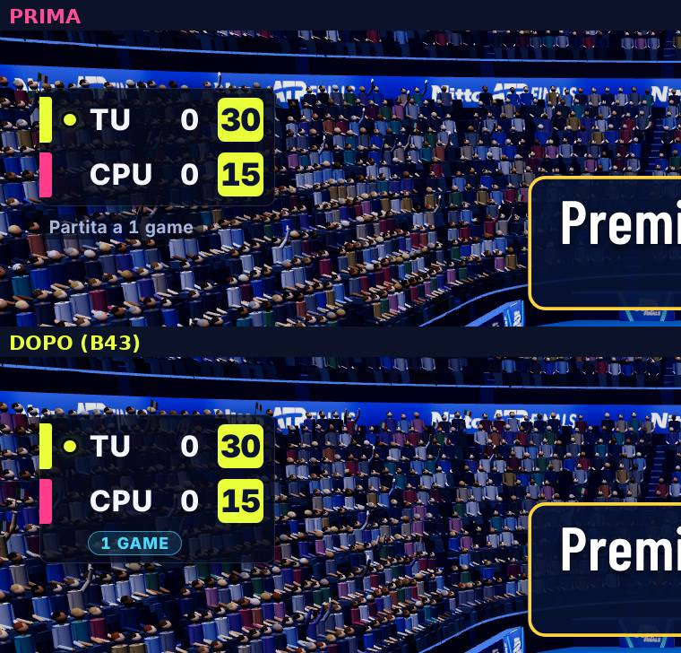 | — | 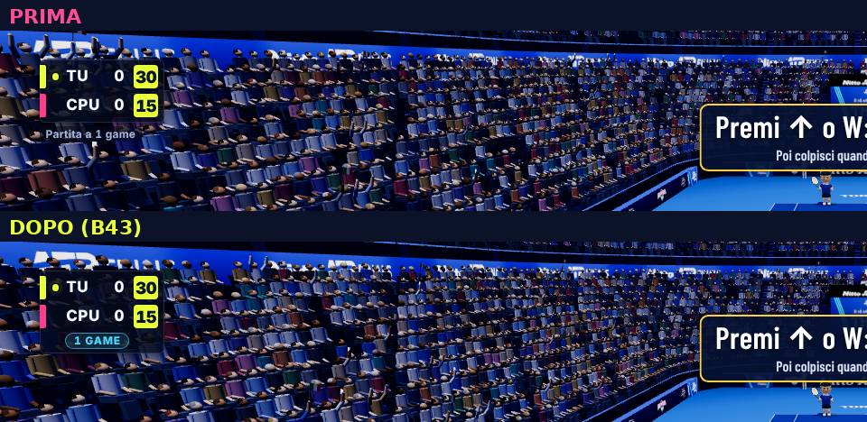 |
| contro la CPU, formato in fiera «Sì» (30-15 e 40-40) | 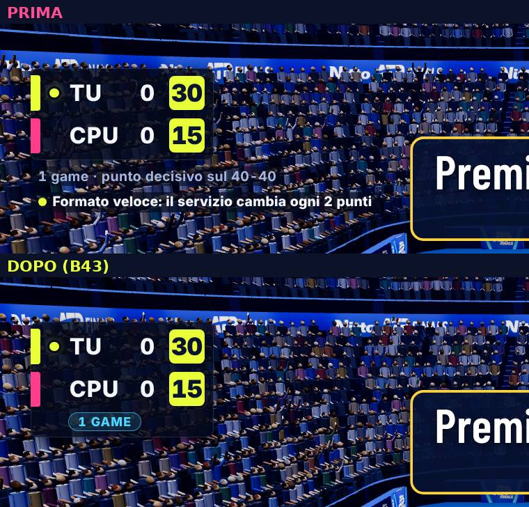 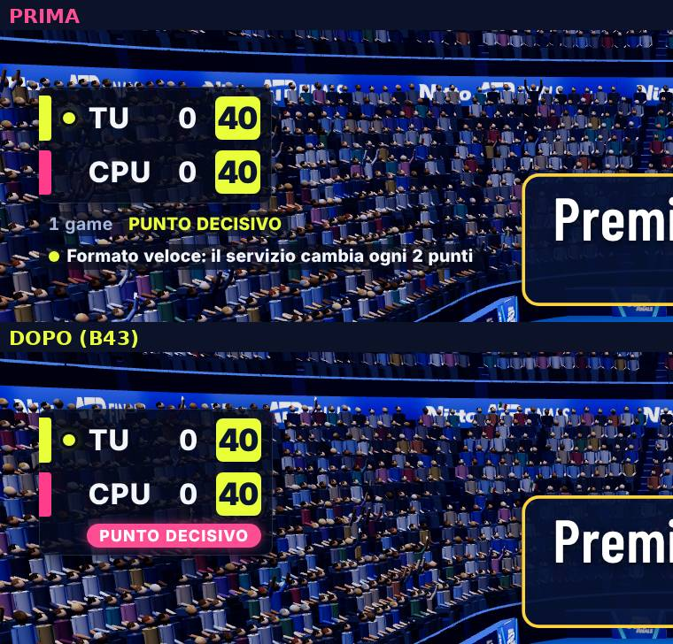 | 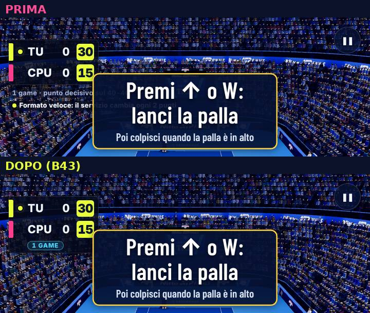 | — |
| stesso schermo (formato in fiera di base, 40-40) | 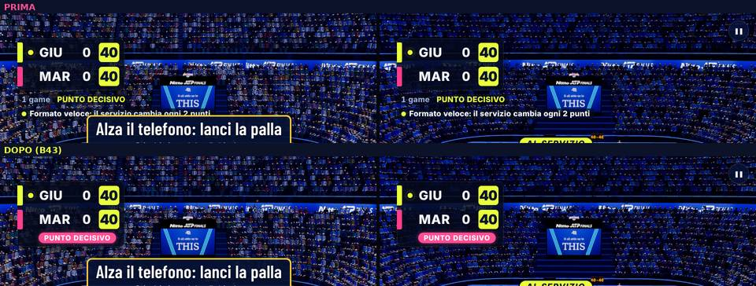 | 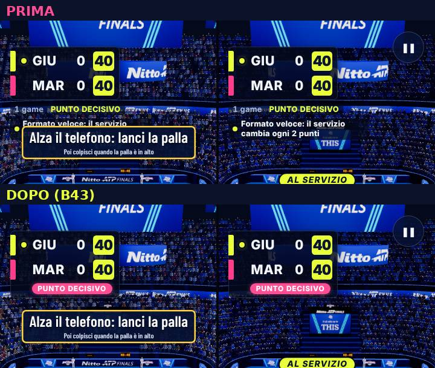 | 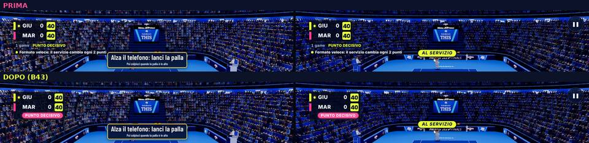 |
| Lob & Drop (al meglio di 3) | 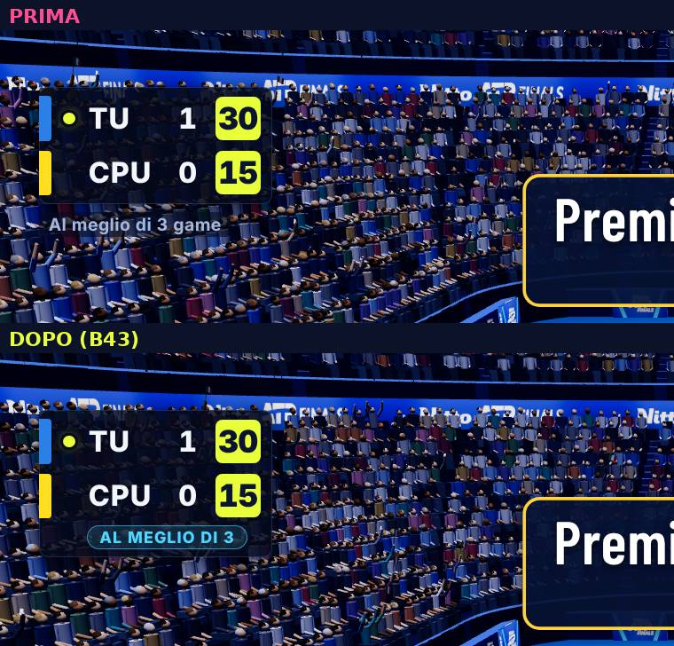 | 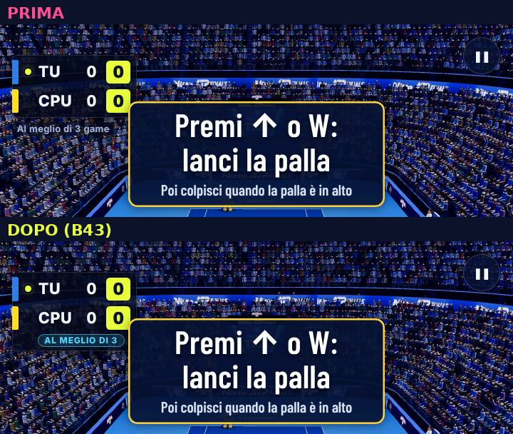 | 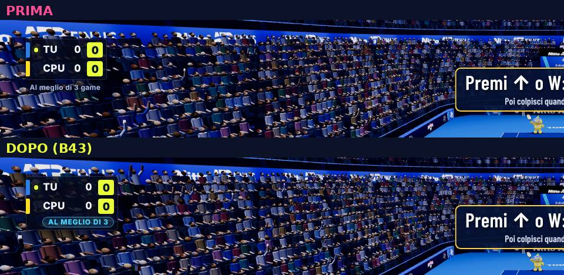 |

Tutte le scritte in alto insieme (forzate): 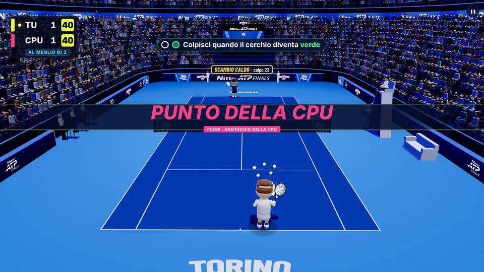 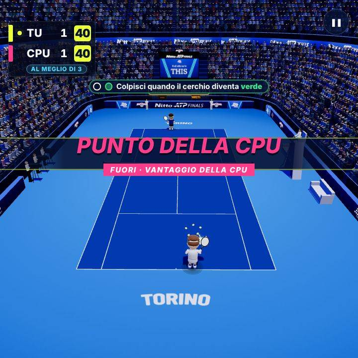
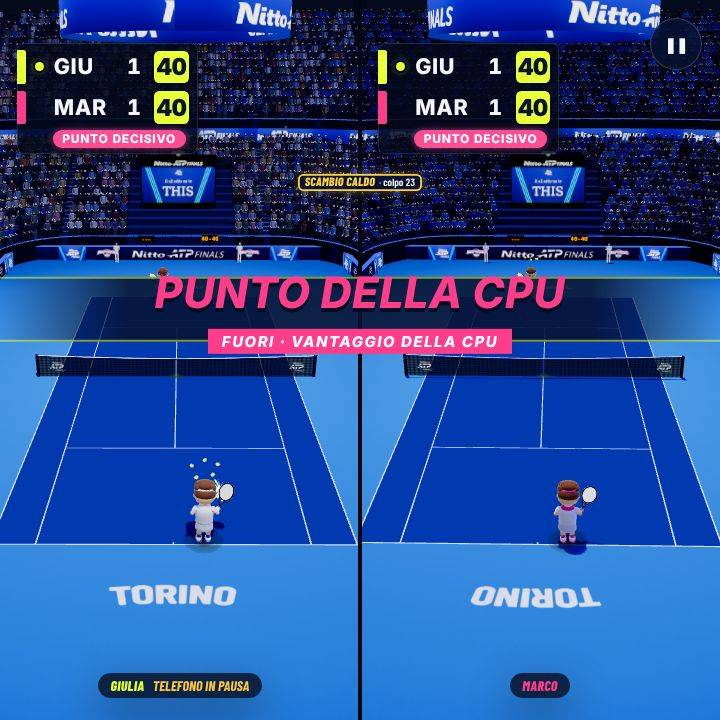 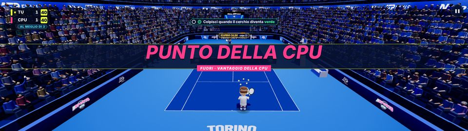

## Punto 2 · Pannello dello staff, telecomando e diagnostica

**Cosa succedeva** (controllo «solo mouse» del B39, `docs/b39/controllo-solo-mouse/`, provato nel browser):
- A1: il pannello aperto in partita non fermava niente: in 12 s la CPU aveva vinto 2 punti dietro il pannello;
- A2: tutti i fogli avevano lo stesso z-index (60) e il pannello viene prima della pausa nella pagina: aperto con la
  pausa aperta finiva **sotto** la pausa, invisibile e non cliccabile (F9 «non faceva niente»);
- A3 e n. 14: la diagnostica (z-index 200) copriva la pausa, e «Diagnostica» dalla pausa chiudeva la pausa: la partita
  ripartiva dietro la diagnostica (3,9 s di gioco in 4 s);
- A5 e n. 15: «Nuovo giocatore» (accanto a «Chiudi»), «Classifica a schermo intero», «Telefono: Scollega» e «Torna al
  menu» (accanto a «Riprendi ›») partivano al primo clic: un clic impreciso chiudeva la partita del visitatore.

**Cosa fa adesso**
- **Partita ferma** (`natpf_ui._syncPause`, `staffOpen()`): conta il pannello dello stand, il foglio del telecomando
  dello staff (anche mentre si apre, `remote.opening`: tra il pannello che si chiude e il foglio che compare la partita
  non riparte) e la diagnostica. Vale in partita, negli scambi di prova, nell'allenamento e nei minigiochi (tutto quello
  che in campo si ferma con la pausa). Il pannello, il telecomando e la diagnostica chiamano `_syncPause` quando si
  aprono e si chiudono; finché uno è aperto la pausa si ricalcola anche ogni 100 ms (una partita che parte con la
  diagnostica già aperta, `?diag=1`, resta ferma come le altre). La scritta grande del punto aspetta anche lei (punto 3).
- **Sopra la pausa e sopra tutto** (`natpf-ui.css`): pannello e telecomando a z-index 250, sopra pausa e fogli (60),
  tutorial in campo (70), diagnostica e intro (200), riquadro «Telefono in pausa» (60). Sopra di loro restano solo la
  calibrazione dello schermo (300) e gli avvisi brevi (320), che rispondono ai pulsanti del pannello.
- **Diagnostica**: aperta dalla pausa (pulsante o Maiusc+D) la pausa si chiude (la diagnostica non la copre più) e con ×
  si torna alla pausa; aprendo la pausa con la diagnostica aperta, la diagnostica si chiude. Tornando al menu il ritorno
  alla pausa si dimentica (non riapre la pausa nella partita del visitatore dopo). In alto, con la partita ferma, la
  scritta «Partita ferma finché la diagnostica è aperta: × per giocare».
- **Esc** chiude prima i fogli dello staff (il telecomando torna al pannello, il pannello si chiude); la calibrazione
  dello schermo, sopra di loro, tiene i suoi tasti.
- **Conferma in due clic** (`natpf_confirm.js`, `TwoStep`): primo clic → pulsante armato (bordo e alone rosa `#FF4D94`,
  scritta «Sicuro? Clicca ancora»; anche «Nuovo giocatore», che è già rosa pieno, diventa rosa scuro con l'anello e la
  scritta bianca: con un fondo bianco, nel passaggio di colore, la scritta spariva per un attimo); il secondo clic vale solo se
  arriva **almeno 0,45 s** dopo il primo (un doppio clic di Windows sta sotto: non basta) ed **entro 5 s**; dopo 5 s, con
  un clic su un'altra voce o chiudendo il foglio il pulsante torna com'era (con la scritta di adesso: se intanto il
  telefono si è scollegato dice «Nessuno collegato»). Niente finestre di Windows (`confirm()`): sul ledwall, con il solo
  mouse e dal telecomando non si chiuderebbero. Le chiamate dal codice (il chiosco che azzera lo stand, i tasti «Menu» e
  «Nuovo giocatore» del telecomando, che chiedono conferma sul telefono) restano immediate.
- Il pannello armato sta in una schermata con «Chiudi» in vista anche a 1024×600 e 720×720 (prova nel browser).

Schermate: pannello sopra la pausa con la partita ferma a 1920×1080 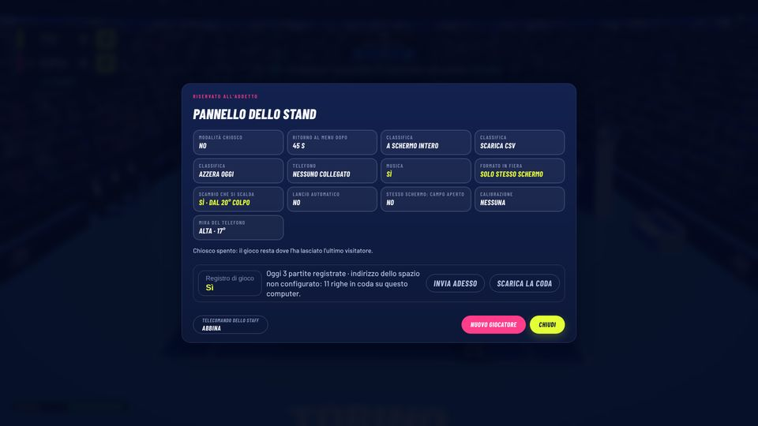, pannello
aperto a scambio in corso (partita ferma) 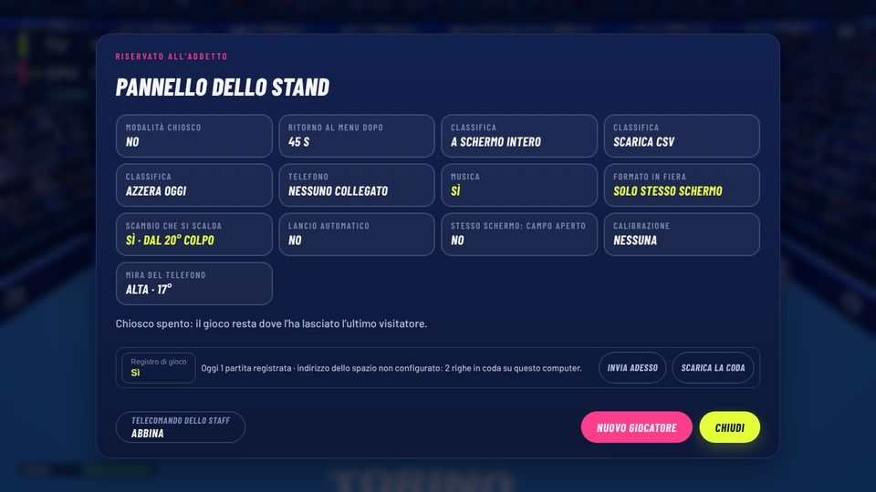, «Nuovo giocatore» armato a
1280×720 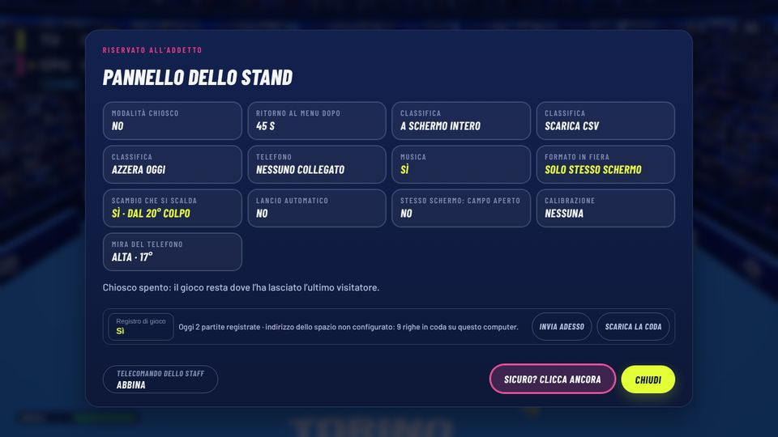 e a 720×720
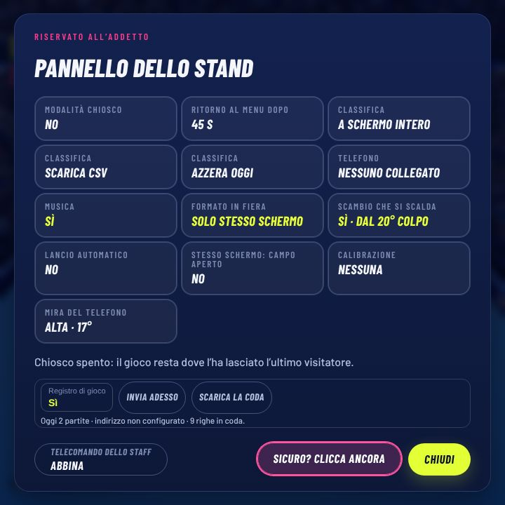, «Torna al menu» armato a 720×720
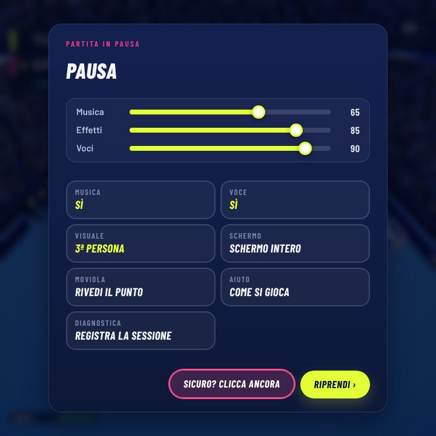, diagnostica aperta dalla pausa con la scritta «Partita ferma…»
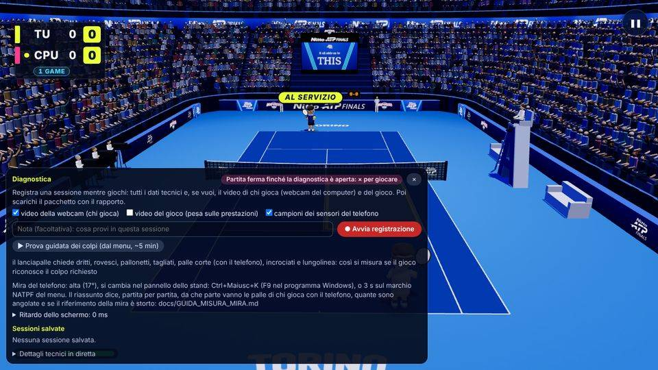.

Non fatto qui (resta del B39, `LISTA-UNICA-E-PROPOSTA-B39.md`): le vie nuove per aprire il pannello con il solo mouse
in partita (n. 1: ❚❚ tenuto 3 s, menu del tasto destro), il riquadro «Telefono in pausa» sopra la pausa (n. 13: i fogli
dello staff ora gli stanno sopra, la pausa no), il chiosco che azzera lo stand mentre lo staff lavora in un foglio senza
cliccare (A4).

## Punto 3 · La scritta grande del punto mezzo secondo dopo

**Decisione dell'utente** (13/11 sera, domanda a scelta dopo il B37): prima si vede la palla che cade, l'anello rosso del
fuori e «Fuori» in basso; poi, mezzo secondo dopo, la scritta grande «Punto della CPU» / «Punto per …» con la riga del
motivo. Nella metà lontana del campo la scritta arrivava nello stesso istante dell'atterraggio e copriva il punto di
caduta e l'anello.

**Come funziona** (`game_engine._natpfPointBanner`, `natpf_point_call.POINT_BANNER_DELAY` = 0,5 s):
- la scritta grande del **punto**, del **game** e della **partita** si prenota all'atterraggio e compare quando sono
  passati 0,5 s **del tempo del gioco** dall'atterraggio (`phaseTimer` riparte da 0 al punto): con la partita in pausa
  (pausa, pannello dello stand, telefono che cade…) la scritta aspetta e arriva alla ripresa;
- all'atterraggio restano, come nel B37: punteggio sul tabellone, «Fuori» / «In rete» in basso, anello rosso, voce,
  telefono (scritta e vibrazione), messaggio per il Player 2 della sfida tra due computer;
- se intanto il punto finisce (servizio dopo, ritorno al menu, moviola) la scritta non compare più;
- la pausa tra i punti è la stessa (2,15 s dall'atterraggio al servizio dopo: la scritta si vede da 0,5 s al servizio);
- **fine partita**: la scritta «Partita tua!» / «Partita della CPU» a 0,5 s, la schermata finale **1,8 s dopo la
  scritta** (prima 1,8 s dopo l'atterraggio), mai prima;
- **sfida tra due computer**: sul computer del Player 2 le scritte del punto, del game e della partita aspettano allo
  stesso modo (tempo della fase che arriva dall'host); l'inizio partita, «Palla break», «Punto decisivo» al servizio
  restano subito; la schermata finale 1,8 s dopo la scritta;
- **stesso schermo**: la scritta è una sola (in mezzo alle due metà), con lo stesso mezzo secondo.

Misure nel browser (`natpf-fuori-vero`, partita vera contro la CPU con il telefono simulato, quattro colpi mandati
fuori largo o in rete, l'ultimo sul punto della partita; ms dall'atterraggio, orologio del computer):

| Punto | «Fuori» in basso | anello | tabellone | voce | telefono «Fuori» | **scritta grande** | tempo del gioco | schermata finale |
|---|---|---|---|---|---|---|---|---|
| fuori largo, 0-15 | +11 | +4 | +7 | +9 | +5 | **+499** | 0,500 s | — |
| in rete, 0-30 | +9 | — | +6 | +7 | +6 | **+517** | 0,517 s | — |
| fuori largo, 0-40 | +6 | +2 | +4 | +5 | +3 | **+500** | 0,500 s | — |
| fuori largo, partita | +7 | +2 | +4 | (voce della partita) | +3 | **+499** | 0,500 s | +2301 (1802 dopo la scritta) |

Schermate dello stesso punto: all'atterraggio (verdetto, niente scritta grande) e mezzo secondo dopo (la scritta):
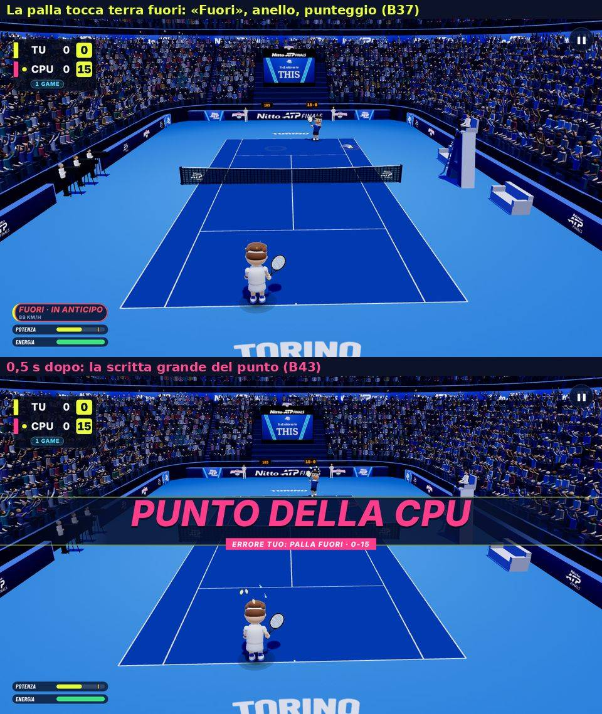

## Prove

Sul codice unito (`242fed5`: il ramo con dentro `natpf-simulator` a `c0c9b6d`, che aggiungeva solo la traccia dei
passi), più lo stile del pulsante armato rifinito dopo:

- **gioco** (`cd natpf-tennis && npm test`): **1492/1492** (0 saltati; 4 min 32 s). Test nuovi: `natpf-b43-tabellone-pannello.test.mjs` (4,
  punto 3: regola, tempi nel motore, punto finito prima, computer del Player 2) e `natpf-b43-pannello-partita.test.mjs`
  (11: regola della conferma, `TwoStep`, partita ferma con pannello / telecomando / diagnostica, anche scambi di prova e
  allenamento, Esc, conferme del pannello e della pausa, ordine dei fogli nel CSS, scritta del punto che aspetta la
  pausa e il pannello; 9 su 11 falliscono sul codice di prima); `natpf-scoreboard.test.mjs` con l'etichetta (14 in tutto, 1 nuovo).
- **sito** (`node --test tools/test/*.test.mjs`): 226/226 · **programma Windows** (`natpf-desktop`, `npm test`): 43/43 ·
  **LAN** (`tools/lan`): 12/12 · **build** (`npm run build`): ok.
- **`npm run audit:legend`**: identico alla base 13.11 (`38709e3`, copia con `git archive`): 91 righe, nessuna
  differenza, «Tutti i criteri rispettati».
- **nel browser** (Chromium headless, porte 4101–4149, una prova alla volta):

| Prova | Esito | Note |
|---|---|---|
| `natpf-pannello-partita` (nuova) | 25/25 | pannello aperto a scambio in corso con la CPU al servizio: in 8 s nessun tempo di gioco, nessun punto; «Chiudi» con un clic e si riprende; pannello sopra la pausa (`elementFromPoint` su «Chiudi», «Nuovo giocatore», «Mira», «Modalità chiosco»); «Torna al menu» con due clic (il doppio clic non basta); «Diagnostica» dalla pausa: 4 s senza tempo di gioco, × torna alla pausa; Maiusc+D a pausa aperta; telecomando dello staff in partita (foglio in cima, partita ferma, Esc torna al pannello); «Nuovo giocatore» e «Classifica a schermo intero» con due clic; foglio armato senza scorrere a 1280×720, 1024×600 e 720×720 |
| `natpf-tabellone` | 41/41 | etichetta dentro il riquadro, ≥ 12 px, intera, niente sotto il riquadro; punto decisivo rosa; «In attesa di Player 2» 12 px sotto il tabellone |
| `natpf-formato-fiera` | 25/25 | «Formato veloce» solo nel banner d'inizio; «Punto decisivo» nell'etichetta dei due tabelloni |
| `natpf-stesso-schermo-b20` | 53/53 | etichetta «1 GAME» nelle due copie; istruzioni del servizio che non coprono i tabelloni alle quattro misure |
| `natpf-menu` | 45/45 | pannello dello stand in una schermata con «Chiudi» in vista alle cinque misure |
| `natpf-diag-session` | 26/26 | controllo nuovo: diagnostica aperta in allenamento → allenamento fermo; chiusa, si gioca e la registrazione continua |
| `SERVIZIO=1 natpf-lob-drop` | 13/13 | casella «Al servizio» e riquadro di servizio (B37.1) come prima |
| `natpf-fuori-vero` | 12/12 | verdetto all'atterraggio come nel B37; scritta grande 0,5 s dopo (tabella sopra); fine partita 1,8 s dopo la scritta. Con `SHOTS=1 MISURA=1`: 2/2 e le schermate |
| `natpf-fine-partita` | 47/47 | |
| `natpf-telecomando` (porte fisse 4902/4903, con `flock`) | 85/85 | sulla build ricostruita; «Menu» e «Nuovo giocatore» del telefono con la sua conferma, come prima |

Cartelle delle schermate (scratchpad della sessione, non nel repository): `shots/prima`, `shots/dopo` (tabellone),
`shots/insieme2` (scritte in alto insieme), `shots/e2e/<prova>`.

## Cosa non è verificato

- **Programma Windows, ledwall, PC dello stand**: F9 vero nel programma Windows non provato (nel browser la prova usa
  Ctrl+Maiusc+K, che chiama la stessa funzione `kiosk.toggle`); mouse vero, doppio clic di Windows (il limite di 0,45 s
  è quello della guardia del doppio clic del B39, non misurato su un mouse vero), ledwall vero.
- **Telecomando dello staff con un telefono vero**: provato solo con la pagina del telecomando simulata (`natpf-telecomando`);
  i due OK sul pulsante armato del pannello non provati su un telefono.
- **Sfida tra due computer** nel browser con la scritta del punto rimandata: provata solo nei test di unità (messaggi
  dell'host finti); `natpf-1v1-p2p` non rifatta.
- **Persone vere**: nessuno ha letto la nuova etichetta da lontano su un ledwall; il colore azzurro dell'etichetta e il
  rosa del punto decisivo sono quelli del sistema grafico, non provati allo stand.
- **Screen reader**: il testo nascosto (`.sb-sr`) non è stato letto con uno screen reader vero.
- **Non fatto qui** (resta del B39): vie nuove per aprire il pannello con il solo mouse in partita (n. 1), riquadro
  «Telefono in pausa» sopra la pausa (n. 13), chiosco che azzera lo stand mentre lo staff lavora in un foglio (A4).
- **Istruzioni del servizio a 720×720 contro la CPU**: sfiorano l'angolo del tabellone (circa 12 px, come prima del
  B43). Proposta, se l'utente vuole: in quell'area metterle sotto il tabellone come nello stesso schermo (coprono però
  il campo lontano e il riquadro di servizio) oppure più strette.

## File

- Punto 1: `natpf-tennis/src/natpf/natpf_scoreboard.js`, `natpf_ui.js` (`onScore`), `natpf-round.css`, `natpf-hud.css`
  (segnale del momento giusto nelle aree strette), `natpf_fair_format.js` (commento).
- Punto 2: `natpf-tennis/src/natpf/natpf_confirm.js` (nuovo), `natpf_ui.js`, `natpf_kiosk.js`, `natpf_pause.js`,
  `natpf_diag.js`, `natpf_remote.js`, `natpf_lobby.js`, `natpf-ui.css`, `natpf-flow.css`.
- Punto 3: `natpf-tennis/src/game_engine.js`, `natpf_point_call.js`.
- Prove: `natpf-tennis/test/natpf-b43-tabellone-pannello.test.mjs`, `natpf-b43-pannello-partita.test.mjs` (nuovi),
  `ui-world.mjs`, `natpf-scoreboard.test.mjs`, `natpf-b35-battuta.test.mjs`, `natpf-b20-stesso-schermo.test.mjs`,
  `natpf-b37-collaudo.test.mjs`, `natpf-fine-partita.test.mjs`; `tools/e2e/natpf-pannello-partita.mjs` (nuova),
  `natpf-tabellone.mjs`, `natpf-formato-fiera.mjs`, `natpf-stesso-schermo-b20.mjs`, `natpf-diag-session.mjs`,
  `natpf-fuori-vero.mjs`.
