# B44 · Servizio: un'icona animata al posto del riquadro di testo

Compito: `docs/coda/B44-servizio-animato.md`. Ramo `b38-tastiera` (insieme al B38), base 2026-11-14.1 (`889cb25`).

Richiesta dell'utente (13/11 notte): «Togli "Premi ↑ o W: lanci la palla", è orribile, magari metti una leggera animazione
per indicare di salire su». Decisioni con le domande a scelta:

- **al posto del riquadro** «Premi ↑ o W: lanci la palla / Poi colpisci quando la palla è in alto» (e della versione del
  telefono «Alza il telefono: lanci la palla», e di quella della webcam «Alza la mano…») una **piccola icona di telefono che
  sale con la palla sopra, in loop, accanto a chi batte, senza scritte**;
- **solo ai primi servizi**: ai primi 2 servizi di ogni giocatore nuovo (anche dopo «Nuovo giocatore» e nel formato in
  fiera), poi sparisce; torna se chi batte non lancia per qualche secondo (il tempo d'attesa che c'era già: 6 s).

Il gioco non cambia: lancio, battuta, esiti, chi serve, formato, lancio automatico e tabellone sono quelli di prima
(`audit:legend` identico alla base, sotto).

## Cosa si vede adesso

| Momento | Prima | Adesso |
|---|---|---|
| Al servizio, primi 2 servizi di un giocatore nuovo (telefono) | riquadro grande in alto: «Alza il telefono: lanci la palla» / «Poi colpisci quando la palla è in alto» | **icona** accanto alla casella gialla «Al servizio» di chi batte: un telefono bianco che sale e scende con la palla gialla sopra, che parte con lui, sale ancora, si ferma e ricade sul telefono (1,6 s, in loop). Nessuna scritta |
| Webcam, mouse e tastiera (modalità prova) | «Alza la mano: lanci la palla» / «Premi ↑ o W: lanci la palla» | la stessa icona |
| Chi batte resta fermo 6 s | di nuovo il riquadro del lancio | di nuovo l'icona |
| Lancio a vuoto (la palla ricade) | «Colpisci quando la palla è in alto» / «Lancio a vuoto: riprova. Alza il telefono: lanci la palla» | «Colpisci quando la palla è in alto» / «Lancio a vuoto: riprova», e l'icona |
| Palla in aria, primi servizi | «Aspetta che salga…», poi «Colpisci!» | uguale |
| Stesso schermo, fermi 9 s | «Marco, batti tu» / «Alza il telefono: lanci la palla» | «Marco, batti tu» (a tutta larghezza) e l'icona nella metà di Marco |
| Lancio automatico (B25), ultimi 10 s | «Marco, batti tu» / «Alza il telefono: lanci la palla · tra 8 s la lancia il gioco» | «Marco, batti tu» / «Tra 8 s la lancia il gioco», e l'icona |
| Quando batte la CPU | niente | niente (mai l'icona) |
| Partita nuova dello stesso giocatore («Gioca ancora») | di nuovo i primi 2 servizi con il riquadro | niente icona (salvo fermo 6 s): il conto è **per giocatore**, non per partita; «Nuovo giocatore» e il chiosco lo rimettono a zero |

Restano come prima: la casella gialla tonda «Al servizio» (B37.1), il riquadro di servizio a terra (B37), il lancio
automatico dopo 30 s del B25 e il suo avviso, il richiamo per nome dello stesso schermo (B20), le scritte sul telefono.

**Dove sta l'icona.** Dentro la casella «Al servizio» di chi batte, di lato, verso il centro della sua vista (così non
esce dallo schermo); è grande come la casella cresce (sui ledwall di più). Nello stesso schermo la casella c'è in tutte e
due le metà: l'icona solo nella metà di chi batte. Nella sfida tra due computer sul computer di chi batte. In prima
persona la casella di chi gioca non c'è: l'icona sta in basso al centro. Non c'è nella moviola e a partita ferma (pausa,
pannello dello stand, telefono da ricollegare).

**Leggera**: un disegno SVG nella pagina animato con il CSS (`natpf-servizio.css`), niente file, niente oggetti 3D, niente
ombre. Colori del gioco: telefono bianco con lo schermo blu notte, palla #E8FF3A, cartellino blu notte con il bordo
azzurro #4DD7FF. Con «riduci movimento» del sistema l'icona sta ferma (palla sopra il telefono).

## Tutorial, allenamento e guida dicono la stessa cosa

- **Tutorial** (scheda «Servizio», anche nel tutorial corto prima della partita): la stessa icona, piccola, accanto a
  «1 · Alza il telefono: lanci la palla».
- **Allenamento**, esercizio «Servizio»: la stessa icona accanto a chi batte **a ogni servizio** dell'esercizio (senza
  scritte in campo: la scheda dell'esercizio ha già il suo testo) e accanto al primo passo di «Guarda e ripeti». I
  servizi dell'esercizio non consumano i due della partita.
- **Guida «Come si gioca»**, scheda «Il servizio», «Cosa succede in campo»: «Quando servi tu, sopra di te compare «Al
  servizio» e a terra il riquadro dove deve cadere la palla. Ai primi servizi, accanto, [icona] un telefono che sale con la
  palla: fai così e la lanci.» (Prima diceva «in basso compare «Al servizio»»: dal B35b la casella è sopra chi batte.)

## Schermate (guardate)

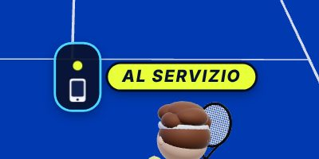

| | |
|---|---|
| Contro la CPU, 1920 × 1080: batte chi gioca, icona accanto alla casella | 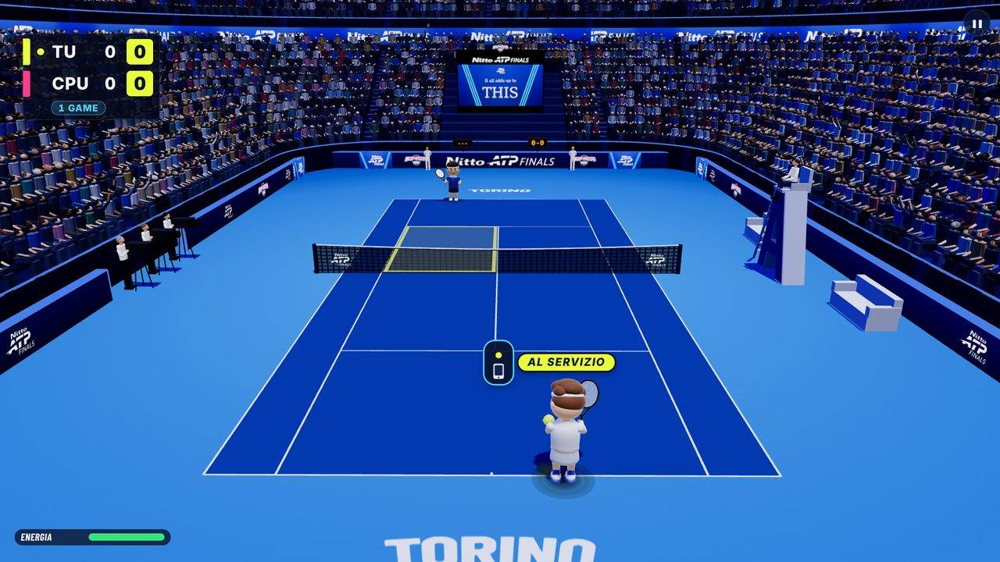 |
| Contro la CPU, 1280 × 720 |  |
| Striscia da ledwall 1920 × 540 (icona alta 55 px) | 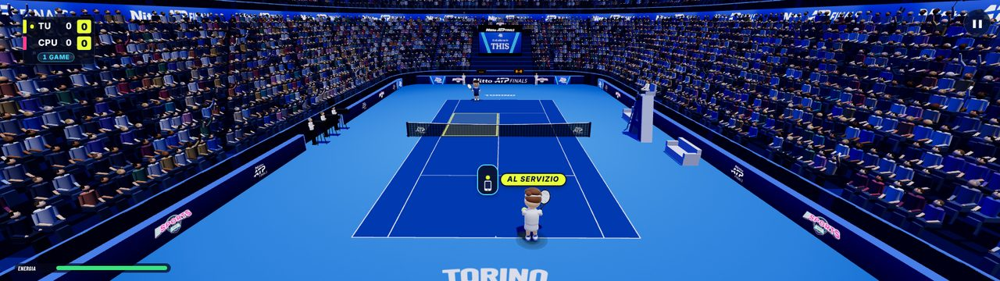 |
| Palla in aria ai primi servizi: «Colpisci!» (l'icona non c'è) | 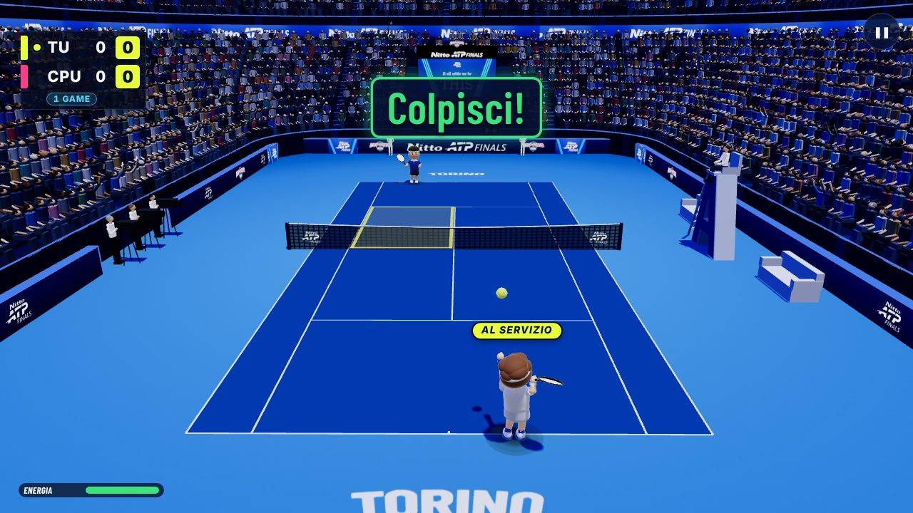 |
| Lancio a vuoto: «Colpisci quando la palla è in alto · Lancio a vuoto: riprova» e l'icona | 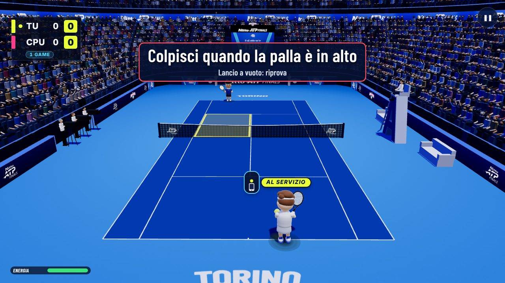 |
| Stesso schermo, batte Giulia (Player 2): l'icona solo nella metà destra, 1920 × 1080 | 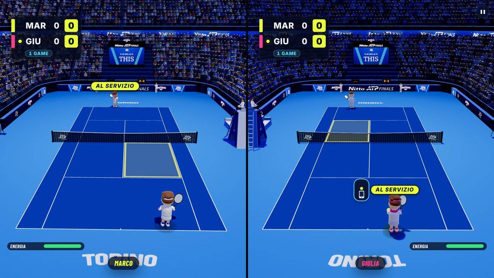 |
| Stesso schermo 1280 × 720 | 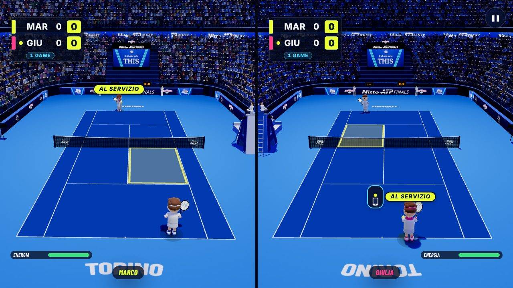 |
| Stesso schermo 1920 × 540 | 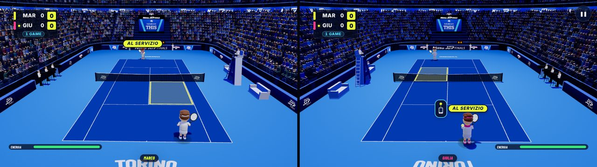 |
| Stesso schermo 720 × 720 | 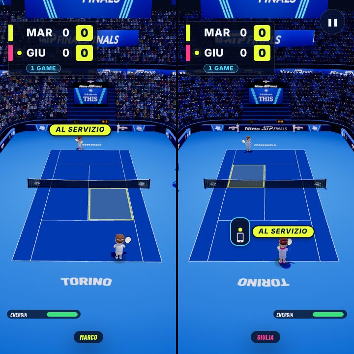 |
| Stesso schermo, ferma 9 s: «Giulia, batti tu» (senza il testo del lancio) e l'icona | 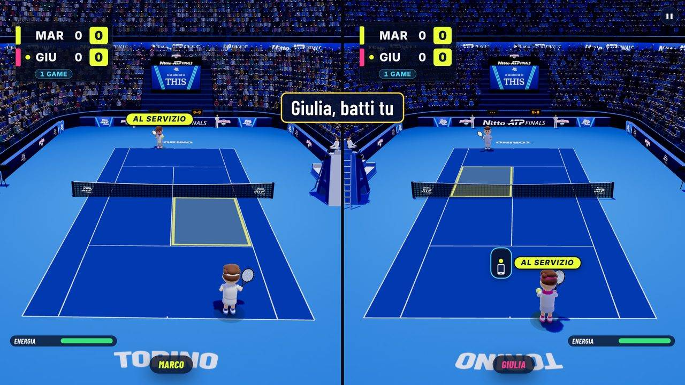 |
| Tutorial, scheda «Servizio»: la stessa icona accanto al lancio | 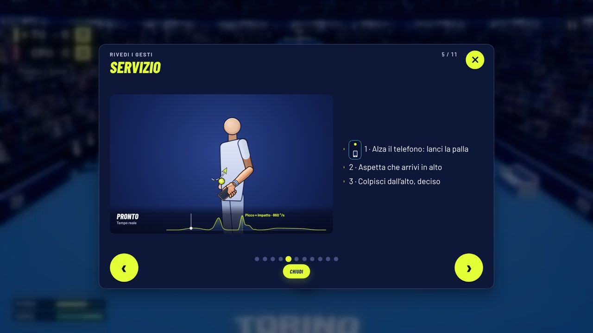 |
| Guida «Come si gioca», scheda «Il servizio» | 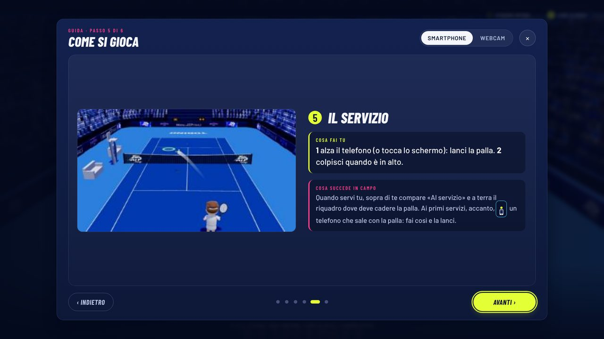 |

Misure: cartellino dell'icona 2,6 × 3,9 volte il carattere della casella «Al servizio»: 36 × 55 px a 1280 × 720 e a
1920 × 540, 54 × 82 px a 1920 × 1080; sta sempre dentro lo schermo (prove sotto). Non guardato: l'esercizio «Servizio»
dell'allenamento nel browser (provato solo nei test di unità) e l'icona sul computer del Player 2 della sfida tra due
computer (test di unità della fotografia del gioco).

## File

- `natpf-tennis/src/natpf/natpf_serve_hint.js` (nuovo: icona, posto nella casella, `hintSide`),
  `natpf-tennis/natpf-servizio.css` (nuovo), `natpf_serve_coach.js` (`icon` nella vista, conto per giocatore nuovo,
  `newPlayer()`, esercizio «Servizio»), `natpf_new_player.js` e `natpf_kiosk.js` (chiamano `newPlayer()`),
  `natpf_tutorial.js`, `natpf_training.js`, `natpf_onboarding.js`, `index.html` (foglio di stile).
- Prove: `natpf-tennis/test/natpf-servizio-istruzioni.test.mjs` (aggiornato e +5), `natpf-b20-stesso-schermo.test.mjs`,
  `natpf-b25-stesso-schermo.test.mjs`, `natpf-split-ricollega.test.mjs` (aggiornati); nel browser
  `tools/e2e/natpf-servizio-lancio.mjs`, `natpf-stesso-schermo-b20.mjs`, `natpf-stesso-schermo-b25.mjs` (aggiornate).

## Prove

- Test di unità (`natpf-servizio-istruzioni`, 11): l'icona al posto del riquadro per telefono, webcam e tastiera; ai primi
  2 servizi, poi niente; la partita nuova dello stesso giocatore non la rimette, `newPlayer()` sì; torna dopo 6 s fermi e
  dopo un lancio a vuoto; mai per la CPU (anche ferma 60 s); il Player 2 dell'altro computer sul suo; nell'esercizio
  «Servizio» a ogni servizio senza consumare i due della partita; la casella giusta (motore, metà sinistra o destra dello
  stesso schermo), di lato verso il centro, in prima persona in basso; nessuna scritta nell'icona. Aggiornati
  `natpf-b20-stesso-schermo`, `natpf-b25-stesso-schermo`, `natpf-split-ricollega`.
- Nel browser: `natpf-servizio-lancio` **17/17** (icona accanto alla casella, animata, senza scritte, dentro lo schermo a
  1280 × 720, 1920 × 1080 e 1920 × 540; sparisce con la palla in aria; torna dopo il lancio a vuoto; sparisce quando il
  servizio parte), `natpf-stesso-schermo-b20` **49/49** (icona solo nella metà di chi batte, non copre i tabelloni, alta
  almeno 28 px, alle quattro misure; richiamo per nome), `natpf-stesso-schermo-b25` 53/54 (avviso del lancio automatico
  senza il testo del lancio; il KO è il pannello dello stand a 720 × 720, uguale sulla base), `natpf-chi-serve` 64/64,
  `natpf-formato-fiera` 25/25, `natpf-tabellone` 41/41.
- `npm run audit:legend` identico alla base (il gioco non cambia).
- Non provato: l'icona sul computer del Player 2 della sfida tra due computer e nell'esercizio «Servizio» dell'allenamento
  nel browser (solo test di unità); un ledwall vero; persone vere (se l'icona si capisce senza scritte).
