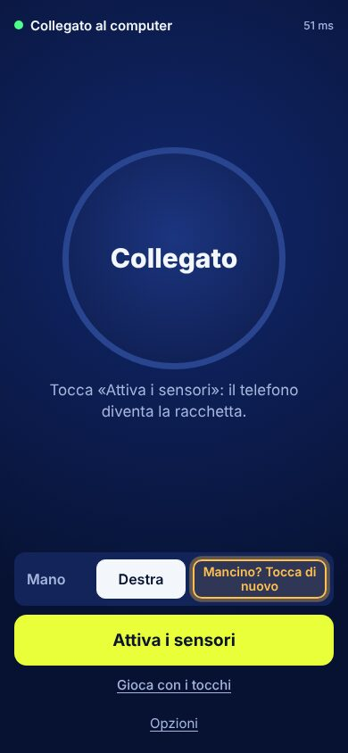
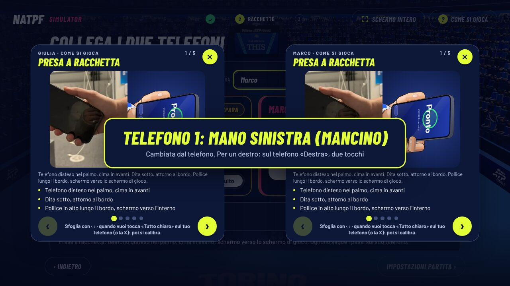
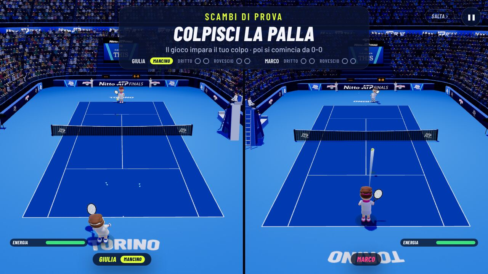
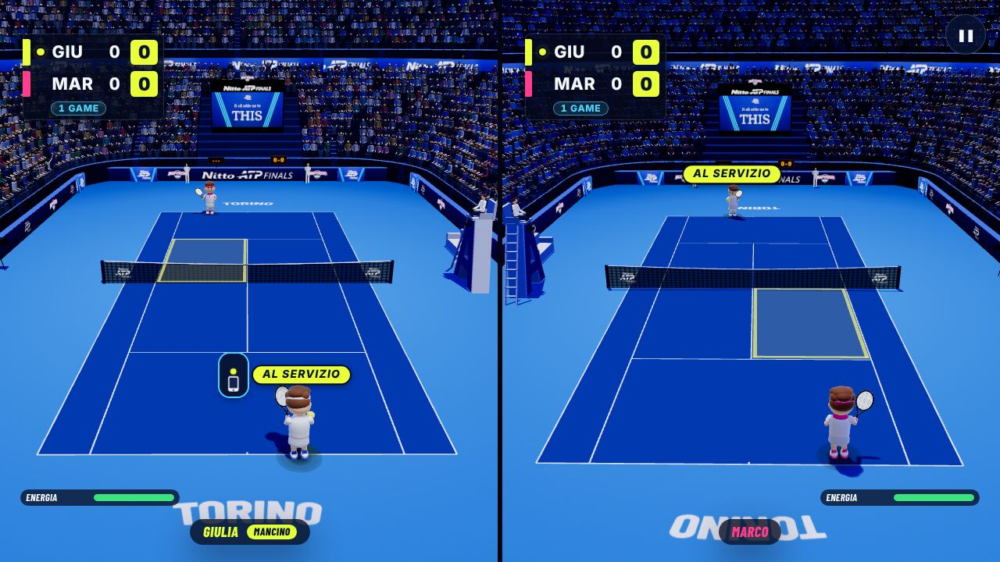
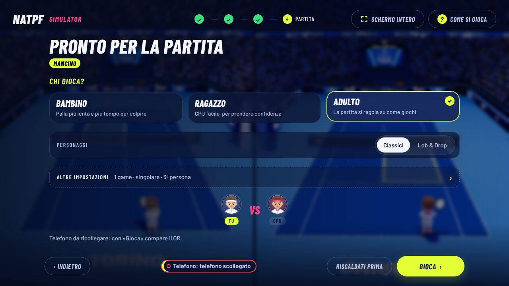
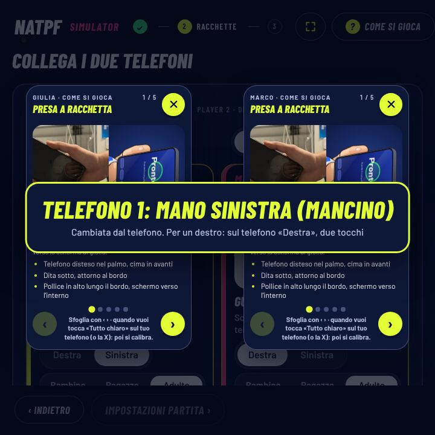

# B46 · Dritto e rovescio al sicuro

Ramo `b46-lato-sicuro`, base `int-b38-b39` (`55e818a` = natpf-simulator 2026-11-14.1 + B38/B44 + B39). Nessun file di
versione toccato: la versione nuova la mette chi unisce.

## Perché

Segnalazione dell'utente sulla **2026-11-14.1** (programma Windows, telefono **Android**, **stesso schermo**, giocatore di
**sinistra** = Telefono 1 = Player 1, «Calibrazione: **Giocando**», **dal primo colpo**):

> «se provavo a fare un rovescio mi veniva fuori un dritto lungolinea, se facevo un dritto veniva fuori un rovescio
> incrociato»

L'indagine (prove ripetibili in `scratchpad/swap/split-ruoli-mano/`, script `B-stesso-schermo.mjs`) ha mostrato che il
percorso dello stesso schermo legge **giusto** un Player 1 destro con il telefono a posto (uguale nella 12.5, 13.12 e
14.1), e che quelle scritte esatte («Dritto lungolinea» sui rovesci, «Rovescio incrociato» sui dritti) escono in **tre
casi**:

| Caso | Che cosa succede | Perché non guariva |
|---|---|---|
| **MANO** | La mano del Player 1 salvata «sinistra» (`natpf-tennis.hand`) mentre gioca un destro. Bastava **un tocco** su «Sinistra» nella pagina del telefono (riga della mano in «Attiva i sensori», in errore e nel riepilogo della calibrazione) o sulla casella della pagina «Collega» | Negli scambi di prova i puntini Dritto/Rovescio si riempiono normalmente (il verso del gesto segue il lato della palla, non la mano); la mano restava salvata anche dopo un riavvio |
| **ACC_DOPO** | Il segno dell'accelerazione del telefono (`motion-sign.js`, votato dai tocchi sullo schermo) cambia **dopo** gli scambi di prova: per esempio i tocchi per il lancio al servizio, con il telefono tenuto come una racchetta | Il segno imparato dagli scambi di prova (`learner.sign`) restava quello di prima: doppia inversione, in partita ogni colpo con il nome sbagliato |
| **SEGNO** | Il segno del rilevatore del telefono (`swing-detect.js`, `absSign`) cambia dopo gli scambi di prova | Il cambio arrivava al gioco solo con il colpo, senza traccia nel registro |

Non sappiamo quale è successo all'utente (non ha potuto rispondere): il B46 li chiude **tutti e tre** e fa in modo che,
se ricapita, il registro dello stand dica quale.

## In breve: che cosa cambia

| Punto | Prima | Adesso |
|---|---|---|
| 1 · mano visibile | La mano sinistra non si vedeva da nessuna parte fuori dalla pagina «Collega» | «**Mancino**» nella riga dei puntini degli scambi di prova, nella targhetta della propria metà dello stesso schermo (anche in partita) e accanto al titolo «Pronto per la partita» contro la CPU. Quando la mano cambia **dal telefono**, sul computer un **avviso grande per 3 s**: «Telefono 1: mano sinistra (mancino)» (o «… mano destra») |
| 2 · mano dal telefono | Un tocco su «Sinistra» (o «Destra») cambiava la mano | **Due tocchi**: al primo il pulsante dice «**Mancino? Tocca di nuovo**» (o «Destro? Tocca di nuovo») per 4 s e non cambia niente; il secondo tocco entro 4 s conferma |
| 3 · visitatore nuovo | «Nuovo giocatore» rimetteva destro il Player 1 (nello stesso schermo anche il Player 2) | Destri **Player 1 e Player 2** con «Nuovo giocatore» in ogni strada e con il **chiosco** che torna al menu per inattività; pronto per il «Prossimo giocatore» della fiera (`resetHands(ui, 'fiera')`, il pulsante arriva con la B41 seconda parte). **Non** al riavvio del programma: lì resta la mano salvata |
| 4a · segno dell'accelerazione cambiato | Il segno imparato dagli scambi di prova restava | Il telefono rimanda «dev» con il segno nuovo (`as`): il gioco rimette a **+1** il segno imparato da quel telefono e riparte da capo con i riferimenti che dipendono dal verso (mira, salita, piatto), come già per il segno del rilevatore |
| 4b · tocchi che votano il segno | Ogni tocco sullo schermo votava, anche al servizio, nello scambio e negli scambi di prova | Votano **solo** nelle pagine in cui il telefono si tiene davanti per leggerlo: «Attiva i sensori», tutorial, calibrazione e «Pronto» con il computer al menu (pagine «Collega» e «Pronto per la partita», «Sono pronto»). **Mai** in `serve`, `toss`, `play`, né negli scambi di prova (e nemmeno in pausa e a partita finita) |
| 4c · voto del rilevatore | Arrivava con il colpo (`sg`), senza traccia | Resta com'è, ma il telefono lo dice subito (messaggio nuovo `sgn`) e il gioco lo registra |
| 5 · registro e diagnostica | Nessuna riga | Una riga «**tel**» per ogni cambio di mano e di segno (sotto), le tabelle nel riassunto del registro e le righe nella diagnostica (`?diag=1`) |

## Come si attiva

Sempre, senza opzioni, in tutte le modalità. Serve la **pagina del telefono nuova** (quella servita dalla versione con il
B46): una pagina rimasta in cache dal telefono continua a cambiare mano con un tocco e a votare il segno con ogni tocco
finché non si ricarica. Il computer funziona con le pagine vecchie (il messaggio `sgn` manca e il segno del rilevatore si
legge dal colpo, come prima) e la pagina nuova con un computer vecchio (che ignora `sgn`).

## Che cosa è stato fatto, punto per punto

### 1 · Mano visibile (`natpf_hand_notice.js`, `natpf_trial.js`, `natpf_split_ui.js`, `natpf_lobby.js`)
- **Avviso**: `NatpfHandNotice` ascolta i due telefoni (`_diag('mano', { mano, causa, ruolo })`) e mostra l'avviso solo
  con `causa === 'telefono'` (chi cambia la mano dal computer la sta già guardando). Testi: `handNoticeText`; 3 s
  (`HAND_NOTICE_MS`). Il Telefono 2 nasce tardi (stesso schermo, fiera): lo si aggancia al controllo di ogni 100 ms.
- **«Mancino»**: classe `.hand-tag` (palla gialla), nella riga dei puntini (`data-hand="left"` sulla riga), nella targhetta
  `[data-split-tag] .hand-tag` (`_paintNames`, anche in partita) e in `#match-hand` accanto al titolo di «Pronto per la
  partita» (fuori dallo stesso schermo; sulla stessa riga del titolo, la pagina non si allunga).
- CSS in `natpf-ui.css` con `cqw`/`cqh` (ledwall): avviso al centro, z-index 330 (sopra pagine, tutorial, pannello dello
  stand, tastiera a schermo e calibrazione dello schermo; sotto gli aiuti del solo mouse, 400–600, e la tendina di
  passaggio). Non prende i clic (`pointer-events: none`).

### 2 · Mano dal telefono con la conferma (`phone-screen.js`, `racchetta.js`, `racchetta.html`)
- `handTap(armed, { want, current, now })` → `{ armed, commit }` (funzione pura) e `handLabel`. Un tocco sulla mano già
  scelta chiude la domanda; un tocco sull'altra mano la sposta; scaduti i 4 s il tocco è di nuovo il primo.
- La mano decisa dal computer (`cfg`) chiude la domanda aperta sul telefono.
- Stile `.ask` (bordo giallo che pulsa, niente animazione con «riduci movimento»).

### 3 · Ogni visitatore nuovo parte destro (`natpf_hand.js`, `natpf_kiosk.js`, `natpf_new_player.js`)
- `resetHands(ui, causa)`: Player 1 (`NatpfHand.set('right', causa)`), Player 2 (telefono 2, oppure la chiave salvata
  `natpf-tennis.hand.p2` se il telefono non c'è), personaggio e piano del Player 2 se lo stesso schermo è in corso,
  webcam del Player 2. Chiamata da `NatpfKiosk.reset` (`'chiosco'`) e da `resetVisitor` fuori dallo stesso schermo
  (`'nuovo giocatore'`; nello stesso schermo `S.setHand(id, 'right', 'nuovo giocatore')` per ciascuno, come prima).
- Mano del Player 2 dalla sua pagina del telefono: ora passa da `NatpfSplitUi._applyHand` come dalla casella del computer
  (prima cambiava solo il telefono, non il personaggio, il piano d'intercetto e la webcam del P2).

### 4 · Segni coerenti (`natpf_phone_racket.js`, `racchetta.js`, `phone-screen.js`, `link.js`)
- **(a)** `NatpfPhoneRacket._accSignSeen(as)` dal messaggio «dev»: con un segno diverso da quello di prima
  `learner.reset()` (+1), `aimModel`, `riseModel`, `faceModel` da capo, evento con causa `'tocchi'` (stesso collegamento)
  o `'pagina'` (collegamento nuovo: pagina ricaricata o altro telefono). Il primo «dev» non è un cambio.
- **(b)** `tapVotesSign({ screen, phase, trial })` sulla pagina del telefono, prima di `accSign.vote`.
- **(c)** il rilevatore annuncia il suo voto (`status` `sign`) e la pagina manda `{ t: 'sgn', d: ±1 }`; il computer
  (`_detectorSign`, lo stesso del segno che arriva con il colpo) azzera i riferimenti per verso come prima e registra.
  Il segno imparato dagli scambi di prova **resta**: il telefono vota con il verso atteso già girato da quel segno, quindi
  il suo voto corregge un errore, non lo raddoppia.
- In più: il giro del segno durante gli scambi di prova (`'prova'`) e la calibrazione che rimette a +1 un segno girato
  (`'calibrazione'`: a metà partita toglie la compensazione degli scambi di prova) si registrano anche loro.

### 5 · Registro dello stand e diagnostica
- Riga `tel` (tipo già esistente), **solo campi già in `CAMPI`**: il Worker non va ricaricato.
  - cambio di mano: `{ k: 'tel', chi: 'g'|'a', motivo: 'mano', mano: 'left'|'right', causa: 'telefono'|'gioco'|'nuovo giocatore'|'chiosco'|'fiera', ruolo: 'p1'|'p2', inPartita? }`
  - cambio di segno: `{ k: 'tel', chi, motivo: 'segno', stato: -1|1, causa: 'tocchi'|'pagina'|'rilevatore'|'prova'|'calibrazione', ruolo, inPartita? }`
    (`stato` è il segno nuovo: dell'accelerazione per `tocchi`/`pagina`, del rilevatore per `rilevatore`, imparato per
    `prova`/`calibrazione`)
- **Riassunto** (`scripts/registro/riassunto.mjs`): sezione «Collegamento del telefono» con le tabelle «Mano cambiata»
  e «Segno del verso del telefono cambiato» (con quanti in partita); le righe con un motivo non contano più come stati del
  collegamento.
- **Diagnostica** (`?diag=1`): eventi `tel.mano`, `tel.verso` (`tel2.*` per il secondo telefono) nella registrazione e
  nel visore; nel riassunto in parole «Mano cambiata: …» e «Segno del verso del telefono cambiato: …».

**Come leggerlo se ricapita**: una riga `motivo: 'mano', mano: 'left', causa: 'telefono'` prima della partita = caso MANO;
`motivo: 'segno', causa: 'tocchi'` (o `'pagina'`) dopo `causa: 'prova'` = caso ACC_DOPO; `causa: 'rilevatore'` = caso
SEGNO; `causa: 'calibrazione'` con `inPartita` = la calibrazione rifatta a metà partita ha tolto la compensazione.

## Prove

- **Gioco** (`npm test`): `natpf-b46-lato-sicuro.test.mjs` (10: avviso, mano dal telefono del P1 e del P2, «Mancino» in
  riga, targhetta e pagina, chiosco, «Nuovo giocatore», segno dell'accelerazione, voto del rilevatore, segno degli scambi
  di prova, registro, diagnostica), `natpf-b46-caso-utente.test.mjs` (5, il caso dell'utente rifatto da `B-stesso-schermo.mjs`
  con la pagina del telefono simulata dalle sue funzioni pure: tocco singolo → mano invariata e partita giusta; doppio
  tocco → mancino con avviso e «Mancino»; chiosco → destri e il visitatore dopo gioca giusto; segno del telefono cambiato
  dopo gli scambi di prova → in partita il lato resta giusto, e senza il B46 la doppia inversione; tocchi al servizio
  con il telefono a testa in giù → segno invariato), `registro-riassunto.test.mjs` (+1).
- **Sito** (`tools/test`): `b46-lato-sicuro.test.mjs` (6: due tocchi, regola dei tocchi che votano con il caso del
  servizio, `sgn` nel collegamento, i pezzi di `racchetta.js`). `tools/e2e/gesture-calibration.mjs` aggiornato ai due tocchi.
- **Nel browser**: `tools/e2e/natpf-mano-sicura.mjs` (nuova; gioco vero e due pagine vere del telefono, «Giocando»): 17/17 a
  1280×720 e a 720×720 (`AREA=720`). Le schermate qui sopra vengono da lì.
- Numeri della verifica finale: qui sotto.

## Non verificato

- Telefoni veri (Android e iPhone): i due tocchi, la scritta che va a capo, la vibrazione al primo tocco, i tocchi che
  votano solo nelle pagine da leggere. Nelle prove gli eventi dei sensori sono sintetici.
- Programma Windows e ledwall veri (provato nel browser e nell'area 720×720 simulata).
- Pagine del telefono rimaste in cache con la versione di prima (si comportano come prima finché non si ricaricano).
- Il caso dell'utente non è riprodotto dal suo registro: non sappiamo quale dei tre è successo.

## Limiti e punti aperti (per il coordinatore)

- **Segno rimesso a +1 o girato?** Deciso: con il segno dell'accelerazione cambiato il segno imparato torna a **+1**. È
  giusto quando il telefono passa da sbagliato a giusto (caso ACC_PRIMA poi corretto). Se invece passa da giusto a
  sbagliato **tra gli scambi di prova e la partita**, la cosa esatta sarebbe girare il segno imparato (−1), non
  rimetterlo a +1. Con il B46 questo può succedere solo con i tocchi in una pagina da leggere tra le due cose: contro la
  CPU la pagina «Pronto per la partita» (tocchi su «Sono pronto» con il telefono a testa in giù, almeno 4 concordi su
  tutti i voti); nello stesso schermo no (dopo gli scambi di prova parte subito la partita). Inoltre il telefono, quando
  il suo segno cambia, si ricalibra da solo e la fine di quella calibrazione rimette comunque a +1 il segno imparato
  (B28: profilo nuovo, niente di imparato prima). In quel caso a sistemare il verso resta il voto del rilevatore (dopo
  qualche colpo deciso da tutti e due i lati), che ora si vede nel registro.
- Le caselle della mano **sul computer** (pagina «Collega», foglio del nome, Opzioni del Player 2) cambiano ancora con un
  clic: chi le usa guarda lo schermo, e «Mancino» ora si vede durante gli scambi di prova e la partita.
- Il registro aggancia il Telefono 2 al suo controllo di ogni secondo: un cambio di mano nel primo secondo di vita del
  Telefono 2 non avrebbe la riga (nel gioco il telefono 2 nasce quando si sceglie lo stesso schermo o all'avvio della
  fiera, molto prima che qualcuno tocchi la mano).
- Trovato per strada, **non toccato** (fuori compito): in `racchetta.js` la variabile di modulo `let screen` (la schermata
  della pagina) nasconde `window.screen`, quindi `lockOrientation()` non blocca mai l'orientamento (`screen.orientation`
  è `undefined`) e il messaggio «dev» manda `or: null` e `sc: [undefined, undefined, dpr]`. Da sistemare a parte, con una
  prova su telefoni veri (bloccare davvero l'orientamento cambia il comportamento a schermo intero).

## Verifica finale (14/11, sul ramo, `09a97ed`)

- Gioco **1576/1576** (`npm test`; in un giro con il carico della macchina a 11 due prove a tempo del registro, «testi enormi»,
  erano andate oltre il limite: da sole 48/48, e nel giro dopo tutte verdi). Sito **254/254**. Build riuscito.
- `npm run audit:legend`: **identico** all'uscita di `int-b38-b39` (`scratchpad/int/legend-unito.txt`), 69 criteri OK.
- Nel browser (`CHROMIUM_PATH=/opt/pw-browsers/chromium`, porte 4110–4115, una prova alla volta): natpf-stesso-schermo-b20
  **49/49** (con il carico a 7–13 due giri a 41/49 e 34/49 su richiamo e icona del servizio, che sono passeggeri; la base
  nello stesso momento 46/49 sugli stessi controlli; da sola verde), natpf-stesso-schermo-b25 **53/54** (lo stesso KO della
  base: pannello dello stand a 720×720 con 4 opzioni accese, scorre di 38 px), natpf-split-ready **34/34**,
  natpf-scambi-di-prova **30/30**, natpf-nuovo-giocatore **28/28**, natpf-tutorial-phone **46/46**, natpf-phone-upright
  **10/10**, natpf-flusso-tocchi **5/5**, natpf-fiera-telefoni **38/38**, natpf-menu **45/45**, natpf-tastiera-schermo
  **53/53** (con il carico a 8–12 la schermata andava oltre i 30 s: rilanciata da sola), natpf-solo-mouse **42/42**,
  natpf-mano-sicura **17/17** (1280×720) e **17/17** (720×720), gesture-calibration **21/21** (con copie temporanee sulle porte
  4114/4115: lo script usa 8765/9000).
- Non eseguiti: test del server LAN e del programma Windows (il B46 non li tocca).

