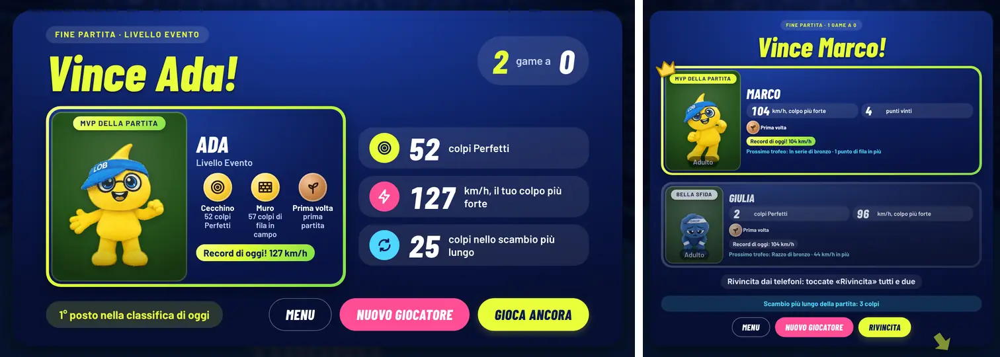

# B58 · Lob e Drop a fine partita (FIERA)

Richiesta dell'utente del 16/11/2026: le 20 animazioni delle mascotte (10 di Lob e 10 di Drop, 5 di vittoria e 5 di
sconfitta per ognuno) nella schermata di fine partita, una sola scelta a caso in base all'esito, mai la stessa della
partita prima. Poi: «le gif devono vedersi», «aggiornare solo su fiera e adattare il materiale in base a quello che è ora».

## Cosa c'è

- **Materiale adattato** (`natpf-tennis/public/media/mascotte/`): le GIF consegnate avevano il fondo bianco pieno e sulla
  schermata blu erano un quadrato bianco. Fondo reso trasparente con il bordo morbido e l'ombra sotto i piedi semitrasparente,
  stesse misure (320×320), 10 fotogrammi, 1,6 s in loop; WebP animati con l'alfa, da 150 a 210 KB (3,6 MB in tutto, le GIF
  erano 4,4 MB). Script: `docs/b58/fondo-trasparente.py`; le GIF di partenza restano nel commit `9d48127`. Controllo a
  occhio dei 200 fotogrammi su fondo blu: Drop pulito (fascia e polsini bianchi intatti); in `lob-win-01`, fotogrammi 6–8
  (il salto), restano due o tre punti chiari vicino alla visiera.
- **Dove**: accanto al titolo («Vince Ada!», «Bella sfida, Ada!»), nello spazio libero che la schermata ha già; la card e i
  riquadri non cambiano. Sugli schermi larghi dopo il titolo, con la pillola dei game a destra; sugli schermi quadrati in
  alto a destra della testa, e il titolo le lascia il posto.
- **Quale**: contro la CPU e tra due computer quella dell'esito di chi guarda; nello stesso schermo una di vittoria (per chi
  vince); a pari nessuna. A caso fra le 10 dell'esito, mai quella della partita prima (anche dopo un riavvio: la ricorda il
  computer, chiave `natpf-tennis.mascotte`).
- **Prericarica**: le prossime due (una di vittoria e una di sconfitta) si scelgono e si caricano 6 s dopo l'avvio e 2,5 s
  dopo ogni fine partita; a fine partita si usa quella giusta e l'altra resta prenotata. Due file per partita, mai tutti e venti.
- **Se manca il file** la mascotte non c'è (nessuna immagine rotta). **«Riduci movimento»** del sistema: primo fotogramma fermo.
- **Solo FIERA**: si vedono nel programma Windows (`window.natpfDesktop`) e nel server di sviluppo per le prove; il gioco
  nel browser non le mostra e lo zip Cloudflare non porta la cartella (`FIERA_ONLY` in `scripts/pacchetto-cloudflare.mjs`):
  con le mascotte lo zip pesava 28,32 MB, sopra il limite dei 25; senza 23,95 MB.

File: `src/natpf/natpf_mascotte.js` (nuovo), `src/hud_ui.js` (`showVictoryModal`), `src/natpf/natpf_ui.js` (prericarica
all'avvio), `index.html` (`#victory-mascot`), `natpf-hud.css`, `scripts/pacchetto-cloudflare.mjs`.

## Prove

- `natpf-tennis/test/natpf-b58-mascotte.test.mjs` (11): elenco uguale ai file e al manifest, WebP animati 320×320 con l'alfa,
  10 fotogrammi da 160 ms in loop; scelta per esito; mai la stessa su 500 partite e tutte e venti col tempo; prenotate =
  mostrate; stato sul computer rovinato o assente; esito dalle card; solo programma Windows e sviluppo; file che manca;
  «riduci movimento». `pacchetto-cloudflare-zip.test.mjs` (+1): niente `media/mascotte` nello zip web.
- `tools/e2e/natpf-fine-partita.mjs` 66/66 (+10): mascotte dell'esito, caricata, almeno 60 px e dentro la scheda a 1280×720,
  1920×1080, 1920×540, 1024×600, 720×720, 1366×768, 1024×1024, senza sovrapporsi a titolo, pillola e card; cinque partite di
  fila mai con la stessa due volte.
- Build: la cartella è nella build (`dist/media/mascotte`, 20 file); nel codice di produzione `dev` è falso, quindi nel
  browser no. Il server dello stand dà i `.webp` come `image/webp`.

**Non provato**: nel programma Windows vero (si vede solo se c'è `window.natpfDesktop`: provato con la funzione, non con
l'installer), sul ledwall, con «riduci movimento» acceso in un browser vero (provato con un finto DOM).

**Uscita con la versione 2026-11-16.9** (PR #4 unita in `natpf-simulator` in un solo commit, decisione dell'utente del
16/11: «Unisci e pubblica»): l'installer cresce di circa 3,6 MB, lo zip Cloudflare non cambia.
