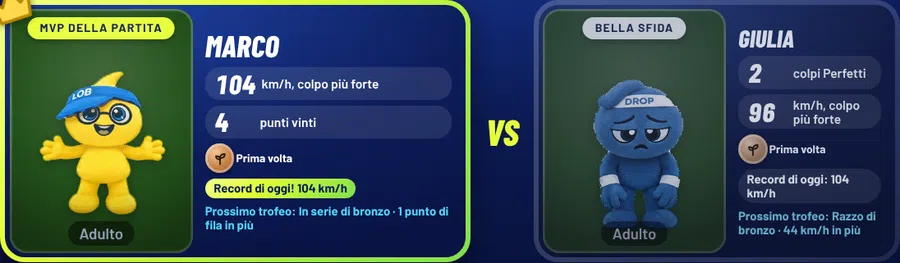
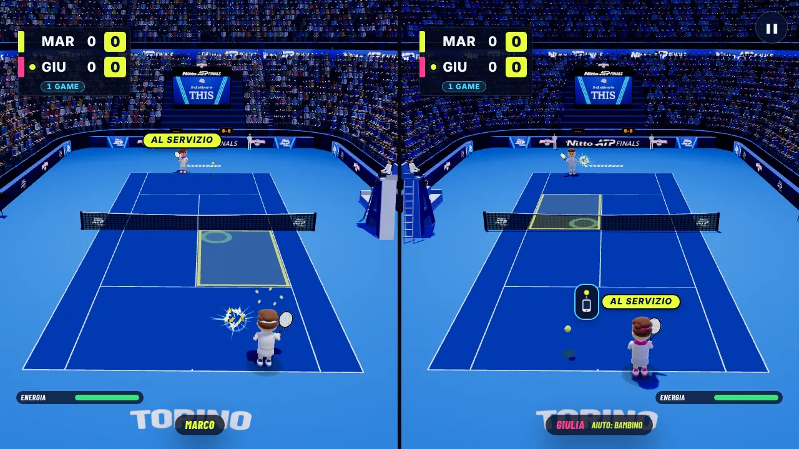

# B61 · Collaudo dello stand del 17/11/2026 sulla 2026-11-17.1 (FIERA)

Foto dell'utente del ledwall a fine partita, **stesso schermo**, personaggi **Lob & Drop**, versione 2026-11-17.1, con
quattro segnalazioni:

> 1. «Uno dovrebbe essere Drop e l'altro Lob, qui hai messo entrambi Lob»
> 2. «Ti ho chiesto esplicitamente gif e quindi immagini animate, io sul display vedo immagini statiche»
> 3. «Ho l'impressione come nel video che il dritto e rovescio siano invertiti a volte. Provo a muovere il telefono verso
>    destra per fare un dritto e il gioco mi rileva l'animazione di un rovescio, almeno così sembra nel video»
> 4. «Quando faccio scambi tra Lob e Drop, il cerchio di anteprima di dove finisce la palla non mi pare ci sia da entrambi.
>    Inoltre su stesso schermo dovrei vedere sempre TORINO dritto e invece adesso è tutto specchiato ed invertito»

Versione con le correzioni: **2026-11-17.2**.

## 1. Mascotte: Drop e Lob, una per parte

**Causa**: dalla 16.10 il personaggio della mascotte era a caso fra i due (5 di Lob e 5 di Drop per esito). Nello stesso
schermo potevano uscire due Lob o due Drop.

**Adesso** (`natpf_mascotte.mascotCharacter`, `mascotPlan`, `MascotRotation.takeFor`): il personaggio segue la card,
come in campo con «Lob & Drop» (`natpf_personaggi`, LOOKS: chi gioca Drop, l'avversario Lob):
- card del Player 1 (o di chi gioca contro la CPU): **Drop**; card del Player 2 o della CPU: **Lob**;
- con i personaggi classici: due card → Drop sul Player 1 e Lob sul Player 2; una card sola → uno dei due a caso.
Resta tutto il resto: esito della card, mai una della partita prima, prenotate e prericaricate.

## 2. Animate, e la figura intera che si muove

**Cause** (tutte e due possibili sul PC dello stand, non sappiamo quale):
- con «riduci movimento» del sistema (Windows: Impostazioni → Accessibilità → Effetti visivi → **Effetti di animazione**
  spenti, comune sui PC per ledwall) la 16.10 mostrava **il primo fotogramma fermo** (scelta di accessibilità del B58);
- le animazioni consegnate si muovono poco: misurati i 20 file, in metà di loro cambia **meno del 2% dei pixel** tra un
  fotogramma e l'altro e la figura si sposta di 1–4 px su 320 (in `lob-win-01` e `drop-win-01`, i salti, 56–61 px). Sul
  ledwall, da lontano, sembrano ferme anche quando girano.

**Adesso**:
- **sempre animate**, anche con «riduci movimento» (l'utente le vuole animate; `mountMascots` non mette più il primo
  fotogramma fermo);
- oltre ai 10 fotogrammi del file, **la figura intera si muove con i piedi** (era la richiesta del 16/11, B58.1:
  «movenze con i piedi con cui la mascotte va avanti o va indietro oppure destra e sinistra»): `natpf-hud.css`,
  `.card-mascot[data-outcome][data-move]`, solo `transform`, dentro la finestra del personaggio. Tre giri per esito, dal
  numero del file (01 e 04: a, 02 e 05: b, 03: c), così due card di fila raramente si muovono uguali:

| | a | b | c |
|---|---|---|---|
| Vittoria (2,4 s) | due salti sul posto, passo a destra e a sinistra | passo avanti (verso chi guarda) e indietro, con saltelli | di lato a saltelli, destra e sinistra |
| Sconfitta (3,2 s, più piccola) | passi indietro a testa bassa | si trascina di lato | si accascia e si rialza |

Nel browser (Chromium, dev server): la figura si sposta fino a 21 px (card da 258 px) o cambia scala del 4–9% in 2,5 s.

**Non fatto**: nuove animazioni dei file (servirebbe rigenerarle; si può, con l'approvazione dell'utente).

## 3. Dritto e rovescio «invertiti a volte»: non riprodotto, ora misurabile

Quello che si è controllato:
- il motore usa il lato del gesto del telefono (`e.side`) per il P1 e per il P2, e la racchetta di tutti e due è dalla
  parte giusta nella propria metà dello stesso schermo (schermata `3c` della prova nel browser);
- il riconoscimento (PROJECT_MEMORY §Gesti): per un **destro** il **dritto va da destra verso sinistra**; muovere il
  telefono **verso destra** è il verso del **rovescio** (per un mancino il contrario). Gli scambi di prova imparano il
  verso di chi gioca (segno), quindi un verso «al contrario» ma sempre uguale funziona;
- restano i tre casi del B46 che danno proprio «a volte»: mano salvata sbagliata, **segno dell'accelerazione** cambiato
  dopo gli scambi di prova (il segno imparato torna +1: chi aveva insegnato il verso «al contrario» si trova dritto e
  rovescio scambiati), **segno del rilevatore** del telefono che si gira in partita (B46: reso visibile, non chiuso).

**Adesso**: la riga «colpo» del registro dello stand ha il campo nuovo **`pl`** (da che parte di chi colpisce era la palla:
+1 destra, −1 sinistra, 0 entro 0,3 m), accanto a `lato` (parte del corpo del colpo). Il riassunto ha la sezione
**«Dritto e rovescio dalla parte della palla (17/11)»**: quanti colpi dalla parte opposta alla palla, per giocatore, e
quante partite con **3 di fila** dello stesso giocatore (verso girato, non un colpo voluto). Da leggere con le tabelle
«Mano cambiata» e «Segno del verso del telefono cambiato» del B46. Il campo nuovo chiede una ricarica del Worker (la
correzione del 503 è già su: verificato il 17/11 dalla pagina pubblica); prima della ricarica il Worker lo scarta e tiene
la riga.

**Serve dall'utente**: il registro del 17/11 (le tabelle del B46 dicono già se il segno o la mano sono cambiati in
partita), la mano con cui gioca e, se c'è, il video.

## 4. Stesso schermo: anello a terra per tutti e due, TORINO dritto

**Anello** («cerchio di anteprima»: l'anello colorato a terra dove cadrà la palla, al colpo). **Causa**: era «del
giocatore locale» (`natpf_ui.feedback` usciva subito per i colpi del Player 2). **Adesso**: `NatpfShotFeedback.onSplitFeedback`,
stesso anello e stesso lampo sulla racchetta per i colpi del Player 2 nello stesso schermo, con il suo esito; con il
verdetto che aspetta la palla (fuori o in rete, B37) l'anello arriva al rimbalzo e l'etichetta del gesto del Player 1 non
riceve l'esito del Player 2. Allenamento, minigiochi e diagnostica restano di chi gioca qui. Negli scambi di prova
nessun anello per nessuno (B28: i colpi di prova non si giudicano), come prima.

**TORINO**. **Causa**: le due scritte sul campo sono una sola coppia per le due metà, girate per chi gioca «su questo
computer» (il Player 1): nella metà del Player 2, che guarda dall'altra parte, erano capovolte. **Adesso**:
`natpf_split.render` le gira solo mentre disegna la metà del Player 2 (`natpf_arena.viewFrom(-1)`, poi
`viewFrom(null)`), anche se il disegno si interrompe. Il resto della metà del Player 2 è la vista da dietro di lui, come
dal B20 (non è specchiata: la sua destra è a destra).

## Prove

- `test/natpf-stand-17-11.test.mjs` (4): giro delle scritte per la sola metà del Player 2 (ordine, ritorno, errore nel
  disegno, fuori dallo stesso schermo) e geometria (scritta letta da sinistra a destra dalla camera del Player 2); anello e
  lampo del Player 2; verdetto rimandato; `natpf_ui.feedback`.
- `test/natpf-b58-mascotte.test.mjs` (14, +2): personaggio della card (400 partite dello stesso schermo: sempre Drop sul
  Player 1 e Lob sul Player 2, mai una della partita prima, tutte e venti col tempo); giri della figura; mai più il
  fotogramma fermo.
- `test/natpf-registro.test.mjs` (+1, `pl` anche per il Player 2), `test/registro-riassunto.test.mjs` (+1).
- Nel browser: `natpf-fine-partita` 68/68 (+2: figura in movimento, Drop e Lob nello stesso schermo),
  `natpf-stesso-schermo-b25` 57/57 (+2: TORINO e anello del Player 2, schermata `3c-torino-e-anello-del-player2`).
- Gioco 1800/1800, sito 282/282, LAN 13/13, desktop 56/56, build.

**Pacchetti della 17.2** (`d8183f1`, tre workflow verdi): installer dal link fisso = `latest.json` (131.379.955 B, sha256
`f3788fa9cae637d4b2d537d731002eef98c0e7ef8df2681c0eb91ec4ae66ca2d`, primo in `windows/versioni.json`); zip Cloudflare
23.955.734 B, sha256 `a0fc630ff40ff5254c28d8656bb3772de9aa9780f6a43262839c079df408f89a`, provato estratto (versione
giusta, nessun errore, senza la cartella delle mascotte).

**Non provato**: ledwall e programma Windows vero (con «riduci movimento» acceso: provato solo che il codice non lo
legge più), telefoni veri; il punto 3 non è riprodotto.
