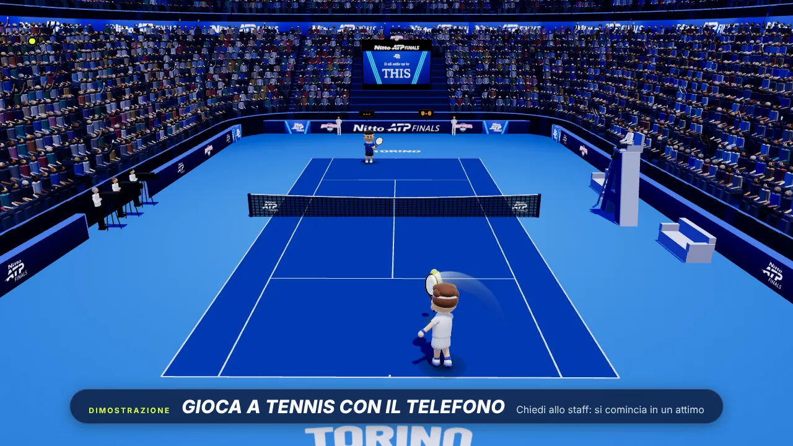

# B62 · Salvaschermo con una partita dimostrativa (FIERA)

Richiesta dell'utente del 17/11/2026: «Dopo un periodo di inattività sul ledwall vorrei mettere un finto gameplay in loop.
Inattività di almeno 1 minuto che si sblocca come screensaver».

## Come funziona

- **Quando parte**: dopo **1 minuto senza nessuno** (impostazione dello staff: 1, 2 o 5 minuti, oppure spento) con il gioco
  in una **pagina del menu**: menu principale, pagina della fiera, «Collega», «Pronto per la partita», Opzioni e le altre.
  «Senza nessuno» si conta come il chiosco: nessun tasto, clic, tocco o mouse mosso, nessun gesto o tocco sui telefoni,
  nessun «Sono pronto», nessun telefono preso in mano (`natpf_kiosk.last`).
- **Cosa si vede**: il menu sparisce e a schermo intero gira la **partita dimostrativa del motore** (CPU contro CPU, con la
  telecamera di gioco, i personaggi scelti: Classici o Lob & Drop), punto dopo punto senza fine. In basso una fascia
  discreta: «Dimostrazione · **Gioca a tennis con il telefono** · Chiedi allo staff: si comincia in un attimo». Niente
  cursore sopra la dimostrazione.
- **Come si chiude**: mouse mosso, clic, tasto, rotellina, tocco, un gesto o un tocco su un telefono, il telecomando dello
  staff, oppure il gioco che esce dal menu da solo (per esempio «Sono pronto» sui telefoni della fiera). **Si torna alla
  stessa pagina di prima** (il menu resta aperto sotto). Il primo clic o tasto sveglia e basta: non preme il pulsante che
  c'è sotto e Invio non manda avanti il menu.
- **Quando non parte mai**: in partita, negli scambi di prova, nell'allenamento e nei minigiochi; con un foglio aperto
  (pannello dello stand, telecomando, telefoni dello stand, diagnostica, calibrazione dello schermo, tastiera a schermo,
  tutorial, nickname); con la classifica a schermo intero (è per chi è in fila); nella sfida tra due computer.
- **Con il chiosco**: alla fine di una partita lasciata lì il chiosco torna al menu (o alla pagina della fiera) dopo il suo
  tempo (45 s di base), poi dopo un altro minuto senza nessuno parte il salvaschermo.

## Dove si imposta

Pannello dello stand (Ctrl+Maiusc+K, F9 nel programma Windows) → **«Salvaschermo»**: Dopo 1 min → Dopo 2 min → Dopo 5 min →
No. Resta salvato sul computer (chiave `natpf-tennis.salvaschermo`). Di base **«Dopo 1 min» nel programma Windows** (fiera);
**«No» nel gioco dal browser** (versione online) e nel server di sviluppo (dalla 17.4: nelle prove nel browser, ferme nel
menu più di un minuto, copriva la pagina; anche `tools/e2e/th.mjs` lo spegne), dove resta da scegliere.

## File

`natpf-tennis/src/natpf/natpf_screensaver.js` (nuovo), `natpf_ui.js` (creato prima del menu, `tick`, `menuBackdrop`),
`natpf_kiosk.js` (voce del pannello), `index.html` (voce «Salvaschermo»), `natpf-ui.css` (fascia, menu nascosto: misure
`cqw`/`cqh`, `@container natpf`). La partita dimostrativa è quella che girava dietro il menu prima dello sfondo fermo
(`game_engine`, `autoPlayMode`, `_setupMidRallyShowcase`): niente telefoni, nessun punteggio vero, niente registro.

## Prove

- `natpf-tennis/test/natpf-b62-salvaschermo.test.mjs` (8): valori di base e salvati, voce del pannello, quando parte e
  quando si chiude, cosa non copre (15 casi), partita dimostrativa da capo, il gesto che sveglia non arriva alla pagina
  (pointerdown, mousedown, keydown, touchstart, wheel e il resto dello stesso gesto per mezzo secondo), sfondo del menu di
  nuovo fermo, mouse che trema contro mouse mosso, attività dei telefoni, Player 2 della sfida, spento dal pannello.
- `tools/e2e/natpf-salvaschermo.mjs` 21/21 nel browser: parte dopo il tempo, la dimostrazione gira (fasi e palla), fascia
  dentro lo schermo a 1280×720 e 1920×540, si chiude con mouse, clic sopra «Gioca» (il pulsante non scatta), Invio (il
  menu non va avanti), telefono; da «Collega» si torna a «Collega»; non parte con il pannello aperto; voce del pannello
  1 → 2 → 5 min → No e salvata; spento non parte; si chiude quando il gioco esce dal menu; nessun errore JavaScript.

**Non provato**: sul ledwall e nel programma Windows vero (con la GPU la dimostrazione è fluida; qui il disegno è senza
GPU e va a pochi fotogrammi al secondo); con telefoni veri appoggiati sul tavolo (se il telefono «si muove» da solo conta
come attività, come per il chiosco).
