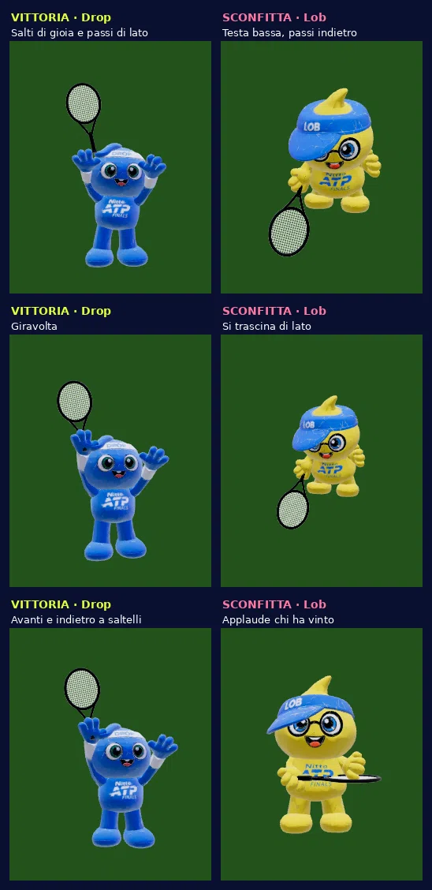

# B63 · Mascotte 3D con animazioni nuove nella card (FIERA) · APPROVATE (B67/B69, 18/11: accese di base con «Lob & Drop», `docs/b69/balletti-mascotte.md`)

> **18/11: rivisto dal B67** (`docs/b67/pose-mascotte.md`): impugnatura nel pugno, «Sei-sette» e «Aura», sconfitta con la
> faccia triste; i movimenti qui sotto sono quelli del B63 (restano «Salti di gioia» e «Giravolta»).

Domanda dell'utente del 17/11/2026: «Ma non puoi generare tu con il 3D di Lob e Drop delle animazioni native se le gif non
vanno bene?». Risposta alla domanda a scelta: **«3D con animazioni nuove»**: 3 di vittoria e 3 di sconfitta per i modelli
3D, con passi avanti, indietro, di lato, balletto, testa bassa; **anteprima all'utente prima di pubblicare**.

## Cosa c'è (spento di base finché l'utente non approva)

- I ritratti 3D della card (B40.6, `natpf_ritratti.js`) fotografano il personaggio della partita con le luci dell'arena.
  Con l'interruttore acceso (`?mascotte3d=1` o `localStorage['natpf-tennis.mascotte3d'] = '1'`) il giro dura 2,05 s (tre
  salti, `CARD_LOOP`), 24 fotogrammi (12 su Android o con poca memoria), e sopra la reazione del corpo tutto il personaggio
  si muove (`natpf_card_moves.js`):

| Esito | Movimento | Corpo | Tutto il personaggio |
|---|---|---|---|
| Vittoria | a · Salti di gioia e passi di lato | salto con la racchetta alzata | passi a destra e a sinistra, saltelli, piedi che si alzano |
| Vittoria | b · Giravolta | salto con la racchetta alzata | un giro intero su se stesso, in alto a metà giro |
| Vittoria | c · Avanti e indietro a saltelli | salto con la racchetta alzata | verso chi guarda e indietro, saltelli |
| Sconfitta | a · Testa bassa, passi indietro | testa bassa (`sad`), racchetta che pende | piegato in avanti, due passi indietro e ritorno |
| Sconfitta | b · Si trascina di lato | testa bassa, racchetta che pende | di lato a passi strascicati, piegato |
| Sconfitta | c · Applaude chi ha vinto | applauso | si gira un po' verso chi ha vinto |

- Un movimento per card, a caso fra i tre del suo esito, mai quello della partita prima (chiave `natpf-tennis.mosse3d`).
- Con l'interruttore acceso la card non usa le GIF del B58; il personaggio torna al suo posto dopo la fotografia (e tra una
  fetta e l'altra, così in campo non salta). Sempre animate, anche con «riduci movimento» (come le GIF dalla 17.2).
- `player_body_animation.js`: reazione nuova **`sad`** (la testa bassa di «loss» assestata, oscillazioni a multipli di
  `SAD_W` = un giro della card, racchetta che pende).

## Limiti noti (da sapere prima di decidere)

- La faccia dei modelli 3D è disegnata (sorride sempre): la sconfitta si legge dal corpo (piegato, racchetta giù), non
  dall'espressione. Le GIF hanno la faccia triste.
- Sul petto dei modelli 3D c'è il marchio dell'evento (come in campo dal B29); nelle GIF era stato tolto.
- Memoria: due fogli da 24 fotogrammi 256×320 = 15 MB (prima 7,9 MB); sul PC dello stand non è un problema.
- Personaggi «Classici»: oggi la card fotografa chi ha giocato (i tennisti). Per avere Lob e Drop anche con i Classici
  serve un passo in più (la mascotte 3D al posto del tennista solo durante la fotografia): da fare se l'utente approva.

## Prove

- `test/natpf-b63-mascotte-3d.test.mjs` (6): sei movimenti con la reazione giusta, giro chiuso (fine = inizio, giravolta
  di un giro intero), ampiezza visibile, piedi solo in su, scelta senza ripetere su 300 partite, interruttore, posto e
  rotazione rimessi, riproduzione sulla durata del giro, niente GIF con l'interruttore acceso.
- `tools/e2e/natpf-mascotte-3d-anteprima.mjs`: tre partite dello stesso schermo con Lob & Drop, i sei fogli e l'anteprima.
- Con l'interruttore spento tutto come la 17.3 (prove dei ritratti e della fine partita nel browser).
