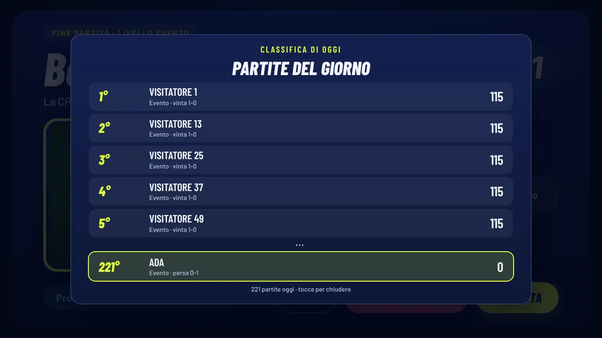

# B65 · Classifica di oggi a fine partita (FIERA)

Richiesta dell'utente del 17/11/2026: «A fine partita in fiera vorrei che mettessi anche una live scoreboard (tipo una card
o una modale) che mostra la top 5 di oggi con annesso punteggio e poi scompare. Ha senso far vedere a fine partita anche il
posizionamento del giocatore vincente rispetto agli altri (es. Top 5 e poi sotto il player che ha giocato con sua posizione
tipo 200). Classifica giornaliera».

Decisioni dell'utente (domande a scelta): **nello stesso schermo in classifica solo chi vince**; la classifica compare
**dopo la card, per 8 s**.

## Cosa si vede

- Alla fine di una partita contro la CPU o nello stesso schermo si apre la schermata finale con la card (come prima).
  **5 secondi dopo**, sopra, la finestra **«Classifica di oggi · Partite del giorno»**:
  - le **prime 5** partite di oggi: posizione, nome, livello (o «stesso schermo»), vinta o persa con i game, punteggio;
  - la riga di **chi ha appena giocato evidenziata**; se è oltre il 5° posto, sotto i «⋯» la sua riga con la posizione
    (per esempio **221°**);
  - senza nome (Ospite; nello stesso schermo «Player 1» o «Player 2» di base) «senza nome, fuori classifica»;
  - in basso quante partite ci sono oggi.
- Dopo **8 secondi** sparisce e resta la schermata finale. Un tocco o un tasto la chiude prima e **non preme niente sotto**.
  Se intanto la schermata finale si chiude (Rivincita, Prossimo giocatore), la classifica non compare.
- **Stesso schermo**: in classifica entra solo chi vince, con il punteggio di sempre (% di punti vinti × 1,4, il valore
  del livello Evento) e la scritta «stesso schermo». Nel CSV della classifica la colonna livello dice «Stesso schermo».
- La classifica del giorno ora tiene **tutte le partite** (fino a 3000; prima le prime 50), così la posizione è quella vera.
- Dove: programma Windows (fiera) e server di sviluppo; mai nella sfida tra due computer e nel doppio. Spenta a mano con
  `localStorage['natpf-tennis.classificaFine'] = '0'` (le prove nel browser la spengono, `tools/e2e/th.mjs`).

## File

`natpf-tennis/src/natpf/natpf_classifica_fine.js` (nuovo), `natpf_events.js` (`MATCH_KEEP`, `split`, `recordSplitWin`,
CSV), `natpf_ui.js` (vincitore dello stesso schermo in classifica, `dayBoard`), `natpf-ui.css`.

## Prove

- `test/natpf-b65-classifica-fine.test.mjs` (5): 241 partite tenute e posizione vera; vista con le prime 5, «⋯» e la
  riga di chi ha giocato, nei primi 5, al 6° posto, senza nome; stesso schermo (punteggio ×1,4, CSV); dove si vede; tempi
  (5 s dopo, 8 s, chiusa con la schermata, mai nel doppio e nella sfida tra due computer).
- `tools/e2e/natpf-classifica-fine.mjs` 11/11 nel browser: classifica con 220 partite, Ada perde contro la CPU: niente
  prima dei 5 s, poi prime 5 + «⋯» + «221° Ada» evidenziata, «221 partite oggi», dentro lo schermo a 1280×720 e 1920×540,
  sparisce dopo 8 s; un tocco la chiude senza aprire la rivincita; nello stesso schermo vince Marco: in classifica solo lui
  («stesso schermo»).

**Non provato**: sul ledwall e nel programma Windows vero; con migliaia di partite (oltre 3000 al giorno le ultime escono).
