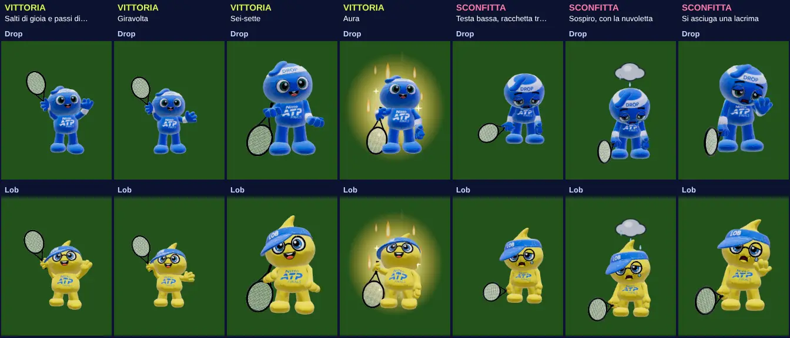

# B67 · Pose delle mascotte 3D nella card: impugnatura, «Sei-sette», «Aura», sconfitta triste (FIERA) · APPROVATE il 18/11

**Aggiornamento 18/11 (B69, `docs/b69/balletti-mascotte.md`)**: l'utente ha approvato l'anteprima («Le mascotte ok,
integra queste»): pose accese di base con «Lob & Drop» (programma Windows e web), più sei balletti di vittoria e due
sconfitte. Quello che segue sull'interruttore spento vale per l'anteprima.

Richiesta dell'utente del 18/11/2026, dopo l'anteprima del B63 (`docs/b63/mascotte-3d.md`): «Per le animazioni dovresti
sistemare meglio come la mascotte impugna la racchetta. Prevedi delle pose simpatiche come "Six Seven" (TikTok) o aura
battle. Per la sconfitta la mascotte deve sembrare visibilmente triste.»

Come il B63, tutto è **spento di base** (`?mascotte3d=1` o `localStorage['natpf-tennis.mascotte3d'] = '1'` per accenderlo)
finché l'utente non approva l'anteprima. Con l'interruttore spento il gioco è identico a prima (prove nel browser della
fine partita e dei ritratti verdi, vedi sotto).

Fotogrammi grandi (stessa camera della card): `docs/analisi/mascotte-3d-b67-sei-sette-drop.png`, `-aura-lob.png`,
`-salti-drop.png`, `-sospiro-drop.png`, `-lacrima-lob.png`; la schermata vera a 1920 × 1080 con la sconfitta di Lob (sospiro):
`docs/analisi/mascotte-3d-b67-card-1920x1080.webp`.

## Impugnatura

- **Prima (B63)**: nella card le mascotte facevano le reazioni del tennista riportate sulle ossa. Il palmo andava sul
  manico, ma la mano restava aperta (il modello ha il guanto a dita aperte) e orientata come l'avambraccio: la racchetta
  sembrava uscire dalla punta delle dita o restare sospesa sopra la mano (`docs/analisi/mascotte-3d-anteprima.webp`).
- **Ora**: nella fotografia della card la posa è descritta direttamente nel sistema del modello
  (`natpf_mascot_rig.poseMascotCard`) e la racchetta si mette **dopo** la mano, **dalla** mano: il manico passa per il
  centro del guanto (`HAND_CENTER`, media dei vertici della mano) lungo il pollice, il piatto è parallelo al palmo (presa
  eastern), il guanto si raccoglie a pugno (`FIST_SCALE`: dita più corte). Dal pugno escono il fondello da una parte e la
  gola dall'altra. Il braccio è a due ossa fino al polso; l'orientamento della mano è libero (dita che continuano
  l'avambraccio, oppure il palmo voluto dalla posa).
- In campo (durante la partita) **niente cambia**: le pose del gioco usano il codice di prima; all'uscita dalla card spalle e
  mani tornano a riposo (prova «uscita dalla posa»: dopo la card le ossa sono identiche a una partita senza card).

## Pose (un movimento per card a caso fra quelli del suo esito, mai lo stesso della partita prima)

| Esito | Movimento | Cosa fa |
|---|---|---|
| Vittoria | Salti di gioia e passi di lato (B63) | racchetta alzata nel pugno, l'altra mano che saluta, saltelli e passi di lato |
| Vittoria | Giravolta (B63) | racchetta alzata, l'altro braccio in fuori, un giro intero su se stesso |
| Vittoria | **Sei-sette** | le due mani aperte, palmi in su, che salgono e scendono alternate davanti alla pancia come i piatti di una bilancia (tre volte per giro), la testa che ondeggia a tempo; la racchetta **appoggiata alla gamba** con la testa a terra (così le due mani sono libere: è la soluzione più leggibile) |
| Vittoria | **Aura** | petto in fuori e mento alto, la racchetta piantata a terra come una spada con la mano sopra il manico, l'altra mano sul fianco, un giro lento e deciso; intorno un alone dorato con fiammelle e scintille |
| Sconfitta | Testa bassa, racchetta trascinata | spalle cadenti, testa bassa, passi strascicati di lato con la racchetta che tocca terra |
| Sconfitta | Sospiro, con la nuvoletta | si gonfia e si affloscia in un grande sospiro, poi resta giù; sopra la testa una nuvoletta grigia con la pioggia |
| Sconfitta | Si asciuga una lacrima | la mano libera strofina l'occhio a singhiozzi, testa inclinata, racchetta a terra |

«Racchetta in spalla» per l'Aura non è possibile con queste mascotte: le braccia escono proprio sotto la testa grande e la
racchetta passerebbe dentro la testa; la racchetta piantata a terra dà la stessa sicurezza e si legge meglio.

Tutto chiuso: l'ultimo fotogramma si attacca al primo (giro di 2,05 s, 24 fotogrammi come il B63).

## Sconfitta visibilmente triste

- **Faccia triste disegnata** (`natpf_mascot_face.js`): una maschera sui soli triangoli davanti della faccia (1.389 su
  8.268 per Drop, 1.369 su 8.210 per Lob), con la stessa pelle e le stesse ossa del modello (si piega con la testa), e una texture piccola disegnata con
  il canvas (320 × 229): la bocca sorridente coperta con il colore della pelle e una bocca all'ingiù, le palpebre che cadono
  più basse verso l'esterno, sopracciglia all'ingiù (Drop), una lacrima. Accesa solo nella fotografia della sconfitta.
- **Corpo**: testa bassa, schiena piegata, spalle che cadono, racchetta a terra; Lob si piega meno (con la testa troppo giù
  la visiera copre la faccia).
- **Camera** un filo dal basso nelle sconfitte (`camUp`), così la faccia si vede anche con la testa bassa.
- Nuvoletta con la pioggia nel «Sospiro».
- Personaggi «Classici» (tennisti) con l'interruttore acceso: fanno la reazione di base («cheer» o «sad») con il viso
  `shocked_loss` nella sconfitta; le pose nuove sono delle mascotte.

## File

- `src/natpf/natpf_card_moves.js`: i sette movimenti (`at` per tutto il personaggio, `mascot` per la posa, `fx`, `camUp`).
- `src/natpf/natpf_mascot_rig.js`: `poseMascotCard` (bacino, schiena, testa, braccia, pugno, racchetta in mano o appoggiata,
  a terra con la punta), `mascotGripProbe` per le prove.
- `src/natpf/natpf_mascot_face.js`: faccia triste. `src/natpf/natpf_card_fx.js`: alone dell'Aura e nuvoletta (sprite nel
  solo layer del ritratto, texture fatte con il canvas).
- `src/natpf/natpf_character.js`: con `actor.natpfCardPose` la mascotte prende la posa della card.
- `src/natpf/natpf_ritratti.js`: effetti e faccia pronti e compilati prima della fotografia (0 programmi nuovi durante), le
  ossa aggiornate prima di ogni scatto (correzione: il fotogramma 0 del foglio prendeva le ossa dell'ultimo disegno
  dell'arena), riquadro allargato per l'effetto, posa ed effetti tolti al rilascio.
- `tools/e2e/natpf-mascotte-3d-anteprima.mjs`: anteprima (fogli, griglia animata, fotogrammi grandi, schermate).

## Prove

- `test/natpf-b67-mascotte-pose.test.mjs` (8): manico al centro del pugno in tutti i 576 fotogrammi con la racchetta in mano
  (Drop e Lob, destri e mancini: al più 0,00 mm; mano dove la vuole la posa; braccia allungate al più 1,75 volte), racchetta
  mai dentro la testa o il busto, telaio a terra entro pochi centimetri dove deve, giro chiuso, mani alternate nel
  «Sei-sette», faccia triste solo nella sconfitta (maschera che copre bocca e occhi, stessa pelle), uscita dalla posa
  pulita, effetti solo nel layer del ritratto e chiusi, niente oggetti nuovi per fotogramma nel rig.
- `test/natpf-b63-mascotte-3d.test.mjs` aggiornata ai sette movimenti.
- Nel browser: `natpf-fine-partita` 68/68, `natpf-fine-partita-ritratti` 24/24 (interruttore spento); anteprima 15/15.

## Misure (Chromium senza GPU, swiftshader)

- Memoria dei fogli: come il B63 (2 × 24 fotogrammi 256 × 320 = 15,7 MB). In più, solo con l'interruttore acceso: texture
  della faccia (0,3 MB per mascotte) e degli effetti (0,2 MB).
- Cattura (somma delle fette di 6 ms, due personaggi): 2,6–3,2 s in una prima prova, 4,3–6,0 s in una seconda con la
  macchina carica; il B63 nelle stesse due condizioni 2,2–3,0 s e 3,5–7,8 s. Differenza nel rumore della misura.
- Programmi shader nuovi durante la cattura: 0 (compilati 1,3 s prima).

## Non provato

PC dello stand, Windows vero, ledwall vero (solo `?area=40,40,640,360` nel browser), GPU vera (i tempi sono di swiftshader).
