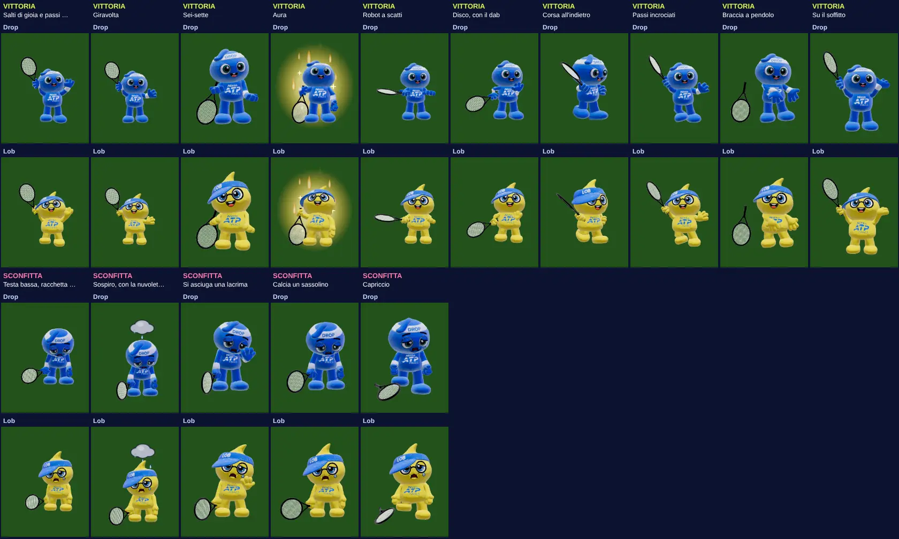

# B69 · Mascotte 3D accese e balletti di vittoria nella card (FIERA, anche nel web)

Richiesta dell'utente del 18/11/2026, dopo l'anteprima del B67 (`docs/b67/pose-mascotte.md`): «Le mascotte ok, integra
queste e butta dentro altre animazioni simili alle esultanze e balletti» dei videogiochi online (i balletti virali di
vittoria). Quindi: (1) le pose del B67 sono **approvate** e accese di base; (2) **sei balletti nuovi di vittoria**,
originali ma nello spirito di quei balletti, e **due sconfitte buffe** in più; (3) scelta a caso fra tutti i movimenti
dell'esito, mai lo stesso della partita prima.

Fotogrammi grandi dei balletti nuovi (stessa camera della card): `docs/analisi/mascotte-3d-b69-grandi.png` (22 pose,
tre momenti per balletto); schermate vere: `docs/analisi/mascotte-3d-b69-card-1920x1080.webp` e
`docs/analisi/mascotte-3d-b69-card-area-640x360.webp` (area piccola del ledwall, `?area=40,40,640,360`).

## Dove sono accese (e perché)

| Dove | Personaggi «Lob & Drop» | Personaggi «Classici» |
|---|---|---|
| Programma Windows (fiera) | **mascotte 3D con i movimenti** (B63/B67/B69) | GIF di Lob e Drop del B58, come prima |
| Gioco web (zip Cloudflare) | **mascotte 3D con i movimenti** | ritratto 3D del tennista (B40.6), come prima |

- **Fiera**: come previsto dal B63 («se l'utente approva, accendere di base nel programma Windows»).
- **Web, accese anche lì** con «Lob & Drop»: prima la card del web fotografava già le mascotte 3D, ma con le reazioni
  del tennista (la racchetta che usciva dalla punta delle dita, B67 «Prima»); i movimenti sono solo codice (niente asset:
  lo zip non cresce); sugli Android e sui dispositivi con meno di 4 GB la cattura fa 12 fotogrammi invece di 24 (metà
  memoria). Un comportamento solo, provato in un posto solo.
- **Classici**: l'utente non ha deciso diversamente, quindi niente cambia: dove ci sono le GIF del B58 (programma
  Windows) restano le GIF (Lob e Drop animati), nel web il ritratto del tennista. Le GIF restano anche il ripiego con le
  mascotte spente.
- Spegnere (allo stand, se servisse): `?mascotte3d=0` nell'indirizzo o `localStorage['natpf-tennis.mascotte3d'] = '0'`;
  `?ritratti=svg` torna al ritratto disegnato. `natpf_card_moves.cardUses3d`/`cardsUse3d` decidono per la card (tutte le
  card della partita devono avere Lob o Drop: il giro della cattura è uno solo).

## Balletti nuovi di vittoria (originali; nessun nome di gioco, marchio o ballo con nome proprio)

Il giro della card (2,05 s, 24 fotogrammi) è diviso in **8 battute** da 0,256 s: le pose chiave stanno sulle battute,
con arrivo che va un filo oltre e torna (rimbalzo), anticipazione (accovacciata prima dei salti, piede che va indietro
prima del calcio) e pose tenute. Tutti a giro chiuso.

| Movimento | Cosa fa | Racchetta |
|---|---|---|
| **Robot a scatti** | una posa per battuta, tenuta e poi cambiata di colpo fra due fotogrammi: braccia avanti a 90°, una su e una giù alternate, testa che scatta a destra e a sinistra, busto che gira a scatti con un passo di lato, alla fine un piccolo inchino | nel pugno, di lato in orizzontale o in alto in fuori |
| **Disco, con il dab** | la mano libera punta in alto in fuori e poi in basso dall'altra parte (tre volte), i fianchi che ondeggiano al contrario, la testa che segue il dito; nelle ultime due battute un piccolo dab tenuto (racchetta in alto in fuori, l'altro braccio piegato davanti alla faccia, testa china dentro il gomito; Lob china meno per la visiera) | nel pugno sul fianco, in fuori verso il basso; nel dab in alto in fuori |
| **Corsa all'indietro** | girato di tre quarti, un ginocchio su, il piede batte davanti e scivola indietro mentre sale l'altro (quattro passi per giro), le braccia che pompano, giù a ogni battuta del piede | nel pugno, in alto in fuori |
| **Passi incrociati** | a ogni battuta un piede incrocia davanti all'altro e torna largo, il corpo scivola di lato e torna, rimbalzo a ogni passo | nel pugno, alzata e che pompa; l'altra mano in fuori |
| **Braccia a pendolo** | le due braccia vanno insieme da una parte e dall'altra davanti ai fianchi (una in fuori, l'altra incrocia davanti alla pancia), i fianchi al contrario, le ginocchia che molleggiano. Le braccia del peluche sono troppo corte per passare dietro il corpo: si fa la parte davanti | **piantata a terra** accanto, ferma mentre balla |
| **Su il soffitto** | saltelli a due piedi (accovacciata prima di ogni salto), le mani che spingono in su accanto alla testa a ogni battuta, palmi in su | nel pugno, in alto in fuori accanto alla testa |

«Mani sopra la testa» non si può: la testa è metà del pupazzo e le braccia escono subito sotto (come per la racchetta in
spalla del B67); le mani spingono accanto alla testa.

## Sconfitte nuove (buffe ma tristi, con la faccia triste del B67)

| Movimento | Cosa fa | Racchetta |
|---|---|---|
| **Calcia un sassolino** | testa bassa, il piede libero va indietro e calcia piano davanti, due volte per giro | pende, con la punta a terra |
| **Capriccio** | pesta i piedi alternati a ogni battuta, pugni giù, la testa che dice di no | buttata a terra davanti, distesa e inclinata verso chi guarda |

## Scelta (natpf_card_moves.pickCardMoves)

Per ogni card un movimento a caso fra tutti quelli del suo esito (10 di vittoria, 5 di sconfitta), mai uno della partita
prima per lo stesso esito, e nello stesso schermo due card con lo stesso esito (a pari) mai uguali. Memoria in
`localStorage['natpf-tennis.mosse3d']` (un id per esito, o la lista se le card erano due).

## Come (file)

- `natpf-tennis/src/natpf/natpf_card_balli.js`: i balletti (`DANCE_MOVES`), `beats` (pose sulle battute con sosta e
  rimbalzo), `mixPose`.
- `natpf_card_moves.js`: i movimenti nelle liste; acceso di base; `cardUses3d`/`cardsUse3d`; `pickCardMoves`; il posto di
  partenza in `actor.natpfCardPose.base`; il giro di tutto il personaggio verso il lato libero anche per i mancini.
- `natpf_mascot_rig.js`: `legs` (i piedi messi dalla posa: passi, incroci, calci, piedi pestati), racchetta `rest` con
  `frame: 'ground'` (ferma a terra nel posto di partenza, non segue il personaggio), `fist` per la mano libera a pugno.
- `natpf_ritratti.js` e `hud_ui.js`: mascotte 3D solo dove ci sono Lob e Drop, GIF per i Classici.

## Prove

- `test/natpf-b69-balletti.test.mjs` (7): in TUTTI i fotogrammi dei balletti, Drop e Lob, destri e mancini, con il
  movimento di tutto il personaggio: manico al centro del pugno (al più 0,00 mm su 576 fotogrammi), mano dove la vuole
  la posa, braccia allungate al più 1,88 volte; racchetta a terra ferma nel mondo e appoggiata al campo; racchetta mai
  dentro testa, busto o gambe (5 cm dalle ossa delle gambe); piedi mai sotto il campo; giro chiuso; ritmo (robot a
  scatti, dab tenuto); scelta senza ripetere su 400 partite (escono tutti e 15), a pari due diversi; interruttore;
  mancino; nessun nome di giochi o balli con nome proprio nei file.
- `test/natpf-b67-mascotte-pose.test.mjs` copre anche i balletti (1.152 fotogrammi con la racchetta in mano);
  `test/natpf-b63-mascotte-3d.test.mjs` aggiornata (15 movimenti, acceso di base).
- Nel browser: vedi `docs/WORK_PROGRESS.md` (B69) per i numeri delle prove della fine partita e dell'anteprima.

## Non provato

PC dello stand, Windows vero, ledwall vero (solo l'area `?area=` nel browser), GPU vera (i tempi della cattura sono di
SwiftShader, il caso peggiore).
