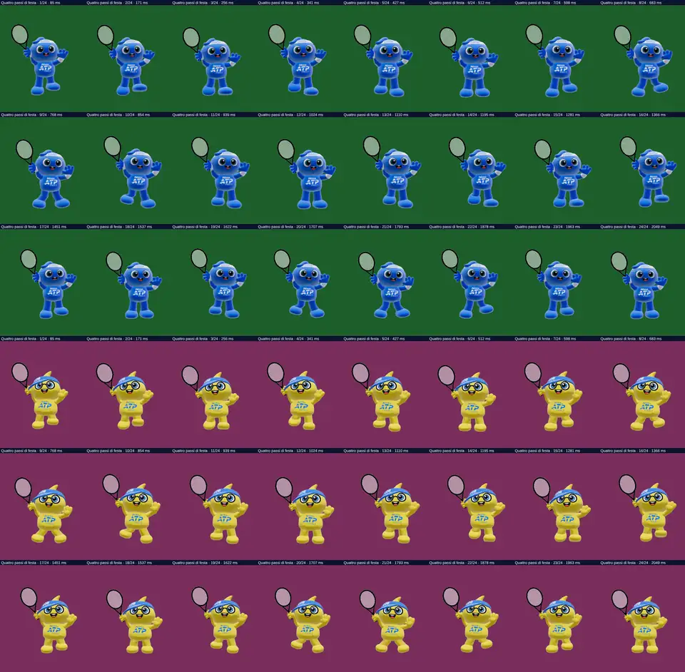
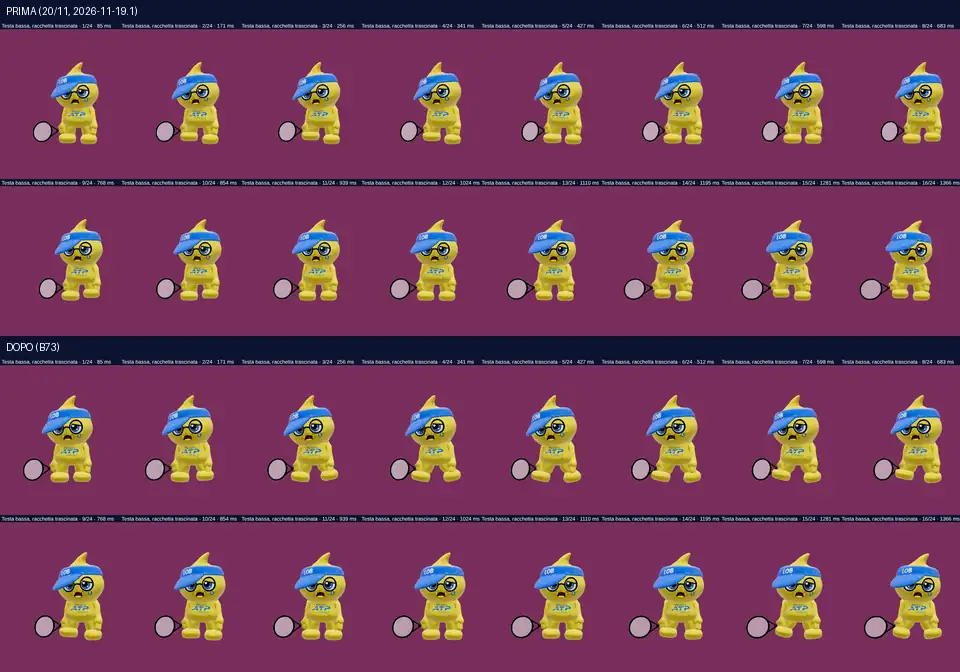
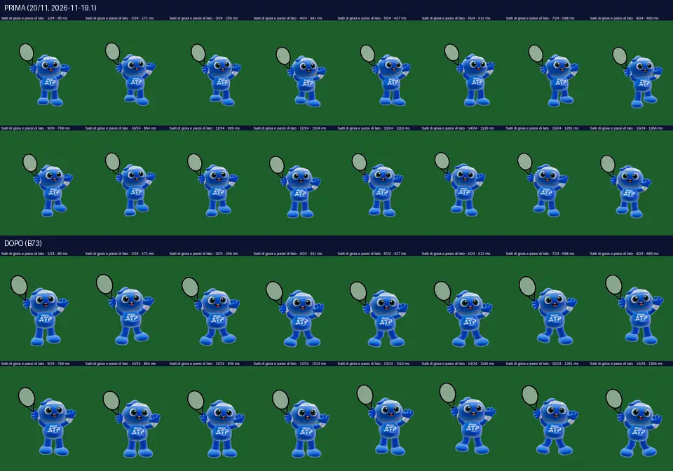

# B73 · Passi veri delle mascotte 3D nella card di fine partita (FIERA)

Richiesta dell'utente del 16/11/2026 ripresa il 20/11 (punto 6 di «Vai avanti su 4, 6 (falli), tecnico»): «migliorare le
movenze con i piedi: avanti, indietro, destra e sinistra», «falli». Le mascotte 3D di Lob e Drop ballano nella card solo
nel programma Windows (`window.natpfDesktop`) e nel server di sviluppo (B70); le GIF restano per i «Classici».

Ramo `b73-mascotte` (worktree), da `natpf-simulator` 8d374b7f; commit `0a38be02`, `3c48d136` e quello di questo
documento. Nessun file di versione e nessun documento vivo toccati.

## 1. Prima: cosa facevano i piedi (misura del 20/11, versione 2026-11-19.1)

Misura sui modelli veri come la cattura della card (`natpf_ritratti`: giro di prova, poi il giro; reazione del corpo e
movimento di tutto il personaggio), 96 campioni per giro di 2,05 s, Drop (card del Player 1) e Lob (Player 2); «a terra»
= pianta a meno di 1,2 cm dal campo. Sonda `misura-piedi.mjs` (§6).

| Movimento | Corpo: di lato / avanti-indietro | Piedi a terra che scivolano (per giro) | Cosa si vede |
|---|---|---|---|
| Salti di gioia e passi di lato | 48 cm / 0 | 4–6 cm, ma a terra solo il 4–7 % del giro | tutto il personaggio scivola di lato saltellando, i piedi quasi sempre in aria |
| Testa bassa, racchetta trascinata | 28 cm / 0 | **35 cm** | scivola di lato con i piedi incollati a terra |
| Passi incrociati | 22 cm / 0 | 13–24 cm | il corpo scivola, il piede che incrocia torna strisciando |
| Robot a scatti | 15 cm / 0 | 9 cm | come sopra, meno |
| Aura | 0 / 4 cm | **51–66 cm** | ferma, ma i piedi seguono quelli del tennista che salta sotto (nascosto) |
| Giravolta | 0 / 12 cm | 25–40 cm | gira e va avanti anche con i piedi a terra |
| Sei-sette, disco, lacrima, sassolino, sospiro | 0–9 cm | 5–54 cm | piedi che strisciano sul posto |
| Corsa all'indietro | 0 | (scivola apposta: è il passo del balletto) | |

- **Avanti e indietro**: nessun movimento ci andava (al più 12 cm nella giravolta, in salto, e 4 cm nell'Aura).
- **Passi veri** (un piede si alza e si posa in un punto nuovo mentre l'altro resta fermo): nessuno.
- **Nella finestra** (browser, server di sviluppo, stesso schermo a 1280 × 720: finestra 223 × 298 px, fotogramma
  256 × 320 tagliato ai lati): il centro della figura andava da una parte all'altra del 16–17 % della larghezza (salti),
  13–15 % (trascinata), 11 % (passi incrociati), 11–12 % (robot); sempre dentro la finestra (margine minimo 4,1 %); la
  finestra non tocca nome, numeri e trofei.

Due cause: (1) il movimento di tutto il personaggio (`natpf_card_moves.applyCardMove`) spostava la radice, e i piedi
della posa (B69) erano nel sistema del modello, cioè andavano con lei; (2) nelle sette pose del B63/B67 senza `legs` i
piedi venivano dalle parti del tennista nascosto sotto, che salta nella reazione «cheer» e ondeggia in «sad».

## 2. Dopo: passi veri

**Piano di passi** (`natpf-tennis/src/natpf/natpf_card_passi.js`, nuovo): una lista di passi sulle 8 battute del giro;
a ogni passo un piede si stacca (prima solo in su, `STEP_LIFTOFF` = 15 % del passo), va nel punto nuovo e si posa (alla
fine solo in giù), mentre l'altro resta fermo; il corpo sta a metà fra i due piedi, quindi va avanti mentre il piede è in
aria; il bacino va un po' sopra il piede fermo (peso) e sale un filo a metà passo. Il giro si chiude (ogni piede torna al
suo posto). Unità del modello (la mascotte è alta 1, in campo 1,6 m), x come le mani (lato della racchetta x < 0), z verso
chi guarda.

**Piedi fermi nel mondo** (`natpf_mascot_rig.cardLeg`, `legs.frame = 'ground'`): il piede della posa è misurato dalla
pianta a riposo sotto il POSTO DI PARTENZA del personaggio, nel riferimento di chi guarda, come lo spostamento di tutto
il personaggio (`applyCardMove`, che ora passa anche il verso di chi guarda e dove ha messo il personaggio): quando il
personaggio si sposta, gira o si piega, il piede a terra resta dov'è. Fra una fetta e l'altra della fotografia
`natpf_ritratti` rimette il personaggio al suo posto (l'arena si disegna ancora per mezzo secondo prima della card): lì i
piedi vanno con lui come nella posa, invece di restare indietro con le gambe allungate (prova apposta). Senza posto di
partenza (pose senza movimento) come prima.

| Movimento | Prima | Dopo |
|---|---|---|
| **Quattro passi di festa** (nuovo, vittoria) | — | due passi avanti verso chi guarda, due a destra, due indietro, due a sinistra (passo e chiudi: 27 cm avanti-indietro, 24 cm di lato, un quadrato); il piede in aria per il 90 % della battuta, così due fotogrammi su tre lo mostrano staccato; racchetta alzata che pompa a ogni passo, l'altra mano che saluta |
| **Passi indietro, a testa bassa** (nuovo, sconfitta) | — | due passi lenti indietro e due avanti per tornare (24 cm), spalle cadenti, racchetta che pende con la punta a terra, faccia triste |
| Salti di gioia e passi di lato | scivolata di 48 cm saltellando | quattro passi saltellati veri: due a destra e due a sinistra (24 cm), anche il piede fermo si stacca in verticale nel saltello |
| Testa bassa, racchetta trascinata | scivolata di 28 cm, piedi incollati | due passi lenti veri a destra e due a sinistra (21 cm), il piede appena staccato (trascinato) |
| Passi incrociati | corpo che scivola 22 cm | il piede incrocia e torna in aria, l'altro fermo; il corpo va sopra il piede fermo (±3 cm) |
| Robot, disco, pendolo, sassolino | piedi che seguivano il corpo | piedi fermi a terra, il corpo si sposta sopra di loro; il piede che batte o calcia si alza prima di muoversi |
| Aura, sei-sette, sospiro, lacrima | piedi del tennista che salta | piedi fermi a terra; il molleggio nel bacino invece che in tutto il personaggio |
| Giravolta | gira e va avanti con i piedi a terra | gira solo in aria (piedi raccolti), avanti solo nel salto |
| Su il soffitto, capriccio | (salti e pestate sul posto: già giusti) | come prima |
| Corsa all'indietro | | come prima: il piede a terra scivola indietro apposta, è il passo del balletto |

Movimenti per esito: 11 di vittoria e 6 di sconfitta (prima 10 e 5); scelta come prima (a caso, mai quello della partita
prima, mai due uguali nella stessa partita).

**Mancini**: lo spostamento di lato di tutto il personaggio ora è allo specchio, come le mani, i piedi della posa e il
giro (B69): il balletto del mancino è lo specchio di quello del destro. Prima per il mancino il corpo andava di lato dalla
parte del piede che si alzava (robot, disco); ora va sopra il piede fermo.

**Riduci movimento**: niente cambia (B61: le mascotte 3D si muovono sempre, `natpf_ritratti._play`).
**GIF** (Classici nel programma Windows): non hanno piedi da muovere, resta tutto come prima (salti e passi della figura
intera con `translate`, B61).

Nei fotogrammi di prima la figura è più piccola: la camera della cattura inquadra tutto il giro, e con la scivolata di
48 cm il giro era più largo.

## 3. Numeri dopo

Stessa sonda del §1 (node, modelli veri, 96 campioni per giro), uguali per Drop e Lob:

| Movimento | Corpo: di lato / avanti-indietro | Piede a terra che scivola (massimo fra due campioni) | Passi (il piede si posa più in là) |
|---|---|---|---|
| Quattro passi di festa | 24 cm / 27 cm | 0,00 mm | 4 per piede |
| Passi indietro, a testa bassa | 0 / 24 cm | 0,10 mm | 2 per piede |
| Salti di gioia | 24 cm / 0 | 0,00 mm | 2 per piede |
| Trascinata | 21 cm / 0 | 0,08 mm | 2 per piede |
| Giravolta | 0 / 6 cm (in salto) | 1,39 mm (stacco e arrivo) | — |
| tutti gli altri, corsa esclusa | 0–15 cm (sopra i piedi fermi) | 0,00 mm | — |

Nel browser (server di sviluppo, stesso schermo 1280 × 720, finestra 223 × 298, vittoria del Player 1 e del Player 2,
`natpf-mascotte-passi.mjs`, uscita `dopo4/`):

| Movimento | Centro della figura da una parte all'altra | Piedi su e giù / altezza della figura che cambia (avanti-indietro) | Margine minimo nella finestra |
|---|---|---|---|
| Quattro passi di festa | 12,5–12,9 % della larghezza | 3,4 % / 9,5 % | 4,9 % |
| Salti di gioia | 11,5–11,7 % | 3,4–3,8 % / 9–9,8 % | 5,3 % |
| Trascinata | 10,6–10,9 % | 0,9 % / 2,3–3,2 % | 8,7 % |
| Passi indietro | 3,8–4,4 % | 0,9–1,2 % / 4,5–5,2 % | 6,6 % |

La figura resta sempre dentro la finestra e la finestra non tocca nome, numeri e trofei. Di lato il centro si sposta un
po' meno di prima (12 % invece di 16 % nei salti) perché il passo vero è più corto della scivolata (24 cm invece di 48:
con gambe così corte un passo più lungo apre troppo le gambe), ma adesso si vedono i piedi che si alzano e si posano e
la figura è più grande nel fotogramma. Avanti e indietro si legge soprattutto dalla grandezza (la camera è davanti):
9,5 % nei «Quattro passi», 5 % nei passi indietro. Strisce (finestre come le mostra la card, ogni 120 ms per un giro):
`dopo4/striscia-*.png`; fotogrammi grandi: `dopo4/fotogrammi-*.png`; la card vera: [card-1280x720.webp](card-1280x720.webp).

Inquadratura della cattura (test node, vertici veri proiettati, tutti i 17 movimenti): figura alta il 55–76 % del
fotogramma (con i passi 59–70 %: come prima robot e disco, 55 %), sempre dentro la finestra 3:4 dello stesso schermo.

## 4. Prove

- `natpf-tennis/test/natpf-b73-passi-mascotte.test.mjs` (5): piani chiusi, un piede alla volta, corpo a metà, piede che
  si stacca prima di andare e arriva prima di posarsi, ordine avanti → destra → indietro → sinistra; **piede a terra
  fermo nel mondo** in tutti i 17 movimenti (Drop e Lob, destri e mancini, 96 campioni con la reazione del corpo come la
  cattura: al più 2 mm fra due campioni; la corsa all'indietro esclusa apposta); **passi veri** (fra due passi il piede
  fermo non si sposta più di 2 mm in tutto l'appoggio, ogni passo lo posa almeno al 90 % della lunghezza del piano, il
  corpo va dove dice il piano, allo specchio per il mancino); **figura dentro la finestra** con l'inquadratura della
  cattura (riquadro del giro di prova, `frameCamera`, camera di `_shoot`, vertici veri in tutti i 24 fotogrammi; finestra
  3:4 dello stesso schermo con i lati tagliati), figura alta almeno il 53 % del fotogramma, centro che va di lato almeno
  del 10 % per i passi di lato; **piedi con il personaggio rimesso al suo posto** fra due fette della fotografia.
- `natpf-b63-mascotte-3d.test.mjs` e `natpf-b69-balletti.test.mjs` aggiornate (17 movimenti; i salti a metà giro sono
  24 cm a destra; piedi mai sotto il campo misurati nel mondo).
- Nel browser: `tools/e2e/natpf-mascotte-passi.mjs` (nuovo): stesso schermo, vittoria del Player 1 e del Player 2,
  cinque coppie di movimenti scelte; figura dentro la finestra in ogni fotogramma del foglio ritagliato come lo mostra la
  card, finestra che non tocca nome, numeri e trofei, quanto si sposta; piedi sui modelli della pagina (piede a terra
  ≤ 3 mm per campione, passi veri e spostamento); strisce di fotogrammi ogni 120 ms (prese nella pagina dal canvas della
  card: una schermata di Playwright costa 150–200 ms con SwiftShader) e i 24 fotogrammi grandi dei movimenti con i passi.
  `PRIMA=1` misura soltanto (serve sul codice di prima). `tools/e2e/natpf-mascotte-3d-anteprima.mjs` aggiornata ai 17.

Esiti (codice finale, macchina condivisa con altri agenti, carico 3–15):

- gioco `npm test` 1918/1919 sul primo commit (1 saltata: «avvio LAN», `npm ci` in `tools/lan` che nel worktree non
  c'è; ambiente, non il codice; il primo ritocco è arrivato mentre girava); i due ritocchi (piedi con il personaggio rimesso al suo posto, passi indietro di
  24 cm invece di 21) toccano solo la posa della card: suite delle mascotte (B40, B58, B63, B67, B69, B70, B73, Lob &
  Drop) 76/76 sul codice finale; sito 322/322; build ok;
- nel browser: `natpf-mascotte-passi` 91/91 (sul codice di prima, con `PRIMA=1`, 43/43: solo misure),
  `natpf-fine-partita-ritratti` 28/28, `natpf-mascotte-3d-anteprima` 29/29 (i 17 movimenti per Drop e per Lob, 0
  programmi shader nuovi).
- Schermate guardate: strisce e fotogrammi grandi di prima e dopo (salti, trascinata, quattro passi, passi indietro), la
  griglia dell'anteprima con i 17 movimenti, la card a 1280 × 720.
- Non rifatte qui (il passo non le tocca): LAN, programma Windows, app Android.

## 5. Costo

- **Posa per fotogramma** (node, 20.000 pose dell'Aura, stessa posa e solo i piedi diversi, `costo.mjs`): piedi del
  tennista (come prima per sette movimenti) 74 µs, piedi della posa nel sistema del modello (balletti di prima) 59 µs,
  **piedi nel riferimento del suolo (B73) 60 µs**; piano dei passi 0,5 µs per fotogramma. Nessun oggetto nuovo per
  fotogramma nel rig (prova B67). Una cattura fa 48 pose per personaggio: 3 ms in tutto contro secondi di disegno.
- **Cattura nel browser** (somma delle fette di 6 ms, SwiftShader, stessi 8 giri prima e dopo, alternati sulla stessa
  macchina con il carico che cambiava): prima 4,5–5,8 s (mediana 5,0, carico 3–6) e 5,2–8,2 s (mediana 5,7, carico
  12–14); dopo 5,2–8,3 s (mediana 5,4, carico 6–12) e 5,0–9,2 s (mediana 6,0, carico 12–14). Le differenze seguono il
  carico, non il codice; il disegno è lo stesso (stessi fotogrammi, stessa luce, 0 programmi shader nuovi). Il primo giro
  di ogni pagina è il più lento, prima e dopo.
- Memoria: come prima (24 fotogrammi 256 × 320 per card); niente asset nuovi (i passi sono solo codice).

## 6. File di misura (non nel repository)

Cartella della sessione `scratchpad/b73/mascotte/`: `misura-piedi.mjs` (sonda dei piedi, `JSON=` per salvare; `prima.json`
con i numeri di prima), `costo.mjs`, `tempi-cattura.mjs` (tempi prima e dopo), `rig-misure.mjs`; uscite del browser
`prima/`, `prima2/`, `prima3/` (codice di prima: strisce e fotogrammi) e `dopo*/` (codice nuovo; `dopo4/` è quella finale).

## 7. Non provato

PC dello stand, Windows vero (programma installato), ledwall vero, GPU vera (i tempi della cattura sono di SwiftShader su
una macchina condivisa). Con 12 fotogrammi per giro (Android o meno di 4 GB: nel programma Windows di solito no) i passi
dei «Quattro passi di festa» durano un fotogramma e mezzo: si vede lo spostamento, poco il piede in aria. L'utente non ha
ancora visto i due movimenti nuovi.
