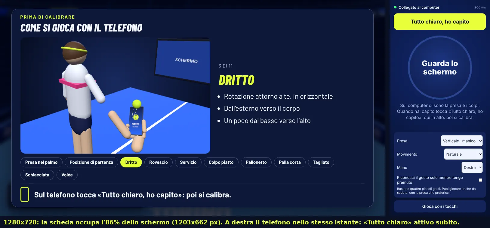
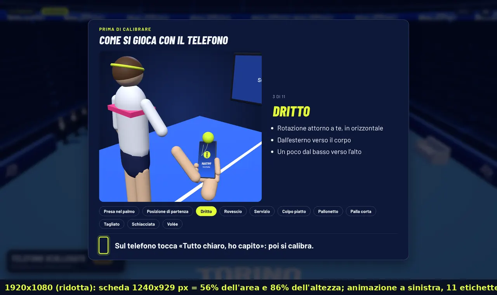
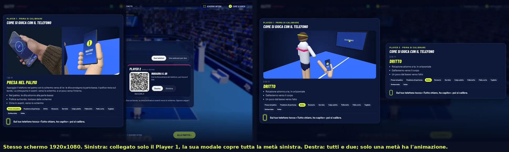
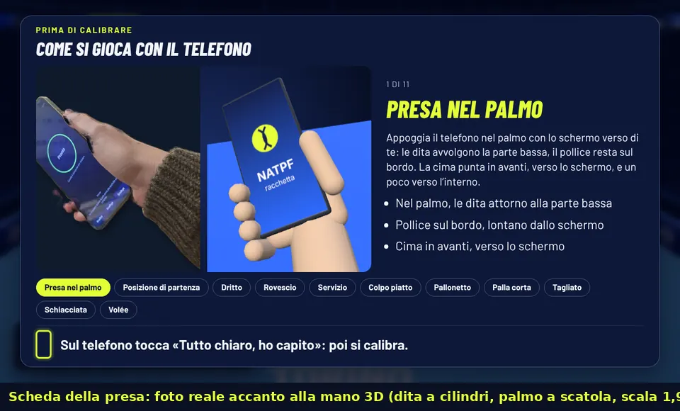
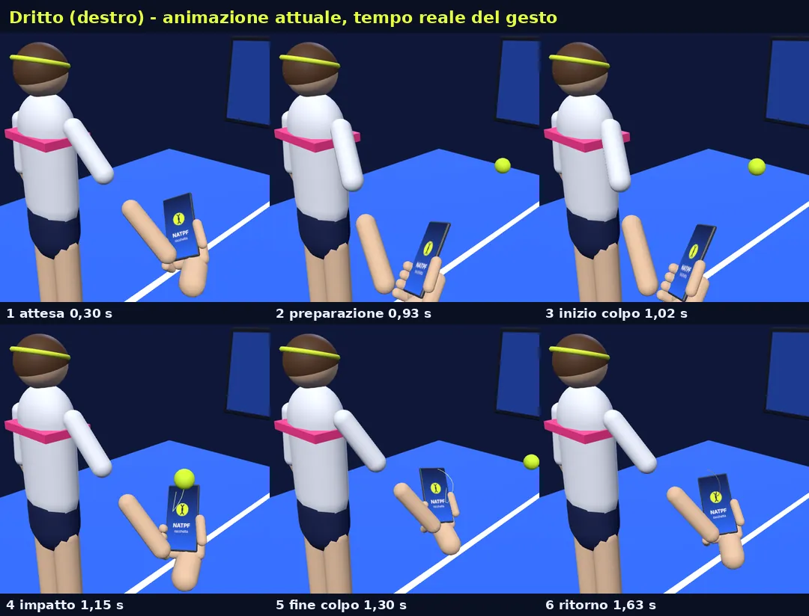
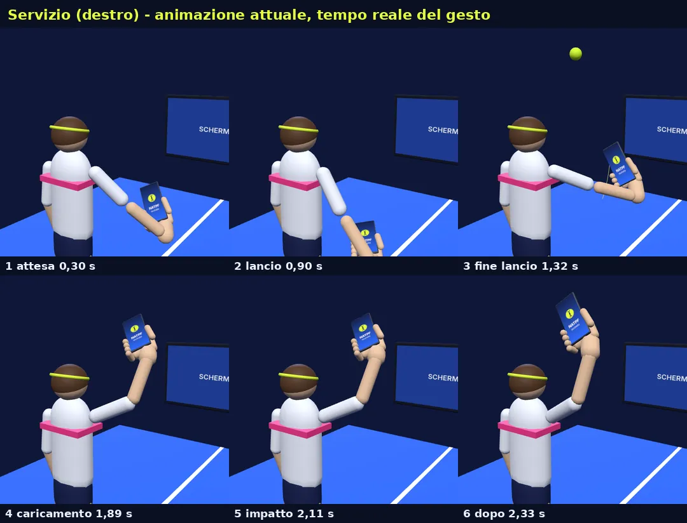
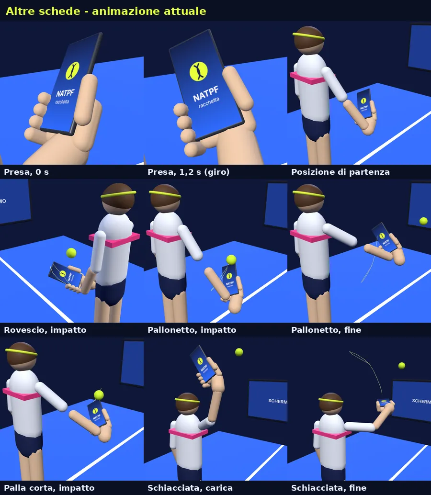
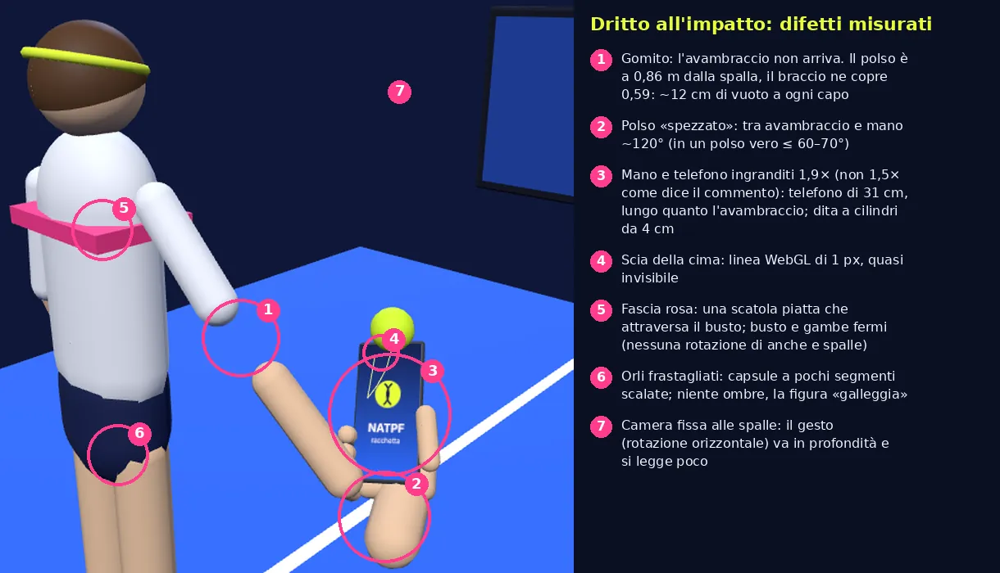

# B9 · Analisi A — modale del tutorial e animazione dei gesti

Stato: COMPLETO (05/11/2026, agente Claude, sigla immagini `A`). Codice letto su `natpf-simulator` HEAD
`e7cd44d`. Nessun file del gioco modificato.

Avanzamento
- [x] (a) percorsi di apertura, struttura HTML/CSS/JS, posizione, scorrimento automatico, etichette, chiusura dal telefono
- [x] (b) fotogrammi reali con Chromium (8 immagini in `docs/b9/img/A-*.webp`)
- [x] (c) diagnosi da motion designer
- [x] (d) vincoli tecnici per la sostituzione

Sintesi per decidere
- **Modale**: grande per costruzione (scheda `min(94cqw, 1240px)` × 94cqh, stage 54cqh: 86% dello schermo a 1280×720,
  56% a 1920×1080); nello stesso schermo ogni metà è coperta per intero dalla sua modale (`.half`, 50cqw), quindi con un
  solo telefono collegato «compare a sinistra». Navigazione solo con 11 etichette e scorrimento automatico a giro ogni
  6,5 s; il telefono non sa quali schede sono state viste e accende «Tutto chiaro» subito.
- **Animazione**: i moti del telefono sono giusti (verificati con il rilevatore vero), la resa no. Difetti misurati: braccio
  in tre pezzi (nel dritto il polso è a 0,86 m dalla spalla, il braccio arriva a 0,59), polso piegato di ~120°, mano e
  telefono a scala 1,9× (telefono di 31 cm), corpo fermo fatto di capsule, camera alle spalle che nasconde la rotazione,
  metà del ciclo immobile, tutto a 0,6× (piatto e dritto si distinguono solo dalla velocità), palla del servizio 0,9 m
  sopra il telefono all'impatto, niente ombre né riflessi.
- **Sostituzione**: tenere `strokePose`/`serveTimeline` come unica sorgente del moto del telefono (così il test dei gesti
  resta la prova di fedeltà), rifare modello, rig, camera, luci e tempi; un solo contesto WebGL, ≤ 30 fps, due metà
  dello schermo servite dallo stesso contesto; margine di peso Cloudflare ~2,48 MB (1,48 MB prima dell'avviso).

---

## (a) Dove e come si apre la modale oggi

### Percorsi

| Percorso | Chi la apre | Elemento | Note |
|---|---|---|---|
| **Allenamento** (menu) | `natpf_lobby.startWarmup()` → `training.start({ drills: null, intro: true })` → `_openTutorial()` (`natpf_training.js:202-241`) | `#natpf-tutorial` (`index.html:761`) | solo con `controller === 'phone'`, una volta per sessione (`tutorialSeen.p1`, azzerato a ogni nuovo collegamento del telefono: `state.joins`) |
| **Gioca contro la CPU** (riscaldamento) | `startWarmup()` → `training.start({ drills: warmupDrills })` | `#natpf-tutorial` | stessa modale, stessa regola «una volta per sessione» |
| **Sfide / minigiochi** con telefono non calibrato | `startWarmup()` → `training.start({ calOnly: true })` | `#natpf-tutorial` | idem |
| **Stesso schermo** (1v1, «Collega i due telefoni») | `NatpfSplitUi._drive(id)` → `_tutOpen(id)` appena il telefono di quel giocatore è collegato (`natpf_split_ui.js:156-173`) | `#split-tut-p1` (sinistra), `#split-tut-p2` (destra) (`index.html:763-764`) | due istanze indipendenti `NatpfTutorial({ half: true })`; **una sola animazione 3D**, alla metà aperta per prima (`demoOwner`), l'altra metà mostra solo testo |
| **Rivedi i gesti** (pulsante del pannello in campo) | `training.reviewGestures()` | `#natpf-tutorial` | modo `review`: si chiude con «Chiudi» sul computer |
| Diagnostica, P2 della sfida tra due PC (`guest`) | — | — | niente modale |
| **Webcam** («versione breve») | — | — | **non è questa modale**: è la lezione a un passo `WEBCAM_LESSON` nel pannello `natpf-coach` (`natpf_training.js:51-53`), solo in Allenamento; nello stesso schermo con la webcam per due nessun tutorial (`_drive`: `!this.webcam`) |

### Struttura

`NatpfTutorial` (`natpf_tutorial.js`, 120 righe) scrive nel contenitore:

```
.natpf-tutorial (overlay a tutta area, z-index 70, sfondo blu scuro 74% + blur 6px)
 └ .tut-card (griglia: testa / corpo / schede / piede)
    ├ header .tut-head: kicker («Player 1 · Prima di calibrare») + h2 «Come si gioca con il telefono»
    ├ .tut-body (2 colonne 1,3fr | 1fr)
    │   ├ .tut-stage (54cqh di altezza) → .tut-media (foto della presa) + .tut-3d (canvas WebGL condiviso)
    │   └ .tut-info: «3 di 11», nome del gesto, testo, 3 indicazioni (<ul>)
    ├ nav .tut-tabs: 11 pulsanti-etichetta, uno per scheda (Presa nel palmo, Posizione di partenza, Dritto, Rovescio,
    │   Servizio, Colpo piatto, Pallonetto, Palla corta, Tagliato, Schiacciata, Volée)
    └ footer .tut-foot: icona del telefono che pulsa + «Sul telefono tocca «Tutto chiaro, ho capito»: poi si calibra.»
```

Le 11 schede (`TUTORIAL_CARDS`) vengono da `GESTURES` di `natpf_gesture_motion.js` (titolo e indicazioni); la presa ha
la foto (`PHOTOS.grip`) e l'animazione 3D affiancate.

### Perché è grande e perché «a sinistra»

- Gioco singolo: `.tut-card { width: min(94cqw, 1240px); max-height: 94cqh }` con lo stage alto `54cqh`
  (`natpf-ui.css:1375-1381`): a 1280×720 la scheda occupa quasi tutto lo schermo; a 1920×1080 è larga 1240 px su 1920
  e alta fin quasi al 94%. È **centrata**, ma dentro la scheda l'animazione sta nella colonna di sinistra (1,3fr)
  e il testo a destra: l'impressione è di un pannello che riempie lo schermo con il peso visivo a sinistra.
- **Stesso schermo** (la schermata mandata dall'utente il 05/11): `.natpf-tutorial.half { inset: 0 auto 0 0;
  width: 50cqw }` (`natpf-ui.css:1411-1424`): la modale del Player 1 copre **tutta la metà sinistra** (scheda larga 100%
  della metà, `max-height: 96cqh`). Quando è collegato solo il primo telefono si vede solo questa, quindi «la modale
  compare sul lato sinistro». È voluto da B5 (una modale per metà), ma la scheda riempie la metà invece di stare al
  centro con margini proporzionati.
- Le misure sono in `cqw/cqh` sul contenitore `natpf` (`body { container: natpf / size }`, `natpf-ui.css:1083`), quindi
  scalano con l'area del gioco (anche ledwall); il problema non è l'unità ma le proporzioni scelte (94% / 54% / 100%
  della metà).

### Scorrimento automatico ed etichette

- `TUTORIAL = { autoMs: 6500, holdMs: 20000 }`: ogni 6,5 s la scheda successiva, a giro (dopo l'ultima ricomincia dalla
  prima). Un clic su un'etichetta ferma lì lo scorrimento per 20 s (`tutorialStep`, funzione pura testata in
  `natpf-tutorial.test.mjs`). Un timer `setInterval(500 ms)` chiama `tick()`.
- Conseguenze: 11 schede × 6,5 s = **71,5 s** per vederle tutte; con l'animazione a 0,6× un dritto dura ~4,3 s, quindi
  ogni scheda mostra circa 1,5 cicli del gesto e passa oltre mentre chi guarda sta ancora capendo. Lo scorrimento
  non sa se una scheda è stata vista; il telefono non sa quale scheda è mostrata (per questo «Tutto chiaro» oggi è
  attivo subito: vedi analisi del telefono).
- Le **etichette** (`.tut-tabs`, 11 pulsanti a pillola) sono l'unica navigazione: chi gioca ha il telefono in mano e
  non il mouse, e a ledwall sono piccole (clamp 11–17 px; nella metà 9–13 px). La richiesta dell'utente le sostituisce
  con frecce ‹ › in basso a sinistra e a destra.

### Come il telefono la chiude

1. Il computer apre la modale e chiama `phone.waitTutorial(true)` (`natpf_phone_racket.js:474-479`): la configurazione
   mandata al telefono contiene `tut: 1` (`_cfg()`).
2. Il telefono (`site/js/tennis/racchetta.js:213-217`) risponde `{ t: 'tut', w: 1 }` (pagina aggiornata:
   `tutSupported`) e, dopo «Attiva i sensori», non avvia la calibrazione ma passa a `sensor = 'tut'` (`:315`) con
   «Guarda lo schermo» e il pulsante `#tutOk` «Tutto chiaro, ho capito» in alto (`racchetta.html:68`).
3. Al tocco `tutDone()` (`racchetta.js:386-390`) manda `{ t: 'tut', ok: 1 }` e avvia `cal.start`; il computer riceve
   `tut ok` → `onTutorial` → `training._tutorialDone('phone')` (o `split._tutDone(id)`) chiude la modale e avvia o
   segue la calibrazione.
4. Compatibilità: un telefono con la pagina di prima (non manda `w`) calibra subito; il computer chiude la modale al
   primo evento `step` di calibrazione (`_onCal`). Esc sul computer chiude per chi gestisce la postazione.

Osservazione utile per l'analisi del telefono (punto 2 della richiesta): `#tutOk` è mostrato anche con
`sensor === 'ready'` (`racchetta.js:98`); un telefono già calibrato (sensori attivi, «Pronto») a cui il computer
chiede di aspettare il tutorial mostra quindi «Tutto chiaro» **sopra** la schermata «Pronto» con «Ricalibra /
Ricollega / Scollega» (`#tools`, mostrato con `sensor === 'ready' || 'cal'`). Il pulsante è attivo dal primo istante:
nessun legame con le schede viste.

---

## (b) Fotogrammi reali (Chromium)

Come sono state fatte: script di prova (fuori dal repository, nella cartella temporanea della sessione) sul modello di
`tools/e2e/natpf-training-flow.mjs`: vite e server PeerJS locali, gioco in Chromium headless con WebGL software
(SwiftShader), **telefono simulato vero** (pagina `racchetta.html` con eventi `devicemotion` sintetici) collegato dal QR.
Percorsi reali: *Allenamento → Smartphone → QR → Attiva i sensori* (la modale si apre da sola) e *Gioca → Stesso
schermo → due QR* (le due metà si aprono al collegamento di ciascun telefono). Unico intervento a mano: scelta della
scheda (`tutorial.show(i)`) e, per i fotogrammi, l'animazione fermata e posata a tempi precisi
(`demo.pose(t)` passo passo a 0,02 s, come il ciclo vero, poi `render`). WebGL software: colori e antialiasing possono
differire un poco da una GPU vera; composizione, proporzioni e tempi no.

| Immagine | Cosa mostra |
|---|---|
|  | **1280×720**, scheda «Dritto»: la scheda occupa l'**86%** dello schermo (1203×662 px); a destra il telefono nello stesso istante («Guarda lo schermo», «Tutto chiaro, ho capito» già attivo) |
|  | **1920×1080**: scheda 1240×929 px = **56% dell'area, 86% dell'altezza**; animazione nella colonna sinistra (628×583 px), 11 etichette in due righe. Con uno stage quasi quadrato l'inquadratura taglia lo «SCHERMO» e il giocatore |
|  | **Stesso schermo 1920×1080**: con il solo Player 1 collegato la sua modale (914×859 px) copre **tutta la metà sinistra** e taglia a metà il pannello «Collega» sottostante (è la schermata dell'utente: «compare sul lato sinistro»). Con tutti e due: P1 con l'animazione (914×799), P2 **senza** animazione e più bassa (914×419): due metà diverse |
|  | Scheda della presa: foto vera accanto alla mano 3D (palmo a scatola, dita a cilindri paralleli, scala 1,9×) |
|  | **Dritto**, 6 fotogrammi (attesa, preparazione, inizio colpo, impatto, fine, ritorno) dalla camera della scheda |
|  | **Servizio**, 6 fotogrammi: la palla compare 60 cm sopra la mano e all'impatto è 90 cm sopra il telefono, fuori inquadratura |
|  | Presa (giro), posizione di partenza, rovescio, pallonetto, palla corta, schiacciata |
|  | Dritto all'impatto con i difetti misurati (numeri in (c)) |

Nessun errore in console nelle tre pagine (gioco 1280, gioco 1920, stesso schermo).

## (c) Diagnosi da motion designer: perché l'animazione non convince

In breve: i **dati del moto** sono buoni (sono quelli che il rilevatore vero riconosce, verificati dai test) ma la
**messa in scena** li tradisce: un manichino di capsule con il braccio staccato, mano e telefono giganti, un polso
impossibile, una camera che guarda il gesto di taglio, metà del ciclo immobile, nessuna luce né ombra. Chi guarda vede
«un pupazzo che agita un tablet», non «come muovere il polso con il telefono». Misure prese sul canvas vero, posa per
posa (script in (b), passo 0,02 s).

### 1. Proporzioni e scala
- **Mano e telefono ingranditi 1,9×** (`PHONE.scale: 1.9`, `natpf_gesture_demo.js:18`; il commento alla riga 17 dice
  ancora 1,5×). Telefono 162 mm → **31 cm**, lungo quanto l'avambraccio (capsula di 32 cm); palmo 9 cm → 17 cm; dita
  `capsule(.0105)` → **4 cm di diametro** (vere ~1,8 cm). Il braccio invece è a grandezza naturale (avambraccio 8 cm di
  diametro): la mano è grande il doppio del braccio che la regge.
- Corpo da omino: busto = una capsula `r .17` schiacciata, testa sfera da 24 cm, gambe capsule dritte senza ginocchia
  né piedi visibili, nessun collo; spalla «incollata» sul fianco della capsula (`SHOULDER .19, 1.42`).
- Punto d'impatto del dritto all'altezza dell'anca e solo 25 cm davanti al corpo (`rc [.45, -.5, -.25]`): in un dritto
  vero il contatto è più avanti; con la camera alle spalle la mano finisce in basso a destra, vicino all'obiettivo.

### 2. Primitive e materiali
- Tutto è fatto di `CapsuleGeometry(r, l, 4, 10)` e `RoundedBoxGeometry`: pochi segmenti (orli frastagliati dei
  pantaloncini, contorni a poligono), nessuna fusione tra i pezzi (spalla, gomito e polso sono capsule che si toccano o
  no), **fascia rosa = una scatola piatta 35×4×25 cm** che attraversa il busto, capelli = mezza sfera, nessun volto.
- `MeshStandardMaterial` con rugosità 0,6 ovunque e **nessuna mappa d'ambiente**: la cornice «in titanio» del telefono
  (metalness 0,7) senza riflessi diventa grigio scuro piatto; pelle e maglia sembrano plastica opaca.
- Il campo è un piano blu saturo (`#2f6bff`) che occupa metà del fotogramma e ruba l'attenzione al soggetto.

### 3. Articolazioni e cinematica del braccio (il difetto più visibile)
- Cinematica inversa a due ossa con il **polo del gomito fisso** (`elbowFor`, polo `(.35, -1, .45)` per tutti i gesti) e
  segmenti a **lunghezza fissa**: quando il polso è fuori portata la funzione accorcia la distanza solo per calcolare il
  gomito, poi `segment()` mette la capsula dell'avambraccio a metà strada senza allungarla. Risultato misurato (portata
  massima del braccio 0,59 m):

  | Gesto | spalla → polso | pose fuori portata | avambraccio da coprire (capsula 0,32 m) | angolo avambraccio/mano |
  |---|---|---|---|---|
  | Dritto | 0,86–0,87 m | **100%** | 0,56 m → ~12 cm di vuoto a gomito e polso | **121–124°** |
  | Pallonetto | 0,82 m | 100% | 0,52 m | 114–117° |
  | Palla corta | 0,70–0,72 m | 100% | 0,41 m | 99–103° |
  | Rovescio | 0,60–0,69 m | 100% | 0,31–0,39 m | 59–80° |
  | Posizione di partenza | 0,64 m | 100% | 0,34 m | 107° |
  | Servizio | 0,52–0,67 m | 64% | 0,29–0,37 m | 55–105° |
  | Schiacciata | 0,52 m | 0% | 0,29 m | 55–78° |

  Cioè nel dritto, il gesto più importante, **il braccio è in tre pezzi** per tutto il ciclo (immagine A-7, punti 1–2) e
  il polso è piegato di 120° (un polso vero arriva a 60–70° di estensione). La causa è doppia: la mano ingrandita 1,9×
  sposta il polso di 22 cm (`userData.wrist (.016, -.115, .012)` × 1,9) e il vettore spalla → telefono dei moti
  (`rc`, 0,59–0,74 m) è già al limite di un braccio teso.
- Il moto è una **rotazione rigida attorno alla spalla** (`strokePose`: `rotate(rc, axis, φ)`): il braccio è un
  tergicristallo a gomito bloccato. Mancano flessione ed estensione del gomito, prono-supinazione dell'avambraccio,
  ritardo del polso, la catena cinetica anche → busto → spalla. Busto, testa, gambe e braccio libero **non si muovono
  mai** (solo un dondolio di 6 mm nelle pose ferme).

### 4. Impugnatura
- La posa del telefono è giusta (`GRIP_POSE.palmo`: cima 40° in avanti e 35° verso l'interno, la stessa dei test), ma
  la mano non la «tiene»: palmo = scatola dietro il terzo basso, quattro cilindri paralleli **perpendicolari** allo
  schermo sul bordo sinistro (sembrano un pettine o una pinza, non dita che avvolgono), pollice = una capsula dritta
  lungo il bordo destro, polso = un mozzicone (`wristM`) che non si collega all'avambraccio. Accanto alla foto vera
  (A-8) il confronto è impietoso.
- Nella scheda della presa (primo piano) il braccio è nascosto (`close`): la mano galleggia nel vuoto.

### 5. Luci e camera
- Luce emisferica + chiave + controluce, **niente ombre** (`shadowMap` mai attivato), **niente tone mapping** né
  occlusione: la figura galleggia sul campo, i volumi si appiattiscono.
- **Camera fissa per gesto** (`pose()`, righe 264-269), quasi sempre alle spalle e a destra (`1,5; 1,8; 0,95`):
  il dritto e il rovescio sono rotazioni orizzontali che da lì vanno **in profondità**; tra preparazione e fine colpo
  il telefono si sposta sullo schermo di poco più della sua larghezza (A-4). La schiacciata «giù, decisa» vista da dietro
  e dall'alto sale verso il fondo dell'immagine (A-6, ultima): il verso si legge al contrario.
- FOV verticale fisso 40°: la composizione cambia con la forma del riquadro (1280×720: 631×389; 1920×1080: 628×583;
  metà dello schermo: 858×367). A 1920 lo «SCHERMO» è tagliato e il giocatore pure (A-2).
- Il soggetto (mano + telefono) occupa il 5–10% del fotogramma; campo, televisore e corpo fermo il resto.

### 6. Tempi ed easing

| Gesto | ciclo (s) | ciclo a 0,6× (s) | cicli visti in una scheda (6,5 s) | quota immobile | parte veloce (ms) | arco (°) | picco (°/s) |
|---|---|---|---|---|---|---|---|
| Dritto | 2,57 | 4,28 | 1,5 | 53% | 260 | 85 | 650 |
| Rovescio | 2,50 | 4,16 | 1,6 | 55% | 260 | 78 | 600 |
| Piatto | 2,81 | 4,69 | 1,4 | 49% | 220 | 110 | 1000 |
| Volée | 1,92 | 3,19 | 2,0 | 71% | 200 | 48 | 480 |
| Pallonetto | 2,54 | 4,23 | 1,5 | 54% | 300 | 78 | 520 |
| Palla corta | 2,05 | 3,42 | 1,9 | 67% | 240 | 40 | 330 |
| Tagliato | 2,50 | 4,16 | 1,6 | 55% | 260 | 78 | 600 |
| Schiacciata | 2,54 | 4,24 | 1,5 | 54% | 240 | 84 | 700 |
| Servizio | 3,71 | 6,19 | **1,05** | — | 420 + 240 | 63 + 84 | 300 / 700 |

- **Metà del ciclo è immobile** (attesa 0,55 s, fermo 0,12 s dopo il colpo, pausa 0,7 s, `strokeTimeline`), e a ogni
  cambio di scheda il gesto riparte da capo: il primo secondo di ogni scheda non succede niente. Il servizio si vede
  **una volta sola** prima che la scheda cambi.
- **Arresto a fine caricamento**: la preparazione finisce con velocità zero (smoothstep) e il colpo riparte da zero
  (sin²): tra «indietro» e «avanti» c'è un fermo, il contrario dell'anello continuo di un colpo vero. Il ritorno è un
  secondo smoothstep a 90 °/s costanti: meccanico.
- La parte che conta (il colpo) dura 200–300 ms veri, 330–500 ms a 0,6×: il 10% del ciclo, si perde in un battito.
- **Rallentare a 0,6× tradisce il gesto**: il gioco distingue piatto e dritto, palla corta e tagliato **dalla velocità**
  (potenza ≥ 0,78 del proprio colpo; palla corta < 0,45), ma tutti i gesti si vedono rallentati e con la stessa camera:
  piatto e dritto sembrano identici; chi copia la velocità vista fa colpi lenti.
- Nessuna animazione secondaria (anticipo, assestamento dopo il colpo, respiro, testa che segue la palla).

### 7. Leggibilità del gesto e palla
- Scia della cima = `THREE.Line` (WebGL disegna linee da **1 px**): quasi invisibile, non mostra il percorso.
- Nessuna freccia, nessun «fantasma» delle posizioni di partenza e arrivo, nessuna fase scritta (preparazione / colpo /
  impatto); le tre indicazioni a destra non sono legate al momento dell'animazione.
- Palla: nel servizio **compare 0,6 m sopra la mano** al rilascio (`tossBall` parte da `SHOULDER.y + .25`, la mano è a
  1,07 m) e **all'impatto è 0,9 m sopra il telefono**, fuori inquadratura (A-5): proprio il «colpisci quando è in alto»
  non si vede. Le palle da fondo e alte viaggiano in linea retta interpolata (`lerp`) con un rimbalzo a seno: niente
  gravità credibile.

### 8. Fedeltà al riconoscimento (cosa è giusto e va tenuto)
- Giusto e verificato: assi di rotazione, versi, picchi, durate, rientro, presa (`GESTURES` / `S` in
  `natpf_gesture_motion.js`), fatti eseguire al telefono simulato con rilevatore, filtro d'orientamento, calibrazione e
  mappatura del gioco (`test/natpf-gesture-demo.test.mjs`: destro e mancino, prese 20–50° / 25–55°, martello, prese di
  prima). La direzione della mano è controllata da un test a parte.
- Tradito dalla resa: la **velocità** (0,6×), il **verso leggibile** (camera), il **contatto con la palla** (servizio),
  la **presa** (mano finta), l'**origine del moto** (un braccio staccato non spiega da dove viene la rotazione).

### Conseguenza per la sostituzione
Non serve ritoccare: va rifatta la messa in scena (modello, rig, camera, luci, tempi di presentazione), tenendo come
unica sorgente del moto del telefono `strokePose` / `serveTimeline` (orientamento + traiettoria). Direzioni che questa
diagnosi rende evidenti (da confrontare con i prototipi):
1. **Solo braccio, mano e telefono** in vista ravvicinata: elimina il corpo (la parte giudicata peggiore), ingrandisce
   il soggetto senza ingrandire il telefono (scala 1:1), toglie il problema della portata (la spalla può stare fuori
   campo e muoversi un poco: scapola).
2. Mano anatomica con dita che avvolgono davvero la parte bassa (falangi, pollice opposto), polso con limiti
   articolari, avambraccio che prono-supina, gomito con polo per gesto.
3. Camera per gesto scelta per leggere l'**asse di rotazione** (dritto/rovescio dall'alto e di lato; pallonetto,
   palla corta, tagliato, schiacciata di profilo), composizione indipendente dalla forma del riquadro (FOV orizzontale o
   inquadratura calcolata sul percorso del telefono).
4. Tempi: colpo a **velocità reale**, poi ripetizione rallentata dichiarata («× 0,4»); ciclo senza fermi morti;
   anticipo e assestamento sul braccio e sulle dita, non sul telefono (il telefono resta quello verificato).
5. Scia a nastro (mesh, non `Line`) con il colore della velocità; palla che incontra davvero il telefono all'impatto.
6. Luce a tre punti con ombra di contatto (anche finta: un disco sfumato), ambiente procedurale per i riflessi del
   telefono (`RoomEnvironment` di three, zero byte), tone mapping ACES o AgX.

## (d) Vincoli tecnici per una sostituzione

### API da rispettare (chi usa l'animazione oggi)
- `getGestureDemo()` → istanza **unica** condivisa (`natpf_gesture_demo.js:294-295`), usata da:
  - `natpf_tutorial.js` (`paint`): `demo.mount(el)`, `demo.available`, `demo.setSize(w, h)` con le misure CSS del
    riquadro, `demo.play(id, { hand, speed })` con `id` tra `grip`, `ready` e i gesti, `demo.stop()` alla chiusura;
  - `natpf_training.js` (`_paintDemo`, riquadro «Guarda e ripeti» degli esercizi dell'Allenamento, **200×200 px**, e
    riquadro grande della lezione 300×300): stessi metodi; `stop()` in `stop()` dell'allenamento;
  - `natpf_split_ui.js` tramite il tutorial (`canDemo: () => this.demoOwner === id`).
- Metodi pubblici oggi: `available`, `canvas`, `mount`, `setSize`, `play`, `start`, `stop`, `hitTime`, `cycle`, `pose`,
  `dispose`; costruttore `new NatpfGestureDemo({ width, height })` usato anche da `demo-gesti.html` (pagina di
  sviluppo con una istanza per gesto: 13 contesti, solo per sviluppo).
- Senza WebGL (`node:test`, browser vecchi) `available === false` e nessun errore: nei test il DOM finto di
  `test/ui-world.mjs` non ha `getContext`, e tutorial e pannello chiamano il `getGestureDemo()` vero. La sostituzione deve restare importabile in Node senza DOM.
- Mancino: oggi specchio del mondo (`world.scale.x = -1`); gli `id` devono restare quelli di `GESTURES` (anche
  `cross`/`line` degli esercizi).
- **Rollback della presa** (`GRIP_STYLE = 'martello'` in `grip-art.js`, `docs/PROJECT_MEMORY.md` §Gesti): l'animazione
  nuova deve saper mostrare anche la presa a martello (`GRIP_POSE.martello`).

### Fedeltà (test da tenere verdi)
- `test/natpf-gesture-demo.test.mjs` non guarda il disegno: fa eseguire `GESTURES[id].stroke` / `toss` (via
  `strokeFor`, `strokePose`, `strokeTimeline`, `serveTimeline`, `tossBall`) al braccio simulato (`test/arm-sim.mjs`) con
  il telefono simulato completo e controlla che il gioco riconosca il colpo mostrato. **Regola per la sostituzione**:
  l'orientamento e la posizione del telefono nel disegno devono venire **solo** da `strokePose` (+ `GRIP_POSE`); braccio,
  dita, corpo e camera sono liberi. Se si vuole un gesto diverso (arco più ampio, tempi, polso), si cambia in
  `natpf_gesture_motion.js` e il test lo riverifica da solo. Un moto aggiunto solo nel disegno (es. un polso che ruota il
  telefono) **non** sarebbe verificato.
- Mostrare la velocità vera: il rilevatore vuole un picco di rotazione (inizio > ~140 °/s, almeno 18°, 30–700 ms), il
  piatto ≥ 0,78 della potenza del proprio colpo, la palla corta < 0,45 (`docs/PROJECT_MEMORY.md` §Gesti).
- Altri test toccati da una modale nuova: `test/natpf-tutorial.test.mjs` (scorrimento `autoMs/holdMs`, prime due schede
  `grip`, `ready`, titolo e indicazioni per ogni scheda), `test/natpf-media.test.mjs` (`.tut-media`, foto specchiata per il
  mancino), `test/natpf-split.test.mjs` (`tutOpen`, `demoOwner`: «animazione 3D a una sola metà», passaggio al P2),
  `test/natpf-presa.test.mjs` (`GRIP_POSE` delle due prese); nel browser `tools/e2e/natpf-training-flow.mjs:104-107`
  conta le etichette `.tut-tab` (≥ 10) e legge `.tut-wait`: con le frecce va aggiornato.

### Prestazioni
- Oggi i contesti WebGL sono **due**: quello del campo (`game_engine.js:285`) e quello della dimostrazione. Una sola
  istanza per tutte le modali e il riquadro «Guarda e ripeti»: va mantenuto (GPU integrata del PC noleggiato, limite
  dei contesti nei browser).
- 30 fotogrammi al secondo al massimo (`_frame`: niente disegno sotto 32 ms), niente disegno se il canvas non è nel
  documento o è nascosto (`offsetParent === null`), `powerPreference: 'low-power'`, pixel ratio ≤ 2. Il campo continua a
  essere disegnato dietro la modale e lo sfondo usa `backdrop-filter: blur(6px)` su un canvas animato: su grafica
  integrata è un costo da tenere d'occhio (non misurato su hardware reale).
- **Stesso schermo**: oggi una sola metà ha l'animazione. Per averla in tutte e due senza un secondo contesto: un
  canvas che copre l'area del gioco con due viewport (`setScissor`/`setViewport` sulle due metà), oppure disegno a turno
  nel canvas condiviso e copia con `drawImage` in due canvas 2D (subito dopo `render`, senza `preserveDrawingBuffer`).
  Due istanze a 30 fps raddoppiano il lavoro: valutare 30 fps per una e 15 per l'altra, o un solo disegno con due camere.
- Misure: il riquadro deve reggere da 200×200 (esercizi) a ~900×600 px (modale a 1920) e il ledwall (`cqw/cqh`,
  `viewport()` di `natpf_screen.js` per le misure in JS).

### Peso
- Zip Cloudflare **22.517.792 B** (versione 2026-11-05.1): margine **2.482.208 B** sul limite di 25.000.000 e
  **1.482.208 B** prima dell'avviso a 24.000.000 (`scripts/pacchetto-cloudflare.mjs`, `ZIP_LIMIT`/`ZIP_WARN`, anche in CI).
  Il peso è soprattutto MediaPipe (wasm SIMD, modelli `.tflite` e dati: ~30 MB non compressi nella build; le versioni
  senza SIMD sono già escluse, `MEDIAPIPE_EXCLUDED` in `scripts/offline-assets.mjs`).
- three.js 0.160 è già nel pacchetto, con `GLTFLoader` (alias in `vite.config.ts`): un modello glTF di braccio e mano
  con scheletro non aggiunge librerie. Ordini di grandezza: mesh da 5–10 mila triangoli con pelle e ossa 0,1–0,3 MB
  (con `meshopt`, decodificatore in `three/examples/jsm/libs`, ~20 KB); evitare Draco (decoder wasm ~0,3 MB) e texture
  grandi (una 1024² in WebP 0,1–0,3 MB). `RoomEnvironment` dà i riflessi senza file. Una mano costruita nel codice
  (ossa + geometrie procedurali) pesa zero ma costa più lavoro per arrivare alla qualità richiesta.
- Licenza: un modello scaricato deve avere licenza verificata (come per l'audio, `CLAUDE.md`); niente clip video
  generate dei gesti (rifiutate il 28/10): animazione 3D nostra, verificata dal test.

### Navigazione della modale (impatto sul codice)
- Le frecce ‹ › sostituiscono `.tut-tabs`; lo scorrimento automatico (`TUTORIAL.autoMs`) e il ritorno alla prima scheda
  dopo l'ultima vanno ripensati insieme al pulsante del telefono (acceso solo dopo l'ultima scheda vista): serve uno
  stato «schede viste» nel tutorial e un messaggio al telefono (oggi il telefono non sa quale scheda è mostrata).
- 11 schede: con 6–8 s a scheda servono **70–90 s** prima che «Tutto chiaro» si accenda. Agli eventi conviene
  decidere con l'utente se raggruppare i colpi speciali (es. presa, posizione, dritto, rovescio, servizio, «colpi
  speciali»), oppure tenerle tutte con un'animazione più breve per scheda.
