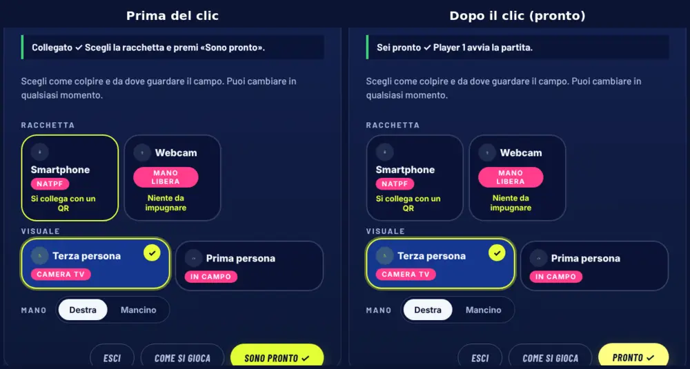
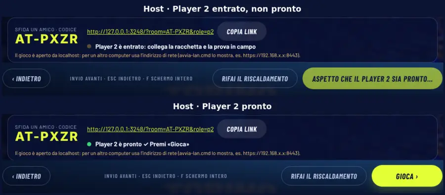
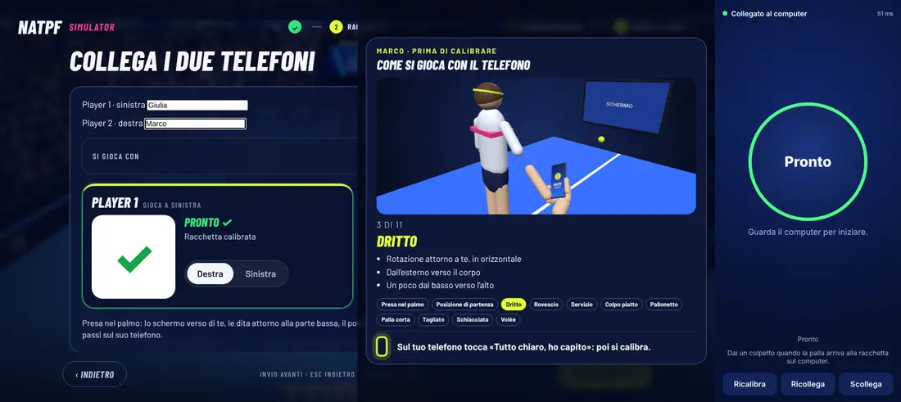
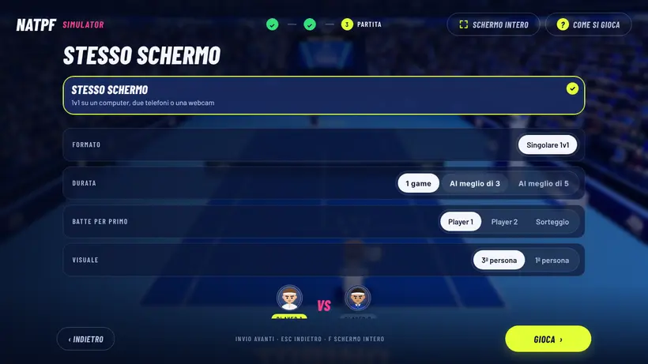
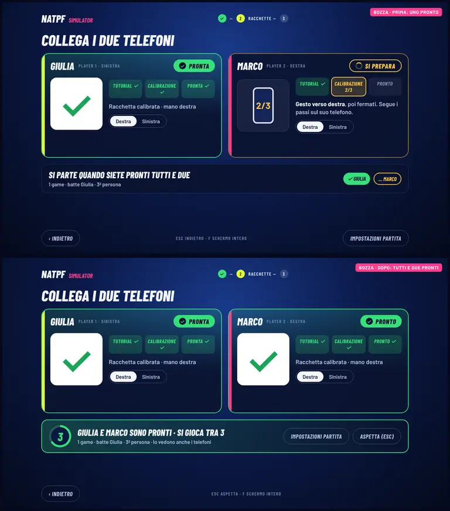
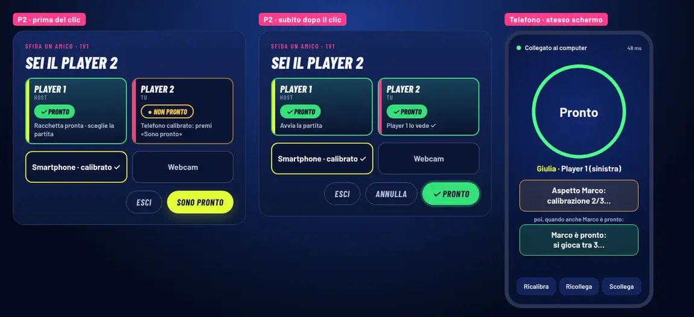

# B9 · Analisi D — «Sono pronto» / «Pronto» nel 1v1

> 05/11/2026, agente Claude, sigla immagini `D-`. Punto 4 della richiesta B9
> (`docs/PIANO_LAVORI.md` §5 B9). Codice letto su `natpf-simulator` a `e7cd44d`/`2a847da` (nessuna modifica al codice).
> Stato: **rapporto completo** (codice, fotogrammi reali, proposta con bozze, cambiamenti di codice, decisioni).

## 0. In breve

- Il pulsante che l'utente descrive esiste **una sola volta nel codice**: è `#natpf-guest-go` nel pannello del Player 2
  di **«Sfida un amico»** (due computer, `natpf_versus_ui.js`). Le sue due scritte sono proprio **«Sono pronto ✓»**
  (prima del clic) e **«Pronto ✓»** (dopo il clic): «Sono pronto» e «Pronto» sono lo **stesso pulsante** in due stati.
  Al clic riceve la classe `selected`, ma **nessuna regola CSS colora `.lobby-primary.selected`**: resta giallo
  (`var(--ball)`) identico. In più la scritta di partenza ha già il segno ✓, e un secondo clic **toglie** il «pronto»
  senza dirlo (`primary()` → `setReady(false)`).
- Nello **stesso schermo** («Collega i due telefoni», `natpf_split_ui.js`) non c'è un pulsante «pronto»: il «Pronto» è
  lo **stato** del telefono (anello verde e scritta «Pronto» sulla pagina del telefono, «Pronto ✓» verde nella metà del
  computer). Lì il problema è diverso: nessun riepilogo «chi è pronto» al momento della partita, e un salto automatico
  a «Partita» dopo 700 ms in cui l'unico pulsante è «Gioca», giallo come tutto il resto.
- Proposta: un **componente unico «stato dei giocatori»**, usato in tutti e due i percorsi: due schede Player 1 /
  Player 2 con nome, icona e colore per *non collegato · si prepara · pronto · problema*.
  - Il pulsante del P2 cambia **davvero** aspetto: giallo «Sono pronto» → verde pieno «Pronto ✓», con «Annulla» a
    parte. Sotto, la conferma che l'host l'ha ricevuto.
  - Nello stesso schermo, quando tutti e due sono pronti, un conto alla rovescia di 3 s sul computer e sui telefoni, e
    poi si gioca.
  - Nella sfida tra due computer, che è sospesa, solo la correzione minima, più lo stato dell'host mandato al P2.

## 1. Schermate con uno stato «pronto» per due giocatori

### 1.1 «Sfida un amico» — Player 2 (secondo computer), `natpf_versus_ui.js`

Pannello `#natpf-guest-modal` (`index.html:669-680`), riempito da `_bindGuest()` (`natpf_versus_ui.js:198-219`).

| Stato interno | Scritta del pulsante `#natpf-guest-go` (`_paintGuest`, r. 341) | Riga di stato `[data-versus-guest]` (`guestText`, `natpf_versus.js:102-112`) | Aspetto |
|---|---|---|---|
| racchetta telefono non pronta | «Collega il telefono ›» | «Collegato ✓ Collega il telefono: lo calibri in campo…» | giallo |
| webcam da preparare | «Accendi la webcam ›» | «Collegato ✓ Accendi la webcam…» | giallo |
| mouse o telefono già pronto, **non pronto** | **«Sono pronto ✓»** | «Collegato ✓ Scegli la racchetta e premi «Sono pronto».» | giallo |
| **pronto** (`this.ready`) | **«Pronto ✓»** + classe `selected` | «Sei pronto ✓ Player 1 avvia la partita.» | **giallo identico** |
| non collegato / perso / chiuso | (disabilitato se non `lobby`/`connecting`) | testo d'errore, bordo rosso | giallo al 40 % |

- Clic (`primary()`, r. 233-241): se `ready` → `setReady(false)` (si **annulla** senza conferma); con la webcam da
  preparare → pannello webcam; con il telefono non pronto → QR e calibrazione in campo (`startCal`), poi pronto da solo
  (`calDone` → `setReady(true)` e un toast «Racchetta pronta ✓ ora aspetta che l'host avvii la partita»); altrimenti
  `setReady(true)`.
- `setReady()` (r. 221-225) scrive `motionController.versusReady` e ridisegna: il cambio di scritta è immediato, ma
  `go.classList.toggle('selected', this.ready)` (r. 343) **non ha stile**: in `natpf-ui.css:731` `.natpf-sheet
  .lobby-primary` è sempre `background: var(--ball)`; `.selected` è stilizzato solo per `.lobby-tile`, `.seg-btn`,
  `.grip-pill`, `.cal-seg button` (`natpf-ui.css:98, 575, 627`, `natpf.css:227, 635`, `natpf-round.css:83, 129`).
- La riga di stato cambia colore solo nel **bordo sinistro** (giallo `#f5b942` di base, verde per `lobby` e
  `playing`, rosso per gli errori: `natpf.css:1022-1037`): «collegato, non pronto» e «pronto» hanno **lo stesso bordo
  verde** perché lo stato della riga è `lobby` in tutti e due i casi.
- Dell'host il P2 non sa nulla oltre a «in lobby» (lo snapshot di lobby è `{ lobby: true, fmt, gamesToWin }`,
  `game_engine.js:3262`): non vede se l'host ha la racchetta pronta, se è nel riscaldamento o se sta per premere
  «Gioca».

### 1.2 «Sfida un amico» — host (primo computer)

Barra dell'invito `#natpf-invite` (codice, link, riga `[data-versus-state]`) e pulsante `#btn-start-match` nel piede
della lobby, ridisegnati ogni 250 ms da `paintLobby()` (`natpf_versus_ui.js:50-67`).

| `lobbyState` (`natpf_versus.js:22`) | Riga (`hostLobbyStatus`, r. 61-70) | Pallino | «Gioca» (`startLabel`, r. 86-88) |
|---|---|---|---|
| `waiting` | «In attesa di Player 2: mandagli il link…» | giallo pulsante | «In attesa del Player 2…», disabilitato, `.waiting` |
| `joined` | «Player 2 è entrato: collega la racchetta e la prova in campo» | giallo pulsante | «Aspetto che il Player 2 sia pronto…», disabilitato |
| `ready` | «Player 2 è pronto ✓ Premi «Gioca»» | verde fisso | «Gioca ›», attivo |

- Anche qui il pulsante è **giallo** in tutti gli stati: disabilitato è solo più trasparente (`opacity .4`,
  `natpf-ui.css:737`; `.waiting` `opacity .6`, `natpf.css:1018`). L'unico segnale verde è un pallino di 10 px nella
  barra dell'invito, e nell'area «VS» la scritta sotto l'avversario diventa «🟢 Player 2 pronto»
  (`hud_ui.js:660`, emoji in un'etichetta maiuscola).
- L'host **non ha un proprio «pronto»**: è pronto quando preme «Gioca». Il P2 non lo vede.
- La pillola di presenza in campo (`#opponent-presence-pill`, `hud_ui.js:633-641`) dice «Player 2 in campo • pronti al
  servizio!» già quando il P2 è solo **collegato**, non pronto (testo fuorviante, ereditato dal motore base).

### 1.3 Sincronizzazione «Sfida un amico»

- P2 → relay: ogni lettura dello stato (~50 ms, `motion_controls.js:1368`) porta `&ready=1|0` e `&hold=…`; il relay
  (`scripts/match-relay.mjs:180`) salva `p2Ready` e lo rimanda come `p2Ready: p2Online && p2Ready` (r. 199). Con il
  sito senza server lo stesso relay gira nel browser dell'host (`natpf_p2p.js:68`) e il P2 lo interroga via WebRTC.
- Relay → host: `_handleRoomStateUpdate` (`game_engine.js:3343`) mette `roomStatus.p2Ready`; `paintLobby()` lo legge
  ogni 250 ms. Ritardo tipico clic → host ≈ 50–300 ms; un P2 che sparisce per 4 s torna «non pronto» da solo.
- Host → P2: solo `{ lobby: true }` ogni 0,5 s; all'avvio della partita gli snapshot di gioco chiudono il pannello
  (`guestState` → `playing`).
- Avvio: **solo** con «Gioca» dell'host, abilitato da `canStart(state)` (`state === 'ready'`); la cattura in
  `natpf_ui.js:357` blocca anche Invio e mostra un toast se il P2 non è pronto. Nessun conto alla rovescia.

### 1.4 Stesso schermo — «Collega i due telefoni», `natpf_split_ui.js`

Pagina `connect` della lobby con `data-setup="split"` (`index.html:435-472`): nomi, «Due telefoni / Una webcam per
due», due pannelli `.split-player` (QR, stato `#split-status-pN`, mano, «Gioca senza calibrare»).

| Stato del telefono (`splitPlayerStatus`, r. 37-47) | Titolo nella metà | Colore del titolo |
|---|---|---|
| `wait` | «Preparo il QR…» | bianco |
| `qr` | «Inquadra il QR» | bianco |
| `on` | «Tocca «Attiva i sensori»» / passi della calibrazione | bianco |
| `go` | passo della calibrazione «ora» | giallo |
| `ok` (**pronto**) | **«Pronto ✓»** («Racchetta calibrata» / «Senza calibrazione…») | **verde**, e il pannello prende `.ready` (bordo verde) |
| `ko` | errore sensori / collegamento | arancio |

- «Pronto» qui **non si clicca**: lo diventa da solo il telefono quando la calibrazione riesce (`_onCal` → `p.confirm()`)
  o dopo 3 verifiche fallite (`skipCalibration()`), o con «Gioca senza calibrare». Dal 04/11 prima c'è il tutorial
  nella metà: il telefono aspetta «Tutto chiaro, ho capito» (`_tutOpen` / `_tutDone`).
- Il pannello pronto ha un bordo verde, ma il **bordo superiore resta giallo (P1) o rosa (P2)** (`natpf-ui.css:1044-1045`
  dopo la regola `.ready`, r. 1043): il riquadro pronto è verde su tre lati e giallo/rosa sopra.
- Sul telefono: anello verde e scritta grande «Pronto» (`racchetta.js:108`, `#ring.ready`), poi in partita «Al
  servizio» o «Pronto»; sotto, «Ricalibra · Ricollega · Scollega». Il telefono **non sa** se l'altro giocatore è pronto.
- Avvio: `bothReady()` (r. 106-109) → `stepReady('connect', { splitReady })` abilita «Alla partita ›» e `autoAdvance`
  porta **da solo** alla pagina «Partita» dopo 700 ms (`natpf_lobby.js:388-391`); lì serve ancora «Gioca ›» (giallo).
  Nella pagina «Partita» la nota dice «Player 1 a sinistra, Player 2 a destra…» o «Un telefono non è pronto: torna a
  «Racchette».», ma **non** c'è uno stato per giocatore. Se un telefono cade dopo il salto, «Gioca» resta giallo e
  attivo: il controllo arriva solo al clic (`natpf_ui.js:352`, `bothReady()` falso → toast «Servono i due telefoni
  pronti» e ritorno a «Racchette»). Verificato nei fotogrammi (§2.2).

### 1.5 Altre schermate con «pronto»

- `site/js/tennis/main.js:443-451` (sito vecchio `site/tennis/`, non NATPF Simulator): righe «Pronto / Non pronto» con
  colore; fuori dal prodotto su cui si lavora, citato solo per completezza.
- Tessera del telefono (`natpf_tiles.js:29`): «Pronto ✓ / Collegato / Si collega con un QR» (gioco singolo).

## 2. Fotogrammi reali

Chromium 1243 (`/opt/pw-browsers/chromium`, WebGL software), server di sviluppo Vite con il relay della partita e un
server PeerJS locale. Script di prova fuori dal repository, con i fotogrammi grezzi e le note JSON in `out/`:
`/tmp/claude-0/-home-user-foro-italico-world/ba4c6b81-3eda-5b46-9643-f32c32c7e045/scratchpad/b9/D/`
(`split-frames.mjs`, `versus-frames.mjs`, `versus-timing.mjs`, bozze `mock-*.html`). Telefoni simulati con `devicemotion` sintetici e la calibrazione rapida di
`tools/e2e/th.mjs` (`quickCalibrate`). **Non** sono telefoni veri né due computer veri.

### 2.1 «Sfida un amico» (host 1280×720 + Player 2 1280×720, relay del server)

Prima e dopo il clic il pulsante del P2 è giallo (misurato: `rgb(227,255,54)` prima, `rgb(239,255,122)` dopo, cioè il
giallo di `:hover` perché il puntatore è ancora sopra; classe `lobby-primary selected` senza stile). Cambiano solo la
scritta («SONO PRONTO ✓» → «PRONTO ✓») e la riga in alto, con lo stesso bordo verde. A 1280×720 il pannello è più
alto dello schermo e scorre (`max-height` e `overflow: auto`, `natpf-ui.css:764-767`): senza scorrere i pulsanti si
vedono solo a metà.

Sull'host «Gioca» passa da giallo spento (`opacity .6`) con «ASPETTO CHE IL PLAYER 2 SIA PRONTO…» a giallo pieno con
«GIOCA ›»; il segnale «pronto» è il pallino da 10 px che diventa verde. L'etichetta «🟢 Player 2 pronto» sotto il
«VS» esiste ma a 1280×720 è **sotto il piede**, non si vede.

Misure (6 clic alternati, senza disegno 3D): dal clic del P2 al cambio di «Gioca» sull'host **106–274 ms**
(274, 143, 223, 106, 193, 273). Il secondo clic su «Pronto ✓» toglie il pronto: sull'host «Gioca» si disattiva di
nuovo negli stessi tempi (sono i clic dispari della misura), e il P2 non riceve nessun avviso. Partita avviata con «Gioca» dell'host: il pannello del P2 si chiude e
compare «Si gioca!» (toast).

Nota di metodo: con il disegno 3D attivo nelle due pagine (WebGL software, ~1 fotogramma/s) lo stesso passaggio ha
richiesto 24 s e il P2 è risultato «scollegato» per qualche secondo: è il limite dell'ambiente di prova, non del
relay (letture ferme oltre i 4 s del relay → `p2Online` falso).

### 2.2 Stesso schermo («Collega i due telefoni», 1280×720, due telefoni simulati 390×844)

Sequenza registrata: QR (`qr`) → tutti e due «Attiva i sensori» → le due modali del tutorial coprono le metà →
P1 «Tutto chiaro, ho capito» → calibrazione → P1 **«PRONTO ✓»** verde con il segno di spunta al posto del QR e il
bordo verde (ma il bordo superiore resta giallo) → P2 «ho capito» e calibrazione → appena anche il P2 è pronto, dopo
**722 ms** la lobby salta da sola alla pagina «Partita».

Difetti visti (oltre a quelli del codice):
- Con la modale del P2 aperta, il suo stato calcolato è «Tocca «Attiva i sensori»» anche se i sensori sono già attivi
  (il telefono è nello stato `tut`, che `splitPlayerStatus` non conosce): non si vede perché la modale lo copre, ma
  diventa visibile appena la modale si rimpicciolisce (punto 1 di B9).
- I nomi scritti («Giulia», «Marco») sono campi bianchi del browser senza stile e non arrivano alla pagina «Partita»,
  dove restano «PLAYER 1 / PLAYER 2» (e «Batte per primo: Player 1 / Player 2»).
- Sul telefono pronto: anello verde e «Pronto», «Guarda il computer per iniziare.»; nessuna indicazione di **quale**
  giocatore è (P1/P2, nome) né se l'**altro** è pronto.

Nella pagina «Partita» nessuno stato per giocatore: «VS» con i due ritratti (etichette tagliate dal piede a 720 px),
la nota «Player 1 a sinistra…» sotto il piede, «Gioca» giallo. Chiudendo la pagina del telefono del P2 l'immagine
resta **identica** (stesso PNG byte per byte): solo la nota fuori vista diventa «Un telefono non è pronto: torna a
«Racchette».»; «Gioca» resta attivo e, se premuto, rimanda a «Racchette» con un toast.

## 3. Diagnosi: perché «restano gialli entrambi»

1. `#natpf-guest-go` usa `.lobby-primary` (giallo) e lo stato pronto è solo la classe `selected`, che per i pulsanti
   primari non ha regole CSS → stesso giallo prima e dopo.
2. Le scritte dicono la stessa cosa: «Sono pronto ✓» e «Pronto ✓» hanno entrambe il ✓; l'occhio non distingue
   «azione da fare» da «fatto».
3. Il pulsante è un interruttore nascosto: riclicare «Pronto ✓» toglie il pronto senza avviso; chi riclicca per
   «confermare» si ritrova non pronto e l'host vede «Gioca» spegnersi.
4. La riga di stato del P2 ha lo stesso bordo verde per «collegato» e «pronto» (stato `lobby` in tutti e due).
5. Sull'host «Gioca» è giallo anche disabilitato (solo più trasparente) e il verde è un pallino di 10 px.
6. Nessuno dei due computer mostra lo stato dell'**altro** giocatore in forma «Player 1 · Player 2».

## 4. UX proposta

### 4.0 Regole comuni ai due percorsi

1. **Lo stato non è un pulsante.** Lo stato di ciascun giocatore sta in una **scheda giocatore** (nome, racchetta,
   distintivo di stato); il pulsante resta solo un'azione. Oggi il pulsante giallo fa da azione e da stato insieme.
2. **Quattro stati, sempre con colore, icona e parola** (leggibili anche da chi non distingue i colori e da lontano su
   un ledwall):

   | Stato | Distintivo | Colore (token di `natpf-ui.css`) | Icona |
   |---|---|---|---|
   | Non collegato | «IN ATTESA» | grigio `--text-3`, bordo tratteggiato | cerchio vuoto |
   | Si prepara | «SI PREPARA» + dettaglio («Tutorial 4/11», «Calibrazione 2/3», «Sceglie la racchetta») | ambra `--warn` | anello che gira |
   | Pronto | «PRONTO» | **verde pieno** `--ok`, testo scuro `--ink-900`, bordo verde su tutti i lati | ✓ nel cerchio |
   | Problema | «TELEFONO SCOLLEGATO», «SENSORI NEGATI»… | rosso `--bad` | ! |

3. Il **colore del giocatore** (P1 giallo `--ball`, P2 rosa `--pink`) serve solo a dire *chi* è (striscia laterale e
   nome), mai lo stato: oggi il bordo superiore giallo del P1 si confonde con il giallo «da fare».
4. **Nomi**: quelli scritti nello stesso schermo (oggi non arrivano oltre la pagina «Racchette»), altrimenti «Player 1 /
   Player 2»; sul proprio computer «(tu)».
5. **Feedback immediato**: cambio di scheda in 200 ms con un piccolo «pop», annuncio `aria-live` («Marco è pronto»).
   Nella sfida tra due computer anche la **conferma di ricezione** (il relay rimanda `p2Ready`: «Player 1 lo vede ✓»).
6. **Annulla separato**: finché la partita non parte si può tornare «non pronto» solo con un pulsante «Annulla» a sé,
   mai ricliccando lo stesso pulsante.
7. **Avvio coerente**: quando tutti e due sono pronti parte un **conto alla rovescia di 3 s**, visibile sul computer e
   sui telefoni, annullabile («Aspetta», Esc). Si ferma da solo se uno dei due torna non pronto (telefono scollegato,
   tutorial riaperto).

### 4.1 Stesso schermo (priorità: è il percorso degli eventi)

- **Pagina «Racchette»**: i due pannelli attuali diventano le schede giocatore. In alto il nome (campo con lo stile del
  gioco, non il campo bianco del browser) e il distintivo. Sotto, il QR finché il telefono non è collegato, poi tre
  tappe piccole: **Tutorial → Calibrazione → Pronto**, con la tappa in corso evidenziata (lo stato `tut` dell'analisi C:
  «Tutorial 4/11»). Da pronti: il segno di spunta grande (c'è già) e il bordo verde su **tutti** i lati.
- **Barra dell'avvio** sotto le due schede, sempre in vista (oggi la nota è sotto il piede):
  - meno di due pronti: «Si parte quando siete pronti tutti e due» e i due nomi con il loro stato;
  - tutti e due pronti: «Giulia e Marco sono pronti · Si gioca tra 3», con le impostazioni in una riga («1 game ·
    batte Giulia · 3ª persona») e i pulsanti «Impostazioni partita» e «Aspetta».
- **Alla fine del conto si gioca** con le impostazioni mostrate (raccomandato). Agli eventi chi gioca ha in mano il
  telefono e spesso è lontano dal PC: oggi, dopo il salto automatico a «Partita», qualcuno deve comunque premere
  «Gioca» con mouse o tastiera. «Impostazioni partita» ferma il conto e apre la pagina «Partita».
  *Alternativa più conservativa*: il conto porta a «Partita» come oggi (al posto del salto muto dopo 700 ms), dove
  resta «Gioca».
- **Pagina «Partita»** (se ci si arriva): al posto del «VS» con le sole etichette «Player 1 / Player 2», le due schede
  compatte con nome e stato, aggiornate dal vivo. «Gioca» grigio neutro e disattivato con il motivo («Il telefono di
  Marco non è pronto») se uno non è pronto, invece di un giallo attivo che poi rimanda indietro.
- **Telefoni**: la schermata «Pronto» (S5 dell'analisi C) dice anche **chi sei** e **cosa fa l'altro**:
  «Pronto · Giulia · Player 1 (sinistra)», poi «Aspetto Marco: calibrazione…» → «Marco è pronto: si gioca tra 3…» →
  in partita il testo di sempre.
- **Webcam per due**: stesse schede; «Webcam spenta» (grigio) → «Alza la mano» (ambra) → «Mano vista ✓» (verde, cioè
  pronto). Le funzioni ci sono già (`splitCamStatus`): cambia solo il disegno.

### 4.2 «Sfida un amico» tra due computer (sospesa: correzione minima)

Il 04/11 l'utente ha detto che agli eventi non serve; il piano la tiene «sospesa: non si toglie e non si sviluppa
oltre». Il pulsante descritto dall'utente, però, è proprio questo, ed è un difetto visibile: va corretto in piccolo,
con lo stesso componente.

- **Pannello del Player 2**:
  - in alto le due schede compatte «Player 1 · host» e «Player 2 · tu»;
  - il pulsante dice «Sono pronto» (senza ✓) in giallo;
  - al clic diventa subito **verde pieno «Pronto ✓»** (`aria-pressed="true"`, non più cliccabile come interruttore)
    e compare **«Annulla»** accanto;
  - sotto la propria scheda: «invio…» finché il relay non rimanda `p2Ready`, poi «Player 1 lo vede ✓»; dopo 3 s
    senza conferma, «Non arriva all'host: controlla il collegamento» e la scheda torna ambra;
  - «Collega il telefono ›» e «Accendi la webcam ›» restano: sono azioni, e la scheda dice «Si prepara · calibrazione».
- **Pronto che decade da solo**: se in lobby il telefono del P2 si scollega o la webcam si spegne, il P2 torna non
  pronto con il motivo, e l'host lo vede. Oggi resta «pronto» e la partita parte per fermarsi subito con la pausa.
- **Host**: nella barra dell'invito le stesse due schede. «Player 1 (tu)» è pronto con la racchetta pronta e la
  pagina «Partita» aperta. «Player 2» passa da «In attesa» a «Si prepara» a «Pronto». «Gioca»: disattivato in **grigio
  neutro** con «Aspetto Player 2…», attivo in giallo con «Gioca ›». Lo stato dell'host arriva al P2 nello snapshot di
  lobby (oggi solo `{ lobby: true }`).
- Facoltativo: il conto alla rovescia di 3 s anche qui, su tutti e due i computer, dopo «Gioca».
- Testi da correggere:
  - la pillola «Player 2 in campo • pronti al servizio!», che compare quando il P2 è solo collegato;
  - «🟢 Player 2 pronto», l'emoji nell'etichetta sotto il «VS».
- Il pannello del P2 a 1280×720 scorre e i pulsanti si vedono a metà: piede dei pulsanti fisso in basso (`sticky`),
  sempre in vista.

## 5. Cambiamenti di codice precisi

Ordine consigliato: 5.1 → 5.2 → 5.3 (5.3 si può rimandare se si decide di non toccare la sfida sospesa).

### 5.1 Componente comune

- **Nuovo `natpf-tennis/src/natpf/natpf_ready.js`** (funzioni pure più un disegno idempotente):
  - `slotView({ id, name, you, state, detail })`:
    - `state` è uno di `'off' | 'prep' | 'ready' | 'ko'`;
    - restituisce `{ cls, badge, icon, detail, aria }`.
  - `splitSlot(p, { tut, cam })`: dallo stato del telefono (`splitPlayerStatus`) e del tutorial allo stato della
    scheda. `wait`/`qr` → `off`; `on`/`go` → `prep`; `ok` → `ready`; `ko` → `ko`; tutorial aperto →
    `prep` con «Tutorial i/n».
  - `startGate(slots)` → `{ both, waitingFor: [nomi] }`.
  - `createCountdown({ ms: 3000 })` → `update(both, now)`:
    - restituisce `{ left, fire }`;
    - si azzera se `both` diventa falso;
    - `fire` vale vero una sola volta.
  - `paintSlots(el, slots)`: cambia testi e classi solo se diversi, come fa oggi `paintLobby`, così le animazioni
    non ripartono a ogni giro.
- **CSS in `natpf-tennis/natpf-ui.css`** (`cqw/cqh`, `@container natpf`, niente `vw/vh/@media`):
  - `.ready-board`, `.ready-slot`, `.ready-badge`;
  - `.ready-slot.is-ready`: bordo `var(--ok)` su tutti i lati, fondo verde al 14 %, distintivo verde pieno con testo
    `--ink-900`;
  - `.is-prep`: distintivo ambra con l'anello che gira;
  - `.is-off`: bordo grigio tratteggiato;
  - `.is-ko`: rosso;
  - `.ready-slot[data-p="p1"|"p2"]`: striscia laterale `--ball`/`--pink`;
  - `@keyframes ready-pop` (220 ms).
  - Pulsanti: `.lobby-primary.is-ready { background: var(--ok); }`; `.lobby-primary:disabled.is-wait`, grigio neutro
    al posto del giallo spento.
  - **Correzione** di `natpf-ui.css:1043-1045`: `.split-player.ready` va **dopo** le regole del bordo superiore (o con
    `border-top-color: var(--ok)`). Oggi il bordo superiore resta giallo o rosa.
- **Test** `natpf-tennis/test/natpf-ready.test.mjs`:
  - corrispondenza degli stati, compreso `tut`;
  - `startGate`;
  - conto alla rovescia: parte a 3 s, `fire` una sola volta, annullato quando uno torna non pronto, ripartito da capo.

### 5.2 Stesso schermo

- `natpf-tennis/src/natpf/natpf_split_ui.js`:
  - `splitPlayerStatus(p, hand, { tut })` (r. 37-47): caso nuovo per il tutorial aperto o il telefono in `tut`
    («Guarda il tutorial · 4/11», «Poi sul telefono «Tutto chiaro, ho capito»»). Oggi esce «Tocca «Attiva i
    sensori»» con i sensori già attivi.
  - `paint()` (r. 189-218):
    - il nome in `.split-head b` da `engine.natpfSplitNames` (oggi resta «Player 1»);
    - classi e distintivo della scheda con `slotView`;
    - disegno della barra dell'avvio `#split-ready-bar`.
  - `tick()` (r. 239, ogni 100 ms), con la lobby in `connect` o `match` e la modalità `split`:
    - `both = bothReady() && !tutOpen.p1 && !tutOpen.p2`, la stessa regola dell'analisi C;
    - quando scatta `fire`, `$('btn-start-match').click()`: passa da `_bindStart`, che ricontrolla `bothReady`, poi
      `split.start()` e la fascia di passaggio;
    - annullato da Esc, «Aspetta» e «Impostazioni partita» (questo con `lobby.go('match')`).
  - Messaggio ai telefoni `{ t: 'duo', me, name, other: { name, st }, go }`, mandato solo quando cambia, con un metodo
    nuovo `NatpfPhoneRacket.sendDuo(info)` in `natpf_phone_racket.js` (dedup come `lastPhase`).
- `natpf-tennis/src/natpf/natpf_lobby.js`:
  - `autoAdvance` (r. 69): `false` per `split`. Il salto muto dopo 700 ms (r. 388-391) lo sostituisce il conto alla
    rovescia;
  - nota `lobby-match-note` (r. 385): sostituita dalle schede compatte;
  - `paint()` (r. 379): `split.paint()` anche nella pagina `match`, così lo stato è sempre vivo.
- `natpf-tennis/index.html:435-472`:
  - `` in `.split-head`;
  - `
` dopo i due pannelli;
  - campi del nome con classe e senza gli `style=""` in linea (r. 436);
  - nella pagina `match`, un `
` al posto di `.lobby-versus` in
    modalità split.
- Telefono (in accordo con l'analisi C, schermata S5):
  - `site/js/tennis/racchetta.js`, `onData`: `case 'duo'`; in `paint()`, con `sensor === 'ready'`, la riga `#duo`
    («Giulia · Player 1 (sinistra)», «Aspetto Marco: calibrazione…», «Marco è pronto: si gioca tra 3…»);
  - `site/tennis/racchetta.html`: `
` sotto `#sub`.
  - Le pagine di prima ignorano `duo` (lo `switch` non ha `default`), quindi le versioni sono compatibili nei due versi.
- Test:
  - `natpf-split.test.mjs`:
    - nomi nelle intestazioni;
    - niente salto automatico;
    - conto alla rovescia → partita;
    - telefono che cade durante il conto → annullato;
    - messaggi `duo` con `me`/`other` giusti;
    - stato `tut` nella scheda;
  - aggiornare `natpf-split.test.mjs:133` (`autoAdvance` split).
  - Prova nel browser nuova, `tools/e2e/natpf-split-ready.mjs`:
    - parte dallo script di questa analisi: due telefoni, tutorial, calibrazioni, conto, partita, telefono chiuso
      durante il conto;
    - schermate a 1280×720, 1920×1080 e in un'area di ledwall.

### 5.3 «Sfida un amico» (correzione minima)

- `natpf-tennis/src/natpf/natpf_versus_ui.js`:
  - `_bindGuest` (r. 198-219):
    - scritta iniziale «Sono pronto»;
    - `<button class="lobby-ghost hidden" data-versus-unready>Annulla</button>` accanto a `#natpf-guest-go`;
    - `
` prima di `.natpf-setup`.
  - `primary()` (r. 235): `if (this.ready) return;` invece di `setReady(false)`. «Annulla» chiama `setReady(false)`
    e mostra il toast «Non sei più pronto».
  - `setReady()`: segna `readyAt` per il controllo della conferma.
  - `_paintGuest` (r. 338-344):
    - scritte `'Pronto ✓' | 'Collega il telefono ›' | 'Accendi la webcam ›' | 'Sono pronto'`;
    - `classList.toggle('is-ready', this.ready)` e `aria-pressed`;
    - «Annulla» visibile se pronto e in `lobby`;
    - conferma `this.ready && !!engine.roomStatus.p2Ready`, con l'avviso dopo 3 s;
    - scheda del P1 da `engine.versusGuest.host`.
  - `_tickGuest`: in `lobby`, se pronto con telefono non pronto o webcam spenta, `setReady(false)` con il motivo.
  - `paintLobby()` (r. 50-67, host):
    - due schede nella barra dell'invito;
    - `btn.classList.toggle('is-wait', !ok)`;
    - metodo `hostInfo()` → `{ ready, detail }`: racchetta pronta, pagina della lobby, riscaldamento.
- `natpf-tennis/src/natpf/natpf_versus.js`:
  - `guestText('lobby')`: «Premi «Sono pronto» quando hai scelto la racchetta.» / «Sei pronto ✓ Aspetti che
    Player 1 avvii la partita.»;
  - `guestLine`: stato `'ready'` quando pronto (bordo e fondo diversi da «collegato»);
  - `startLabel('joined')`: «Aspetto Player 2…» (più corto).
- `natpf-tennis/src/game_engine.js`:
  - r. 3262: snapshot di lobby `{ lobby: true, fmt, gamesToWin, host: this.natpfUi?.versus?.hostInfo?.() }`;
  - r. 3367-3369: `G.host = n.host || null`.
- `natpf-tennis/src/hud_ui.js`:
  - r. 633-641: fuori dalla partita «Player 2 collegato» / «Player 2 pronto» al posto di «pronti al servizio!»;
  - r. 660: niente emoji.
- CSS:
  - `natpf.css:1018`: `#btn-start-match.waiting` → `.is-wait` grigio;
  - `natpf.css:1022-1037`: `.natpf-versus-status[data-state="ready"]` con il fondo verde;
  - `natpf-ui.css`: in `.natpf-guest-dialog` (che scorre già, r. 764-767) `.sheet-actions` con `position: sticky;
    bottom: 0` e il fondo del pannello, così i pulsanti restano in vista.
- Test:
  - `natpf-versus.test.mjs`:
    - scritte senza ✓;
    - un secondo clic non toglie il pronto, «Annulla» sì;
    - classe `is-ready`;
    - conferma dal relay;
    - `guestLine` `ready`;
    - snapshot di lobby con `host`;
  - aggiornare `natpf-versus-webcam.test.mjs:52-54`, che oggi prova proprio il secondo clic che toglie il pronto;
  - `tools/e2e/natpf-1v1-p2p.mjs`, passo 4: colore calcolato verde del pulsante del P2, «Annulla» → «Gioca» di nuovo
    disattivato sull'host.

### 5.4 Stima

| Parte | Tempo |
|---|---|
| componente e CSS | ½ giornata |
| stesso schermo | 1 giornata |
| telefono `duo` | ½ giornata |
| sfida minima | ½ giornata |
| prove (unità ed e2e) | 1 giornata |

Dipende dall'analisi C, che fissa lo stato `tut` e la schermata S5: va fatta prima, o nello stesso ramo.

## 6. Punti da decidere con l'utente

1. **Quale schermata intendeva.** Le parole «Sono pronto» e «Pronto» corrispondono esattamente al pulsante del
   Player 2 di «Sfida un amico», cioè due computer, un percorso sospeso. Nello stesso schermo «Pronto» non è un pulsante
   ma lo stato del telefono. Va chiesta conferma, mostrando le due immagini del §2.
2. **Stesso schermo:** alla fine del conto alla rovescia si gioca subito (consigliato), o si passa ancora da «Partita»
   e «Gioca»?
3. **Conto alla rovescia:** 3 s (consigliato) o 5 s per il ledwall.
4. **«Sfida un amico»:** solo la correzione minima del §5.3 (consigliata), o anche lo stato dell'host e il conto
   alla rovescia tra due computer.

## 7. Cosa non è stato verificato

- Nessun telefono vero e nessun secondo computer vero: telefoni simulati con `devicemotion` sintetici e due sessioni
  di Chromium sulla stessa macchina.
- Ritardo del «pronto» misurato solo in locale, sul relay del server di sviluppo (106–274 ms). Non misurato nella
  sfida senza server, via WebRTC, né su reti vere.
- Le immagini della proposta sono **bozze statiche**, scritte in HTML e fotografate con Chromium. Non sono il gioco
  modificato e non è stato cambiato nessun file del gioco.
