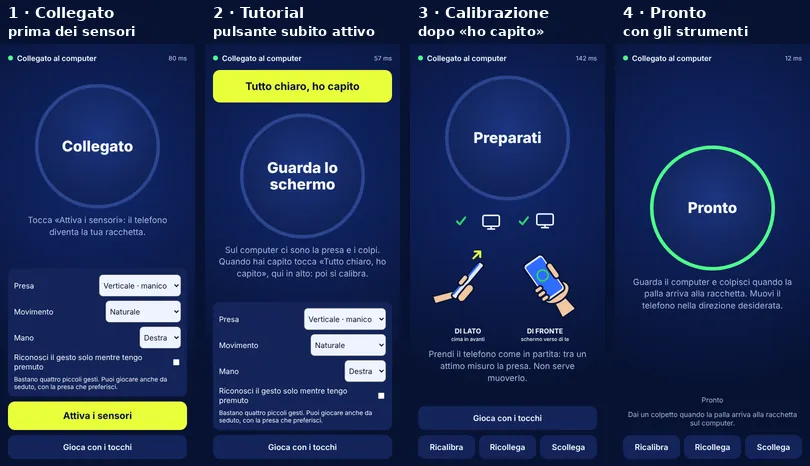
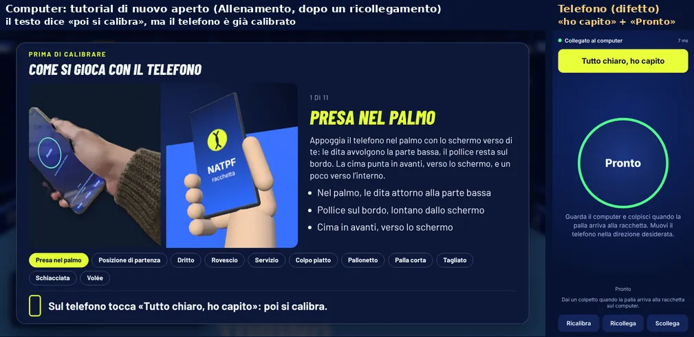
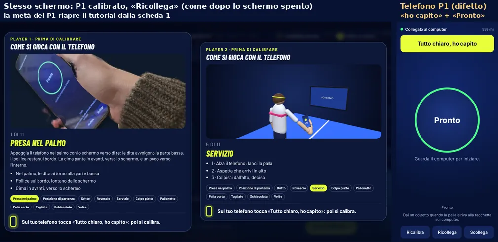
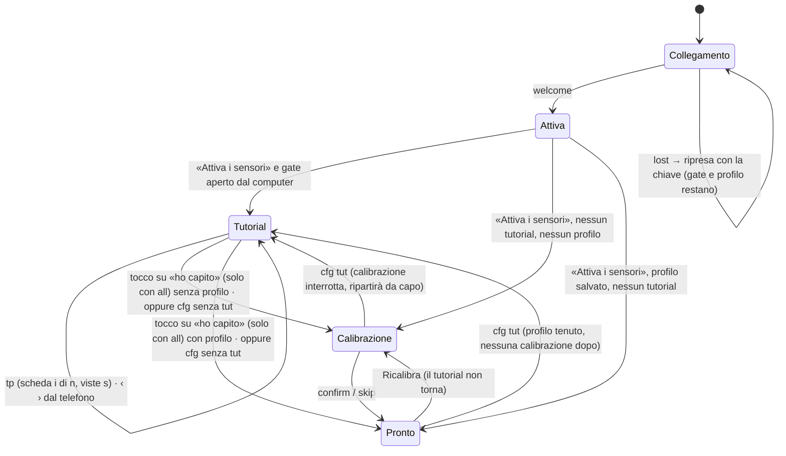
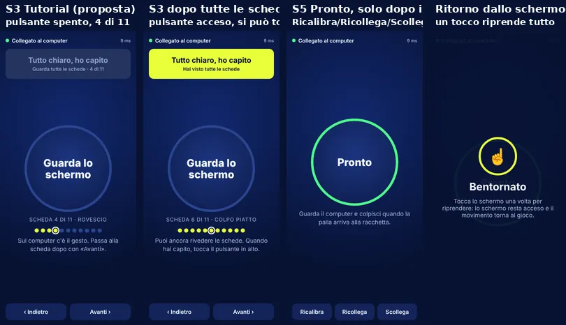
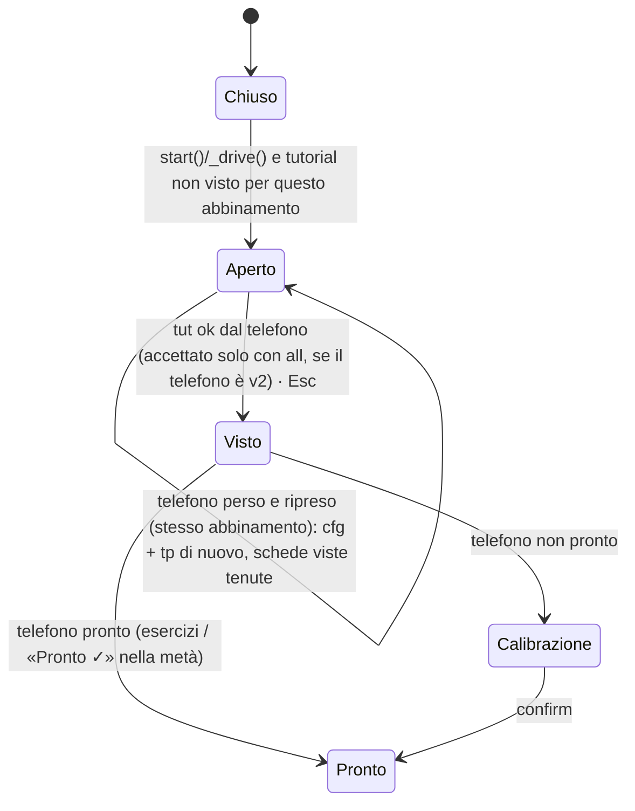

# B9 · Analisi C — pagina del telefono: «Tutto chiaro, ho capito» → «Pronto» e schermo spento

Stato: **rapporto completo** per (a) e (b) (05/11/2026, agente Claude, sigla C); mancano solo le prove su telefoni veri,
che qui non si possono fare. HEAD analizzato: `2a847da` (branch `natpf-simulator`); nessun file del gioco modificato.
Immagini: `docs/b9/img/C-*.webp`. Fotogrammi grezzi e script di prova (non nel repository):
`/tmp/claude-0/-home-user-foro-italico-world/ba4c6b81-3eda-5b46-9643-f32c32c7e045/scratchpad/b9/C/` (`shots.mjs`,
`split.mjs`, `raw/`).

## In breve

**(a) «Tutto chiaro» sopra «Pronto».** Riprodotto nel browser (Chromium «mobile» 390×844, telefono simulato), sia in
Allenamento sia nello stesso schermo. Succede quando il tutorial si apre con il telefono **già calibrato**. Il telefono
non cambia schermata (resta «Pronto», l'anello verde e Ricalibra/Ricollega/Scollega) e accende comunque il pulsante
in alto (`racchetta.js:98` e `:215`). Il caso più frequente è anche il più subdolo: **ogni ricollegamento** fa ripartire
il tutorial (`joins` cresce anche con la chiave di ripresa), compreso quello automatico dopo lo **schermo spento**. Il
telefono, poi, non sa nulla delle schede, quindi il pulsante è attivo subito.
Correzione proposta:
- sul telefono, **una sola schermata alla volta**, calcolata da una funzione pura;
- l'avanzamento del tutorial mandato dal computer al telefono (messaggio nuovo `tp`, versione 2 dichiarata in `cfg`),
  con il pulsante spento finché non si sono viste tutte le schede, e frecce ‹ › anche sul telefono;
- tutorial ripetuto solo con un **abbinamento nuovo** (QR), non a ogni ricollegamento;
- compatibilità in tutti e due i versi tra pagine vecchie e nuove.

**(b) Schermo spento.** Va detto chiaramente: **dal browser non si può**. Le specifiche W3C e il codice di Chromium e di
WebKit fermano accelerometro e giroscopio appena la pagina non è visibile. Schermo spento vuol dire pagina nascosta, e
nessun trucco cambia questo: video, audio, Picture-in-Picture, PWA o schermo intero. Si può invece:
1. evitare lo spegnimento automatico (Wake Lock, già fatto: da completare su iPhone, dove serve un tocco);
2. fermare subito la partita e rigiocare il punto (già fatto);
3. riprendere in 1–3 s alla riaccensione, senza rifare tutorial né calibrazione. Oggi il tutorial si riapre: è il
   difetto (a);
4. preparare i telefoni dello staff in modo che un tocco accidentale del tasto di accensione si recuperi con una sola
   pressione: niente PIN, spegnimento lungo, risparmio energetico spento.

L'unica alternativa che terrebbe davvero vivo il controller a schermo spento è un'**app Android nativa** con un servizio
in primo piano, un wake lock parziale, i sensori e la rete nel servizio. Su iPhone non esiste un equivalente
praticabile. Va decisa solo se le diagnostiche degli eventi mostrano spegnimenti nonostante le misure 1–4.

---

## (a) Flusso «Tutto chiaro, ho capito» → «Pronto»

### a.1 Cosa si vede oggi (verificato nel browser)

Percorso giusto (telefono non ancora calibrato):
1. «Collegato» con «Attiva i sensori»;
2. dopo «Attiva i sensori», «Guarda lo schermo» con «Tutto chiaro, ho capito» in alto, **attivo subito**;
3. al tocco parte la calibrazione («Preparati» 1,5 s, poi «Tieni fermo» e i gesti);
4. «Pronto» con Ricalibra/Ricollega/Scollega.

Nella fase 2 si vedono anche cose che lì non servono: le opzioni (Movimento, Mano, «Riconosci il gesto solo mentre
tengo premuto»), «Gioca con i tocchi» e perfino la riga **«Presa: Verticale · manico»**, che dovrebbe essere nascosta.
`racchetta.html:91` ha `<label hidden>`, ma la regola `#profileOptions label{display:flex}` (`:34`) vince
sull'attributo `hidden`: è un difetto a sé, anche fuori dal tutorial.

**Difetto riprodotto — Allenamento** (`shots.mjs`): prima Allenamento, calibrazione e «Pronto»; poi «Ricollega» sul
telefono (stesso effetto del ricollegamento automatico dopo lo schermo spento), menu e di nuovo Allenamento. Il
computer riapre il tutorial (`joins` passato da 1 a 2); il telefono mostra **«Tutto chiaro, ho capito» + anello verde
«Pronto» + Ricalibra/Ricollega/Scollega** insieme. Sul computer la modale dice «poi si calibra», ma non si calibra:
al tocco il computer passa agli esercizi.

**Difetto riprodotto — stesso schermo** (`split.mjs`): due telefoni, P1 vede il tutorial, tocca «ho capito», calibra
ed è «Pronto»; poi «Ricollega». La metà del P1 riapre il tutorial dalla scheda 1 (`tutSeen.p1` torna `false`) e il
telefono del P1 mostra di nuovo «ho capito» sopra «Pronto».

### a.2 Perché (cause nel codice)

| # | Dove | Cosa |
|---|---|---|
| C1 | `site/js/tennis/racchetta.js:98` | `show('#tutOk', … tutWait && (sensor === 'tut' \|\| sensor === 'ready'))`: con il telefono pronto il pulsante si accende **insieme** a «Pronto» (`:108`) e agli strumenti (`:97`, `sensor === 'ready'`). Non c'è una schermata unica: ogni elemento ha la sua condizione e le condizioni si sovrappongono. |
| C2 | `racchetta.js:212-218` (`cfg`) | All'arrivo di `cfg { tut: 1 }` solo `cal → tut`; un telefono `ready` resta `ready`. Anche `enableSensors()` (`:314`) mette `ready` se c'è un profilo salvato in `sessionStorage` (pagina ricaricata), prima di guardare `tutWait`. |
| C3 | protocollo | Il computer manda solo «aspetta sì/no» (`cfg.tut`, `natpf_phone_racket.js:472`). Il telefono non sa quale scheda è mostrata né quante ne sono state viste: il pulsante non può essere spento fino alla fine. |
| C4 | `natpf_training.js:204-206`, `natpf_split_ui.js:137-140`, `site/js/tennis/link.js:210` | Il tutorial «una volta per sessione e per giocatore» si azzera a ogni cambio di `L.joins`, che cresce a **ogni** `hello` accettato (`link.js`, `accept`), anche con la chiave di ripresa (`r`) e con «Ricollega» (`rl: 1`). Quindi dopo lo schermo spento il tutorial ricompare alla stessa persona, dalla scheda 1. |
| C5 | `natpf_tutorial.js:70`, `natpf_split_ui.js:172` | Testo fisso «poi si calibra» anche quando il telefono è già calibrato e si va agli esercizi o a «Pronto ✓». |
| C6 | `natpf_phone_racket.js:258` | Durante il tutorial dell'Allenamento il motore è in `POINT_OVER` e il telefono riceve la fase `play`: un telefono nello stato del difetto (`ready`) **manda colpi mentre si guarda il tutorial** (`racchetta.js:415-429`). Effetto sul motore non verificato. |
| C7 | `racchetta.js:472` | «Pronto» scritto due volte in «Pronto» (anello e `#phaseFeedback`, la fase del rilevatore). Minore. |

Nota sul doppio avvio della calibrazione dopo «ho capito». Il telefono la avvia da solo (`tutDone`, `:389`) e il
computer, in `_begin` (`natpf_training.js:267`), manda `cmd: 'cal'` se il suo `cal.step` è vuoto. Nella prova non è
successo («Preparati» 1,5 s una volta sola, poi «Tieni fermo»), perché il computer aveva già il passo `still` dagli
eventi di prima. Con un ordine diverso dei messaggi può ripartire: nella macchina nuova la calibrazione dopo il
tutorial la avvia **solo il telefono**.

### a.3 Stati e messaggi che esistono oggi

**Telefono** (`racchetta.js`): `linkState` (off, connecting, on, lost, denied) × `sensor` (off, denied, nomotion,
insecure, tut, cal, ready) × `cal.state.step` (idle, still, grip, swings, shots, review, free, done) × `inputMode`
(motion, touch) × `tutWait` × `phase` (menu, serve, toss, play, pause, over).

| Verso | Messaggi |
|---|---|
| telefono → computer | `hello {v:2, k \| r, rl?}`, `ping`, `dq`, `st {s, b, rtt, gp, hz, vis, wk, pm, in, sa}` (ogni secondo e a ogni cambio), `cal {e}`, `tut {w:1}` (so aspettare) / `tut {ok:1}` (toccato), `sw`, `fo`, `pr`, `sm`, `rs`, `gx`, `mk`, `dev {…, vr}`, `hand`, `toss` |
| computer → telefono | `welcome {r, f}`, `deny`, `pong`, `dp`, `grip`, `cfg {prep, mo, hand, diag?, tut?}`, `ex`, `practice`, `ph`, `cmd {cal, retry, relink, invert, skipGrip, free, skip, confirm}`, `ev`, `bye` |

**Computer**: `NatpfPhoneRacket.tutWait` / `tutSupported` (`natpf_phone_racket.js:353-355, 471-479`). Il tutorial è
aperto da `NatpfTraining._openTutorial` (Allenamento, riscaldamento, sfide con telefono da calibrare) o da
`NatpfSplitUi._tutOpen(id)` (stesso schermo, appena il telefono di quel giocatore è collegato). Si chiude con
`tut ok` dal telefono, con Esc (chi gestisce la postazione), uscendo dalla pagina, oppure da solo se il telefono ha la
pagina di prima e manda un passo della calibrazione (`tutSupported` falso).

### a.4 Macchina a stati corretta del telefono

Due variabili indipendenti, più **una funzione pura** che ne ricava **una sola schermata**. Oggi ogni elemento della
pagina ha una condizione propria, e le condizioni si sovrappongono.
- **`sensor`**: cosa sa fare il telefono. Valori: `off` | `error` (denied, nomotion, insecure) | `cal` | `ready`, più
  `idle` = sensori attivi ma calibrazione non ancora partita.
- **`gate`**: il cancello del tutorial, deciso dal computer. `null` (nessun tutorial), oppure
  `{ v, i, n, seen, all }`: versione del protocollo, scheda mostrata, schede totali, schede viste, tutte viste.

Schermate (mutuamente esclusive; la prima condizione vera vince):

| Schermata | Quando | Cosa si vede | Cosa **non** si vede |
|---|---|---|---|
| S0 Collegamento | `linkState ≠ on` | barra, messaggio, «Riprova» se perso | tutto il resto |
| S1 Errore sensori | `sensor = error` | motivo, «Gioca con i tocchi» | strumenti, tutorial |
| S2 Attiva | `sensor = off` | «Attiva i sensori», «Gioca con i tocchi», Mano, Movimento | strumenti, tutorial |
| **S3 Tutorial** | `gate ≠ null` (e sensori attivi) | «Guarda lo schermo» + nome della scheda + «Scheda 4 di 11» + pallini; ‹ Indietro / Avanti ›; in alto «Tutto chiaro, ho capito» **spento** («Guarda tutte le schede · 4/11») finché `all` è falso | anello verde, «Pronto», Ricalibra/Ricollega/Scollega, opzioni, «Gioca con i tocchi», avvisi dello schermo |
| S4 Calibrazione | `sensor = cal` | passo della calibrazione (come oggi) | «ho capito», «Pronto»; strumenti: vedi nota |
| **S5 Pronto** | `sensor = ready` e `gate = null` | «Pronto» / «Al servizio» + Ricalibra, Ricollega, Scollega + avvisi | «ho capito» |

Bozza grafica fatta con lo stesso CSS della pagina, solo per decidere: non è codice del gioco.

Nota su S4. L'utente ha chiesto Ricalibra/Ricollega/Scollega «sotto Pronto». Oggi si vedono anche durante la
calibrazione: la proposta è di toglierli da S4, perché la calibrazione bloccata si gestisce dal computer («Salta»,
ripetizione automatica) e «Ricollega» resta anche sul computer. È una decisione da confermare.

Regole che risolvono i casi chiesti:
- **Pulsante spento fino alla fine**: si accende solo con `gate.all` vero, cioè quando il computer ha mostrato ogni
  scheda almeno una volta. Il computer è la fonte di verità: il telefono non conta da solo.
- **Tornare indietro**: `all` non torna mai falso nella stessa apertura del tutorial. Dopo aver visto tutto si può
  rivedere una scheda e toccare «ho capito» da lì. Prima di aver visto tutto, indietro e avanti non accendono niente.
  Il contatore mostra le schede viste, non la posizione.
- **Ricalibra**: da S5 a S4 e poi a S5; il tutorial non torna. Si rivede con «Rivedi i gesti» sul computer (modalità
  `review`, non tocca il telefono) o con un abbinamento nuovo.
- **Telefono già calibrato**: con `cfg tut` va in S3 (il profilo resta in memoria); dopo il tocco va **direttamente**
  in S5, senza calibrare. Il computer dice «poi giochi», non «poi si calibra» (C5).
- **Ricollegamento a tutorial aperto**: il telefono tiene `gate` (anche in `sessionStorage`, per una pagina
  ricaricata). Dopo `welcome` il computer rimanda subito `cfg` e `tp` con le schede già viste: niente lampo di
  «Pronto» né ripartenza dalla scheda 1.
- **Nessun colpo durante il tutorial**: in S3 il rilevatore scarta i colpi (motivo `tutorial` nella diagnostica, C6).
- **«Gioca con i tocchi»** si sceglie prima (S1/S2); in S3 non c'è.

### a.5 Macchina a stati del computer (per giocatore)

- Lo stato per giocatore vive nel computer: `{ open, idx, visited: Set, all, pairKey }`. `all` è
  `visited.size === n`; una scheda conta come vista se è rimasta a schermo almeno ~1 s, così chi tocca ‹ › di fila non
  la salta. La soglia è da tarare con la modale nuova.
- **Quando si rivede il tutorial**: solo con un **abbinamento nuovo** (hello con il token del QR, `k`), non con la
  ripresa (`r`) né con «Ricollega» (`rl`). In `link.js` serve un campo `paired` (o `resumed: !!d.r`) accanto a
  `joins`; training e stesso schermo confrontano quello invece di `joins` (C4). Una pagina ricaricata (ripresa con `r`)
  è quasi sempre la stessa persona: niente tutorial di nuovo.
- **Stesso schermo**:
  - `bothReady()` richiede anche `!tutOpen[id]`;
  - l'etichetta della metà dice «Sta guardando il tutorial · 4/11», poi «Calibrazione», poi «Pronto ✓».

  Il «pronto» del 1v1 è il tema dell'analisi D: qui basta che lo stato del tutorial sia leggibile.
- **Allenamento con il telefono già pronto**: la guardia di pausa (`natpf_ui._phoneWatchTick`, `inField` in
  `POINT_OVER`) resta com'è. Il telefono in S3 continua a dichiarare `s: 'ready'` (vedi a.6), quindi non scatta la
  pausa «non pronto» sopra il tutorial.

### a.6 Messaggi nuovi e compatibilità

| Messaggio | Verso | Contenuto | Note |
|---|---|---|---|
| `cfg` | computer → telefono | `tut: 1, tv: 2` | `tv` nuovo: «manderò l'avanzamento, tieni il pulsante spento finché `all`» |
| `tp` (nuovo) | computer → telefono | `{ i, n, s, all, name? }` | a ogni cambio di scheda, all'apertura e dopo ogni `welcome` |
| `tut` | telefono → computer | `{ w: 1, v: 2 }` · `{ ok: 1 }` · `{ nav: 1 \| -1 }` (nuovo) | `v: 2` = il telefono sa tenere il pulsante spento; `nav` = frecce sul telefono |
| `st` | telefono → computer | `s` come oggi (`ready` resta `ready`), più `tu: 1` quando la schermata è S3 | i computer di prima leggono `s` come sempre |

Compatibilità:

| Computer | Telefono | Risultato |
|---|---|---|
| nuovo (`tv: 2`) | nuovo (`v: 2`) | pulsante spento fino a `all`, schermate esclusive; il computer ignora un `ok` prima di `all` e rimanda `tp` |
| nuovo | di prima (scheda del telefono aperta prima dell'aggiornamento) | come oggi: pulsante subito attivo; il computer accetta l'`ok` (non può fare altro). Con `dev.vr` diverso dalla versione del gioco il computer può dire «Ricarica la pagina del telefono» |
| di prima (solo `tut: 1`) | nuovo | il telefono accende il pulsante subito (nessun `tp` in arrivo), ma **mai** sopra «Pronto»: le schermate restano esclusive |
| qualsiasi | pagina senza tutorial (cfg senza `tut`) | nessun cambiamento |

Nella versione LAN e nel programma Windows la pagina del telefono la serve lo stesso computer: le versioni miste
capitano solo con una scheda del telefono rimasta aperta durante un aggiornamento, o con una pagina in cache sulla
versione Cloudflare.

### a.7 Come implementarlo (passi piccoli, ognuno con test)

1. `site/js/tennis/phone-screen.js` (nuovo, puro): `phoneScreen({ linkState, sensor, gate, inputMode, calStep })` →
   `{ screen, show: { tutOk, tutOkEnabled, tools, profileOptions, enableTouch, … } }`. `paint()` di `racchetta.js` usa
   solo questo. Test `tools/test/phone-screen.test.mjs`, su tutte le combinazioni: esattamente una schermata;
   «ho capito» solo in S3; strumenti solo in S5; niente anello `ready` in S3.
2. Gate sul telefono: `cfg` / `tp` / tocco / ripresa, con `sessionStorage`. Lo stato `ready` più `gate` va in S3 senza
   perdere il profilo; il tocco porta in S5 o in calibrazione. Correzione del `label hidden` in CSS:
   `[hidden]{display:none!important}`.
3. Computer: `NatpfTutorial` tiene `visited`/`all` e chiama un `onProgress`; `NatpfPhoneRacket.tutorialProgress()`
   manda `tp` e lo rimanda a ogni `joins`; `tut ok` accettato solo con `all` dai telefoni v2; testo del piede secondo
   lo stato del telefono (C5). Test in `natpf-tutorial.test.mjs`, `natpf-split.test.mjs`, `natpf-phone-racket*`.
4. `link.js`: abbinamento nuovo distinto dalla ripresa; training e stesso schermo usano quello (C4). Test in
   `tools/test/phone-reconnect.test.mjs`.
5. Prove nel browser: `natpf-training-flow.mjs` e una prova nuova per lo stesso schermo:
   - pulsante spento fino all'ultima scheda;
   - indietro dopo aver visto tutto, poi «ho capito»;
   - telefono già calibrato: mai «Pronto» prima del tocco;
   - «Ricollega» a tutorial aperto: si riprende dalla scheda raggiunta;
   - Ricalibra dopo il tutorial: niente tutorial.

   Fotogrammi a 390×844 in ogni stato.

---

## (b) Telefono con lo schermo spento

### b.1 Cosa fanno davvero i browser (fonti ufficiali)

| Aspetto | Chrome Android / Samsung Internet (Chromium) | Safari iOS (e ogni browser su iPhone: tutti WebKit) | Fonte |
|---|---|---|---|
| **DeviceMotion / DeviceOrientation** a pagina nascosta (schermo spento, altra app) | **fermi**: il listener si stacca, gli eventi non arrivano (non vengono conservati); ripartono da soli quando la pagina torna visibile | **fermi**: `suspendDeviceMotionAndOrientationUpdates()` alla pagina nascosta, `resume…` al ritorno | specifica W3C: «If document's visibility state is not "visible", return»; Chromium `PageVisibilityChanged`: `IsPageVisible() ? StartUpdating() : StopUpdating()`; WebKit `Page::setIsVisibleInternal` |
| Sensori «generici» (`Gyroscope`, `Accelerometer`) | stessa regola: solo documento visibile **e** a fuoco | non disponibili | Generic Sensor §4.2.3–4.2.4 |
| **Screen Wake Lock** | dal Chrome 84; rilasciato quando la pagina è nascosta; si può richiedere al ritorno anche senza tocco; il browser può negarlo (batteria scarica, risparmio energetico) | da 16.4; nelle app sulla schermata Home solo da **18.4**; richiede **un tocco** (attivazione transitoria): al ritorno dalla schermata Home la richiesta senza tocco può fallire (`NotAllowedError`) | W3C Screen Wake Lock; MDN; bug WebKit 254545 e 255363 |
| Wake Lock e tasto di accensione | il blocco evita lo spegnimento **automatico**; non impedisce di spegnere lo schermo con il tasto, e dopo lo spegnimento manuale non vale finché lo schermo non si riaccende | idem | W3C Screen Wake Lock §11 |
| Tipo «system» (CPU accesa a schermo spento) | **non esiste**: abbandonato | non esiste | developer.chrome.com, Wake Lock |
| **WebRTC DataChannel** a schermo spento | dal 2016 Chrome Android **non chiude** più le RTCPeerConnection dopo 1 minuto di schermo spento; con un DataChannel aperto la pagina non va nel «throttling intensivo»; ma Chrome Android **congela le schede in background dopo 5 minuti** (niente timer né callback di rete) | la pagina viene sospesa poco dopo il blocco (JavaScript fermo); la durata del collegamento non è documentata ufficialmente: da misurare | Chromium code review 2263373003; developer.chrome.com «timer throttling in Chrome 88»; blink-dev «Freezing on Energy Saver»; Page Lifecycle API |
| WebSocket (segnalazione LAN) | come sopra: aperto finché la pagina non è congelata | segnalazioni di chiusura subito al blocco (bug WebKit 247943, commento dell'autore, non di Apple) | idem |
| Timer | pagina nascosta: al più una volta al secondo; dopo 5 minuti una volta al minuto, ma non con WebRTC aperto | sospesi con la pagina | idem |
| **Schermo intero** | disponibile; non impedisce lo spegnimento; cosa succede alla riaccensione (esce o no) non è verificato | **non disponibile su iPhone** (solo iPad) | MDN browser-compat-data, `requestFullscreen` |
| **PWA installata** | stessa pagina di Chrome: stessi limiti di visibilità; aiuta solo a evitare barre e gesti del browser | Wake Lock funziona nelle app Home solo da 18.4; sensori fermi lo stesso | bug WebKit 254545 |
| **Picture-in-Picture / audio o video in riproduzione** | tengono «viva» la pagina contro congelamento e rallentamento dei timer, ma la pagina resta **nascosta**: i sensori non arrivano. Consumano batteria e mostrano controlli multimediali sulla schermata di blocco. Da **evitare** | idem (sensori sospesi da WebKit a pagina nascosta) | stesse fonti sui sensori |
| **App nativa Android** | un'app in background non riceve accelerometro e giroscopio (Android 9+) se non ha un **servizio in primo piano**; a SoC sospeso i sensori non «wake-up» finiscono in un FIFO che trabocca e si perdono, se l'app non tiene un **wake lock parziale**; da Android 14 il servizio dichiara un tipo (per un controller in rete: `connectedDevice`) | iOS: nessun modo ammesso per leggere i sensori in continuo con il telefono bloccato per questo uso | developer.android.com (Android 9, tipi di servizio); source.android.com (suspend mode) |

Conclusione onesta. **Con lo schermo spento la pagina web non ha i sensori, su nessun telefono e con nessun
browser**. È una regola di sicurezza delle specifiche, applicata nel codice di Chromium e di WebKit: nessuna
impostazione della pagina la aggira. Il collegamento può sopravvivere per un po' (Android), ma il telefono non è più
una racchetta. Su iPhone, inoltre, la Modalità risparmio energetico fissa il blocco automatico a **30 s**
(support.apple.com/101604).

### b.2 Cosa fa già il gioco

| Misura | Dove | Stato |
|---|---|---|
| Wake Lock richiesto con «Attiva i sensori» (tocco), di nuovo al ritorno in primo piano, dopo un rilascio a pagina visibile (attese 1–8 s) e **a ogni tocco** | `site/js/tennis/phone-keep.js` `createWakeKeeper`; `racchetta.js:305, 495-498, 516` | fatto; lo stato va al computer (`st.wk`) |
| Avviso sul telefono «Lo schermo può spegnersi» con il pulsante, o il consiglio di allungare lo spegnimento automatico se il browser non lo offre | `racchetta.js:525-553` | fatto, ma solo in «Pronto» e come riquadro piccolo |
| Avviso sul computer, una volta per collegamento, se il blocco manca | `natpf_ui.js:425-435` | fatto |
| Pagina nascosta: il telefono lo dice subito (`st.vis: 0` su `visibilitychange`) e il computer va **subito** in pausa, con il testo «riaccendi lo schermo e torna alla pagina» | `racchetta.js:495`; `natpf_phone_watch.js` (`pagina nascosta`, nessuna tolleranza) | fatto |
| Se il messaggio non arriva in tempo: flusso dei sensori fermo da 0,4 s (con 0,3 s di tolleranza) → pausa | `natpf_phone_watch.js` `WATCH.sensorGapMs`, `graceMs` | fatto |
| Punto rigiocato se la pausa arriva nello scambio; ripresa dopo 0,7 s regolari e conto alla rovescia di 2,4 s | `natpf_phone_watch.js` | fatto |
| Collegamento: silenzio di 5 s → perso (tutti e due i lati); al ritorno ping subito, ripresa con la chiave in `sessionStorage`; evento `resume` (pagina scongelata) | `racchetta.js:289-296, 497, 511-518`; `link.js` | fatto |
| Sensori che non ripartono a pagina visibile: «Riattiva i sensori» (anche il permesso su iPhone, dentro il tocco), poi «Ricarica la pagina» (collegamento e calibrazione restano) | `racchetta.js:525-561` | fatto |
| Profilo di calibrazione in `sessionStorage`: dopo un ricaricamento niente calibrazione | `racchetta.js:312-314` | fatto, ma è la strada che porta al difetto (a) |
| Prove nel browser: `natpf-phone-keep.mjs` (sensori fermi, pagina nascosta, blocco rilasciato o negato), `natpf-phone-blackout.mjs`, `natpf-training-reconnect.mjs` | `tools/e2e/` | esistono (simulano visibilità e blocco nella pagina) |

Quello che manca o non va:
1. **Il ricollegamento dopo lo schermo spento riapre il tutorial** (C4) e il telefono, già calibrato, finisce nel
   difetto (a). È probabilmente il modo più comune in cui l'utente ha visto «ho capito» sopra «Pronto».
2. Su iPhone il Wake Lock al ritorno chiede un tocco (WebKit 255363). Il gioco ci riprova a ogni tocco, ma l'avviso è
   un riquadro piccolo e compare solo in «Pronto». Chi gioca deve capire che basta toccare lo schermo una volta.
3. Il computer non sa **quanto** spesso e quanto a lungo succede: la diagnostica registra `vis` e `wk`, ma non c'è un
   riassunto (episodi, durata, tempo di ripresa).
4. Niente indicazioni per preparare i telefoni dello staff (spegnimento automatico, blocco, risparmio energetico).

### b.3 Proposta (la più affidabile senza cambiare architettura)

Cosa si può **garantire**: partita ferma entro meno di 1 s e punto rigiocato; ripresa senza tutorial né calibrazione
appena lo schermo si riaccende; schermo che non si spegne **da solo**, dove il browser concede il blocco.
Cosa **non** si può garantire dal browser: colpi con lo schermo spento; blocco concesso con il risparmio energetico
attivo; collegamento ancora aperto dopo minuti di schermo spento.

1. **Ripresa pulita** (insieme ad (a)): tutorial solo con un abbinamento nuovo; dopo una ripresa il telefono torna
   dov'era (S5 se era pronto, S3 con le schede già viste se era nel tutorial, la calibrazione da capo se era a metà).
2. **«Tocca per riprendere» sul telefono**: al ritorno in primo piano, se il blocco non è tenuto o i sensori non
   ripartono entro ~1,5 s, un velo a tutto schermo «Tocca lo schermo per riprendere». **Un solo tocco** fa tutto: Wake
   Lock, permesso dei sensori su iPhone e listener di nuovo. Vale in S4 e S5, non solo in «Pronto». Test:
   `tools/test/phone-keep.test.mjs` (stato) e `natpf-phone-keep.mjs` (prova nel browser con visibilità simulata).
3. **Computer**:
   - nella pausa «pagina nascosta», nome del giocatore e tempo trascorso («Telefono del Player 2: schermo spento da
     12 s. Premi il tasto di accensione»);
   - nella diagnostica un riassunto per sessione: episodi di pagina nascosta, durata media e massima, tempo dalla
     riaccensione al gioco, collegamento tenuto o rifatto. Serve per decidere il punto 5 con i dati.
4. **Telefoni dello staff preparati** (nuova sezione in `docs/COLLAUDO_WINDOWS.md` e una schermata «Impostazioni
   consigliate» sul telefono quando il blocco è negato o assente):
   - Android: Display → Spegnimento schermo 10 min; blocco schermo «Nessuno» o «Scorrimento», così il tasto di
     accensione premuto per sbaglio si recupera con una pressione, senza PIN; Risparmio energetico spento; Chrome o
     Samsung Internet fuori dalle app «in sospensione» o ottimizzate. Consigli dalle impostazioni di Android, da
     provare sui telefoni dello staff;
   - iPhone: Blocco automatico «Mai» e Modalità risparmio energetico spenta, che altrimenti fissa 30 s;
   - in tutti e due, controllare con la diagnostica che lo stato del blocco sia «tenuto»;
   - da provare con la presa nel palmo: le dita non devono premere i tasti laterali (dipende dal modello, non
     verificato).
5. **Alternativa tecnica, solo se i dati degli eventi lo chiedono**: app **Android** «NATPF Racchetta» per i telefoni
   dello staff, installata a mano (APK, nessuno store). È fatta di:
   - un servizio in primo piano di tipo `connectedDevice` con la notifica fissa;
   - un `PARTIAL_WAKE_LOCK`;
   - `SensorManager` a 100–200 Hz;
   - la rete (WebRTC nativo o WebSocket/UDP verso il server LAN) **nel servizio**;
   - lo stesso protocollo (`hello`, `st`, `cal`, `sw`…), quindi il computer non cambia.

   Condizioni e costi:
   - il rilevatore dei colpi, la calibrazione e l'orientamento del piatto devono girare **nel servizio** (porting di
     circa 1.000 righe di `swing-detect.js`, `calibration.js`, `face-tracker.js`, oppure un motore JavaScript
     incorporato). L'«app sottile con la pagina dentro e un ponte verso i sensori» del 21/10
     (`docs/NATPF_APP_NATIVA_E_TRASPORTI.md` §6) **non basta**: a schermo spento la WebView è nascosta come la pagina;
   - anche così, va **prototipato e misurato** su un telefono vero prima di promettere qualcosa;
   - su iPhone non c'è una strada equivalente.

Scartati, con il motivo:
- video muto in ciclo (alla NoSleep.js) per i browser senza Wake Lock: tiene acceso lo schermo con un trucco fragile e
  costoso in batteria, e i browser senza Wake Lock nel 2026 sono pochi (Safari < 16.4, Samsung Internet < 14). Meglio
  dire di aggiornare o di allungare lo spegnimento;
- audio, Picture-in-Picture, PWA o schermo intero per «tenere viva» la pagina: non danno i sensori (b.1);
- Generic Sensor API: stesse regole di visibilità.

### b.4 Cosa resta da verificare su telefoni veri (non verificabile qui)

Per ogni telefono dello staff (Android con Chrome e con Samsung Internet; iPhone con Safari), con la diagnostica
accesa:
1. scambio lasciato andare oltre il tempo di spegnimento: lo schermo resta acceso (blocco tenuto)?
2. tasto di accensione per 3 s, 30 s e 6 min, poi riaccensione: il collegamento resta o si rifà? Quanto tempo passa
   dalla riaccensione alla ripresa del gioco? Tutorial e calibrazione non devono tornare;
3. iPhone: al ritorno serve un tocco per il blocco? Il velo «Tocca per riprendere» compare?
4. schermo intero dopo la riaccensione su Android (resta o esce);
5. presa nel palmo: si premono per sbaglio i tasti laterali?

---

## Fonti

- W3C, DeviceOrientation Event Specification — https://www.w3.org/TR/orientation-event/
- Chromium, `platform_event_controller.cc` (`PageVisibilityChanged`) —
  https://chromium.googlesource.com/chromium/src/+/refs/heads/main/third_party/blink/renderer/core/frame/platform_event_controller.cc
- WebKit, `Source/WebCore/page/Page.cpp` (`setIsVisibleInternal`) — https://github.com/WebKit/WebKit/blob/main/Source/WebCore/page/Page.cpp
- W3C, Generic Sensor API (§4.2.3, §4.2.4, §5.5) — https://www.w3.org/TR/generic-sensor/
- W3C, Screen Wake Lock API — https://www.w3.org/TR/screen-wake-lock/
- MDN, Screen Wake Lock API — https://developer.mozilla.org/en-US/docs/Web/API/Screen_Wake_Lock_API
- Chrome for Developers, Screen Wake Lock API — https://developer.chrome.com/docs/capabilities/web-apis/wake-lock
- WebKit bug 254545 (Wake Lock nelle app Home, corretto in iOS 18.4) — https://bugs.webkit.org/show_bug.cgi?id=254545
- WebKit bug 255363 (Wake Lock negato dopo `visibilitychange`: serve l'attivazione transitoria) — https://bugs.webkit.org/show_bug.cgi?id=255363
- WebKit bug 247943 (WebSocket e blocco del telefono, osservazioni dell'autore) — https://bugs.webkit.org/show_bug.cgi?id=247943
- MDN browser-compat-data, `api/WakeLock.json` (copia nel mirror Chromium) —
  https://chromium.googlesource.com/external/github.com/mdn/browser-compat-data/+/73d346309ee9d8be7e32fda8ff574d4c79dd4c51/api/WakeLock.json
- MDN browser-compat-data, `api/Element.json` (`requestFullscreen`: «Only available on iPad, not on iPhone») —
  https://github.com/mdn/browser-compat-data/blob/main/api/Element.json
- caniuse, Screen Wake Lock (Samsung Internet dal 14) — https://caniuse.com/wake-lock
- Chrome for Developers, Heavy throttling of chained JS timers (Chrome 88) — https://developer.chrome.com/blog/timer-throttling-in-chrome-88
- Chrome for Developers, Page Lifecycle API — https://developer.chrome.com/docs/web-platform/page-lifecycle-api
- blink-dev, Intent to Ship: Freezing on Energy Saver («Chrome on Android freezes background tabs after 5 minutes») —
  https://groups.google.com/a/chromium.org/g/blink-dev/c/OVoSqEhtpNI
- Chrome for Developers, Freezing on Energy Saver — https://developer.chrome.com/blog/freezing-on-energy-saver
- Chromium code review 2263373003, «Android: move peerconnection out of power observer» (2016) — https://codereview.chromium.org/2263373003
- Android 9, Limited access to sensors in background — https://developer.android.com/about/versions/pie/android-9.0-changes-all
- Android, Foreground service types — https://developer.android.com/develop/background-work/services/fgs/service-types
- Android Open Source Project, Sensors suspend mode — https://source.android.com/docs/core/interaction/sensors/suspend-mode
- Apple, Use Low Power Mode («Sets Auto-Lock to 30 seconds») — https://support.apple.com/en-us/101604
- NoSleep.js (valutato e scartato) — https://github.com/richtr/NoSleep.js
