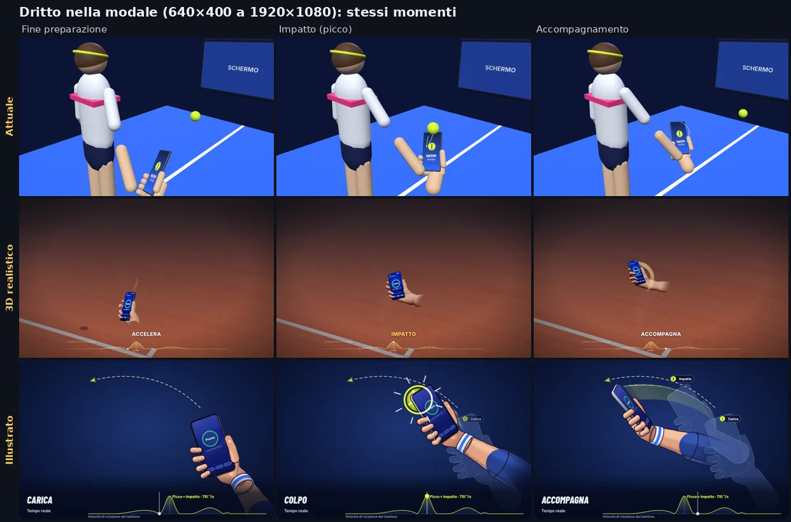
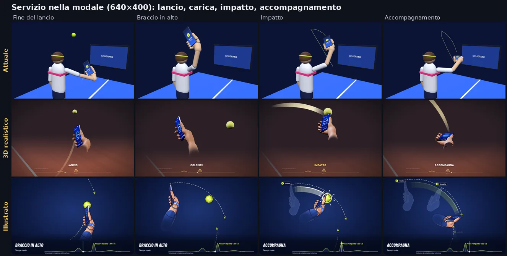
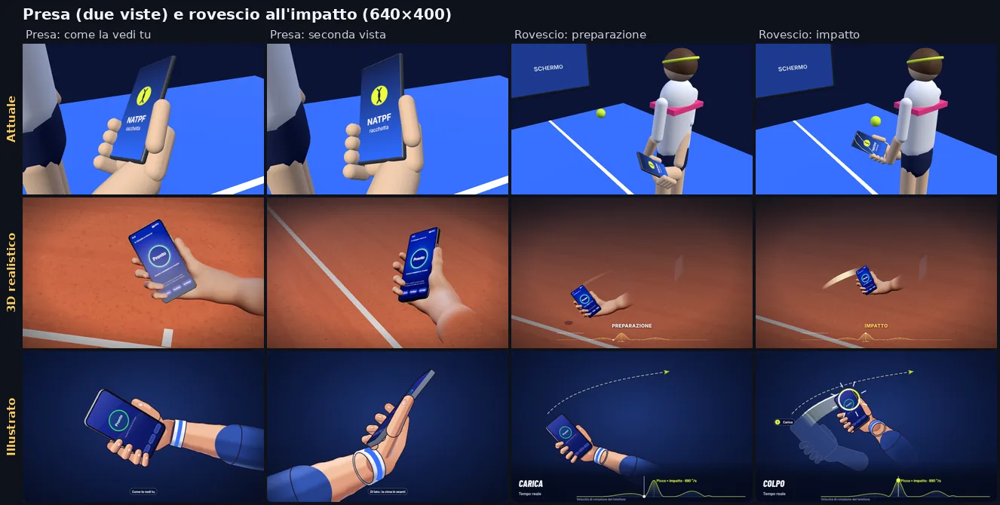
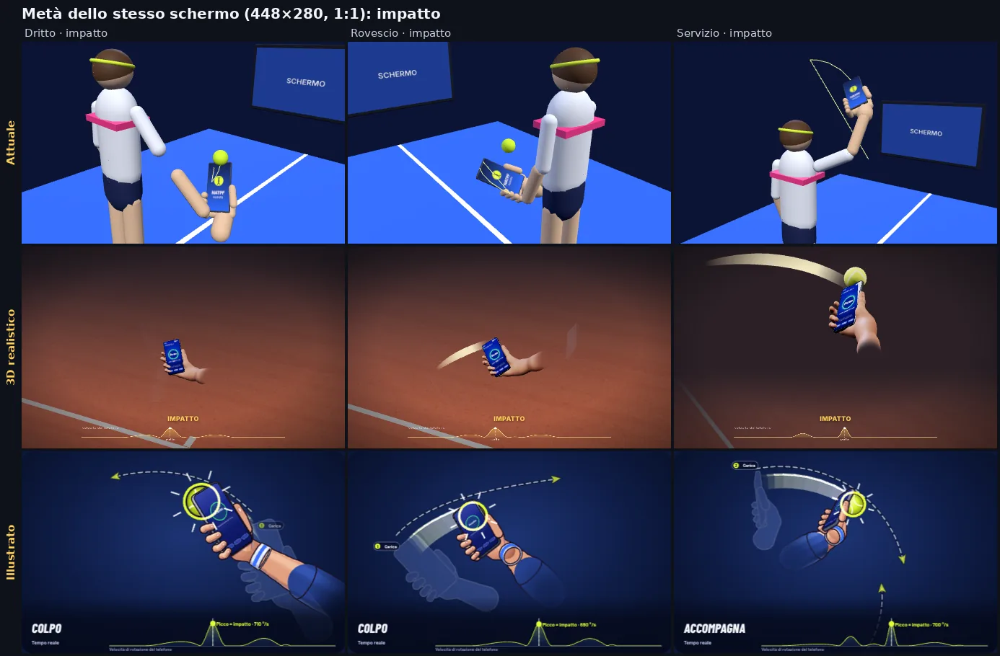

# B9 · Giudizio dell'animazione dei gesti e brief di produzione

> Stato: **completo** (06/11/2026, agente Claude nel ruolo di direttore artistico e motion designer). Nessun file del
> gioco modificato. Consegna: `docs/b9/compiti.md` §«Giudizio e brief di produzione».
> Confronto tra l'animazione **attuale** (`natpf-tennis/src/natpf/natpf_gesture_demo.js`, three.js), il prototipo
> **3D realistico** (`natpf-tennis/prototipi/b9-3d/`, rapporto `docs/b9/prototipo-3d.md`) e il prototipo **illustrato**
> («motion design», `natpf-tennis/prototipi/b9-motion/`, rapporto `docs/b9/prototipo-motion.md`), con la specifica
> dei gesti `docs/b9/specifica-gesti.md` e la diagnosi dell'analisi A `docs/b9/analisi-modale-animazione.md`.
> Immagini: `docs/b9/img/G-1…G-4-*.webp`.

## 0. Decisione in breve

- **Direzione scelta: ibrido con base «illustrato 2,5D»** (Canvas 2D, posa calcolata in 3D e proiettata, solo
  avambraccio, mano e telefono), che prende dal 3D la **regia del servizio**, i **fantasmi solo a contorno**, la
  **fase scritta legata al contatto**, la **scia dietro il telefono** e una pelle più calda e contrastata; la **presa**
  resta affidata anche alla **foto vera** dell'utente accanto all'illustrazione (il realismo «fotografico» lo dà la foto,
  il gesto lo spiega l'illustrazione).
- Punteggi pesati (§3): **attuale 3,7 · 3D realistico 6,6 · illustrato 7,7** su 10.
- Perché non il 3D, che è il più bello nei primi piani: nella modale (640×400) e ancora più nella metà dello stesso
  schermo (448×280) dritto e rovescio diventano una mano di 50–90 px su un campo vuoto, con la palla nascosta
  all'impatto; costa 200–230 ms per fotogramma senza scheda grafica (4–5 fps), chiede un secondo contesto WebGL accanto al
  campo del gioco e 93 KB di codice complesso (SDF, worker, shader modificati). Le sue qualità migliori (presa, servizio)
  si possono portare nel disegno illustrato; i suoi limiti di costo e integrazione no.
- Perché l'illustrato: il più chiaro sui colpi a terra a ogni misura, 60 fotogrammi al secondo **senza GPU** (misurato
  qui sotto), nessun contesto WebGL (le due metà dello stesso schermo possono avere ciascuna la sua animazione),
  25,8 KB compressi, fedeltà al riconoscimento verificata anche a velocità 0,8× e 1,25×.
- Da correggere in produzione (visti nei fotogrammi): servizio debole (braccio di punta scuro, telefono di taglio,
  etichetta «Accompagna» all'istante del contatto), fantasmi pieni «a guanto», manica blu scura su sfondo blu, testi di
  8–9 px illeggibili nella modale, mancano 5 schede su 11 (posizione, piatto, tagliato, schiacciata, volée).

## 1. Come ho confrontato (ripetibile)

- Server vite di `natpf-tennis` su una porta propria (5317), Chromium headless (`/opt/pw-browsers/chromium`).
  Script nella cartella temporanea
  `/tmp/claude-0/-home-user-foro-italico-world/ba4c6b81-3eda-5b46-9643-f32c32c7e045/scratchpad/b9/giudizio/`:
  `rendi.mjs` (stessi momenti dei tre), `tempi.mjs` (istanti chiave dai moduli del moto), `costo.mjs` e `fps.mjs`
  (costo), `componi.py` (immagini G).
- **Stessi momenti**: per ogni animazione gli istanti presi dal suo piano dei tempi (non lo stesso secondo, perché i
  cicli sono diversi): fine della preparazione, impatto (picco della velocità), accompagnamento; servizio: fine del
  lancio, braccio in alto, impatto, accompagnamento; presa: due viste. Attuale: posa avanzata a passi di 0,02 s come il
  ciclo vero (la scia si accumula), poi disegno; 3D: `?g=<id>&t=<s>`; illustrato: `window.__show({ card, t })`.
- **Misure**: 640×400 (modale a 1920×1080, riquadro 16:10 della modale compatta) e **448×280** (la metà dello stesso
  schermo a 1280×720: scheda `min(38cqw, …)` = 486 px, riquadro 16:10 ~450×280). Tutti i fotogrammi guardati.
- **Fedeltà**: rifatte da me le verifiche «posa disegnata → sensori → telefono simulato → gioco» dei due prototipi
  (§2.3). **Costo**: misurato con WebGL software (SwiftShader) e, per il Canvas 2D, anche con il disegno su CPU
  (configurazione predefinita di Chromium senza GPU). Durante una parte delle misure un altro agente eseguiva test e
  prove nel browser sulla stessa macchina (carico 4–6 su 4 core): i valori dei colpi per fotogramma sono da leggere
  come limite alto.

| Immagine | Cosa mostra |
|---|---|
|  | **Dritto** nella modale (640×400): fine preparazione, impatto, accompagnamento dei tre |
|  | **Servizio** (640×400): fine del lancio, braccio in alto, impatto, accompagnamento |
|  | **Presa** (due viste) e **rovescio** (preparazione, impatto) a 640×400 |
|  | **Metà dello stesso schermo** (448×280, 1:1): impatto di dritto, rovescio e servizio |

## 2. Cosa si vede (osservazioni dai fotogrammi)

### 2.1 Attuale (`natpf_gesture_demo.js`)
Conferma tutta la diagnosi dell'analisi A: omino di capsule, **braccio in tre pezzi staccati** nel dritto (G-1),
telefono ingrandito 1,9× lungo quanto l'avambraccio, polso a ~120°, fascia rosa a scatola, campo blu saturo che occupa
metà del quadro, nessuna ombra; dalla camera alle spalle il dritto va **in profondità** (il telefono si sposta di poco
più della sua larghezza tra preparazione e accompagnamento). Servizio (G-2): all'impatto la palla **non è nel quadro**;
scia da 1 px. Presa (G-3): quattro cilindri a pettine e un pezzo di gambe e pantaloncini nel quadro. Unico pregio: è
leggero (5,8k triangoli, 28 chiamate) e i moti di riferimento sono giusti.

### 2.2 3D realistico (`prototipi/b9-3d/`)
- **Presa** (G-3): la migliore dei tre. Mano anatomica con pelle calda, dita che avvolgono il bordo come nella foto
  dell'utente (`docs/riferimenti/presa-palmo-utente-2026-11-04.webp`), schermo «Pronto» leggibile, campo in terra rossa
  sfocato dalla nebbia. Dita un po' tubolari, nessuna piega; resa «realistica stilizzata».
- **Servizio** (G-2): molto buono. Camera che segue la mano, telefono di faccia, palla esattamente sulla cima del
  telefono all'impatto con una scia ampia e calda, «IMPATTO» scritto in giallo nell'istante giusto.
- **Dritto e rovescio** (G-1, G-3, G-4): il punto debole. L'inquadratura fissa che contiene tutto l'arco mette mano e
  telefono in un quinto dell'altezza; a 448×280 il telefono è lungo ~45 px. Vista da dietro: l'arco del dritto va in
  profondità (stesso difetto dell'attuale), la scia nell'accompagnamento è un piccolo anello, **la palla all'impatto del
  dritto non si vede** (è dietro il telefono). Il campo vuoto occupa l'80% del quadro.
- Testi della curva della velocità («velocità del telefono», «palla») da 7–8 px: illeggibili nella modale.

### 2.3 Illustrato (`prototipi/b9-motion/`)
- **Dritto e rovescio** (G-1, G-3, G-4): i più chiari dei tre a ogni misura. Mano e telefono grandi (un terzo
  dell'altezza), freccia tratteggiata del verso, scia, fantasmi numerati di carica e impatto, lampo e palla sulla cima del
  telefono nell'istante del picco, curva con «Picco = impatto · 710 °/s». A 448×280 si legge ancora tutto tranne i testi
  piccoli.
- **Presa** (G-3): «Come la vedi tu» chiara (pollice sul bordo, dita che avvolgono, schermo «Pronto»), con il polsino
  bianco e blu che dà un riferimento sportivo; la vista di lato è corretta ma meno parlante (telefono di taglio).
  Meno «vera» del 3D: contorni scuri e luce a bande la dichiarano illustrazione.
- **Servizio** (G-2, G-4): la scheda più debole. L'avambraccio punta verso la camera e diventa una macchia blu scura,
  nel «braccio in alto» il telefono è di taglio, i fantasmi della battuta sono sagome piene azzurre che sembrano guanti,
  e **all'istante del contatto l'etichetta dice già «Accompagna»** (in `main.js:473` il cambio di fase è a metà della
  parte veloce, cioè proprio nel contatto). Freccia e palla escono dal quadro per pochi istanti.
- Contrasto: manica blu notte su sfondo blu notte; testi «Velocità di rotazione del telefono» e badge dei fantasmi da
  8–9 px; etichetta della vista della presa («Come la vedi tu») piccola.

### 2.4 Fedeltà al riconoscimento (rifatta il 06/11)
- **3D**: `scratchpad/b9/p3d/verifica.mjs` → dritto, rovescio, pallonetto, palla corta, piatto, tagliato,
  schiacciata riconosciuti come mostrati, un colpo ciascuno, destro e mancino, calibrazione con il braccio simulato e
  con i gesti dell'animazione («tutto riconosciuto»; picchi 668, 647, 496, 381, 1007, 568, 653 °/s);
  `verifica-tempi.mjs` → servizio 2 messaggi, battuta 0,690 s dopo il lancio (destro e mancino). Non provate le
  velocità 0,8× e 1,25×. Manca la volée.
- **Illustrato**: `node --import ./test/register.mjs prototipi/b9-motion/verifica.mjs` → 12 combinazioni
  (calibrazione braccio/animazione × destro/mancino × 0,8/1/1,25) tutte come atteso: a 1,25× dritto e rovescio diventano
  «piatto», il verso giusto; servizio 2 messaggi con intervallo 0,690 s (0,863 a 0,8×, 0,552 a 1,25×); picco letto 8 ms
  prima del contatto disegnato (mezzo campione a 60 Hz); presa 0 °/s. Solo 6 schede (mancano posizione, piatto,
  tagliato, schiacciata, volée).
- **Attuale**: la posa **disegnata** dà colpi in più su pallonetto, schiacciata e volée e 3 messaggi nel servizio
  (specifica §5); il test di oggi non se ne accorge perché verifica il braccio simulato, non il disegno.

### 2.5 Costo per fotogramma (misurato qui; nessuna GPU in questo contenitore)

| A 640×400 | Attuale (three.js) | 3D realistico (three.js) | Illustrato (Canvas 2D) |
|---|---|---|---|
| WebGL software SwiftShader | 18–28 ms per fotogramma (limitato a 30 fps dal codice) | **209–228 ms** (4–5 fps); 100 ms con `qualita=bassa` (rapporto) | — (nessun WebGL) |
| Canvas 2D, disegno su CPU (Chromium senza GPU, opzioni predefinite) | — | — | registrazione dei comandi 1–2 ms; **60 fps dal vivo** a 1280×720 (stadio 701×394) e a 1920×1080 (1052×592) |
| Canvas 2D «accelerato» su SwiftShader (configurazione artificiale delle prove WebGL) | — | — | 7–12 fps dal vivo: il Canvas 2D passato a una GPU software è lento; su un PC vero o c'è la GPU o il canvas va su CPU |
| Scena | 5,8k triangoli, 28 chiamate | 46–49k triangoli, 20–25 chiamate, ombra 2048², 4 passate per la pelle | nessuna geometria; ~100 tracciati |
| Stima su GPU integrata (Intel UHD/Iris, Radeon Vega; **non misurata**) | < 2 ms | 4–8 ms a 640×400, 10–20 ms a 1280×800 con densità 2, **sommati al campo del gioco che resta disegnato dietro la modale** | < 3 ms anche a 1920×1080 (rasterizzazione accelerata) |

Nota per l'integrazione: la modale vera ha `backdrop-filter: blur(4px)` sul velo (`natpf-ui.css:1480`) sopra un campo
animato; il rapporto dell'illustrato misura che quella sfocatura da sola porta il prototipo da 60 a 39 fps senza GPU.

## 3. Punteggi (1–10, motivati)

Pesi: fedeltà e didattica 20% ciascuna (sono lo scopo del tutorial), realismo e movimento 15% ciascuno (la richiesta
dell'utente), estetica e leggibilità 10% ciascuna, costo e rischio d'integrazione 5% ciascuno.

| Criterio (peso) | Attuale | 3D realistico | Illustrato |
|---|---|---|---|
| Realismo anatomico e impugnatura (15%) | **2** — braccio in tre pezzi, mano 1,9×, polso a 120°, dita a pettine | **8** — mano anatomica fusa, dita che si chiudono sul bordo come nella foto, pelle credibile; dita tubolari, avambraccio che si dissolve di punta | **6** — anatomia giusta (falangi e flessioni misurate, pollice sul bordo, polso fermo) ma dichiaratamente illustrata; servizio con avambraccio a macchia |
| Qualità del movimento (15%) | **3** — 53% del ciclo fermo, arresto tra preparazione e colpo, ritorno a velocità costante, tutto a 0,6× | **7** — accelerazione asimmetrica (45%), preparazione che decelera come il colpo accelera (nessun fermo), assestamento, ritorno a minimo jerk, servizio continuo; telecamera fissa nei colpi a terra; nessun movimento secondario | **8** — legge cicloidale con picco = contatto, preparazione senza fermo, fine colpo 0,14–0,20 s, ritorno con piccolo superamento e assestamento, respiro, ciclo chiuso, alternanza tempo reale / ×0,5 dichiarata |
| Fedeltà al riconoscimento (20%) | **5** — moti di riferimento giusti, ma la posa disegnata sbaglia servizio, pallonetto, schiacciata, volée | **9** — tutto riconosciuto, destro e mancino, due calibrazioni, picco = contatto ±3 ms; non provate 0,8×/1,25×; manca la volée | **9** — tutto riconosciuto anche a 0,8× e 1,25× (verso del cambiamento giusto); solo 6 schede su 11 |
| Chiarezza didattica (20%) | **3** — rotazione nascosta dalla camera, scia da 1 px, nessuna fase, palla del servizio fuori quadro | **5** — presa e servizio eccellenti; dritto e rovescio piccoli, arco in profondità, palla nascosta all'impatto | **7** — colpi a terra chiarissimi (freccia, scia, fantasmi numerati, palla al picco, curva); servizio confuso, etichetta di fase sbagliata al contatto, testi minuscoli |
| Qualità estetica (10%) | **2** — primitive, plastica, nessuna ombra, campo saturo | **7** — luce, materiali e nebbia da prodotto, primi piani bellissimi; nei colpi a terra il campo vuoto domina | **7** — coerente con la palette del gioco, pulito, luce dipinta; contrasto manica/sfondo scarso, fantasmi pieni pesanti |
| Leggibilità: schermo piccolo e ledwall (10%) | **3** — soggetto al 5–10% del quadro | **5** — illeggibile a 448×280 nei colpi a terra; sul ledwall bello solo con GPU | **8** — leggibile a 448×280, vettoriale e nitido a ogni scala; testi da ingrandire |
| Costo (5%) | **8** — leggero anche in software | **3** — 4–5 fps senza GPU, secondo contesto WebGL, 1 s di costruzione | **9** — 60 fps senza GPU, nessun WebGL, due istanze possibili |
| Peso e rischio d'integrazione (5%) | **9** — già integrato, 21 KB | **4** — 93 KB (34 gz), worker, shader modificati, passate di profondità, ripiego obbligatorio senza GPU | **8** — 74,5 KB (25,8 gz), nessuna dipendenza; va avvolto nell'API `getGestureDemo` e completato |
| **Totale pesato** | **3,7** | **6,6** | **7,7** |

## 4. Scelta della direzione: ibrido a base illustrata

**Tecnica e stile dell'illustrato**, con questi innesti:

| Dal 3D realistico | Come nell'illustrato |
|---|---|
| Regia del **servizio** e della **schiacciata**: camera di profilo e un poco da dietro (direzione ~(0,95; 0,30; 0,55)) che segue la mano con media mobile pesata ±0,24 s; telefono mai di taglio nelle pose chiave | stessa proiezione prospettica; vincolo «schermo o dorso visibile ≥ 25°» nelle pose chiave (§5.6) |
| **Fantasmi solo a contorno**, con opacità che si spegne quando il telefono passa per quella posa (±0,16 s) | contorno di 1,5–2 px al 30–40%, niente riempimento |
| **Fase scritta legata al contatto** («Impatto» in giallo per ±30 ms attorno al contatto) | sostituisce il cambio a metà della parte veloce (`main.js:473-474`) |
| **Scia dietro il telefono**: telefono e mano la coprono; testa della scia sfumata negli ultimi 20 ms | ordine dei livelli: scia prima del telefono quando passa davanti allo schermo |
| **Pelle calda** con diffusione nel rosso e **ombra di contatto** del telefono sulle dita | rampa di colore della pelle più calda e chiara, ombra morbida `source-atop` già presente |
| **Inquadratura** calcolata proiettando tutto il ciclo (angoli del telefono, polso, palla ±50 ms dal contatto) nella finestra utile sopra la banda della curva | già così; aggiungere la palla ±50 ms e la dimensione minima del soggetto (§5.6) |
| **Presa**: giro lento della **camera** dagli occhi di chi gioca a tre quarti (non della mano) | già così con due fermi; tenere |

Più la **foto vera della presa** accanto all'illustrazione nella scheda 1 (c'è già nella modale: `.tut-media` con la
foto, specchiata per il mancino).

Scartati: pre-disegnare fotogrammi del 3D (equivale a una clip, rifiutata dall'utente il 28/10, e pesa); 3D con
`qualita=bassa` (resta a 10 fps senza GPU e perde proprio il realismo); tenere l'attuale ritoccato (difetti strutturali).
Il prototipo 3D resta in `prototipi/` come riferimento di anatomia e luce e come possibile modalità futura «alta
qualità» **solo** se il PC dell'evento ha una GPU verificata e misurata (non ora).

**Rischio da dire all'utente**: chiede «realismo» e lo stile illustrato è stilizzato. Prima di integrare tutte le 11
schede conviene mostrargli G-1…G-4 e i due prototipi dal vivo (5 minuti) e fargli scegliere; se preferisce il 3D, il
brief resta valido per moto, tempi, camere e controlli, cambia solo il disegno (e servono GPU e ripiego).

## 5. Brief di produzione (ramo C)

### 5.1 Architettura (stessa API, un modulo puro per il moto)
1. **Moto** — nuovo `natpf-tennis/src/natpf/natpf_gesture_pose.js` (da `prototipi/b9-motion/motion.js`, senza DOM né
   three.js): `gesturePose(id, t, { hand }) → { pos, q, contact, speed, phase }`, `plan(id) → { total, contact,
   keys, T }`. Usa **solo** i parametri di `natpf_gesture_motion.js` (`GESTURES`, `GRIP_POSE`, `strokeFor`):
   asse, verso, picco, durata della parte veloce, polso, presa. Tutte le **11 schede** (`grip`, `ready`, `forehand`,
   `backhand`, `serve`, `flat`, `lob`, `drop`, `slice`, `smash`, `volley`) più `cross` e `line` degli esercizi;
   mancino = specchio esatto (posizioni x → −x, quaternioni (x, −y, −z, w)); presa `GRIP_POSE[GRIP_STYLE]`, quindi anche
   il rollback `martello`.
2. **Disegno** — `natpf_gesture_demo.js` riscritto in Canvas 2D (rig della mano da `prototipi/b9-motion/rig.js`,
   disegno da `main.js`), **stessa API**: `available`, `canvas`, `mount(el)`, `setSize(w, h)`, `play(id, { hand,
   speed })`, `start()`, `stop()`, `hitTime()`, `cycle()`, `pose(t)`, `dispose()`, `getGestureDemo()`. Il disegno legge
   la posa **solo** da `gesturePose` (nessun moto aggiunto nel disegno: un polso che ruota il telefono solo a schermo non
   sarebbe verificato). Importabile in Node senza DOM (`available === false` senza `getContext('2d')`).
3. **Istanze**: niente più WebGL per il tutorial → tolto il vincolo «una sola metà ha l'animazione»
   (`natpf_split_ui.js:93-95, 237, 257`: `demoOwner`/`canDemo`); ogni metà dello stesso schermo crea la sua istanza
   (`getGestureDemo(key)` o `new NatpfGestureDemo()`), il riquadro «Guarda e ripeti» dell'Allenamento (200×200) e la
   lezione (300×300) usano la modalità compatta (§5.5).
4. **Velo della modale**: niente `backdrop-filter` dal vivo mentre l'animazione gira (`natpf-ui.css:1480`): velo
   pieno `rgba(4,8,24,.72)` o sfondo sfocato una volta sola.

### 5.2 Stile
- Solo **avambraccio, mano e telefono**; avambraccio color pelle che **sfuma** verso il gomito fuori quadro (come il
  3D) oppure manica **chiara** (bianca con riga blu): mai blu scuro su sfondo blu. Polsino bianco con riga blu: tenere
  (nasconde l'attacco polso–avambraccio).
- Pelle: rampa di 4 toni calda (ombra `#b8714f`, base `#e9a77f`, luce `#f6c9a6`, lume `#ffe6d2`; da tarare sullo
  sfondo), luce di contorno fredda sul lato in ombra, palmo più chiaro, nocche appena rosate, unghie solo con il dorso
  verso la camera. Contorno caldo scuro (`#2a1812` all'80%) spesso lo 0,3% della larghezza dello stadio (min 1 px).
- Telefono 162 × 79 × 8,6 mm (scala 1:1 rispetto alla mano), cornice metallica a gradiente, vetro con due riflessi,
  schermo «Pronto» della pagina vera (mai specchiato per il mancino), dorso con il modulo fotocamere.
- Sfondo: gradiente radiale della palette del gioco **più chiaro al centro** del soggetto (contrasto pelle/sfondo
  ≥ 3:1), un accenno di piano di gioco in prospettiva (una linea di fondo campo e l'ombra morbida della mano sul piano)
  per dare alto/basso e la direzione dello schermo.
- Palla con cuciture; lampo (anello e 6 raggi, 0,16 s) all'impatto; scia additiva con larghezza e luminosità
  proporzionali alla velocità, ultimi 0,3 s, testa sfumata.

### 5.3 Camera per scheda (prospettiva a 2,2 m, inquadratura calcolata sul ciclo)
| Scheda | Camera | Cosa deve leggersi |
|---|---|---|
| Presa | dagli occhi di chi gioca (3 s) → giro di camera 1,5 s → di lato (3 s) → ritorno | pollice sul bordo destro, dita che avvolgono il sinistro, cima in avanti e verso l'interno; schermo «Pronto» |
| Posizione | tre quarti da dietro a destra, ferma, respiro ±3 mm | telefono fermo nella posa di partenza |
| Dritto, piatto | da dietro a sinistra e dall'alto | arco orizzontale **da destra a sinistra**, mano alla stessa altezza |
| Rovescio | da dietro a destra e dall'alto (specchio della vista del dritto) | arco da sinistra a destra, partenza dall'anca sinistra |
| Tagliato | da dietro, bassa | la mano **scende** durante il colpo |
| Pallonetto | di lato e dall'alto, che segue in basso | la mano **sale**, schermo verso il cielo alla fine |
| Palla corta | da dietro a destra, bassa | gesto corto e lento, mano che scende un poco |
| Servizio, schiacciata | profilo dal lato del braccio, un poco da dietro, che segue la mano (media pesata ±0,24 s, al 50% tra arco e mano) | lancio → braccio in alto con il telefono **di faccia** → battuta giù al colmo della palla |
| Volée | tre quarti davanti | preparazione quasi nulla, gesto corto e deciso |

Il colpo deve restare nel quadro: freccia, palla e scia fuori dallo stadio per non più di 100 ms.

### 5.4 Tempi per colpo (tempo reale; il modulo li scrive così, la riproduzione può rallentare)
Legge della parte veloce: accelerazione nel 40–50% della durata, **picco = contatto con la palla**; preparazione a
minimo jerk senza fermo prima del colpo (nessun tratto sotto 20 °/s più lungo di 40 ms tra carica e colpo); fermo in
fine colpo 0,10–0,20 s; ritorno a minimo jerk entro 0,6 s dall'impatto con superamento ≤ 3° e assestamento; ciclo
chiuso. Limiti dalla specifica §3 (misurati con il telefono simulato).

| Scheda | Parte veloce | Picco (°/s) | Ampiezza | Preparazione max (°/s) | Ritorno max (°/s) | Ciclo indicativo |
|---|---|---|---|---|---|---|
| Dritto | 260 ms | 650–710 | ~85° | 180 | 240 | 2,25 s, contatto a 1,03 |
| Rovescio | 260 ms | 600–690 | ~78° | 180 | 240 | 2,25 s |
| Piatto | 220 ms | ~1000 (≥ 1,2× il proprio dritto) | ~110° | 200 | 250 | 2,4 s |
| Tagliato | 260 ms | ~600, asse inclinato (mano che scende) | ~78° | 180 | 240 | 2,2 s |
| Pallonetto | 300 ms | ~520 | ~78° | **95** (preparazione ≥ 0,6 s) | 170 | 2,56 s |
| Palla corta | 240 ms | 330–410 | ~40° | 140 | 150 | 2,2 s |
| Schiacciata | 240 ms | ~700 | ~84° | **80** (preparazione ≥ 0,7 s) | 240 | 2,7 s |
| Volée | 200 ms | ~480 | ~48° | ≤ 15° di preparazione, ≤ 120 | 240 | 1,9 s |
| Servizio | lancio 420 ms + battuta 240 ms | 300 + 700 | 63° + 84° | raccordo ≤ 90 | 240 | 3,4–3,8 s; battuta **0,69 s** dopo il picco del lancio, al colmo della palla |

Riproduzione nella modale: primo ciclo a **tempo reale** (scritto «Tempo reale»), poi alternanza ×0,5 («Rallentato»)
e tempo reale; il piatto e la palla corta mostrano anche il confronto di velocità con il dritto (testo).

### 5.5 Strati didattici e testi
- Freccia tratteggiata del verso (cresce durante la carica), scia, fantasmi **a contorno** numerati (1 Carica,
  2 Impatto, 3 Fine; nel servizio Lancio, Braccio in alto, Impatto), lampo, palla.
- **Fase scritta** grande in basso a sinistra: Pronto, Carica, Colpo, **Impatto** (giallo, ±30 ms dal contatto),
  Accompagna, Ritorno; servizio: Lancio, Braccio in alto, Battuta, Impatto, Accompagna.
- Banda della curva della velocità con «Picco = impatto» e testina; **testi ≥ 12 px CSS** nella modale a 448 px di
  larghezza (scala `max(12px, 2,6% dell'altezza dello stadio)`), nessun testo sotto i 11 px; «Velocità di rotazione del
  telefono» si toglie se non entra.
- **Modalità compatta** sotto i 320 px di larghezza (esercizi 200×200, lezione 300×300): niente banda, niente
  etichette, solo telefono, mano, scia, freccia e palla; inquadratura quadrata calcolata allo stesso modo.
- Testi delle schede: quelli della specifica §4 (dritto «Il tuo colpo normale, polso fermo», volée «… ma deciso»,
  schiacciata «Braccio in alto, poi giù deciso: solo con la palla alta», lezione «tieni il polso fermo»).

### 5.6 Controlli di qualità da superare (prima dell'unione)
1. **Fedeltà automatica** (nuovo `natpf-tennis/test/natpf-gesture-anim.test.mjs` con l'adattatore
   `natpf-tennis/test/pose-sensors.mjs` della specifica §6; base: `prototipi/b9-motion/verifica.mjs` e
   `scratchpad/b9/sg/posa-sensori.mjs`). Per **tutte** le schede, destro e mancino, presa nel palmo 20–50° / 25–55°
   (e `martello`), calibrazione **con il braccio simulato e con il dritto e il rovescio dell'animazione**, velocità
   0,8× / 1× / 1,25×:
   - esattamente **un** messaggio per ciclo (servizio: **due**, picco della battuta 0,69 ± 0,10 s dopo il lancio),
     colpo e lato come `GESTURES[id].expect` (a 1,25× dritto/rovescio → piatto ammesso; tagliato a 0,8× → palla corta
     ammessa: si verifica il verso del cambiamento);
   - `peakT` letto = `contact` disegnato ± 40 ms;
   - continuità: |ω| ≤ 2000 °/s e |Δpos| ≤ 0,15 m per passo di 1/60 s; ciclo chiuso (posa a 0 e a `total` uguali
     entro 0,5 mm e 0,2°);
   - presa e posizione: nessun messaggio, rotazione ≤ 30 °/s;
   - **la posa disegnata è la stessa del test**: `demo.pose(t)` restituisce (o usa) `gesturePose(id, t, { hand })`
     (test che le confronta su 50 istanti per scheda).
   Il test attuale `natpf-gesture-demo.test.mjs` resta (moti di riferimento e prese di prima).
2. **Controllo visivo** (script di prova, es. `tools/e2e/natpf-gesti-fotogrammi.mjs`): fogli dei momenti chiave di
   tutte le schede a 640×400, 448×280, 200×200 e 1600×1000 (ledwall), **guardati** da chi integra, con questa lista:
   avambraccio e mano sempre uniti; polso visibile ≤ 35° di piega; dita che sporgono sul vetro ≤ 8 mm; nessun fantasma
   sopra il telefono vivo; telefono mai di taglio nelle pose chiave (schermo o dorso a ≥ 25° dalla linea di vista);
   palla a ≤ 1 raggio dalla cima del telefono all'istante del contatto; «Impatto» scritto in quell'istante; mano +
   telefono ≥ 28% dell'altezza dello stadio all'impatto (a 448×280 telefono lungo ≥ 60 px); etichette dentro lo stadio
   e fuori dal soggetto; testi ≥ 12 px; contrasto pelle/sfondo ≥ 3:1.
3. **Prestazioni**: Chromium senza GPU (opzioni predefinite) con il gioco dietro la modale: ≥ 55 fps dal vivo a
   1280×720 e 1920×1080; due istanze nello stesso schermo ≥ 50 fps; registrazione del disegno ≤ 4 ms a 640×400;
   riduzione automatica della densità a 2× e 4K; disegno fermo quando il canvas non si vede. Sul PC dell'evento e sul
   ledwall (collaudo dell'utente): ≥ 60 fps.
4. **Peso**: ≤ 40 KB compressi in più nel pacchetto (three.js resta per il gioco), nessun asset; zip Cloudflare sotto
   l'avviso di 24 MB.
5. **Test esistenti** verdi e aggiornati: `natpf-tutorial`, `natpf-media`, `natpf-split` (niente più «animazione a una
   sola metà»), `natpf-presa`, `tools/e2e/natpf-training-flow.mjs`.
6. **Persone vere** (da fare con l'utente, non simulabile): 3 persone che non conoscono il gioco guardano dritto,
   rovescio e servizio e li ripetono con il telefono: colpo giusto alla prima o seconda prova (diagnostica della
   sessione).

### 5.7 Passi consigliati (piccoli, ciascuno con test e commit)
1. `natpf_gesture_pose.js` + adattatore + test di fedeltà (prima con le 6 schede del prototipo, poi le altre 5).
2. Disegno Canvas 2D con l'API di oggi; tutorial a una metà come oggi; correzioni del §2.3 (servizio, fase al contatto,
   fantasmi a contorno, contrasto, testi).
3. Due istanze nello stesso schermo; modalità compatta per gli esercizi; velo senza sfocatura.
4. Fogli di controllo visivo guardati, prove nel browser, prestazioni; poi versione nuova, pacchetti ed eseguibili.

## 6. Non verificato
- Nessuna GPU vera (Windows, Android, scheda del PC noleggiato, ledwall): le stime su GPU integrata non sono misure.
- Nessuna persona ha guardato le animazioni: la chiarezza didattica è un giudizio sui fotogrammi.
- Movimento giudicato da fotogrammi fermi e dai profili di velocità dei piani (non da un video guardato).
- Le misure di costo del 640×400 sono state prese mentre un altro agente usava la stessa macchina (limite alto);
  il 60 fps dell'illustrato è stato misurato con la macchina meno carica.
- Volée: in nessuno dei due prototipi.

## Stato del lavoro (per riprendere)
- [x] Consegna, rapporti, analisi A, specifica dei gesti letti.
- [x] Fotogrammi dei tre agli stessi momenti a 640×400 e 448×280, guardati; fedeltà dei due prototipi rifatta.
- [x] Costo misurato (SwiftShader e CPU) e annotato.
- [x] Punteggi, scelta della direzione, brief di produzione, immagini `docs/b9/img/G-1…G-4-*.webp` (54–68 KB).
