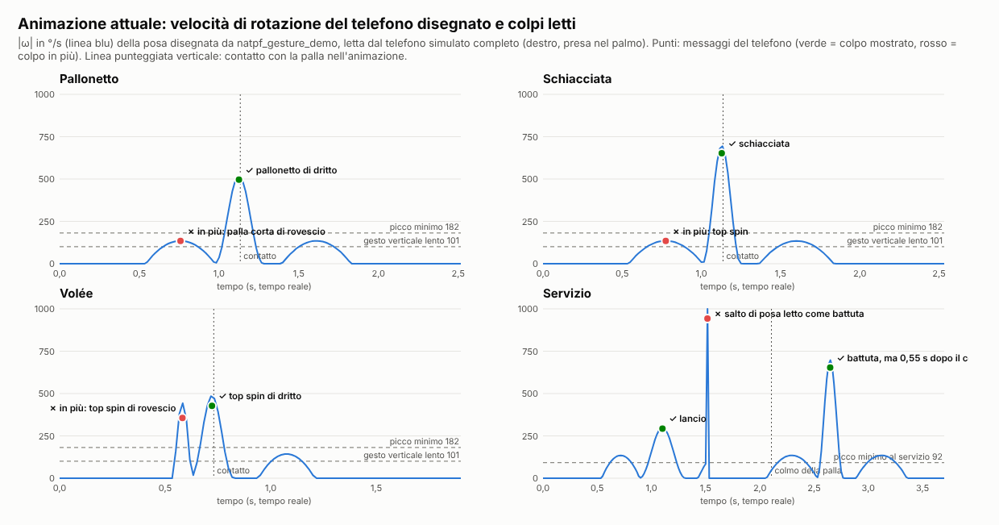
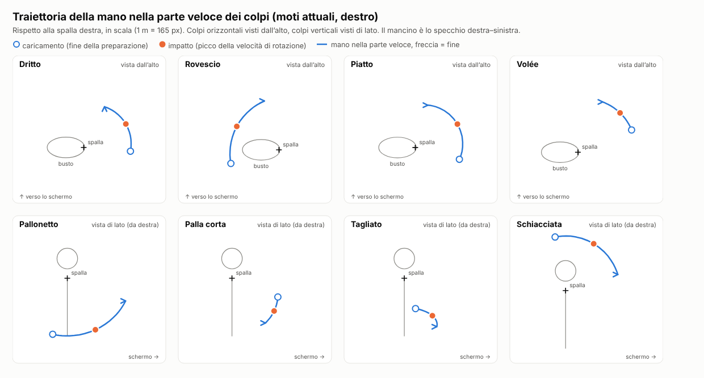

# B9 · Analisi B — specifica dei gesti per l'animazione del tutorial

> Stato: **completa** (05/11/2026). HEAD di partenza `e7cd44d`; nessun file del gioco modificato (solo questo rapporto e
> due immagini `docs/b9/img/sg-*.png`).
> Script di misura (non nel repository, da spostare in `natpf-tennis/test/` se si adotta la verifica del §6):
> `/tmp/claude-0/-home-user-foro-italico-world/ba4c6b81-3eda-5b46-9643-f32c32c7e045/scratchpad/b9/sg/*.mjs`
> (`misura`, `cinematica`, `sweep`, `posa-sensori`, `inviluppo`, `servizio`, `servizio-continuo`, `polso`, `raggio`,
> `asimmetrico`, `profilo`, `volee`, `grafici-dati`, `grafici-html`, `scatta`). Si eseguono da `natpf-tennis/` con `node --import ./test/register.mjs <script> main`.
> Tutti i numeri «misurati» vengono dal telefono simulato completo (`test/phone-sim.mjs`: rilevatore, filtro
> d'orientamento, forma del colpo, calibrazione rapida vera, mappatura del gioco) con la presa nel palmo della foto
> (`GRIP_POSE.palmo`: cima 35° verso l'interno, 40° in avanti). **Non** sono misure su un telefono vero.

## 0. Sintesi per chi decide

1. **Il gioco riconosce rotazioni del telefono, non posizioni del corpo.** Il rilevatore guarda il picco della velocità
   di rotazione (giroscopio); la forma del colpo (piano, salita della «testa», inclinazione) si misura nel riferimento
   della gravità. Quindi un'animazione è fedele se **il telefono** ruota attorno all'asse giusto, nel verso giusto, con
   la velocità e l'ampiezza giuste, e se la mano sale o scende come nel colpo vero. Il corpo serve solo a renderlo
   credibile: mostrare solo braccio, mano e telefono va benissimo per il riconoscimento.
2. **I colpi speciali sono relativi al proprio dritto di calibrazione** (salita abituale `rises`, colpo tipico `refs`):
   il dritto del tutorial deve essere identico al gesto chiesto in calibrazione, e ogni colpo speciale deve
   distinguersi da lui **nella direzione verticale della mano** (non solo del polso) o nella velocità.
3. **Tre difetti dell'animazione attuale** trovati facendo eseguire al telefono simulato la **posa disegnata** (non il
   braccio simulato del test di oggi): (a) **servizio**: tra lancio e battuta la mano salta di ~0,9 m in un fotogramma
   (il telefono lo legge come un colpo da 943 °/s) e la battuta è disegnata **0,55 s dopo il colmo** della palla, con la
   palla ~0,6 m sopra la mano; (b) **pallonetto e schiacciata**: la preparazione disegnata (picco 135 °/s con lo
   smoothstep) è letta come un **secondo colpo** (palla corta di rovescio prima del pallonetto, top spin prima della
   schiacciata); (c) **volée**: la preparazione di 24° in 0,08 s (picco ~450 °/s) è letta come un **rovescio**. Il test
   `natpf-gesture-demo` non se ne accorge perché fa eseguire i moti al braccio simulato (preparazione a 90 °/s
   costanti, volée senza preparazione), non la posa disegnata (§5).
4. **Inviluppi misurati** utili al motion designer (§3): preparazione al massimo ~200 °/s nei colpi orizzontali, ~100 °/s
   nel pallonetto, ~150 °/s nella palla corta, ~85 °/s nella schiacciata (o meglio: preparazione fatta spostando la
   mano senza ruotare il telefono); fase veloce con accelerazione tra 1/3 e 1/2 della durata e **picco all'impatto**;
   ritorno che parte entro 0,6 s dall'impatto con picco ≤ 250 °/s; distanza spalla–mano libera (0,3–0,9 m: il gomito
   si può piegare in modo naturale).
5. **Verifica automatica proposta** (§6): un adattatore «posa animata → sensori» (prototipo funzionante,
   `posa-sensori.mjs`) che campiona a 60 Hz la posizione e l'orientamento del telefono **disegnati** e li fa leggere
   al telefono simulato e al gioco; criterio: esattamente un colpo (due nel servizio), colpo e lato giusti, istante del
   picco = istante del contatto con la palla nell'animazione (±40 ms), per destro e mancino, prese nel palmo 20–50° /
   25–55°, calibrazione fatta con il braccio simulato **e** con il dritto e il rovescio dell'animazione stessa, velocità
   dell'imitazione 0,8–1,25×.

## 1. Come il sistema riconosce un colpo (codice vero)

### 1.1 Riferimenti

- **Campo** (moti del tutorial, `natpf_gesture_motion.js`; braccio simulato `test/arm-sim.mjs`): x a destra, y in alto
  (contro la gravità), −z verso lo schermo del computer. Giocatore destro. Il telefono non sa dov'è lo schermo: sa solo
  dov'è l'alto. Quindi del moto contano: l'angolo tra l'asse di rotazione e la verticale, il segno della componente
  verticale (verso del colpo), e quanto la mano e la cima salgono o scendono. La direzione orizzontale assoluta conta
  solo per la mira (rotazione attorno alla verticale tra la posa ferma e l'impatto, `face-tracker.strokeFace`).
- **Telefono** (come `natpf_gesture_demo.js` e `test/phone-sim.mjs`): y = cima (asse lungo), +z = normale dello
  schermo, +x = bordo destro guardando lo schermo. Presa nel palmo a riposo: `q0 = Euler XYZ (−40°, 0, 35°)`, cioè cima
  `(−0,57, 0,63, −0,53)` (39° sopra l'orizzontale, in avanti e verso l'interno) e schermo `(0, 0,64, 0,77)` (verso il
  viso di chi gioca, 40° verso l'alto).
- **Verso orizzontale** (`dir`, H): +1 = da destra a sinistra (rotazione antioraria vista dall'alto, asse verso l'alto)
  = dritto del destro e rovescio del mancino; −1 = da sinistra a destra.
- **Mancino** = specchio esatto: posizioni (x, y, z) → (−x, y, z); assi di rotazione (x, y, z) → (x, −y, −z); quaternioni
  (x, y, z, w) → (x, −y, −z, w) (`mirrorVec`, `mirrorAxis`, e `mirrorPose` del prototipo).

### 1.2 Rilevatore sul telefono (`site/js/tennis/swing-detect.js`)

Pipeline: campione (60 Hz circa) → deriva tolta → modulo della velocità di rotazione |ω| → media mobile leggera
(peso 0,55) → **inizio** quando la media supera `on` → si seguono picco, ampiezza percorsa (∫|ω|dt), rotazione netta
attorno alla verticale (`turn`), spostamento verticale della mano (`lift`, accelerazione lineare lungo la gravità) →
il colpo **parte** appena passato il picco (velocità grezza sotto l'88% del picco o due campioni in calo, o 40 ms
senza nuovo massimo). **L'istante del picco è l'impatto** (vertice della parabola sui tre campioni grezzi).

Soglie in gioco con il profilo della calibrazione rapida del telefono simulato (dritto 672 °/s, rovescio 651 °/s,
picco vero 703 °/s, ampiezza 71°; `profilo.mjs`):

| Grandezza | Valore | Da dove |
|---|---|---|
| Inizio del gesto | **117 °/s** | `on` = 0,18 × colpo di calibrazione più debole (`calibration.js` 245) |
| Picco minimo | **182 °/s** (0,28 × colpo di calibrazione) | `minPeak`, `thr()` |
| Soglia d'intenzione di un dritto/rovescio | ~0,5 × proprio colpo (**~325 °/s**) | `gesture-intent.gestureFloor` (abbassata a 0,28× se il gesto somiglia a un colpo speciale) |
| Ampiezza minima | **18°** (¼ dell'ampiezza dei gesti di calibrazione) | `minAngles`, `playAngle()` |
| Durata | 30–700 ms dall'inizio alla partenza | `minDur`, `maxDur` |
| Gesto verticale lento (asse nettamente orizzontale, `|cos(asse, alto)| ≤ 0,45`) | da **101 °/s** se ha già percorso **15°** | `VERTICAL.slow*`: è la strada delle palle corte morbide, ed è quella che fa leggere le preparazioni dei colpi verticali (§3) |
| Pausa contro i doppi picchi | 170 ms nello stesso verso | `refractory` |
| Rientro | gesto nel verso opposto entro 0,6 s più debole di 1,2× il colpo, o entro 0,9 s più debole di 0,7×: scartato | `recoverWindow`, `recoverLate` |
| Servizio (`serve`/`toss`) | inizio ~65 °/s, picco minimo ~92 °/s, ampiezza ≥ 2°, nessun controllo di verso né di rientro | `thr()` con `serving()` |

Il **verso** (`dir`) viene dall'asse imparato in calibrazione (coseno > 0,25), altrimenti dalla rotazione attorno alla
verticale (`aroundVertical`, `netTurn`). Un gesto senza verso è un colpo solo se è **verticale** (`verticalGesture`:
asse a non più di 0,6 di coseno dalla verticale e lontano dall'asse del dritto) e abbastanza forte, altrimenti è
scartato «verso». Motivi di scarto (diagnostica): `verso`, `debole`, `corto`, `rientro`, `lento`.

### 1.3 Forma del colpo (`site/js/tennis/stroke-shape.js`), mandata con ogni colpo

- `plane` = coseno medio tra asse di rotazione e alto nei **110 ms prima del picco**: ±1 swing orizzontale, 0 verticale.
- `rise` = direzione verticale della velocità della «testa» (cima del telefono + 45 cm di racchetta virtuale) mediata
  sui **34 ms prima del picco**: velocità della mano integrata dall'**inversione** (l'istante più lento tra 420 e 50 ms
  prima del picco) più ω × manico. −1 scende … +1 sale.
- `tilt` = inclinazione del manico (cima) all'impatto: +1 in alto, 0 orizzontale.
- `roll` = rotazione attorno al manico negli ultimi 60 ms (solo informazione).

### 1.4 Classificazione sul computer

Con la pagina del telefono di oggi (manda sempre `shape`) decide **`classifyStroke`** di
`natpf_stroke_intent.js` (via `natpfSwingToEngine`, `natpf_phone_racket.js` 195–196). La tabella `classifyPhoneShot` di
`natpf_gestures.js` vale **solo** per telefoni senza forma (pagina vecchia) e per la webcam no: non va usata come
specifica dell'animazione (riassunto in Appendice A).

Forza: `power = 0,5·clamp((picco − 250)/1100) + 0,5·clamp(0,6·picco/rif)` (`strokePower`), dove il riferimento è il
picco vero della calibrazione (`rawRef`) e, dopo 3 colpi dello scambio, il colpo tipico imparato giocando. Con il
profilo simulato il dritto del tutorial (picco vero 714 °/s) ha forza 0,52.

Salita abituale `ref` = mediana di `rise` dei gesti di calibrazione per verso (`profile.rises`: dritto +0,12, rovescio
−0,14 nel simulato), sostituita da quella dei colpi veri dopo 5 colpi in quel verso. Regole (la prima che vale):

| Colpo | Condizione (`classifyStroke`) | Significato per il gesto |
|---|---|---|
| Schiacciata | palla alta **e** forza ≥ 0,30 **e** (`rise` ≤ −0,08 + min(0, ref) **o** (`|plane|` < 0,55 e `tilt` ≥ 0,4)) | dall'alto verso il basso, deciso, solo se la palla è alta |
| Pallonetto | `rise` ≥ max(0,5, ref + 0,45) **e** `|plane|` ≤ 0,7 | la testa sale molto più del proprio dritto, piano inclinato oltre ~45° |
| Pallonetto morbido | forza ≤ 0,30 **e** `rise` ≥ max(0,6, ref + 0,35) | gesto lento che sale (anche un dritto troppo lento: §2.3) |
| Palla corta verticale | ampiezza ≥ 15° **e** `rise` ≤ −0,12 **e** `|plane|` ≤ 0,55 **e** forza ≤ 0,36 | carezza dall'alto verso il basso, lenta |
| Palla corta / tagliato | `rise` ≤ −0,22 + min(0, ref): se forza ≤ 0,36 **o** ampiezza ≤ 48° → palla corta, altrimenti **tagliato** | il tagliato deve essere deciso **e** ampio |
| Top spin | `rise − ref` ≥ 0,15 | dal basso verso l'alto rispetto al proprio dritto |
| Piatto | forza ≥ 0,62 **e** `|rise − ref|` ≤ 0,12 | il proprio dritto, più veloce (picco vero ≥ ~830 °/s con rif 700) |
| Top spin | tutto il resto | il colpo normale |

Poi i prototipi personali (`personalSpecial`: pallonetto e palla corta imparati negli esercizi dell'Allenamento) possono
sostituire il colpo, mai con la palla alta. La **volée** non è un gesto diverso: è un dritto o rovescio corto che il
motore gioca al volo (`natpf_impact.js`). Lato: `dir` con la mano (dritto del destro = +1).

**Servizio** (`game_engine.js` 1438–1470, `natpf_stroke_outcome.SERVE`, `natpf_impact.WEAK`/`SERVE_MID`): in
`SERVE_STANCE` il **primo gesto qualsiasi** (≥ ~92 °/s, ≥ 2°) o un tocco sullo schermo del telefono lancia la palla
(vy 6,32 m/s, g 9,15: **colmo 0,69 s dopo**, 2,18 m sopra il punto di lancio). In `SERVE_TOSS` il gesto successivo
batte: ignorato se arriva più di 0,42 s prima del colmo (o nei primi 0,16 s); un gesto debole (< 0,3 del colpo tipico)
o intermedio (< 0,75, prima del colmo) aspetta un gesto più forte fino a 0,3 s dopo il colmo; qualità piena entro
±0,18 s dal colmo, poi scende fino a 0,45 a ±0,58 s («EARLY/LATE SERVE»). La palla parte quando il messaggio del
lancio arriva al computer (30–60 ms dopo il picco): il colmo cade ~0,72–0,75 s dopo il picco del lancio, dentro la
finestra piena. Tipo: `rise` > 0,12 kick, `|plane|` ≥ 0,4
slice, altrimenti piatto.

### 1.5 Calibrazione rapida (`calibration.js`, `QUICK_PLAN = ['L', 'R']`)

Prima il telefono fermo nella presa (mediana ≤ 30 °/s, nessun campione > 90 °/s per 0,6 s), poi **un gesto da destra
a sinistra e uno da sinistra a destra** (dritto e rovescio del destro). Da lì: asse del colpo, `refs`, `rawRef`,
ampiezza minima, salita abituale `rises`, verso del piatto `heads`, piatto abituale `faceRef` (centro della mira).
Conseguenza per il tutorial: **la scheda «Dritto» e la scheda «Rovescio» sono anche la calibrazione**. Chi le imita
con il polso che prona (`polso.mjs`, polso −300 °/s in calibrazione e nel dritto) ha la salita abituale più bassa: il
tagliato del tutorial diventa un top spin e la palla corta resta; con −600 °/s il dritto diventa piatto e la palla
corta non parte. Quindi il dritto del tutorial deve mostrare un **polso calmo** (rotolamento 0…+35°, mai la cima che
«cade» verso il basso), e i colpi speciali devono differire nella traiettoria della mano.

## 2. Specifica per scheda (`TUTORIAL_CARDS`)

Ordine delle schede: presa, posizione di partenza, dritto, rovescio, servizio, piatto, pallonetto, palla corta,
tagliato, schiacciata, volée. Per ogni colpo: **vincoli** (verificati dal test del §6, obbligatori), **misure** del
telefono simulato con il moto attuale, **tolleranze** misurate variando un parametro alla volta (`sweep.mjs`,
`inviluppo.mjs`), **cosa non fare**, **posa anatomica e tempi** (raccomandazione per il motion designer, coerente con i
vincoli). Posizioni della mano rispetto alla spalla destra (m, campo); la spalla del modello attuale è a
(0,19; 1,42; 0) dal centro dei piedi. «Tempo reale»: i tempi sono quelli del gesto vero; la modale li può riprodurre
rallentati (oggi 0,6×), ma i dati del moto vanno scritti a tempo reale.

Legge di velocità della parte veloce nei moti attuali: |ω|(u) = picco·sin²(πu), u ∈ [0, 1] sulla durata `ms` —
è la **legge cicloidale** delle camme: velocità e accelerazione nulle agli estremi, picco a metà = 2× la velocità media,
ampiezza = picco·ms/2. In un'animazione a fotogrammi chiave corrisponde, per l'angolo, a un ease-in-out «cicloidale»
(più morbido agli estremi di easeInOutSine). Si può rendere asimmetrica (§3).

### 2.1 Presa (scheda 1, `grip`, foto + 3D)

- **Vincoli**: telefono nella posa `q0` (cima 39° sopra l'orizzontale, in avanti e ~35° verso l'interno; schermo verso
  il viso, 40° verso l'alto); nessuna rotazione della mano oltre 30 °/s (la calibrazione chiede di stare fermi: mediana
  ≤ 30 °/s, nessun campione > 90 °/s). Mancino: cima verso destra (specchio).
- **Anatomia** (foto `docs/riferimenti/presa-palmo-utente-2026-11-04.webp`, figura `grip-art.js` `palmFront`): è la
  presa con cui si legge il telefono con una mano. Il **dorso del telefono appoggia sul palmo**; il bordo inferiore
  sta sull'eminenza tenar/ipotenar; **indice, medio, anulare e mignolo** avvolgono il **bordo lungo sinistro** nella metà
  bassa (per la mano destra), con i polpastrelli appena visibili sul bordo dello schermo ma **non sopra lo schermo**;
  il **pollice** è disteso lungo il **bordo destro**, a metà altezza, senza toccare il display (tocchi involontari: ogni tocco vota il segno dei sensori e, se cambia, rifà la
  calibrazione, `racchetta.js` 499–505). Avambraccio supinato ~60–70° (palmo verso l'alto e verso il viso), polso esteso ~15–20° e
  inclinato verso il pollice quanto basta perché la cima punti in avanti e verso l'interno.
- **Regia**: la rotazione «a giradischi» di oggi gira **la mano** (±52°, 46 °/s): chi guarda la imita. Meglio girare
  **la camera** attorno alla mano ferma (stesso effetto, nessun movimento da copiare), con due fermi immagine: da dietro
  la spalla (come la vede chi gioca) e di lato (si legge l'inclinazione in avanti). Primo piano: solo avambraccio, mano e
  telefono; lo schermo del telefono con «Pronto» (come nella foto) leggibile.

### 2.2 Posizione di partenza (scheda 2, `ready`)

- **Vincoli**: stessa posa del telefono della presa, ferma (≤ 30 °/s); è la posa di riposo della calibrazione
  (`still`), il riferimento dell'alto e dell'avanti (`face-tracker.setRest`) e il punto di partenza e di ritorno di
  **tutti** i colpi.
- **Anatomia consigliata**: in piedi a 1,5–2 m dallo schermo, piedi alla larghezza delle spalle, ginocchia morbide;
  braccio della racchetta con omero lungo il fianco (flessione della spalla ~15–25°, abduzione ~10°), **gomito a
  ~90–100°**, avambraccio in avanti e un poco verso l'interno, quasi orizzontale (0–20° sopra), mano all'altezza
  dell'ombelico (~1,0 m per un adulto di 1,75 m), ~30 cm davanti al corpo e ~15–20 cm a destra della linea mediana;
  braccio libero rilassato; sguardo allo schermo del gioco, non al telefono. Il modello attuale mette la mano a
  (0,16; −0,42; −0,32) dalla spalla: va bene.
- Un leggero respiro (oscillazione verticale di ±6 mm) non dà problemi; nessuna rotazione del polso.

### 2.3 Dritto (scheda 3, `forehand`) — è anche il gesto «da destra a sinistra» della calibrazione

- **Riconosciuto come**: top spin di dritto (`dir` +1 per il destro, −1 per il mancino; colpo normale).
- **Vincoli del telefono**: rotazione attorno a un asse **quasi verticale** (11° dalla verticale; `plane` misurato
  +0,94), verso **da destra a sinistra** (antiorario visto dall'alto) per il destro, da sinistra a destra per il
  mancino; picco **650 °/s** all'impatto; parte veloce **260 ms**, ampiezza **~85°** (da −42° a +42° attorno
  all'impatto); la mano resta alla stessa altezza (salita della testa = quella abituale: misurata +0,12, abituale
  +0,12); rotolamento del polso nella seconda metà 0…+32° (verso: lo schermo gira verso destra; vedi «non fare»).
- **Traiettoria** (rispetto alla spalla, m): caricamento (+0,50; −0,51; +0,04) → impatto (+0,45; −0,50; −0,25) → fine
  (+0,22; −0,53; −0,43). Arco orizzontale attorno alla verticale della spalla, mano all'altezza dell'anca (~0,9 m).
- **Telefono**: caricamento cima in alto 47° e in avanti, schermo verso il viso e a sinistra; impatto cima in alto/avanti
  /interno, schermo verso chi gioca; fine schermo verso destra e in alto 40° (ha girato con il braccio).
- **Misure** (telefono simulato, destro e mancino uguali): picco 672 °/s (vero 714), ampiezza letta 71°, `plane` 0,94,
  `rise` 0,12, `tilt` 0,78, forza 0,52 → «colpo normale».
- **Tolleranze**: picco 330–650 °/s top spin; **≥ ~800 °/s diventa piatto** (con calibrazione a ~650–700: il piatto è
  «il proprio dritto più veloce del 20–25%»); **≤ 250 °/s diventa pallonetto morbido** (forza ≤ 0,30 con la testa che
  sale); asse inclinato in modo che la mano scenda (componente x dell'asse −0,6) → tagliato; mano che sale di più → resta
  top spin (il piano resta orizzontale). Distanza spalla–mano 0,29–0,90 m tutte riconosciute (`raggio.mjs`).
- **Non fare**: polso che prona con decisione (la cima che cade verso sinistra-basso, −300 °/s o più) → tagliato
  (`sweep`: polso −300 e −600 → tagliato); dritto lento e svogliato → pallonetto; dritto «dall'alto verso il basso» →
  tagliato; preparazione veloce (> ~260 °/s) → letta come un rovescio prima del dritto.
- **Posa anatomica e tempi** (tempo reale; easing tra parentesi):

  | Fase | Tempo | Spalla e tronco | Gomito | Avambraccio | Polso e dita | Telefono |
  |---|---|---|---|---|---|---|
  | Pronto | 0–0,5 s (fermo) | come §2.2 | ~95° | supinato ~65° | presa ferma | `q0` |
  | Preparazione | 0,45–0,55 s (minimo jerk, picco ≤ 200 °/s) | tronco ruota 15–20° a destra, omero in rotazione esterna e abduzione orizzontale: la mano va a destra e un poco indietro | si apre a ~110° | invariato | invariato | ruota ~42° in senso orario (visto dall'alto), cima sempre avanti/alto |
  | Accelerazione | 90–130 ms (ease-in, ≥ 1/3 della fase veloce) | il tronco si srotola, la spalla ruota internamente e adduce: l'avambraccio gira **come una porta** attorno al gomito/spalla | ~110° | invariato | fermo | velocità che sale fino al picco |
  | Impatto | istante del picco | mano davanti all'anca destra, 25 cm avanti | ~110° | supinato | fermo | schermo verso chi gioca |
  | Accompagnamento | 130–170 ms (ease-out) + fermo 0,1–0,15 s | la rotazione continua verso sinistra fin davanti al corpo | ~100° | supina ancora 0–30° (lo schermo gira a destra) | fermo | ~42° oltre l'impatto |
  | Ritorno | entro 0,6 s dall'impatto, 0,4–0,5 s (minimo jerk, picco ≤ 250 °/s) | torna al pronto | ~95° | ~65° | — | `q0` |

### 2.4 Rovescio (scheda 4, `backhand`) — è anche il gesto «da sinistra a destra» della calibrazione

- **Riconosciuto come**: top spin di rovescio (`dir` −1 per il destro, +1 per il mancino).
- **Vincoli**: asse quasi verticale (11°, `plane` −0,88), verso **da sinistra a destra** per il destro (orario visto
  dall'alto); picco **600 °/s**, 260 ms, ampiezza **~78°**; rotolamento del polso nella seconda metà 0…−28° (lo schermo
  gira verso sinistra).
- **Traiettoria**: caricamento (−0,51; −0,48; +0,15) → impatto (−0,45; −0,50; −0,25) → fine (−0,16; −0,47; −0,52):
  la mano parte **davanti all'anca sinistra**, il braccio attraversa il corpo, e finisce davanti al centro.
- **Telefono**: caricamento cima a sinistra e in alto (39°), schermo a destra/indietro; impatto cima avanti/sinistra;
  fine cima in avanti (20° sopra l'orizzontale), schermo a sinistra.
- **Misure**: picco 651 °/s, ampiezza 68°, `plane` −0,88, `rise` −0,14 (abituale −0,14), forza 0,50.
- **Tolleranze**: 250–600 °/s top spin, ≥ 800 °/s piatto di rovescio, ≤ 150 °/s nessun colpo; preparazione fino a
  350 °/s senza colpi in più.
- **Non fare**: partire dal fianco destro (niente verso: «verso» scartato o dritto); chiudere verso il basso (tagliato).
- **Anatomia**: rovescio a una mano «da ping-pong»: preparazione con adduzione orizzontale e rotazione interna della
  spalla (gomito ~90–100°, vicino al busto, avambraccio davanti alla pancia, mano all'anca sinistra), tronco che ruota
  15° a sinistra; fase veloce con abduzione orizzontale e rotazione esterna della spalla, il gomito si apre a ~120°;
  avambraccio che prona appena (0–25°) nell'accompagnamento; polso fermo. Tempi e easing come il dritto.

### 2.5 Servizio (scheda 5, `serve`): lancio e battuta

- **Riconosciuto come**: **due messaggi**: il lancio (qualunque gesto ≥ ~92 °/s, oppure un tocco sullo schermo del
  telefono) e la battuta; qualità piena se il **picco della battuta è 0,69 s ± 0,18 s dopo il picco del lancio**.
- **Vincoli**:
  - Lancio: rotazione attorno all'asse **orizzontale laterale** (+x, la mano davanti sale), picco **300 °/s** in
    420 ms (ampiezza ~63°); mano da (+0,25; −0,50; −0,17) a (+0,25; −0,10; −0,52): **sale di 40 cm e va avanti di 35
    cm**; la cima si alza (da 16° a 54° sopra l'orizzontale), lo schermo da «verso il cielo» a «verso chi gioca».
  - Raccordo lancio → battuta: la mano sale sopra la testa a (+0,15; +0,57; +0,11) (~0,9 m di spostamento) in
    0,2–0,45 s, con il telefono che ruota **appena** (~10°: la fine del lancio è già quasi l'orientamento di
    caricamento della battuta) e mai oltre ~90 °/s (nel contesto `toss` il picco minimo è ~92 °/s: un raccordo che
    ruota di più diventa una battuta anticipata).
  - Battuta: come la schiacciata (§2.10): asse orizzontale −x, picco **700 °/s** in 240 ms, ampiezza ~84°, dall'alto in
    avanti e in basso; il picco **nel colmo della palla**, 0,69 s dopo il picco del lancio.
  - Palla dell'animazione: lasciata alla fine del lancio, colmo 0,69 s dopo il picco del lancio (≈ 2,2 m sopra il
    punto di lancio nel gioco; nella modale si può scalare l'altezza, non il tempo), colpita dalla cima del telefono al
    picco della battuta.
- **Misure**: animazione attuale → **3 messaggi** (lancio 293 °/s, un falso colpo da 943 °/s al cambio di posa, battuta
  653 °/s); prototipo continuo (`servizio-continuo.mjs`) → **2 messaggi**, lancio 293 °/s con `rise` 0,99, battuta
  651 °/s con `rise` −0,40, distanza 0,690 s esatta; regge raccordi da 0,2 a 0,45 s e distanze 0,5–0,9 s, destro e
  mancino.
- **Non fare**: battere prima che la palla salga (entro 0,27 s dal lancio il gesto è ignorato); battere molto dopo il
  colmo («LATE SERVE»); ruotare il telefono mentre si alza il braccio dopo il lancio; un lancio troppo lento
  (< ~90 °/s: non parte; meglio allora il tocco).
- **Anatomia**: lancio = flessione della spalla dal basso in avanti-alto con il gomito quasi teso (~20°) e l'avambraccio
  supinato (palmo verso l'alto, come chi offre un vassoio), polso fermo: la mano «accompagna su» la palla e la lascia
  all'altezza del viso; raccordo = la mano continua a salire e va sopra e un poco dietro la testa (spalla flessa ~160°,
  gomito ~30°), il telefono resta orientato come alla fine del lancio; battuta = estensione della spalla in avanti e in
  basso («piantare un chiodo davanti a sé all'altezza della fronte»), polso fermo o che flette nello stesso verso;
  accompagnamento fino all'altezza del viso. Easing: lancio cicloidale (simmetrico, morbido), raccordo minimo jerk,
  battuta con accelerazione 40–50% e picco al colmo.

### 2.6 Piatto (scheda 6, `flat`)

- **Riconosciuto come**: piatto di dritto: forza ≥ 0,62 **e** salita entro ±0,12 da quella del proprio dritto.
- **Vincoli**: **lo stesso moto del dritto** (stesso asse inclinato di 11°, stesso polso in proporzione), **più veloce**:
  picco **1000 °/s**, 220 ms, ampiezza ~110°; caricamento (+0,47; −0,53; +0,13) → impatto (+0,45; −0,50; −0,25) → fine
  (+0,13; −0,54; −0,45).
- **Misure**: picco 1013 °/s (vero 1097), ampiezza 90°, `plane` 0,95, `rise` 0,11 (abituale 0,12), forza 0,85.
- **Tolleranze**: ≥ 800 °/s piatto; 450–600 °/s top spin; ≤ 330 °/s pallonetto morbido. La finestra della salita è
  **stretta**: asse inclinato di ±8° rispetto al dritto (componente x −0,25…−0,10) resta piatto; asse orizzontale perfetto
  (x = 0, «più piatto» a occhio) o più inclinato (−0,4) → top spin. È la scoperta del 04/11 (`sim-piatto-prese.mjs`).
- **Non fare**: un piatto «perfettamente orizzontale» diverso dal dritto; alzare o abbassare la mano rispetto al dritto;
  rallentare.
- **Anatomia**: identica al dritto (§2.3) con la fase veloce più breve e più intensa (accelerazione 80–110 ms,
  accompagnamento più lungo e ampio, 140–180 ms + fermo), tronco che ruota di più (20–25°); comunicare «più veloce»
  con la scia e il suono, non cambiando la traiettoria.

### 2.7 Pallonetto (scheda 7, `lob`)

- **Riconosciuto come**: pallonetto: testa che sale molto (`rise` ≥ max(0,5; abituale + 0,45)) con il piano inclinato
  oltre ~45° (`|plane|` ≤ 0,7).
- **Vincoli**: asse **quasi orizzontale laterale** (+x con una piccola componente verticale, 71° dalla verticale,
  `plane` misurato 0,33), verso: la mano davanti **sale** (flessione della spalla); picco **520 °/s**, 300 ms, ampiezza
  ~78°; mano da (+0,32; −0,60; +0,16) (bassa, un poco dietro) a (+0,30; −0,55; −0,30) all'impatto e (+0,19; −0,24;
  −0,62) alla fine: **sale di ~36 cm** nella fase veloce e va molto avanti.
- **Telefono**: caricamento cima quasi orizzontale in avanti, schermo verso il cielo (76°); impatto `q0`; fine cima in
  alto 51°, schermo verso chi gioca.
- **Misure**: picco 498 °/s, ampiezza 56°, `plane` 0,33, `rise` 0,80, forza 0,35, `vert` up.
- **Tolleranze**: 250–1300 °/s sempre pallonetto; componente verticale dell'asse fino a 0,7 (piano fino a ~55° dalla
  verticale) pallonetto, con 1,0 (piano a 45°) top spin.
- **Non fare**: un dritto «che sale» con il piano orizzontale (resta top spin); **preparazione veloce**: con la discesa
  della mano a 150 °/s o più il telefono legge una **palla corta di rovescio** prima del pallonetto (§3); fermarsi più di
  0,6 s in alto e poi tornare giù (dopo 0,9 s il ritorno non è più «rientro» e diventa una palla corta).
- **Anatomia**: «lancio da sotto» (bowling): preparazione con estensione della spalla (la mano scende e va un poco
  indietro, 0,6–0,8 s, picco ≤ 100 °/s, oppure solo spostamento della mano con il telefono che non ruota); fase veloce
  con **flessione della spalla** a gomito quasi teso (~15–25°), avambraccio supinato (palmo e schermo verso l'alto al
  caricamento), polso fermo; impatto davanti al fianco; accompagnamento in alto fino all'altezza del petto/viso, lo
  schermo che torna verso il viso; ritorno entro 0,6 s.

### 2.8 Palla corta (scheda 8, `drop`)

- **Riconosciuto come**: palla corta: gesto verticale morbido (`rise` ≤ −0,12, `|plane|` ≤ 0,55, forza ≤ 0,36,
  ampiezza ≥ 15°) o tagliato morbido o corto.
- **Vincoli**: asse **orizzontale verso sinistra** (−x) con una componente verticale (66° dalla verticale, `plane` 0,30),
  verso: la mano davanti **scende**; picco **330 °/s**, 240 ms, ampiezza **~40°**; polso −250 °/s nella seconda metà
  (lo schermo si apre verso il cielo); mano da (+0,37; −0,20; −0,49) (alta, davanti, ~1,2 m) all'impatto (+0,30;
  −0,35; −0,45) e alla fine (+0,24; −0,48; −0,36): **scende di ~28 cm** e torna un poco verso il corpo.
- **Telefono**: caricamento cima in alto 51°, schermo verso chi gioca; fine cima in avanti quasi orizzontale, schermo
  verso il cielo 54° (**piatto aperto**).
- **Misure**: picco 381 °/s, ampiezza 34°, `plane` 0,30, `rise` −0,88, forza 0,25, `vert` v.
- **Tolleranze**: picco 150–450 °/s palla corta, **≥ 600 °/s tagliato**; durata 120–550 ms a parità di ampiezza sempre
  palla corta; componente verticale dell'asse 0–1,5 sempre palla corta; polso −500…+250 indifferente.
- **Non fare**: farla veloce (diventa tagliato); prepararla alzando la mano in fretta (≥ ~260 °/s: letta come un
  pallonetto di rovescio prima della palla corta); ritorno veloce (≥ 500 °/s: pallonetto in più).
- **Anatomia**: carezza «sotto la palla»: preparazione breve alzando la mano davanti al petto (0,3–0,4 s, ≤ 150 °/s);
  fase veloce con estensione del gomito e un poco della spalla (la mano scende davanti), avambraccio che supina
  (il palmo e lo schermo si aprono verso il cielo), polso morbido; accompagnamento corto e lento, la mano si ferma
  all'altezza dell'anca. Easing: accelerazione 45–50%, decelerazione dolce, niente scatto.

### 2.9 Tagliato (scheda 9, `slice`)

- **Riconosciuto come**: tagliato: la testa scende (`rise` ≤ −0,22 + min(0, abituale)), con forza > 0,36 **e**
  ampiezza (letta fino al picco) > 48°.
- **Vincoli**: il dritto **dall'alto verso il basso**: asse inclinato di 31° dalla verticale (`plane` 0,86), verso da
  destra a sinistra; picco **600 °/s**, 260 ms, ampiezza ~78°; mano da (+0,58; −0,32; −0,12) (all'altezza del petto,
  ~1,1 m) all'impatto (+0,45; −0,40; −0,30) e alla fine (+0,25; −0,52; −0,35): **scende di ~20 cm** mentre attraversa;
  il piatto si apre (schermo verso il cielo 59° alla fine).
- **Misure**: picco 569 °/s, ampiezza 61°, `plane` 0,86, `rise` −0,49, forza 0,42.
- **Tolleranze**: **≥ ~550–600 °/s tagliato; 450 °/s palla corta; ≤ 330 °/s nessun colpo**; durata più lunga a parità
  di ampiezza (300 ms) → palla corta; asse con la componente x −0,25…−1,2 tagliato, −0,1 top spin. Con la palla alta
  diventa schiacciata. Accelerazione più breve del 25% della fase veloce → palla corta (ampiezza letta < 48°).
- **Non fare**: tagliato «morbido» o corto (è la palla corta); tagliato quasi orizzontale (è un top spin); con il polso
  che prona nel proprio dritto di calibrazione il tagliato si confonde con il dritto (§1.5).
- **Anatomia**: come il dritto ma con la preparazione **alta** (mano all'altezza della spalla/petto, gomito ~100°),
  fase veloce in discesa diagonale verso la tasca sinistra (spalla in rotazione interna + adduzione + leggera
  estensione), avambraccio che supina appena (piatto aperto), polso fermo; accompagnamento lungo e basso.

### 2.10 Schiacciata (scheda 10, `smash`)

- **Riconosciuto come**: schiacciata, **solo con la palla alta** (`ballHigh`), forza ≥ 0,30 e la testa che scende o lo
  swing verticale con il manico alto. Con la palla bassa lo stesso gesto è un tagliato (≥ 700 °/s) o una palla corta.
- **Vincoli**: asse **orizzontale verso sinistra** (−x), `plane` 0, nessun verso orizzontale (`dir` 0, gesto
  verticale `down`); picco **700 °/s**, 240 ms, ampiezza ~84°; mano da (+0,15; +0,57; +0,11) (sopra la testa, ~2,0 m,
  un poco dietro) a (+0,15; +0,50; −0,30) all'impatto e (+0,15; +0,17; −0,56) alla fine (altezza del viso, avanti).
- **Telefono**: caricamento in verticale sopra la testa, schermo verso chi gioca; fine cima in avanti, schermo verso il
  cielo.
- **Misure**: picco 655 °/s, ampiezza 64°, `plane` 0, `rise` −0,47, `tilt` 0,59, forza 0,50.
- **Tolleranze**: ≥ 600 °/s schiacciata, ≤ 450 °/s palla corta.
- **Non fare**: preparazione che ruota il telefono (alzare il braccio inclinando il telefono indietro): **già a 120 °/s
  è letta come un top spin prima della schiacciata** (§3); schiacciata lenta.
- **Anatomia**: posizione «a trofeo» raggiunta **spostando** la mano (la spalla si flette a ~150–160°, gomito ~30°,
  braccio libero che indica la palla), con il telefono che ruota al massimo ~85 °/s; fase veloce con estensione della
  spalla in avanti-basso, gomito che si distende, polso fermo; impatto sopra-davanti alla fronte; accompagnamento fino al
  viso, non oltre il petto.

### 2.11 Volée (scheda 11, `volley`)

- **Riconosciuto come**: top spin di dritto (il motore la gioca al volo da solo quando chi gioca è avanti).
- **Vincoli**: lo stesso asse del dritto, picco **480 °/s** in 200 ms (ampiezza ~48°), mano **più avanti** (+0,45;
  −0,42; −0,42) all'impatto, polso +150; **preparazione di 10–15° al massimo** (oggi 24° in 0,08 s: picco ~450 °/s,
  letto come un rovescio).
- **Misure** (braccio simulato, senza preparazione): picco 449 °/s, ampiezza 40°, `plane` 0,97, forza 0,32.
- **Tolleranze**: con la stessa ampiezza (~48°) regge da **0,7× a 1,25×** la velocità (336–600 °/s), destro e mancino,
  calibrazione del braccio simulato o dell'animazione (`volee.mjs`); a 0,6× (288 °/s) **nessun colpo** (sotto la
  soglia d'intenzione, ~0,5× del proprio colpo); più lenta **e** più corta insieme (330 °/s, 33°) nessun colpo.
  Anche 550 °/s in 175 ms o 600 °/s in 160 ms (stessa ampiezza, «corta ma secca») sono riconosciute da 0,8× a 1,25×:
  danno più margine verso il basso a chi la imita piano.
- **Non fare**: preparazione ampia o veloce; volée «appoggiata» lenta.
- **Anatomia**: gomito avanti e piegato ~100°, mano davanti al corpo all'altezza della vita/petto; preparazione minima
  (la mano già davanti, 10° in 0,15 s), fase veloce corta con rotazione interna della spalla e un poco di estensione del
  gomito («spingere» la palla), polso fermo; fermo in fine colpo 0,1 s, ritorno rapido ma ≤ 250 °/s.

## 3. Regole comuni per il motion designer (misurate)

| Regola | Valore | Misura |
|---|---|---|
| Picco della velocità di rotazione **= istante del contatto** con la palla | ±1 fotogramma (il rilevatore usa il vertice della parabola) | il gioco misura il tempo del colpo da lì |
| Accelerazione della fase veloce | tra **1/3 e 1/2** della durata; con 1/4 piatto → top spin e tagliato → palla corta | `asimmetrico.mjs` |
| Fase veloce | 200–300 ms (piatto 220, palla corta 240) | moti attuali |
| Preparazione (minimo jerk) | dritto, rovescio, piatto, tagliato ≤ 200–250 °/s; palla corta ≤ 150–200; **pallonetto ≤ 100–120**; **schiacciata ≤ 85**; volée ≤ 15° | `inviluppo.mjs`: dritto e piatto 350 → colpo in più; pallonetto 150 → palla corta in più; palla corta 260 → pallonetto in più; schiacciata 120 → top spin in più |
| Inversione (fine preparazione → inizio colpo) | 50–420 ms prima del picco | finestra di `stroke-shape` per la velocità della mano |
| Piano dello swing | stabile negli ultimi 110 ms prima del picco | `plane` |
| Fermo in fine colpo | 0,05–0,6 s | oltre 0,9 s il ritorno non è più «rientro» |
| Ritorno | entro 0,6 s dall'impatto, picco ≤ 250 °/s (palla corta ≤ 350) | `inviluppo.mjs` |
| Distanza spalla → mano | 0,3–0,9 m (gomito piegato o teso) | `raggio.mjs` |
| Preparazione senza rotazione | spostare la mano senza ruotare il telefono non conta: il giroscopio vede solo le rotazioni | §1.2 |
| Mancino | specchio esatto di posizioni e rotazioni | §1.1 |
| Riproduzione rallentata | sì (oggi 0,6×), ma un ciclo almeno una volta **a tempo reale**: velocità e «secchezza» sono parte del gesto | — |

Tempi complessivi di un ciclo oggi (tempo reale): dritto 2,57 s, rovescio 2,50, piatto 2,81, volée 1,92, pallonetto
2,54, palla corta 2,05, tagliato 2,50, schiacciata 2,54, servizio 3,71 (`strokeTimeline`, `serveTimeline`).

## 4. Testi delle schede: coerenza con il riconoscimento

Le indicazioni di `GESTURES[*].cues` sono coerenti, con tre precisazioni da valutare: dritto «Un poco dal basso verso
l'alto» (il top spin è il colpo normale: basta il proprio dritto; più veloce diventa piatto) → «Il tuo colpo normale,
polso fermo»; volée «Gesto corto, quasi senza preparazione» → aggiungere «ma deciso»; schiacciata «Colpisci prima del
rimbalzo» (il punto lo sceglie il motore) → «Braccio in alto, poi giù deciso: solo con la palla alta». Il testo
`lessonHand` («Il polso resta libero: il gioco segue anche le sue rotazioni») contraddice §1.5: meglio «tieni il polso
fermo: il telefono gira con il braccio».

## 5. Difetti dell'animazione attuale (posa disegnata, verificata con il telefono simulato)

Prova: `posa-sensori.mjs` ricostruisce la posa **come la disegna** `natpf_gesture_demo.pose()` (stessa composizione:
presa `q0`, `preYaw`, braccio, polso; mano = spalla + `strokePose().hand`) e la fa leggere al telefono simulato.

| Scheda | Letto | Causa |
|---|---|---|
| Dritto, rovescio, piatto, palla corta, tagliato | ✓ un colpo, giusto | — |
| Pallonetto | palla corta di rovescio **+** pallonetto | preparazione con smoothstep: picco 135 °/s su un asse orizzontale = «gesto verticale lento» (≥ 101 °/s, ≥ 15°) |
| Schiacciata | top spin **+** schiacciata | idem (preparazione 135 °/s) |
| Volée | rovescio **+** volée | preparazione di 24° in 0,08 s (picco ~450 °/s); nel test il braccio simulato la fa senza preparazione |
| Servizio | 3 messaggi | `pose()` usa `strokePose(g.toss, t)` e `strokePose(g.stroke, t − hitStart)` con la linea del tempo **predefinita** (attesa 0,55 s), non quella di `serveTimeline`: al passaggio la mano salta dalla vita a sopra la testa in un fotogramma (943 °/s), e la battuta è disegnata a 2,657 s contro il colmo della palla a 2,107 s (palla 0,83 m sopra la spalla invece di 1,15; ~0,6 m sopra la mano) |

Inoltre: il test attuale verifica i moti con il braccio simulato (preparazione a 90 °/s costanti, ritorno a 90 °/s),
mentre l'animazione usa lo smoothstep (picco 1,5× = 135 °/s) e per la volée una preparazione che il test non fa. La
cinematica del braccio attuale mette la mano a 0,72 m dalla spalla in tutti i colpi (braccio quasi teso e basso), mentre
la posizione di partenza la tiene a 0,53 m: il braccio si distende passando dal pronto al colpo.

## 6. Verifica automatica della fedeltà di un'animazione nuova

Idea: **campionare la posa disegnata**, non un modello separato. Qualunque sia la tecnica dell'animazione (fotogrammi
chiave, curve, scheletro con cinematica inversa), deve esporre una funzione pura, senza DOM e senza WebGL:

```js
// t in secondi (tempo reale del gesto), hand 'right' | 'left'
// → { pos: [x, y, z] (m, campo: x destra, y alto, −z verso lo schermo), q: [x, y, z, w] (telefono → campo;
//     telefono: y cima, +z schermo), contact: tempo del contatto con la palla (s) }
export function gesturePose(id, t, { hand }) { … }
```

Adattatore (prototipo in `posa-sensori.mjs`, funzione `playPose`): per ogni passo di 1/60 s

```js
const w = omega(q_k, q_k+1, dt);                         // °/s nel campo, da q_k+1 · q_k⁻¹ (asse-angolo / dt)
const acc = (pos_k+1 − 2·pos_k + pos_k−1) / dt²;          // m/s² nel campo, senza gravità
phone.sampleWorld(w, acc);                                // test/phone-sim.mjs: gravità, giroscopio, rilevatore, forma
```

Prima del colpo il telefono simulato si porta lentamente nella posa iniziale (`returnTo`) e resta fermo 0,4 s.
L'orientamento integrato da `sampleWorld` coincide con quello disegnato (stesso passo, stessa composizione).

Dove metterlo se si adotta: l'adattatore in `natpf-tennis/test/pose-sensors.mjs` (accanto a `arm-sim.mjs`), la
posa campionabile nel modulo dei moti (senza three.js WebGL: solo vettori e quaternioni, come oggi
`natpf_gesture_motion.js`), così che `natpf_gesture_demo.js` (o il suo sostituto) **disegni** quella funzione e il test
**legga** la stessa. Il prototipo esegue l'intera matrice (2 mani × 2 calibrazioni × 10 gesti) in ~2 s.

Criteri del test (proposta per `natpf-tennis/test/natpf-gesture-anim.test.mjs`):

1. Per ogni scheda con un colpo, per destro e mancino, presa nel palmo con la cima 20–50° verso l'interno e 25–55° in
   avanti, calibrazione **(a)** con il braccio simulato (`STROKES.dritto/rovescio`) **e (b)** con il dritto e il rovescio
   **dell'animazione** (chi imita il tutorial): **esattamente un messaggio** del telefono per ciclo completo (attesa,
   preparazione, colpo, fermo, ritorno), colpo e lato come `GESTURES[id].expect`.
2. Servizio: esattamente **due** messaggi in contesto `serve` → `toss`; picco della battuta 0,69 ± 0,10 s dopo quello
   del lancio; la palla disegnata al colmo all'istante della battuta.
3. **Tempo**: `peakT` del messaggio = `contact` dell'animazione ± 40 ms (la palla si colpisce al picco).
4. **Continuità**: nessun salto di posa (|ω| ≤ 2000 °/s e |Δpos| ≤ 0,15 m per fotogramma): avrebbe trovato il salto del
   servizio.
5. **Imitazione imperfetta**: lo stesso ciclo riprodotto 0,8× e 1,25× più veloce (ricampionando il tempo) dà ancora il
   colpo giusto, tranne dove la velocità è il discriminante (piatto↔dritto, palla corta↔tagliato): lì si verifica il
   verso del cambiamento (dritto più veloce → piatto, tagliato più lento → palla corta) e che il colpo mostrato resti
   tale entro ±10%.
6. Schede ferme (presa, posizione): nessun messaggio, rotazione ≤ 30 °/s (il passo «fermo» della calibrazione).

Esito del prototipo sull'animazione **attuale** (posa disegnata), calibrazione (a) e (b), destro e mancino: dritto,
rovescio, piatto, palla corta, tagliato, incrociato e lungolinea ✓; volée, pallonetto, schiacciata ✗ (colpo in più),
servizio ✗ (3 messaggi). Il test attuale `natpf-gesture-demo.test.mjs` resta utile (moti di riferimento e prese di
prima) ma non basta per dire che **ciò che si vede** è riconosciuto.

## 7. Immagini



**Figura 1** (`grafici-dati.mjs`, `grafici-html.mjs`): |ω| del telefono **come lo disegna** l'animazione attuale e i
messaggi del telefono simulato. Pallonetto e schiacciata: la preparazione (135 °/s) supera la soglia del gesto
verticale lento (101 °/s) e diventa un colpo in più. Volée: la preparazione di 0,08 s arriva a ~450 °/s. Servizio: il
picco da 943 °/s è il salto di posa tra lancio e battuta; la battuta vera arriva 0,55 s dopo il colmo. In tutti i colpi
il picco della velocità coincide con il contatto disegnato (±10 ms): il tempo del contatto è già giusto.



**Figura 2**: traiettoria della mano nella parte veloce dei moti attuali (destro), rispetto alla spalla e in scala: è il
vincolo spaziale dei colpi (§2). Con il gomito piegato la stessa rotazione su un raggio più corto è riconosciuta allo
stesso modo (`raggio.mjs`, 0,29–0,90 m).

L'analisi A (`docs/b9/analisi-modale-animazione.md`, figura `A-5-servizio-fotogrammi.webp`) vede a occhio lo stesso
difetto del servizio (palla lontana dalla mano all'impatto).

## 8. Non verificato

- Nessuna prova con un telefono vero: tutte le misure sono del telefono simulato (sensori ideali a 60 Hz, nessun rumore
  oltre il tremolio dichiarato). Le soglie relative (rispetto alla propria calibrazione) sono quelle del codice; i
  valori assoluti in °/s dipendono dal profilo simulato (dritto di calibrazione ~650–700 °/s).
- Le indicazioni anatomiche sono una traduzione ragionata dei vincoli del telefono, non misure su persone.

## Appendice A · `classifyPhoneShot` (solo telefoni senza forma del colpo)

Segnali: H (verso da calibrazione), V (`vert` up/down), L (salita della mano rispetto ai propri gesti, con T = verso
verticale del piatto `headAt`: V = 0,6·T + 0,4·L), S (velocità relativa), F (apertura del piatto), P (forza). Regole:
verticale su senza H → pallonetto; verticale giù senza H → schiacciata (palla alta) o tagliato; L ≥ 0,5 (o ≥ 0,35 con
piatto aperto ≥ 10°) e mano che sale davvero (≥ 0,25), non lento → pallonetto; palla alta e L ≤ −0,25 → schiacciata;
L ≤ −0,35: morbido (P < 0,45) → palla corta, altrimenti tagliato se la mano scende davvero; L ≥ 0,2 → top spin;
P ≥ 0,78 con piatto dritto → piatto; resto top spin (`natpf_gestures.js` 23–35, 210–253).

## Appendice B · Nucleo dell'adattatore «posa → sensori» (dal prototipo, per non perderlo)

```js
// da natpf-tennis/test/: import { simPhone } from './phone-sim.mjs'; import { returnTo } from './arm-sim.mjs';
const D = Math.PI/180, DT = 1000/60;
const qmul = (a, b) => [a[3]*b[0] + a[0]*b[3] + a[1]*b[2] - a[2]*b[1], a[3]*b[1] - a[0]*b[2] + a[1]*b[3] + a[2]*b[0],
  a[3]*b[2] + a[0]*b[1] - a[1]*b[0] + a[2]*b[3], a[3]*b[3] - a[0]*b[0] - a[1]*b[1] - a[2]*b[2]];
const qconj = q => [-q[0], -q[1], -q[2], q[3]];
// velocità angolare nel campo (°/s) che porta qa in qb in dt secondi
export function omega(qa, qb, dt){
  let d = qmul(qb, qconj(qa)); if (d[3] < 0) d = d.map(v => -v);
  const s = Math.hypot(d[0], d[1], d[2]); if (s < 1e-12) return [0, 0, 0];
  const ang = 2*Math.atan2(s, d[3]);
  return [d[0]/s*ang/dt/D, d[1]/s*ang/dt/D, d[2]/s*ang/dt/D];
}
// mancino: specchio destra–sinistra della posa del destro
export const mirrorPose = P => t => { const { pos, q } = P(t); return { pos: [-pos[0], pos[1], pos[2]], q: [q[0], -q[1], -q[2], q[3]] }; };
// poseAt(t) → { pos: [x, y, z] m, q: [x, y, z, w] } nel campo; after(k): per cambiare contesto (serve → toss) tra i campioni
export function playPose(p, poseAt, t0, t1, after = null){
  returnTo(p, poseAt(t0).q, 60); p.rest(400, 2);               // posa iniziale, lentamente, poi fermo
  const dt = DT/1000, N = Math.round((t1 - t0)/dt), P = k => poseAt(t0 + k*dt);
  let prev = P(-1), cur = P(0);
  for (let k = 0; k < N; k++){
    const next = P(k + 1);
    p.sampleWorld(omega(cur.q, next.q, dt), [0, 1, 2].map(j => (next.pos[j] - 2*cur.pos[j] + prev.pos[j])/(dt*dt)));
    after?.(k); prev = cur; cur = next;
  }
}
// uso: const p = simPhone({ shape: true, hand }); returnTo(p, posaDiRiposo.q, 60); p.rest(500, 4);
// p.calibrate({ armGesture: w => playPose(p, posaDelDritto o del Rovescio, 0, durata) });
// const b = p.msgs.length; playPose(p, posaDelColpo, 0, durata); p.rest(900, 4);
// const letti = p.msgs.slice(b).map(d => p.game(d, { ballHigh }));   // → letti[i].ev.natpf.shot, letti[i].ev.side
// Attenzione: setContext() del rilevatore non va chiamato dentro un ascoltatore 'swing' (cur diventa null a metà
// campione): si chiama in after().
```
